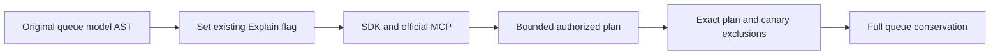

# Model-view Explain caller

The selected ScriptDOM T-SQL profile rejects the retired EXPLAIN spelling. The original AcSqlView005 queue parity operation already owns the corresponding supported typed model-source AST. Its private AssertExplainAsync must dispatch that same original QueueAst with only SelectQuery.Explain=true through the actual SDK QueryAstAsync and official MCP QueryAst operation. No grammar is added, no SQL fallback or text substitution is introduced. Original current grants, queue source/partition, one-request execution, cancellation token/deadline, full cross-caller row equality, one-row/access-path oracle, delivery-authority and both payload/header canary exclusions, and before/after full queue conservation remain unchanged.

Native wire is not enabled by this shared fixture. No full SQL, wire compatibility, compiler/runtime/Linux acceptance follows from this source correction.

