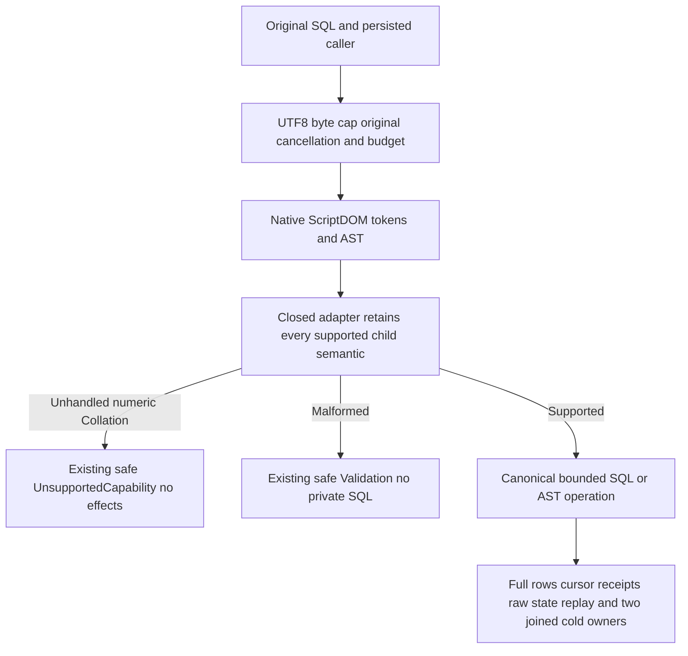

# Native numeric annotations and bounded SQL diagnostics

KL-047 follows [ScriptDOM](ScriptDom.md), REQ/AC-TSQL-001..006 and [ADR-130](../../ADR/ADR-130-microsoft-scriptdom-tsql.md). This successor completes the previously service-interrupted source proposal; its immutable retained26 packet is not acceptance. The canonical parser remains actual Microsoft ScriptDOM180.140.0, `TSql180Parser(true, Standalone)`; no syntax rewriting, handwritten grammar, fallback, library, protocol or persisted format is added.

REQ/AC-PARSER-ANNOTATION-001: reject otherwise silently discarded native child `Collation` before numeric.Value consumption in exactly WindowLowering.Count (after each parenthesis and supported unary unwrap), OperandLowering.Unary, OrderingLowering.Resolve ordinal branch, SourceLowering.Generation unary child, and server InsertScalar.Unary. Preserve all existing validation/operator precedence, cancellation, source argument guards, limits, AST versions, parameters and ordinary numeric semantics. No collation implementation or full grammar execution is claimed.

The real pinned native observations are `TestResults/stage61-native-join/root-r71-kl047-pinned-collation-ast.original.json` SHA256 `e467771f147df9636beb6934b5b04518ba4e7bb6612c49056512a00504d51f1f` and `root-r71-kl047-pinned-adjacent-collation-ast.original.json` SHA256 `1186ec619c732ddedf6df24090c4a6d46ffd4b03a105736a78872e510c580198`. They retain original SQL, complete parse errors, bounded native node/parent/child types, offsets and Collation. Actual DLL SHA256 is `1f95f522e68d6232430fb2c00280f16f248bef46b50cb4fbc1ffd555edbf1604`, assembly18.0.0.0. These are genuine grammar observations, not execution. Annotated TOP, numeric unary predicate, ordinal, OFFSET, event generation and typed INSERT were accepted; annotated EXEC was syntax-rejected and has no added guard.

REQ/AC-PARSER-ANNOTATION-002: whole real-store operations prove refusal without partial value, full state/cut/identity unchanged, then ordinary TOP/ordinal/unary/OFFSET/event-source and typed INSERT return independent complete literal rows and terminal cursors through SQL and canonical AST. All original authored private-input variants, malformed/unsupported/token/depth/UTF8 bounds, typed INSERT no-effect refusal, real original receipts/raw outcomes and persisted reader withdrawal/repair remain. Unit native receipts verify all five mutation fields including hidden CompositionReferences; public receipt checks cover the four observable JSON fields and complete token. Hidden native fields do not cross SDK/MCP JSON.

REQ/AC-PARSER-BOUNDS-003: exactly4096-byte native and65536-byte public valid SQL includes astral+CJK comments. UTF8 bytes differ from UTF16 string.Length; one additional ASCII byte must return the existing byte-budget problem, followed by exact original healthy full four-row pages. Direct native metadata within the same whole Unit flow checks actual statement UTF16 StartOffset/line/column after a Unicode CRLF comment and malformed token Offset/line/column. Native diagnostic positions are not public byte offsets; public errors deliberately remain fixed and do not include SQL, parameters or ScriptDOM messages. No new diagnostic payload is introduced.

REQ/AC-PARSER-LIFETIME-004: genuine pre-cancelled and admitted parser-token cancellation retain the original token and joined work, full raw store conservation and healthy continuation. Reuse the existing native checked-token observation; add no production test seam. SDK typed query and SELECT SQL pre-cancellation use Cancelled/read-unavailable; official MCP raw and unified SELECT tasks are awaited and retain their original cancellation token. These before-cancel public checks do not prove mid-parser transport cancellation or hard preemption. Existing SQL EXEC unknown-write outcome contracts remain unchanged.

REQ/AC-PARSER-RECOVERY-005: original native producers create eight documents, an event append and a typed INSERT with independently authored complete receipt values. Persisted reader revocation refuses legitimate document/event/table reads; original grants are repaired unconditionally. Two same-root native ExistingStore owners independently open after joined original resources and repeat refusal/healthy/replay/conservation. Real public SDK and official MCP raw-query, AST and unified SQL routes preserve their original full result goldens, complete frozen outbox10 and original command replay. Pure nonrecursive current-state checks run after each original SDK/MCP seed/event/INSERT replay, including the final cold MCP response. Both actual Aspire cold attempts are joined even if the earlier wave fails; acquired initialization/body/disposal errors remain in the failure ledger.

The current native session compiler routes actual PostgreSQL-wire/Npgsql T-SQL through the same ScriptDomSyntax and positional AST lowering. It gains these same shared guards without a new protocol. This packet adds no native-driver test or TDS promise; original prepared/simple native-session suites and exact-source RF3/native-driver qualification remain mandatory and OPEN. SDK/MCP operations use existing connection-owned Orleans, persisted authentication/authorization and node-local ZoneTree/RF3. No public corruption endpoint, fake receipt, trusted role or comparison workload exists.

Qualification is OPEN: independent complete source/native-API review, compilation/analyzers/format, genuine native discovery and whole Unit operations, process recovery, actual Aspire SDK/official MCP/native-session outcomes, source/DLL/PDB/image/census/cleanup agreement, Linux original artifacts and broader SQL conformance. Source parser/quality checks are not acceptance, coverage, performance or production proof. Frontend N/A, no UI changes. Root owns SourceY, execution, global status and Git; rollback removes only these five guarded child checks and additive owned roles/doc, preserving selected ScriptDOM and all original boundaries.
