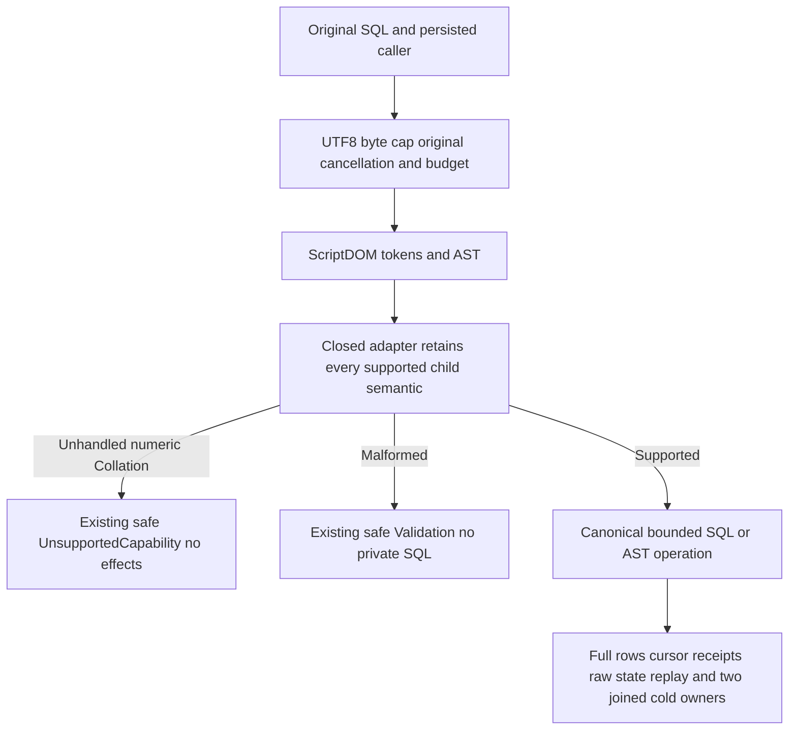

# numeric annotations and bounded SQL diagnostics

This contract follows [ScriptDOM](ScriptDom.md), REQ/AC-TSQL-001..006 and [ADR-130](../../ADR/ADR-130-microsoft-scriptdom-tsql.md). The canonical parser remains actual Microsoft ScriptDOM180.140.0, `TSql180Parser(true, Standalone)`; no syntax rewriting, handwritten grammar, fallback, library, protocol or persisted format is added.

REQ/AC-PARSER-ANNOTATION-001: reject otherwise silently discarded child `Collation` before numeric.Value consumption in exactly WindowLowering.Count (after each parenthesis and supported unary unwrap), OperandLowering.Unary, OrderingLowering.Resolve ordinal branch, SourceLowering.Generation unary child, and server InsertScalar.Unary. Preserve all existing validation/operator precedence, cancellation, source argument guards, limits, AST versions, parameters and ordinary numeric semantics. No collation implementation or full grammar execution is claimed.

They retain original SQL, complete parse errors, bounded node/parent/child types, offsets and Collation. Actual DLL SHA256 is `1f95f522e68d6232430fb2c00280f16f248bef46b50cb4fbc1ffd555edbf1604`, assembly18.0.0.0. Annotated TOP, numeric unary predicate, ordinal, OFFSET, event generation and typed INSERT were accepted; annotated EXEC was syntax-rejected and has no added guard.

REQ/AC-PARSER-ANNOTATION-002: whole real-store operations prove refusal without partial value, full state/cut/identity unchanged, then ordinary TOP/ordinal/unary/OFFSET/event-source and typed INSERT return independent complete literal rows and terminal cursors through SQL and canonical AST. All original authored private-input variants, malformed and unsupported inputs, typed INSERT no-effect refusal, real original receipts/raw outcomes and persisted reader withdrawal/repair remain. Unit receipts verify all five mutation fields including hidden CompositionReferences; public receipt checks cover the four observable JSON fields and complete token. Hidden fields do not cross SDK/MCP JSON.

REQ/AC-PARSER-BOUNDS-003: exactly4096-byte and65536-byte public valid SQL includes astral+CJK comments. UTF8 bytes differ from UTF16 string.Length; SQL text has no byte, token or depth budget ([ADR-149](../../ADR/ADR-149-no-operation-limits.md)), so each such text returns exact original healthy full four-row pages. Direct metadata within the same whole Unit flow checks actual statement UTF16 StartOffset/line/column after a Unicode CRLF comment and malformed token Offset/line/column. diagnostic positions are not public byte offsets; public errors deliberately remain fixed and do not include SQL, parameters or ScriptDOM messages. No new diagnostic payload is introduced.

REQ/AC-PARSER-LIFETIME-004: genuine pre-cancelled and admitted parser-token cancellation retain the original token and joined work, full raw store conservation and healthy continuation. Reuse the existing checked-token observation; add no production test seam. SDK typed query and SELECT SQL pre-cancellation use Cancelled/read-unavailable; official MCP raw and unified SELECT tasks are awaited and retain their original cancellation token. These before-cancel public checks do not prove mid-parser transport cancellation or hard preemption. Existing SQL EXEC unknown-write outcome contracts remain unchanged.

REQ/AC-PARSER-RECOVERY-005: original producers create eight documents, an event append and a typed INSERT with independently authored complete receipt values. Persisted reader revocation refuses legitimate document/event/table reads; original grants are repaired unconditionally. Two same-root ExistingStore owners independently open after joined original resources and repeat refusal/healthy/replay/conservation. Real public SDK and official MCP raw-query, AST and unified SQL routes preserve their original full result goldens, complete frozen outbox10 and original command replay. Pure nonrecursive current-state checks run after each original SDK/MCP seed/event/INSERT replay, including the final cold MCP response. Both actual Aspire cold attempts are joined even if the earlier wave fails; acquired initialization/body/disposal errors remain in the failure ledger.

The current session compiler routes actual PostgreSQL-wire/Npgsql T-SQL through the same ScriptDomSyntax and positional AST lowering. It gains these same shared guards without a new protocol. SDK/MCP operations use existing connection-owned Orleans, persisted authentication/authorization and node-local ZoneTree/cluster. No public corruption endpoint, fake receipt, trusted role or comparison workload exists.

Frontend N/A, no UI changes.
