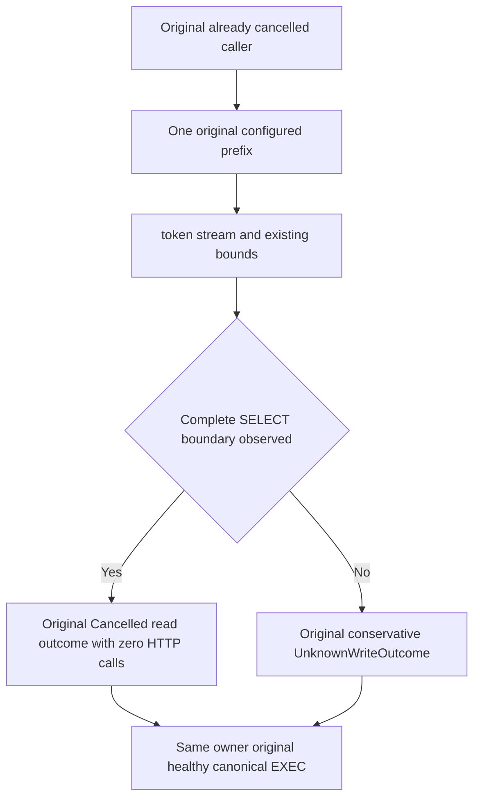

# Pre-cancelled SDK SQL inspection

Canonical slice: QueryExecution; client owner: KeyLoad.Client/Features/QueryExecution/Parsing. Maps REQ/AC-SQLC-005/006 and ADR-130's existing cancellation/resource contracts.

| Requirement | Measurable acceptance and automated mapping |
|---|---|
| REQ-SQL-CANCEL-PREFIX-001 | AC-SQL-CANCEL-PREFIX-001: preserve every original SdkUsesTheSameBoundPrefixAndKeywordBoundary argument. Cadence1/2/3 SELECT, cadence8 comment-prefixSELECT and cadence8 two-leading-spaceSELECT return UnknownWriteOutcome. Cadence8 plain/one-leading-spaceSELECT and cadence16 comment-prefixSELECT return Cancelled. |
| REQ-SQL-CANCEL-PREFIX-002 | AC-SQL-CANCEL-PREFIX-002: each original genuine Kestrel flow observes zero cancelled HTTP calls, then the same owner successfully sends its original canonical EXEC request; compare its complete received request and compiled operation. Configuration default/invalid cadence and normal grammar owner controls remain unchanged. |

An already cancelled SDK operation retains only one original configured prefix window. The selected TSql180Parser provides token identity, offset and text through GetTokenStream; existing ScriptDomTokenBounds applies token/comment/depth constraints. The original full-source character ceiling and retained-prefix UTF8 ceiling are checked here; whole-request and normal parsing validation stay with their original owners. Only a complete SELECT token with its boundary inside the prefix, or the true original EOF, identifies the pre-cancelled read. Synthetic EOF caused by truncation is insufficient. Whitespace/comments are identified by token kind, never a handwritten lexer. Wrong/incomplete/invalid cases remain conservative possible writes.

This finite inspection does not parse/admit an operation, grant authority or send HTTP. The original cancellation is unchanged and still terminates the operation. Normal non-cancelled full Parse/MayWrite, conservative command identities, parameter values, budgets and source spelling are unchanged. No limit, timeout, caller retry, library, storage or protocol is added.

Code map: SqlWriteClassifier.cs delegates its pre-cancelled branch to CancelledSqlInspection.cs; existing SqlTriviaExecutionPolicyTests declaration and all original argument values/assertions remain intact. No new Test/UID is inferred. Product/frontend/persistence/benchmarks: no changed execution/format contract; no performance claim. Compiler, actual admission, original runtime, Linux and full SQL/session qualification remain separate open gates.
