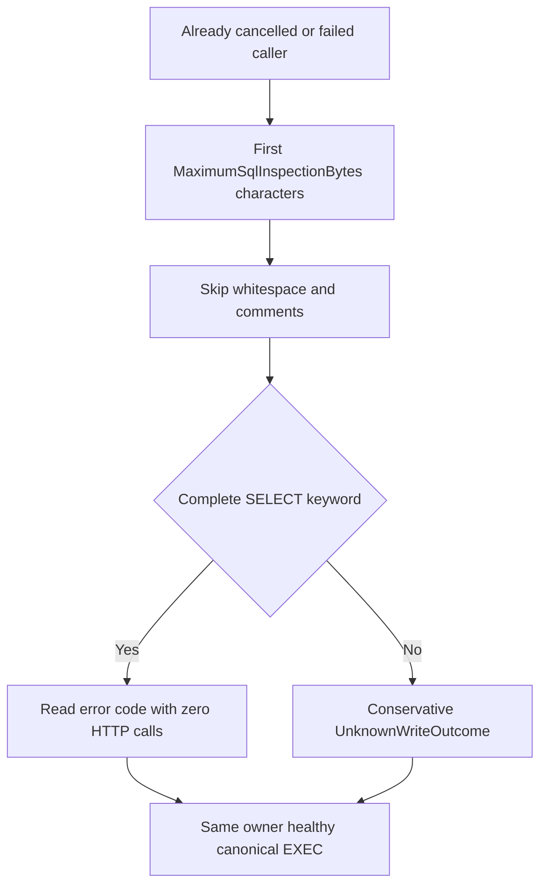

# SDK SQL request classification

Canonical slice: QueryExecution; client owner: `KeyLoad.Client/QueryExecution/Parsing/SqlWriteClassifier.cs`. Maps REQ/AC-SQLC-005/006 and ADR-130's existing cancellation/resource contracts.

The SDK never parses SQL. When a SQL request fails before any server reply (an already cancelled caller, a transport failure), the client has to choose between the read error `Cancelled`/`OwnershipLost` and the conservative write error `UnknownWriteOutcome`. It decides by the first significant keyword of the statement: leading whitespace, `--` line comments and `/* */` block comments are skipped, and the statement is a read only when the first keyword is a complete `SELECT`. The scan is bounded by `KeyLoad:ClientExecution:MaximumSqlInspectionBytes` characters; a keyword cut by that bound is not a complete `SELECT`, so the request is classified as a possible write. The server owns parsing, admission and authorization; this classification only selects an error code.

| Requirement | Measurable acceptance and automated mapping |
|---|---|
| REQ-SQL-CANCEL-PREFIX-001 | AC-SQL-CANCEL-PREFIX-001: `SdkUsesTheSameBoundPrefixAndKeywordBoundary` keeps every argument. Bounds 1/2/3 on `SELECT`, bound 8 on a comment-prefixed `SELECT` and bound 8 on a two-leading-space `SELECT` return `UnknownWriteOutcome`; bound 8 on a plain or one-leading-space `SELECT` and bound 16 on the comment-prefixed `SELECT` return `Cancelled`. |
| REQ-SQL-CANCEL-PREFIX-002 | AC-SQL-CANCEL-PREFIX-002: each genuine Kestrel flow observes zero cancelled HTTP calls, then the same owner successfully sends its canonical EXEC request; its complete received request and compiled operation are compared. The default and the invalid (0, 65 537) bounds fail startup validation as before. |

`Microsoft.SqlServer.TransactSql.ScriptDom` is referenced by `KeyLoad.Query` only; `KeyLoad.Abstractions` and `KeyLoad.Client` carry no parser.
