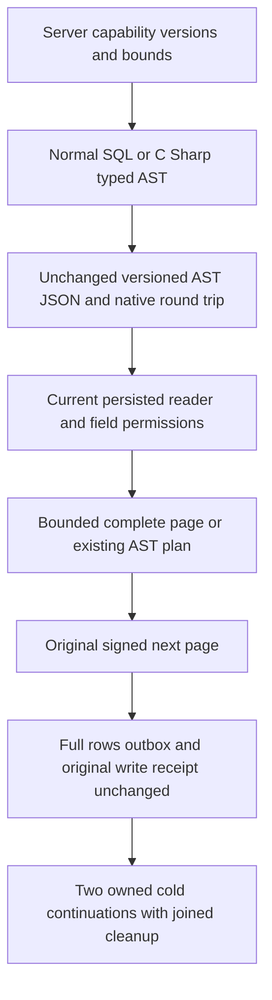

# Query capability versions and ordinary query examples

This contract extends [QueryExecution](../QueryExecution.md), [the selected native T-SQL contract](ScriptDom.md), [ADR-130](../../ADR/ADR-130-microsoft-scriptdom-tsql.md) and the existing capability-output budget contract. This stage adds the explicit `AST.Explain.v1` read-profile name for existing execution and preserves every existing manifest field, version, profile and limit.

## Version inventory

| Identity | Current contract | Execution boundary |
|---|---|---|
| Manifest `ProtocolVersion` | 1; unchanged 18-field generated contract | SDK JSON and official MCP expose the same server profile. This is not a resource or permission inventory. |
| Manifest `AstVersion` | Default 1, not a maximum-version field | The C# builder emits v1 by default. |
| `SupportedAstVersions` | Exactly `[1,2]` | v1 supports the bounded scalar/model plan; v2 also admits the existing bounded inner-join shape. A v2 simple collection query retains ordinary semantics. |
| `SupportedQueryDialectVersions` | Exactly `[1,2]` | Both use `TSQL.ScriptDOM180.v1`; v2 enables the declared join subset, not another parser. |
| Unified SQL envelope `Version` | 1, independently of `QueryDialectVersion` | A dialect-v2 request still uses envelope v1. |
| Native syntax owner | Microsoft ScriptDOM180.140.0, selected standalone T-SQL parser | Successful native parsing does not authorize or implement every native statement or expression. |
| `AST.Explain.v1` | Existing `SelectQuery.Explain` and C# `.Explain()` | Single-atomic-partition, nonjoin collection planning; existing model-view Explain also validates its source head through its separate model contract. Joins and distributed/partition leaves refuse Explain. No SQL `EXPLAIN` keyword is introduced. |

The `SQL`, `JSON` and `C#` adapters share authorized bounded plans. This inventory does not claim TDS, full SQL execution, PostgreSQL grammar compatibility, distributed Explain or a new public protocol. All existing graph/search, model, feed and live-query profile contracts remain separate and unchanged.

## Operator semantics, cost and permissions

All collection operations require current persisted `Query | DocumentsRead` in the requested collection. Every predicate and ordering path requires current field-use authorization. Returned bodies apply current row visibility and projection policies. A manifest describes implementation availability; possession of it grants no database permission.

| Public form | Semantics | Cost class and additional admission |
|---|---|---|
| Field, JSON scalar, named operand | Canonical JSON path; scalar value or separately bound named value | Bounded path/value normalization. Parameter values are not substituted into SQL text. |
| `=`, `!=`, `<>`, `<`, `<=`, `>`, `>=` | Existing decimal/scalar comparison; null/missing retain their distinct policies | Bounded predicate work for each admitted candidate; supported equality can select a native point/index path. |
| `AND`, `OR`, `NOT` | Existing three-valued predicate composition; WHERE retains true rows | Shared node/depth budget and candidate budget; field-use requirements cover dependencies. |
| `IN`, `NOT IN` | Bounded scalar membership and negation | Existing maximum membership count and predicate budgets. |
| `BETWEEN`, `NOT BETWEEN` | SQL lowering to existing bounded comparisons/logical nodes | Same field-use, node/depth and candidate costs; no separate execution engine. |
| `IS NULL`, `IS NOT NULL` | Explicit null test | Bounded per-candidate test. |
| AST `IS MISSING` and its negated form | Explicit absence test, distinct from JSON null | AST/C# marker only; selected SQL grammar does not gain an `IS MISSING` keyword. |
| `IS DISTINCT FROM`, `IS NOT DISTINCT FROM` | Existing null-aware SQL lowering | Same authorized predicate tree and costs. |
| Projection and aliases | Requested fields or the declared all-fields projection | Bounded projection bytes; current field-read projection may omit/redact protected output. |
| ASC/DESC and AST null ordering | Deterministic requested field order with existing tie/NULL rules | Bounded retained ordering over admitted candidates. SQL syntax support remains distinct from AST null-order metadata. |
| TOP / ordered OFFSET-FETCH / AST limit and offset | Bounded page and existing continuation semantics | Row, examined-candidate, result-byte and signed-cursor limits. Full scan requires explicit consent. |
| C# `.Explain()` / AST `Explain` | Existing one-row plan, not matching user rows | Current permission/path binding, shared budgets and bounded planning/source-head work; not a promise of zero storage reads. |
| Model sources | Existing event, topic and queue views in one database | Current Query plus EventsRead/TopicsRead/QueueInspect, including the existing dead-letter rule; bounded source scans. |
| Q2 inner join | Existing same-partition bounded join and source lineage | Both current resource grants and field-use/row rules; supported join shape only, no Explain. |
| Graph search, change feed, live query profiles | Their existing typed/native operations | Their own permissions, candidate/backpressure/cursor/lifecycle budgets; not additional scalar AST operators. |

Unknown AST versions and operators refuse before candidate execution. Public JSON discriminator failures retain their existing validation boundary. Native grammar, adapter support, AST semantics and transport compatibility remain distinct qualification gates.

`MaxBytes` is the effective existing output ceiling: native `MaxBatchBytes`, optionally reduced by `MaximumResultBytes`. It covers the serialized `QueryPage` including rows, cursor, cut and access path. SDK Result/MCP transport wrappers have separate framing limits. It is not `MaxQueryBytes` or a promise that request bytes and result bytes share a ceiling. The old complete `SqlOffsetPages.ManifestAsync` oracle now independently expects `MaxBatchBytes` for its unchanged default query options; all its other complete manifest fields remain literal and unchanged apart from the explicit Explain profile.

## Normal examples

Given the four seeded ordinary documents, the following query returns `b/Bravo/20`, then `d/Delta/40`, with the original signed continuation between pages. Named parameters are `active=true` and `minimum=20`.

```sql
SELECT TOP (1) title, score
FROM query_versions
WHERE active = @active AND score >= @minimum
ORDER BY order_id;
```

Use a C# record whose properties map to `order_id`, `title`, `score` and `active` with `JsonPropertyName`. Obtain the existing `IOptions<QueryTranslationOptions>` through application composition:

```csharp
var query = KeyLoadQuery.From<QueryRowModel>(partition, "query_versions", translationOptions)
    .Where(row => row.Active == true && row.Score >= 20m)
    .OrderBy(row => row.OrderId)
    .Select(row => new { title = row.Title, score = row.Score })
    .Take(1);
var request = query.ToRequest(allowFullScan: true);
var page = await sdk.QueryAstAsync(request, cancellationToken);
var plan = await sdk.QueryAstAsync(query.Explain().ToRequest(true), cancellationToken);
```

For the official MCP SDK, use the existing authenticated client and discover the operation through the gateway before invoking it. The example retains the same typed `request`, not a compiled application delegate:

```csharp
await mcp.CallToolAsync("gateway_tools_search",
    new Dictionary<string, object?> { ["query"] = "keyload_query_ast", ["maxResults"] = 1 },
    cancellationToken: cancellationToken);
var reply = await mcp.CallToolAsync("gateway_tool_invoke",
    new Dictionary<string, object?> {
        ["toolId"] = "keyload_query_ast",
        ["arguments"] = new Dictionary<string, object?> { ["request"] = request }
    }, cancellationToken: cancellationToken);
```

The server's discovered descriptor supplies the canonical input schema. The ordinary SQL query can use SDK Query, the discovered `keyload_query_execute`, or the existing unified SQL operation. AST Explain can also use the existing canonical `EXEC keyload_query_ast @args` envelope; this does not introduce SQL EXPLAIN syntax.



## Requirements and operation evidence

| Requirement | Acceptance | Actual case mapping |
|---|---|---|
| REQ-QCV-001 | AC-QCV-001: complete literal v1 manifest preserves `[1,2]`, all existing profiles and the effective output ceiling, adding only the existing AST Explain profile | `QueryCapabilityVersionWholeFlowTests.ManifestVersionsRoundTripBuilderAndSqlPagesExplainCurrentReaderAndTwoColdOwners`; public `QueryCapabilityVersionClusterWholeFlowTests.ManifestVersionsAndBuilderSqlMcpPagesExplainPersistedReaderRepairAndTwoColdOwners` |
| REQ-QCV-002 | AC-QCV-002: C# builder matches an independently authored plan; actual JSON/native v1/v2 round trips retain every field and execute complete literal pages | Same native whole operation; actual public C#→JSON SDK/MCP operations and SQL/dialect-v1/v2 counterparts |
| REQ-QCV-003 | AC-QCV-003: direct SDK/official MCP/unified SQL return full `b` then `d` rows with positive original captured continuation cut; C# Explain returns the complete independently expected plan | Same two whole cases; no comparison of fresh physical cuts with logical write positions |
| REQ-QCV-004 | AC-QCV-004: current persisted reader removal refuses normal queries and planning; repair restores results, while the static manifest remains unchanged | Same cases, full fixed Problems and no partial result; original native full image/cut/identity and public full rows/outbox/receipt observation |
| REQ-QCV-005 | AC-QCV-005: original authentic write receipt replays and both actual same-owner/cold cluster attempts conserve the original data and bounds | Same cases; Unit validates native receipt field5 and retained raw outcome, public validates the four JSON receipt fields/all token fields plus the actual partition, then exact original replay |

The new four-document fixture is a functional example, not scale or performance evidence. Native output is ProcessDurable through actual ordered journal admission; public output is the actual ProcessDurable receipt. `CompositionReferences` is JsonIgnored and is checked only at the actual native boundary, never inferred from a public DTO getter. Native JSON/store round trips do not claim a new client binary wire protocol. Public rows/outbox are logical conservation observations, not private raw-store access.

Existing `CapabilityOutputWholeFlowTests` / `CapabilityOutputClusterTests` retain all three result-ceiling modes, admitted/before-cancel behavior and full output refusals. Existing `SqlModelViewAstTests.AcSqlView001ExplainSupportsBothSourcesWithoutScanningBodies` and the original `SqlModelViewClusterParityTests` Explain path remain mandatory. The prior original model Explain failure is not hidden, skipped or claimed repaired by this profile addition. Existing Q2 join restrictions, malformed/unsupported operators, field policy, recovery, public transport and coverage suites remain mandatory.

Implementation status: coherent source/self-review only. No qualifying run, power-loss durability, speed or production-readiness claim follows from this document or native syntax/numeric/nesting preflight. No dependency, serializer field/alias, persisted format, parser method, protocol version, UI, benchmark or orchestration implementation is changed; those surfaces need no new code in this stage.
