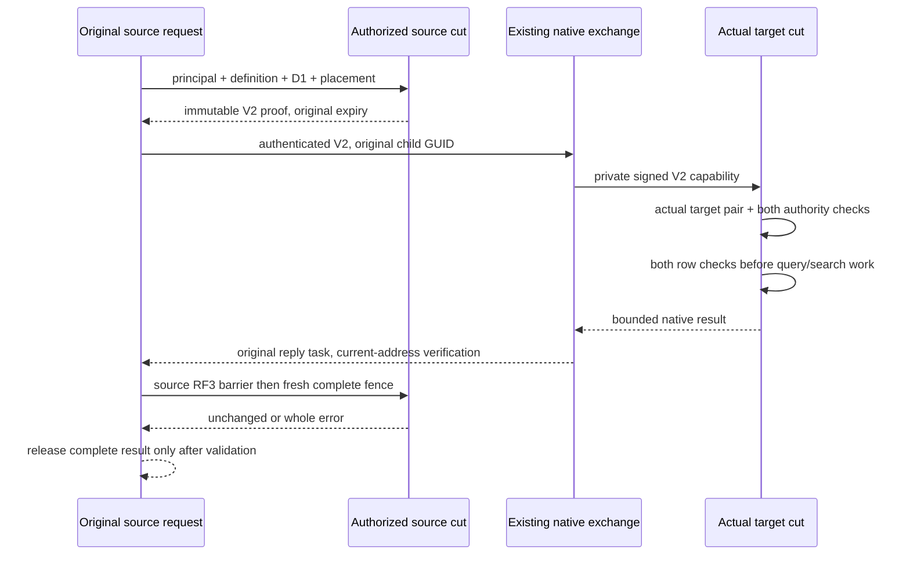

# Query, SQL and distributed search lifetime reads

Contract: [ADR-139](../../ADR/ADR-139-resource-lifetime-read-fence.md) and
[READ requirements](../ClusterRouting/ResourceLifetimeReadFence.md).
This stage is prepared source only. Build, native TUnit, process recovery and the
actual Aspire-owned RF3 SDK/official-MCP qualification remain OPEN. ANN is a
separate mandatory READ dependency; this stage does not close it or DROP/name reuse.

## Selected native path

Partition-query leaves and all four distributed-search phases use new internal
V2 native roots. Their stable fields are 0 Original V1 leaf, 1 complete source
ResourceDefinition, 2 mandatory ResourceLifetimeCoverageV1, and 3 complete source
PrincipalRecord. The source captures these in the same freshly authorized bounded
Store.Read cut as its original route/resource digest. No public V1 payload,
original V1 leaf/result/witness alias or field ID, public request fingerprint,
atomic-partition identity or command-outcome format changes.

The selected native CQRS purposes are private: `keyload-query-lifetime-read-v2`
with PartitionQueryLeafV2 or DistributedSearchLeafV2. Generic request purpose,
missing/default coverage and an old native root do not select a V2 fallback.
Original local V1 execution APIs remain for their existing independent callers;
the selected serving path always creates the V2 root, including its local leaves.

RemoteQueryLifetimeRequestV2 carries the unchanged original RemoteDocumentCallV1
plus Definition, Coverage and Principal with the same four field IDs. The existing
ResourceLifetimeRead native channel authenticates the original request ID, nonce,
expiry, physical source and registered destination, actual silo generations and
complete typed payload. The root public request and native child have distinct
GUIDs; the trusted ambient request context binds the existing armed observation
to its original producer. A child GUID is never substituted for a parent GUID.

## Independent authority in one target cut

Ordinary query/search source and destination catalogs/principals are independent.
Their D1 incarnations and policy epochs are not required to be equal. The target
retains its actual persisted ResourceDefinition as its storage/index descriptor.
Its actual definition/D1 pair is read and validated under the same target view and
downward read grant as its fresh principal and data. The transported source
coverage is separately validated against its exact source definition. There is no
source-catalog overlay hiding the target definition, replacement store, merged
grant array or fabricated trusted principal.

Both native schema preflights run before either path-specific query binder.
Source capture retains only its native schema preflight and coarse scoped
permission; structural/parameter normalization remains on the original path.
Both full binders and field-use checks then run before target candidates,
predicates, ordering, statistics or ranks. Source snapshots that are revoked or
expired at the target cut refuse before data access; no deadline is renewed.

The target's native row checks remain in its actual readers. Each raw accepted
query record additionally passes the source CanReadRow decision before predicate
evaluation. Target visibility-cache identities and drafts remain target-only;
source filtering is performed per read and is never cached under a target key.
Text corpus/frequency counts and text/vector scoring likewise apply the source
row check before counting, tokenization or similarity, in addition to the target
native row admission. Projection rechecks both sides and uses the shared Core
ProjectWithAuthorityIntersection native projector. Complete omissions are retained;
redaction paths are disclosed only when both native schema evaluators permit
them. Selected/aliased query rows apply omission relevance under both definitions.

## Completion and original ownership

Partition queries retain their original source RF3 barrier followed by fresh exact
source capture before merge/public mapping. DistributedSearchOperation already
runs its source barrier before preparing and completing the final Revalidate
phase; that existing phase recaptures the complete source lifetime, principal,
resource and placement. No extra barrier/capture uses an already completed phase
grant. A changed source fence rejects the complete result without partial rows,
rebinding or automatic retry.

The original bounded work owner, expiry token and transport task remain owners.
The local/receiving native-child helper joins the original Node.ExecuteAsync,
then observes original identity-scope disposal and input-buffer clearing through
the existing failure ledger. The addressed native exchange clears its original
owned request and reply buffers after typed decode. A safe native child error
preserves its validated original code and detail, including destination denial.
No callback stops/disposes the host or physical storage.

## Whole-operation evidence declarations

| Requirement/acceptance | Prepared declaration and oracle |
|---|---|
| REQ-LIFETIME-READ-001/003, AC-001 | QueryLifetimeNativeTests.BothAuthoritiesRestrictRowsBeforeQueryPredicatesAndStatisticsThenRepairReplayAndTwoColdOwners, arguments false/true: genuine two-owner ZoneTree operations, asymmetric persisted row grants, zero literal candidates/statistics, real policy repair, literal visible row/statistics, full original receipt replay and two cold reopen cycles. |
| REQ-LIFETIME-READ-003, AC-001 | QueryLifetimeNativeTests.BothAuthoritiesProjectThenHideKnownAndUnknownSchemaBeforeFieldBindingWithoutChangingState, arguments false/true: both asymmetric authority directions, exact star/selected/unknown projection, raw-use refusal, identical hidden-schema known/unknown errors, real schema repair, replay and two cold owners. |
| REQ-LIFETIME-READ-001/002/003, AC-001 | QueryLifetimeNativeTests.ActualIndependentLifetimeCannotSatisfyAnotherResourceLeafThenHealthyReplaySurvivesTwoColdOwners: another actual Configure-created D1 pair is invalid for the first resource, missing/default coverage refuses, complete store/position invariance, native V2 round trips and healthy original replay/two cold reopen cycles. This is typed target-execution evidence, not a forged authenticated transport or a DROP/recreate race. |
| REQ-LIFETIME-READ-002/004, AC-002 | Existing DistributedQueryAuthorityRf3Tests.SourceResourceFenceDuringOriginalLeafDestinationDenyRepairWholeMergeReceiptsCancellationAndTwoColdOwners, false/true: now holds the same original SDK/MCP producer after its actual native target reply, records typed V2 coverage/reply, performs original persisted source policy CAS, then requires whole refusal and joined original producer. All existing SDK/MCP/SQL literals, independent target repair, receipts, cancellation, complete six-owner cuts and two cold phases remain. |
| REQ-LIFETIME-READ-002/004, AC-002 | Existing DistributedSearchRf3Tests.AcDqueryGlobal001To005CanonicalGlobalModalitiesDestinationDenialCancellationStaleEpochAndColdReceipts, false/true: its epoch trial now holds the actual Statistics reply before a destination policy CAS, then requires the existing later-phase/witness stale-authority refusal. This does not promise target-policy linearizability after a single phase. Existing literal global results, SDK/MCP/SQL, original receipts, cancellation, independent-epoch repair and cold behavior remain. |

Existing child AuthorizationReload controls select the new V2 leaf kinds so their
original cancellation/deadline producers remain the same operations. Original
expiry and the native witness's 8 KiB bound remain unchanged. A raw reply observed
at NativeModelAfterDispatch has not yet passed the source client's reply verifier;
the original client resumes through that verifier before final source validation.
Neither observation, prepared syntax nor an imported source packet is a runtime
PASS or a claim that all intervals/requests have been instrumented.

The existing title-only projection oracle correction is owned separately by the
coordinator. Those healthy assertion source files are unchanged in this packet;
qualification depends on their coherent independent repair rather than weakening
them here. Real resource retirement/recreation, global lifetime admission and
current physical-owner inventory remain separate prerequisites.

