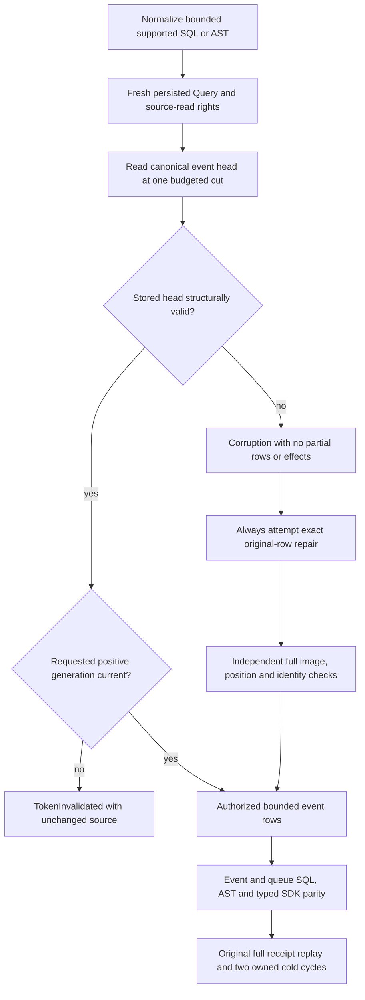

# Retained event head authority in pure SQL model views

Canonical slice QueryExecution. Refines [ADR072](../../ADR/ADR-072-authorized-sql-model-views.md), REQ/AC-SQLVIEW-001..005. Model SQL must classify structurally inconsistent retained history as Corruption; a structurally valid different positive generation remains TokenInvalidated. Existing native generated serialization validates graph shape, nullability and format, and intentionally does not enforce the stream head's scalar domain. Core owns that persisted-domain validation.

The confirmed source defect was in ModelEventQueryRows: it compared persisted head.Generation with the already validated requested generation before validating the stored head, and its head predicate omitted positive generation. Thus a real persisted malformed head appeared to be an ordinary stale request. The canonical AggregateReplayReader validates its full head before comparing generations. This correction keeps ModelEventQueryRows as its existing owner, uses the existing model Corruption detail and performs complete head validation first. It changes no public/native field, format, alias, migration, provider, SQL syntax, trusted caller identity, default, limit, scheduling, protocol or dependency.

| Requirement / criterion | Concrete complete operation |
|---|---|
| REQ/AC-SQLVIEW-001/002 mandatory retained-history consistency | Six actual stored-head faults: zero, negative and Int64.MinValue generations; negative tail, zero retention floor and floor beyond tail+1, each with a different positive generation. Requests keep valid generation1, existing schema and explicit scan consent, so earlier AST/schema checks cannot mask this regression. SQL, independent AST and typed Explain require the same exact Corruption/no partial result. A structurally valid original head queried at generation2 retains TokenInvalidated. |
| REQ/AC-SQLVIEW-002/005 authority and nonmutation | Actual atomic two-event append plus queue enqueue, complete independently authored process-durable receipt with its actual PersistedCopies and original outcome. Native permanent Query-only subject is denied before damaged head inspection. Reader persisted grant denial/repair/withdrawal/repair is repeated through real current callers. SELECT never receives/claims/ACKs the queue. Complete queue metadata retains Ready, attempts0, stateVersion1, null owner/until, leaseVersion0 and deliveryGeneration1. |
| REQ/AC-SQLVIEW-003 privacy and shared projection | Native complete event/queue star rows include independent payload/header redaction metadata and every output field under a frozen real evaluation clock. Public complete queue star rows and explicit complete event selection match independent literals, with private payload/header canaries absent. Actual SDK stream read and queue inspection independently prove the same persisted source-read permission withdrawal and projected body/header behavior. The SQL query requires Query in addition to the existing source capability, as ADR072 specifies. |
| REQ/AC-SQLVIEW-001/004 actual protocol equivalence | Public six query routes: SDK SQL/AST, official MCP SQL/AST, unified SQL SELECT through SDK/official MCP. Every successful row includes full identity, revision, JSON, redaction and source metadata; continuation is explicitly null and access paths literal. Valid stale generation refuses, then original generation is healthy. Generic UPDATE of the actual WorkQueue target refuses UnsupportedCapability before dispatch, followed by unchanged queue inspection/full queue rows and healthy source query. No new UPDATE grammar is implemented. |
| Exact repair, no effects and replay | Native fault uses actual canonical node-local storage; independent expected damaged image substitutes exactly the original head row. Repair always attempts exact original bytes even after a primary assertion fails. Full restored image, original position+2 and all native identity bytes are independently checked before aggregate throw; healthy operations and original receipt/outcome replay are also attempted. Native receipts assert the actual hidden fifth CompositionReferences field, not a public default getter. |
| Cold and public evidence boundaries | Each native same-root owner repeats the real fault/refusal/exact repair/full healthy operation/replay across two reopens; both attempts and cleanup join retained errors. Public all-three Aspire cold cycles repeat current authorized native SDK/official MCP/unified SQL, stale refusal, generic UPDATE refusal, typed source/nonclaim observations and original complete receipt replay. Clients dispose before each cold. Both attempts run before aggregate throw. Public cuts stay opaque positive values and are not ordered against logical receipt positions or compared across nodes. Fresh stream-page snapshot cut equality is checked only within its own actual returned page. |

Public source conservation retains every original StreamRef/head/event/data/recorded-at field through the independent typed SDK source, normalizing only changing fresh-call cut fields after asserting their within-page contract. Initial event identities/types/schema/payload/headers/revisions/sequences are independently literal. Uncontrolled server RecordedAt values are retained as source-authoritative conservation evidence; the new explicit event projection does not claim a public independent clock oracle. Native frozen-clock star results cover the complete recordedAt field independently. Public queue inspection is a complete independent literal, while an administrator full queue query detects extra rows and full source/outbox observations still run after initiating failures.

The corruption injection and exact original-row repair occur only through the existing native test-owned canonical storage API. The public flow does not create an HTTP corruption endpoint or claim public head corruption injection/repair. It proves the supported existing interop/authority/nonclaim contract with real persisted credentials, actual acknowledged mutation effects and stale-request repair. Public receipt expectations include all four observable mutation fields, all three CommitToken fields and all five CommitReceipt fields bound to the independently read partition plus positive logical position and ProcessDurable and the configured PersistedCopies; native-only CompositionReferences remains confined to native proof.

ModelHeadAuthorityWholeFlowTests declares six native fault cases; ModelHeadAuthorityClusterTests declares one whole public operation. Readonly native analyzer/parser counters, full-source self-review and independent peer review are not compilation or runtime receipts. Original model parser/AST/read/authority/budget, original event/queue reference joins, model SDK/MCP parity/validation, topic model controls, typed event/queue operations and queue-to-graph/reverse composition cases remain mandatory. This packet does not qualify every model operator, full SQL/native wire, admitted cancellation, resource endurance, power loss or production readiness. Frontend, schema and migration are N/A.
