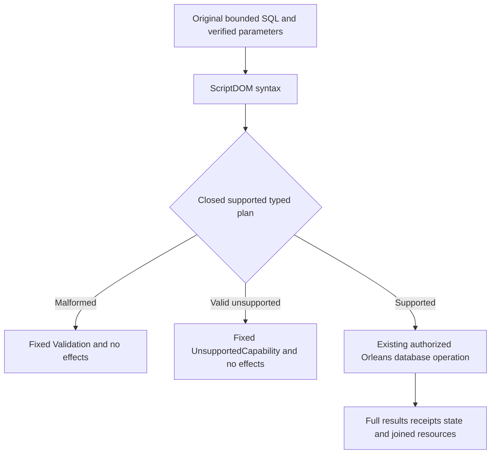

# T-SQL parsing and canonical database execution

Decision: [ADR-130](../../ADR/ADR-130-microsoft-scriptdom-tsql.md). This belongs to QueryExecution and ClientApi under the existing REQ/AC-SQLC-001–011; it does not complete full SQL by itself.

## Scope and boundaries

Microsoft ScriptDOM180.140.0 owns T-SQL syntax and AST. KeyLoad translates execution-supported nodes into existing typed queries and canonical model operations; the same authenticated callers, persisted permissions, bounded connection-owned Orleans execution, ZoneTree authority and cluster receipts remain required. All models remain composable within one database.

Remove replaced handwritten grammar and active PostgreSQL-dialect promises with the replacement. Do not add a fallback parser, SQL normalization shim, legacy mode, persisted-data migration, duplicate authorization or execution dispatcher. PostgreSQL framing is an independently described bounded transport, not a promise about SQL grammar or TDS. Frontend: documentation and examples only; no new page flow. Persistence: N/A, public language selection does not change persisted typed records or serializer aliases/IDs.

## Acceptance criteria

- **REQ-TSQL-001 / AC-TSQL-001 — syntax owner:** centrally pin and restore the selected Microsoft package and preserve its MIT notice. All SQL entry points consume the ScriptDOM AST. Replaced hand parser/lexer paths have no active references or fallback. Independent whole database operations prove equivalent intended results through the selected T-SQL syntax.
- **REQ-TSQL-002 / AC-TSQL-002 — complete lowering:** bind supported SELECT/projection/predicates/joins/order/TOP/OFFSET-FETCH and canonical EXEC operations to existing typed plans. Every unhandled clause or family refuses before a view or command is admitted. EXEC never reaches cluster administration or credential tools (`keyload_admin_*`, `keyload_principals_configure`, `keyload_credentials_configure`); those stay SDK/MCP operations and SQL refuses them as unsupported. Verify full literal results, typed-plan caller parity, final state, original GUID replay and no-effects refusal followed by a healthy operation.
- **REQ-TSQL-003 / AC-TSQL-003 — authority and composition:** SDK, official MCP and the supported session execute the same plans. Fresh persisted policy/credential revocation refuses the original operation; exact repair and the same caller recover. Documents, typed rows, graphs, vectors, blobs, queues, events and time series retain their existing composition and atomicity contracts. No caller roles or extra authority store.
- **REQ-TSQL-004 / AC-TSQL-004 — bounded parser lifetime:** original source/token/depth/node/parameter/output and shared execution limits apply before and during parsing/lowering. Pre-cancelled and admitted cancellation settle and join original work, preserve state and resources, then the same owner executes a healthy operation. Deep, oversized, malformed, multiple-statement and dynamic-SQL inputs retain exact bounded refusal and healthy continuation. A cancellation-aware reader alone is insufficient parsing-phase proof.
- **REQ-TSQL-005 / AC-TSQL-005 — parameter and effect safety:** verified scalar/JSON parameters bind to variable nodes without textual value substitution. Literal/comment content is preserved. Prepared/simple calls retain bounded slot ownership and close/repair behavior; failed or cancelled writes retain original unknown-outcome/GUID rules. Classification uses the same compiled plan.
- **REQ-TSQL-006 / AC-TSQL-006 — delivery and honest conformance:** update dialect, executable-family and session inventories and examples together. Full grammar acceptance is distinct from complete execution and interoperability. Require build/analyzers/format, discovery and whole operation classes, process recovery, genuine Aspire Docker cluster SDK/MCP/driver proof and exact-source Linux originals. Coverage excludes load/performance tests and requires meaningful complete success/failure flows. No local speed, production or power-loss claim.

## Acceptance mapping

Tests are derived from these criteria and preserve original operation/state/fault controls.

| Criterion | Required complete flow | Level and entry |
|---|---|---|
| AC-TSQL-001/002 | Literal T-SQL reads/joins/windows and EXEC writes; complete rows, receipts, replay, malformed/unsupported no-effects then healthy continuation | Genuine ZoneTree TUnit through Aspire-owned Unit/Recovery |
| AC-TSQL-003 | SDK/MCP/driver parity; persisted revoke/repair; model composition and two owned cold continuations | Aspire-owned Docker cluster on Linux |
| AC-TSQL-004 | Original-token and admitted cancellation, parser bounds, producer/resource settlement, healthy same-owner retry | TUnit Unit plus public cluster |
| AC-TSQL-005 | Typed scalar/JSON binding, preserved literals/comments, prepared capacity refusal/close/repair, original command GUID conflict/replay | Official SDK/MCP and actual driver |
| AC-TSQL-006 | Current complete inventories, quality gates, contributor coverage and immutable Linux source/image/process/cleanup evidence | CI |

Existing SQL evidence remains evidence of its actual original language and source; it does not qualify this replacement. Exact declarations and UIDs are bound after genuine compilation/discovery, never inferred from fixture source text.

## Active dialect and execution inventory (REQ-TSQL-006 / AC-TSQL-006)

The [current conformance inventory](../../implementation/sql-client-conformance.json) is the active grammar/execution map. It retains every SQLC family ID and keeps full-SQL/client gates false.

| Boundary | Current source contract | Remaining acceptance |
|---|---|---|
| Grammar | Microsoft ScriptDOM T-SQL AST | Selected parser version, malformed syntax and bounded parse/lowering/cancellation qualify separately |
| SELECT | Bounded projection/predicates/order/TOP/ordered OFFSET-FETCH into existing typed queries | Complete literal pages, policy/cursor/refusal/repair, exact read bounds and Linux public operation proof |
| EXEC | Closed canonical catalog operation and verified typed arguments | Complete output/receipts/GUID replay, effect classification and same-owner failed→healthy proof |
| INSERT/model sources | Closed same-partition queue→graph composition and declared graph/reference profiles | Original atomic rollback, full source/target state/receipt and recovery/cluster gates |
| General SQL families | parsing alone does not supply an executor | Full DDL/DML/transactions/constraints/routines/catalog/session/operator conformance remains OPEN |
| client | Existing PostgreSQL framing + genuine Npgsql session | Authentication, parameters, prepared/simple outcomes, cancellation and joins remain independent; TDS is not claimed |

Microsoft's [official project](https://github.com/microsoft/SqlScriptDOM) owns T-SQL parsing/AST tooling. The [Parse API](https://learn.microsoft.com/en-us/dotnet/api/microsoft.sqlserver.transactsql.scriptdom.tsqlparser.parse?view=sql-transactsql-161) returns fragments and errors; its documentation version is not proof of KeyLoad's restored package. The [AST definitions](https://github.com/microsoft/SqlScriptDOM/blob/main/SqlScriptDom/Parser/TSql/Ast.xml) describe syntax nodes, not implemented KeyLoad operations. This source map changes no package, protocol, persisted identity, execution plan, benchmark or qualification result.

## Inventory schema

REQ-TSQL-006 / AC-TSQL-006 includes the explicit machine-readable `KeyLoad.SqlConformance.Inventory` contract. `schemaVersion` is 2; `commandInventory` and `officialCommandCount` are nullable because no complete T-SQL command enumeration is claimed. Readers validate the current schema and its required fields before consuming it; other schema values are rejected. All15 stable family IDs, false full-SQL/client gates and original wire/driver boundaries remain. This is a documentation inventory, not a persisted database format or runtime SQL compatibility path.

Existing linked Architecture/ClientApi/status prose is updated in the same document batch. Compiled consumer lookup remains a separate finite prerequisite; no result is invented from filename-only inspection. Integration must bind the actual audit and current source guards.

### Topic SQL operation preservation under T-SQL

AC-TSQL-002/003/004 conversion of existing Topic SQL full operations uses SELECT TOP (1) for projected predicate and bounded-retention scan control, preserving TOPIC_EVENTS generation/source identity and quoted ordinary collection. Original SQL/AST/full SourceEventRecord parity, policy payload/header rights, retained-history refusal and exact raw repair, complete pre-LIMIT scan budgets, original-token cancellation, Publish/Purge sameGUID replay/conflict and existing canonical EXEC decoder/identity-dedup flow remain unchanged. No parser/AST/transport/limits/receipt/cold architecture change and no new qualification claim.

### Original scalar operation repair after selected execution

REQ-TSQL-002/004/005/006 preserve original whole-operation declarations, arguments, complete rows, signed cursor continuation, persisted revoke/repair, receipts/replay, raw no-effects and owned cold continuations. Legacy successful LIMIT and EXPLAIN producers use selected TOP or the existing independently authored typed Explain plan; boolean scalar bounds use existing typed named JSON parameters. The canonical `/payload/to` reference path is written as `payload.[to]` in syntax without changing identity or authority. Selected ordered OFFSET-FETCH uses explicit bounded integer counts. malformed inputs return the fixed Validation contract; valid unimplemented COLLATE, TOP modifiers, batch separators and extra statement terminators refuse as UnsupportedCapability before a view or command. Resource/token/depth/deadline accounting completes before structural syntax refusal. Canonical EXEC parameter names remain ordinal even if the supplied dictionary comparer is case insensitive. No old parser fallback, text rewrite, new API/settings or weakened output oracle.

The original focused 395-case execution retained 330 passes and65 failures; this source repair owns40 scalar SQL failures, with the two client outcome/cancellation failures assigned separately. A source repair or patch admission does not prove those40 pass. Full independent NULL and FETCH page expectations remain unchanged; ordered serialized-byte assertions retain precise expected/actual evidence when a static cause is not established.

## CREATE TABLE

REQ-SQLC-006 / AC-SQLC-006, REQ-REL-001/003 and AC-TSQL-003/006 use the [canonical bounded CREATE TABLE contract](../RelationalStorage/CreateTable.md) and [ADR-132](../../ADR/ADR-132-create-table-command-identity.md). They define supported schemas, caller-stable command identity, atomic create-only outcomes, the bounded one-shot session bridge and complete real-store/public cluster test flows.

## Ordinary typed INSERT

REQ-SQLC-006 / AC-SQLC-006, REQ-REL-001/003 and AC-TSQL-003/006 use the [canonical ordinary typed INSERT contract](../RelationalStorage/OrdinarySqlInsert.md). It defines bounded VALUES/parameter lowering, original command identity, current atomic create-only authority and complete execution/public cold operation gates.

### Original NULL whole-operation window refusal correction

AC-TSQL-002/004/006 preserve the original SqlNullDistinct whole-operation identity and fixed Validation/count-bound oracle. Replace retired LIMIT/OFFSET-LIMIT/FETCH-alone window producers with selected ordered OFFSET-FETCH negative/zero/noninteger numeric/binary count refusals. Use the existing no-TOP WindowPrefix so TOP-plus-OFFSET unsupported composition does not mask intended count validation. Positive signed integer counts remain supported and have an independent complete healthy page in the same operation. Original malformed predicate and legitimate UnsupportedCapability controls, cancellation token, type repair, persisted revoke/repair, receipt replay, raw/cut/identity conservation and two cold stores remain unchanged.
