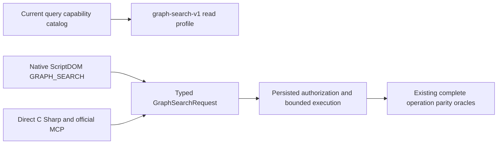

# ScriptDOM GraphSearch capability profile

Canonical slice: `QueryExecution`. This focused correction extends [QueryExecution](../QueryExecution.md) and [ADR-130](../../ADR/ADR-130-microsoft-scriptdom-tsql.md). Current status: complete source proposal; native admission, source integration, compilation and runtime qualification are pending.

## Contract and scope

The current native ScriptDOM `GRAPH_SEARCH` table-valued function lowers to the same typed `GraphSearchRequest` as direct C# and official MCP callers. The capability manifest must report its current version-1 read profile as `graph-search-v1`. The read-profile identity is distinct from `SqlDialect`, which remains `TSQL.ScriptDOM180.v1`, and from the existing AST and query-dialect version arrays. Adding this profile does not qualify full SQL or either client wire protocol.

## Requirements and acceptance

| Requirement | Measurable acceptance | Existing automated coverage |
|---|---|---|
| REQ-SDGC-001: advertise the implemented typed GraphSearch v1 read capability | AC-SDGC-001: `QueryEngine.Capabilities.ReadProfiles` contains `graph-search-v1`; the catalog declares and uses this named constant exactly once | `SqlGraphSearchParityTests.CapabilityManifestAdvertisesSearchProfileWithoutChangingQ1Dialect`, with the dialect literal independently updated by the owning ScriptDOM consumer scope |
| REQ-SDGC-002: preserve the rest of the capability contract | AC-SDGC-002: `SqlDialect` remains `TSQL.ScriptDOM180.v1`, `AstVersion` remains 1, both supported version arrays remain `[1,2]`, all previous read profiles, surfaces, predicates and injected database limits remain unchanged | The same genuine manifest test checks dialect, AST/version arrays and `Q2.InnerJoin.v1`; complete before/after native-type review checks the unchanged catalog fields |
| REQ-SDGC-003: report actual native operations without admitting obsolete syntax or hiding refusals | AC-SDGC-003: the canonical GraphSearch SQL operations retain direct-operation parity, multiple seeds, scope, retrieval, expansion, text/vector weights and empty selectors; wrong parameters, budgets, authority and cancellation retain their existing refusal and healthy-retry oracles | `SqlGraphSearchParityTests`, `SqlGraphSearchRejectionTests`, the existing RF3 GraphSearch and three-way hybrid SDK/official MCP scenarios owned by the graph consumer scope |
| REQ-SDGC-004: qualify the integrated source rather than the proposal | AC-SDGC-004: exact-source compilation, native TUnit unit/recovery/Aspire RF3 and required Linux evidence are retained before claiming acceptance; a native check-only result or profile entry alone does not pass these gates | Main integration owner retains original build/test/source identities and reports; currently OPEN |

## Positive, negative and error flows

A current manifest includes the GraphSearch read profile while preserving the declared native dialect and query versions. Valid native SQL still reaches the separately authorized database operation and the existing bounded read-cut execution. Invalid function shapes, parameter kinds, unauthorized graph labels, excessive requests and cancellation continue through their owning strict diagnostics; the manifest change creates no reader, parser, role or fallback. Empty selector and zero-weight controls continue to use the same canonical graph path.

## Canonical slice map and boundaries

| Surface | Owned path or reason |
|---|---|
| Backend contract | `src/KeyLoad.Query/Features/QueryExecution/Contracts/QueryCapabilityCatalog.cs` |
| Native parser | Existing `src/KeyLoad.Query/Features/QueryExecution/Parsing/ScriptDomGraph*.cs`; unchanged by this correction |
| Unit tests | Existing `tests/KeyLoad.UnitTests/Features/QueryExecution/Cases/SqlGraphSearchParityTests.cs` and rejection/support roles; separate graph consumer owner |
| RF3 tests | Existing QueryExecution GraphSearch and Search three-way hybrid scopes; separate graph consumer owner |
| SDK/MCP/CLI | N/A for new code: the existing query capability contract and graph operation transports are reused |
| Frontend/benchmark/infrastructure | N/A: no UI, measurement, orchestration or topology change |
| Documentation | `docs/Features/QueryExecution/ScriptDomGraphCapabilities.md` |

No persistence format, authorization, operation dispatch, resource limit, profile alias, parser compatibility branch or new dependency is introduced. Runtime and deadline results remain open until the current integrated barrier produces their original evidence.
