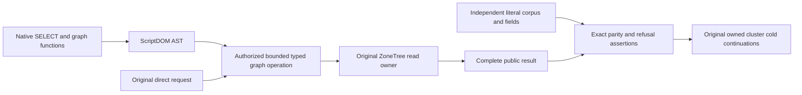

# ScriptDOM Graph operation consumers

Canonical slice: QueryExecution. GraphTraversal owns direct graph operations; Search owns the hybrid ranking corpus; ClientApi owns typed MCP decoding. This contract implements the graph SQL surface of REQ-QUERY-007, REQ-GRAPH-007..010 and REQ-GSEARCH-002..006. Frontend, a new transport and storage format are N/A: this change uses existing public SDK, official MCP SDK, native ZoneTree and Aspire cluster owners.

## Requirements and acceptance

- REQ-GRAPH-DOM-CONSUMER-001 / AC-GRAPH-DOM-CONSUMER-001: shortest-path consumers use `SELECT * FROM GRAPH_SHORTEST_PATH` with unchanged endpoint collection/ID, graph, depth, vertex and edge bounds, parameter values and optional label semantics. Complete ordered vertices and projected edge records, tied-path choice, no path, zero hops, scope refusal and original current cut assertions remain independent of SQL results.
- REQ-GRAPH-DOM-CONSUMER-002 / AC-GRAPH-DOM-CONSUMER-002: graph-search consumers use the nine-argument native `GRAPH_SEARCH` table-valued function and native nested functions for text, vectors and vector space, scope, seeds, retriever, expansion, labels and allowed IDs. Explicit weights, fusion, limits, null and empty selectors preserve each original direct request. Independent full ranked results and expansion results remain unchanged.
- REQ-GRAPH-DOM-CONSUMER-003 / AC-GRAPH-DOM-CONSUMER-003: malformed inputs, wrong scalar parameters, invalid vectors, unsupported native statement shapes and resource bounds refuse with one exact owning code. Path named parameters retain the Path diagnostic family. Every existing no-partial-effect, complete healthy retry, cancellation and persisted authorization check remains. A valid second statement and alternate projection are unsupported native execution shapes; their full native diagnostic is asserted. Serialization-envelope fixtures retain opaque input bytes intentionally: decoding is not execution admission.
- REQ-GRAPH-DOM-CONSUMER-004 / AC-GRAPH-DOM-CONSUMER-004: genuine SDK and official MCP callers execute SQL alongside the direct operation with unchanged credentials, principal epochs, original request identities, receipts, deadlines and owned cluster resource lifetimes. Existing joined cold continuations remain in their original cases. Capability metadata advertises `TSQL.ScriptDOM180.v1` while preserving the original strict `graph-search-v1` profile requirement and supported versions.

## Automated mapping

AC001 maps to SqlGraphPathParityTests, SqlGraphPathRejectionTests, SqlGraphPathParameterBoundaryTests, SqlGraphPathDeadlineTests, SqlGraphPathOperationFlowTests, GraphPathClusterParityTests and its existing GraphPathRawReadR43Trial continuation. GraphPathFieldUseR43State and GraphPathRebindR44State already use the native shortest-path SELECT form. GraphPathNativePayloadTests separately qualifies native payload/envelope identity without interpreting its opaque SQL sample.

AC002 maps to all original SqlGraphSearchParityTests and SqlGraphSearchResultCompositionTests, their original SqlGraphSearchTestSupport and AdapterVectorWholeFlow, SqlGraphSearchClusterTests and ThreeWayHybridClusterTests. The text/vector/scope/retriever/expansion corpus, independent rank fields, allowlist semantics and all original zero-weight/label/refusal assertions remain.

AC003 maps to SqlGraphSearchRejectionTests and the complete original SqlGraphPath rejection/deadline flows. The repeated-semicolon criterion is retained unchanged; its execution remains a required compatibility gate, not waived by this migration.

AC004 maps to original cluster parity/authority/hybrid cases, including SqlLabelAuthorityFlow (original grant, revoke, repair receipt, full current image and existing Cold.RunAsync remain unchanged), and their unchanged owned lifecycle helpers, plus McpCanonicalTestData typed decoding. The decoder graph-search sample now contains a bounded native TVF with its original resource/entity. Its explicit 1/2/3 walk bounds are sample inputs, not inferred direct-operation defaults or cluster qualification.

## Qualification

Consumer migration code is authored. Owning family-parameter diagnostics and graph-search capability metadata are required companion product corrections; the strict consumer assertions remain. Source review does not qualify an execution gate or claim performance, production readiness or power-loss durability.
