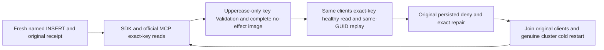

# Exact named parameters through public cluster SQL operations

REQ-TSQL-002/003/005/006 and AC-TSQL-002/003/005/006 in [ScriptDOM](ScriptDom.md), under [ADR-130](../../ADR/ADR-130-microsoft-scriptdom-tsql.md), [ADR-125](../../ADR/ADR-125-connection-owned-execution.md) and [ADR-117](../../ADR/ADR-117-native-tunit-ci-entry.md), retain the existing bounded typed database operations. This is public wire-key parity alongside the separate Unit dictionary-comparer repair. A Dictionary comparer does not survive SDK/MCP JSON serialization; this flow makes no public comparer-regression claim.

## Requirements and whole-operation map

| Requirement | Actual complete operation and independent oracle |
|---|---|
| REQ-NAMED-PUBLIC-001 / AC-NAMED-PUBLIC-001 | Existing SqlParserAdmissionClusterSetup creates a genuine fresh typed row through named id/title/amount INSERT. The original literal row, putDocument mutation/revision, command GUID, actual persisted-copy receipt and original outbox assertions remain. |
| REQ-NAMED-PUBLIC-002 / AC-NAMED-PUBLIC-002 | TOP(@take) and EVENTS(@collection,@stream,@generation) run through SDK Query, official MCP Query, SDK SQL envelope and official MCP SQL envelope. Correct keys require independent complete four-document/two-event literal pages, exact metadata and empty cursor. Each uppercase-only key refuses full fixed Validation, then the same original clients execute the correctly keyed request. |
| REQ-NAMED-PUBLIC-003 / AC-NAMED-PUBLIC-003 | Uppercase-only AMOUNT refuses before mutation dispatch through SDK and official MCP. The same original named INSERT GUID then replays the first typed/public receipt; hidden composition references are checked only as IsEmpty, never disclosed or byte-reencoded as a wire oracle. |
| REQ-NAMED-PUBLIC-004 / AC-NAMED-PUBLIC-004 | Existing Current pure checks conserve every seeded public document, typed row, stream/head and original complete outbox; seed/event/INSERT receipts replay. The original persisted reader denial/exact repair, parser/AST/refusal/cancellation/unicode/numeric controls and two genuine owned cold transitions remain. |
| REQ-NAMED-PUBLIC-005 / AC-NAMED-PUBLIC-005 | Existing caller deadlines and RunOwnedAsync join original SDK/official MCP transports before ModelSqlClusterCold. Keyed fixture retention is enabled before Initialize, retaining body or cleanup failures while original fixture shutdown still joins. |

The existing NativeAnnotationsAndPrivateLexicalBoundsRefuseThenCanonicalSqlAstAndTypedInsertReplaySurviveTwoColdOwners declaration is retained, with the same real Aspire cluster fixture, resources, discovered endpoints and server-owned connections. Existing global serialization is retained because the original whole operation kills/restarts the actual shared-key cluster cohort; no new scheduling restriction is introduced. The same two cold waves each repeat these wire-key checks without writes beyond original GUID replay. Public local cuts are opaque and only bounded positive witnesses; no equal cross-node cut proof is claimed.

No product, parser, package, transport, provider, host, quota, timeout, public API, schema or persisted-format change is included.
