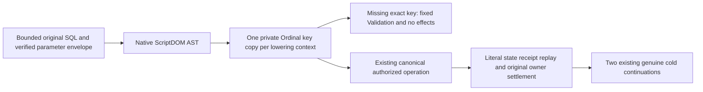

# ScriptDOM ordinal named parameter operation conservation

Selected scope: REQ/AC-TSQL-002/004/005/006 and REQ/AC-QUERY-004/005/006. Existing ADR-130 selects Microsoft ScriptDOM180.140.0 and native AST lowering. The existing QueryValidation canonical normalized parameter dictionary and ScriptDomExecOperation exact key guard establish ordinal binding-envelope identity. This is separate from T-SQL keyword/identifier/collation rules: no SQL identifier casing or grammar changes.

Confirmed source-flow gap: TOP/OFFSET counts, model source arguments, native graph arguments and INSERT/composition parameters currently use the incoming Dictionary comparer before canonical normalization. An OrdinalIgnoreCase dictionary containing only an uppercase key can therefore satisfy a lowercase native variable while the same serialized/deserialized request cannot.

Freeze three existing admitted contexts: ScriptDomLoweringContext, ScriptDomGraphContext, ScriptDomCompositionParameters. Copy the already bounded parameter map once into a private Ordinal dictionary. Preserve original keys and JsonElement values without text substitution, caller mutation or cloning/extended JsonDocument lifetime. Null stays null, exact keys stay exact. Refuse duplicate exact keys through the family's existing safe Validation diagnostic, including unusual caller dictionary comparers. Dictionary null keys are rejected by its native contract. Copy loops observe the original budget/token; SELECT SQL-byte and parameter-count admission precede its context; graph and operation full-envelope checks also precede their contexts. Existing later SELECT scalar normalization remains in place. No node-by-node O(parametercount) membership scans.

Regression integration uses current original whole operations: SqlParserAdmissionWholeFlowTests (native writes/model literals/read/refusals/repair/original receipt/raw conservation/cancellation/two cold waves), SqlTypedInsertWholeFlowTests (real SQL→canonical write, complete independent rows/receipt, comparer refusal→same original replay/policy/healthy/two cold), and SqlGraphPathRejectionTests.MissingAndWrongScalarParametersRejectThenRetry (persisted genuine graph path, exact fixed error and complete independent healthy result). Add no pseudo syntax/getter test, fake provider, new host, public schema/limit/version or parser fallback.

## Owning source and native API

ScriptDOM VariableReference/AST APIs remain the syntax authority. Native Dictionary<TKey,TValue> with StringComparer.Ordinal stores the original actual keys. Existing QueryValidation.NormalizeParameters and ScriptDomExecOperation.BindArguments are current authority for exact binding semantics. Family diagnostics remain ScriptDomErrors.Invalid, graph parameterDetail and ScriptDomOperationErrors.Invalid.

Applicable ADRs: [ADR-130](../../ADR/ADR-130-microsoft-scriptdom-tsql.md), [ADR-125](../../ADR/ADR-125-connection-owned-execution.md). No new decision, package or persisted format is introduced.

Source preparation is not compiler/runtime/coverage/qualification proof.
