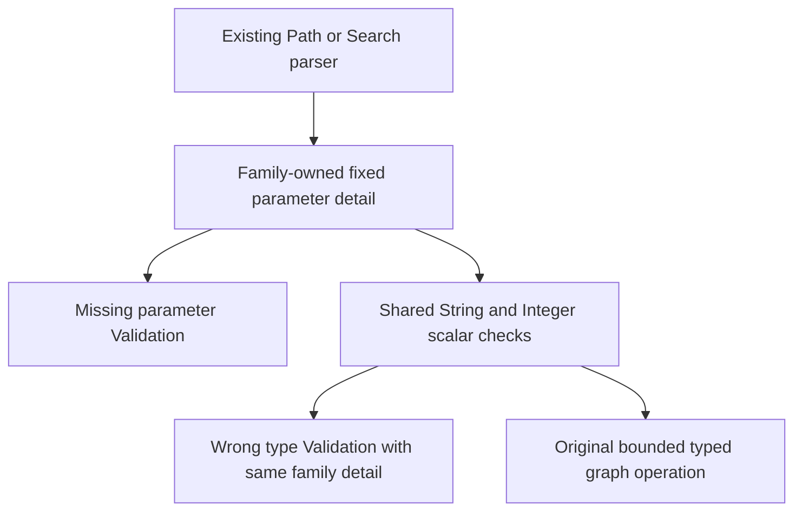

# Family-owned ScriptDOM graph parameter diagnostics

Canonical slice: QueryExecution; GraphTraversal is the linked capability. This preserves REQ/AC-QUERY-004/005/006 and the existing Q1.GraphPath.v1/graph-search error contracts during ADR-130 AST replacement.

| Requirement | Measurable acceptance |
|---|---|
| REQ-GRAPH-PARAM-001 | AC-GRAPH-PARAM-001: GRAPH_SHORTEST_PATH missing or wrong scalar-type named values and nonrepresentable Int32 parameters return Validation with `A named SQL graph-path parameter is missing or has the wrong scalar type.`; healthy same-owner operation follows with complete independent result/current state. |
| REQ-GRAPH-PARAM-002 | AC-GRAPH-PARAM-002: GRAPH_SEARCH retains its original fixed Search parameter detail; no global substitution. Original malformed AST, literal/range/budget/cancellation/authority diagnostics and complete receipt/replay/cold controls remain strict. |

The existing parser constructors select their own immutable detail. Context missing-parameter refusal already uses that selection; shared String/Integer wrong-type refusals must use the same selection. String arrays inherit String. Numeric literals, signed integer bounds, caller parameter names, original budget checks and admission order are unchanged. Search-only weight/vector diagnostics are not changed. No arbitrary value enters a detail, no parsing fallback is introduced and no test oracle is weakened.

Code map: QueryExecution/Parsing/ScriptDom/Graph/ScriptDomGraphContext.cs and ScriptDomGraphScalar.cs; unchanged SqlGraphPathParser/SqlGraphSearchParser caller constructors select the detail. Automated regression mapping: QueryExecution/SqlGraphPathRejectionTests.MissingAndWrongScalarParametersRejectThenRetry and SqlGraphSearchRejectionTests.WrongParameterKindsAndVectorDimensionsReject / ParameterCountIsEnforced, with their current ScriptDOM consumer migration; preserve original case declarations, negative values/details and complete healthy/atomic state/receipt controls. Frontend, persistence, benchmark, package/protocol change: N/A.
