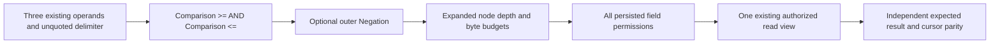

# QueryExecution bounded SQL BETWEEN

Existing Q1 semantics remain the target. Full SQL syntax/semantics and client sessions are separate mandatory unfinished stages.

|Requirement|Acceptance and evidence mapping|
|---|---|
|REQ-SQLC-006 typed expressions|AC-SQLC-006A: lower scalar/field/parameter `BETWEEN` inclusively to existing >=/<= AND; `NOT BETWEEN` negates the whole result. NEW SqlBetween grammar and real-ZoneTree tests plus cluster SDK/official MCP fixtures.|
|REQ-SQLC-003 authority and equivalence|006A independently expected rows, exact AST/SQL rows/order/access path/explain and cursor compatibility. Every field including both bounds uses persisted authorization. No new plan effects/trusted roles.|
|REQ-SQLC-004 bounds and recovery|006A tests expanded7node/depth3 and8node/depth4 boundaries separately from SQL UTF8/token/normalized bytes, cancellation, denied field, malformed/missing/non-scalar/type errors and next successful request.|
|REQ-SQLC-001 honest conformance|006A capability lists only source-supported Q1 operators; full SQL and protocol remain false until their complete inventories qualify.|
|REQ-SQLC-009 measured operation efficiency|Fixed bounded lowering, existing evaluator/read cut/admission. No index-range, speed, allocations, scale or portability improvement claim without authentic comparative GitHub evidence.|

Existing eager three-valued conjunction applies. Only TRUE survives WHERE. Null/missing value makes both comparisons UNKNOWN before type checks. Null bound with a false other comparator yields FALSE; its negation yields TRUE. Null bound with a true other comparator stays UNKNOWN. Both null bounds remain UNKNOWN. Reversed non-null same-type bounds yield FALSE and their negation TRUE. Non-null mismatched scalar types still fail even when the other comparison is false; non-scalar and missing-parameter failures preserve current exact codes. Strings/booleans retain current KeyCodec order; there is no PG collation/coercion.

Canonical map: parser/token constants under src/KeyLoad.Query/ QueryExecution; existing QueryEngine capability entry; NEW tests/KeyLoad.FunctionalTests/ Features/QueryExecution/SqlBetween-prefixed files and IntegrationTests matching slice SqlClusterBetweenTests/helper. Strongest source review precedes code and final join. Backend storage/DDL/DML/ security mutation, frontend, migrations and dependency changes are N/A because this stage reuses the same readonly AST, budgets, resource and contracts.

Test methodology: first-author TUnit grammar/real-store tests from006A; independent literal IDs and hand-built ASTs, exact malformed/budget/error assertions, current normal/scalar plus real cluster SDK/official MCP results. Genuine faults remain failures; no mocks or runtime exceptions are waived. Full Release build, canonical formatter/static governance and independent diff review precede scoped delivery. CI authentic original source/run/attempt/job/report evidence proves execution; coverage remains an open mandatory gate until its collector is configured. Rollback the parser, additive capability values and fixtures together.

## AC-SQLC-006A acceptance contract

The actor is an authenticated existing SDK or official MCP caller. Persisted database authorization remains the only authority. The entry points are existing SQL QueryAsync/MCP query and QueryEngine.Execute/ExecuteAst. Pass requires every criterion below; a skipped, absent or failing required test is a failure.

|Criterion|Positive, negative and edge assertions|Automated proof|
|---|---|---|
|006A-G grammar|Inclusive comparisons and whole-conjunction NOT have identical discriminated AST bytes to independently constructed Predicate roots. Prefix NOT, immediate outer AND, AND-before-OR, aliases, quoted fields, comments and parameter operands preserve grouping. Missing/quoted delimiters/operators fail with the existing exact code; SYMMETRIC and arithmetic remain unsupported.|SqlBetweenGrammarTests; SqlBetweenRejectionTests.|
|006A-T typed truth|Independent literal row IDs cover inclusive/exclusive endpoints, reversed bounds, numbers, strings and booleans. Null/missing values, either/both null bounds and both polarities preserve eager Q1 three-valued evaluation. Non-null incompatible scalar types, nonscalar fields/parameters and missing parameters retain their exact errors, followed by a healthy request.|SqlBetweenTruthTests; SqlBetweenRangeQueryTests; SqlBetweenRejectionTests.|
|006A-B bounds and authority|Normalize the actual parsed positive7node/depth3 and negated8node/depth4 trees at exact/one-under limits. Separately check raw UTF8/token and serialized normalized-request byte limits. Deny every referenced field including either bound from persisted permissions. Pre-cancellation preserves the original token and settles before the next healthy request.|SqlBetweenBudgetAndAuthorityTests; existing SQL lexical budget tests; SecurityAndQueryTests and EqualityAccessPathSecurityTests retain the primary-field authorization regressions.|
|006A-C read contract|Real ZoneTree SQL and independent AST return exact ordered IDs, stable cut/access-path/explain and continuation presence. Cross-use SQL cursors in AST and AST cursors in SQL with independent next-page IDs. Range-only requests reject without full-scan consent and succeed with explicit consent; no range-index path is invented.|SqlBetweenRangeQueryTests.|
|006A-R cluster public flow|Genuine Aspire/Docker cluster SDK and official MCP return independent inclusive, NOT and partial-null IDs over the same committed corpus. Equality group index supplies the asserted path. Both clients expose exactly the prior Q1 predicate list plus BETWEEN/NOT BETWEEN, read-only and full-scan consent. Malformed, typed and parameter failures retain exact codes and a following valid request succeeds.|SqlClusterBetweenTests and SqlClusterBetweenScenario.|
|006A-Q delivery|Full solution Release, canonical formatter, static governance, independent combined source review, then original delivered-source CI normal/scalar/recovery/cluster/analyzer reports with exact source/run/attempt/job/artifact/case bindings pass. Development builds/source review cannot satisfy runtime, coverage or performance gates.|CI original reports; manual independent diff review is the explicit source-review exception.|

No new DDL/DML, AST DTO/version, serializer, evaluator, client session, public route, package, tokenizer, storage or wire behavior is in scope. No data migration is needed. CPU/memory admission, cancellation, read cut and cursor lifetime reuse their existing bounded contracts. Full SQL, protocol, coverage collector, FTS selection, scale measurements and production endurance remain independent open requirements. There is no performance improvement claim.

## Functional operation flows

Three actual caller workflows cover REQ-SQLC-003/004/006, AC-SQLC-006A-T/B/C and AC-CQ-020. No production contract, parser, storage format, dependency, fixture or shared policy changes. ADR065 supplies the unchanged compiler/read/authorization boundaries.

- Parameterized BETWEEN executes against the existing real ZoneTree fixture;
  compare literal ordered IDs and complete rows/read cut against an independently
  authored equivalent AST. Capture committed position before both reads, require
  the actual page cut to match it and preserve position afterward. Keep the
  existing string/boolean ordering assertions.
- Malformed BETWEEN delimiter reaches the actual `QueryEngine.Execute` entry,
  fails with exact Validation and preserves committed position. A following
  valid parameterized request on the same engine returns the expected rows and
  cut. A rejected call must not return a page.
- Persisted lower/upper field-use denial reaches the real executor for both
  bounds, returns PermissionDenied and preserves position. The same SQL as the
  already persisted administrator returns the seeded row; persisted data and
  position remain intact. Caller-supplied roles are not introduced.

These are complete functional operation contributors; property/reflection-only or parser-shape checks cannot establish this evidence. A position comparison proves no committed write, not absence of reads. Historical Stage89 PartitionQuery-only reports contain no BETWEEN IDs and therefore cannot answer coverage of this compiler flow. The fresh source/test/helper/DLL/PDB manifest and measured profile must name actual contributors.
