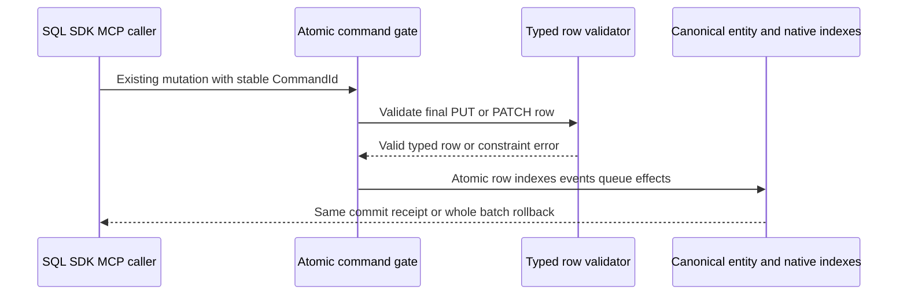

# RelationalStorage

Status: Typed-row and first Q2 join source present; local operation evidence
recorded below, complete original Linux/cluster qualification pending.
Relational data lives within one linked AI database.
[ADR-055](../ADR/ADR-055-typed-relational-rows.md) owns the typed-row stage;
[ADR-054](../ADR/ADR-054-central-sql.md) owns central SQL.

| Requirement | Acceptance | Test/task/evidence |
|---|---|---|
| REQ-REL-001: bounded persisted column schema and primary entity identity | AC-AISQL-002/003 | Real ZoneTree schema/row tests + replicated-cluster tests |
| REQ-REL-002: native unique/revision/security checks and mixed-model atomicity | AC-AISQL-004 | Transactional negative/rollback/reopen tests |
| REQ-REL-003: typed rows share canonical query/graph/vector/workflow identity | AC-AISQL-004/006 | SDK/MCP/SQL cluster linked rows and real-store linkage tests |
| REQ-REL-004: bounded joins and relational FK/check/default/cascade semantics | AC-REL-004: explicit future contract + real atomicity/authorization/budget/fault tests before capability advertisement | PLANNED subsequent ADR/stage; not satisfied by typed rows |
| REQ-REL-005: native indexed correctness and comparable cluster performance | AC-AISQL-008/009/010 | Exact-SHA GitHub qualification and future dedicated table/CALL measurements; no inferred speed result |

Exact pass/fail, positive/negative/edge/error/type/null/current-format rejection/rollback and
test methodology are canonical in [SQL acceptance](QueryExecution.md)
and [execution contract](QueryExecution.md). Rows require current persisted authority;
schema constraints are not row-level grants. Local compile/runtime checks are
development evidence under the root policy; original Linux
qualification, coverage/endurance/power-loss and remaining JOIN/FK gates stay explicit.

## Rel unique rollback replay cold

REQ-REL-002 / AC-AISQL-004 under ADR055 extend SAME AcAisql004PatchConflictAndDeleteRetainNativeUniqueAndRevisionContract after all original conflict, stale revision, delete and unique-name reuse assertions. This typed-row stage does not claim foreign keys/defaults/cascades/arbitrary joins/full SQL.

## Rel join admitted cancel full state

REQ-REL-004 / AC-REL-004-JOIN-004/006 admitted native cancellation: preserve the original SqlInnerJoinCancellationTests.AcJoinCancellationAfterNativeRangeProgressSettlesTheOriginalReadAndKeepsTheStoreHealthy declaration and its genuine ZoneTree RangeExaminedBytes seam. Capture the complete bounded native key/value image, physical position and serialized store identity BEFORE taking the native-progress baseline. Cancellation occurs only after the actual original query has admitted and increased native range work. Await the same original operation task and require OperationCanceledException carrying its original token; before any healthy continuation, independently require unchanged full image, position and identity. The same QueryEngine then executes both SQL and independently constructed AST against the original cut, with literal full ordered page JSON, IDs/revisions, source aliases/IDs/revisions, empty redaction metadata, null cursor and native join access path. Repeat full no-effect checks after both operations. Existing pre-cancelled SDK/MCP cluster case is retained as a separate control and does not qualify admitted Docker cluster cancellation. No product observer, protocol, provider, timeout, default, quota or storage change. Native preview is not compilation/runtime/Linux acceptance.

## Rel join cluster admitted cancellation

AC-REL-004-JOIN-004/006 and AC-QUERY-007-JOIN-002 retain the original pre-cancelled RelationalSqlClusterJoinCancellationTests member as a separate control. A distinct four-case whole operation with two Boolean arguments uses the existing Aspire-owned RequestCqrsClusterWave.StartProbedAsync current-image cluster lane and genuine SDK/official MCP SQL and independently constructed AST callers. The private bounded AuthorizationReload hold follows the actual ReadCapability admission and cluster read barrier, before the fresh persisted principal reload. It proves genuine admitted-operation cancellation only; it does not prove Q2 native row progress. The independent original SqlInnerJoinCancellationTests native RangeExaminedBytes scenario owns row-progress cancellation evidence.

## Rel join retained identity

REQ-REL-001/003, AC-REL-004-JOIN-002/003/006 and AC-QUERY-007-JOIN-002 use the [canonical Q2 observed-identity acceptance contract](QueryExecution.md). Its complete real-store SQL/AST regression covers six native faults, full no-effect images, exact repair and two dirty plus two healthy cold continuations, preserving the original read cut, authorization, budgets and receipt. Source is implemented; required compiler, runtime, Linux and cluster gates remain open.

REQ-REL-001/003 and ADR055 require existing typed primary JSON values to equal canonical entity identity. The next finite Q2 source packet is owned by SqlInnerJoinPrimaryIdentityTests, with ten real native retained-row faults including malformed/non-object JSON, full read refusal/no-effects/repair/receipt/two-dirty and two-healthy cold operations under the canonical QueryExecution contract. Schema evolution remains unsupported; ACL, deleted rows, unread right probes, write constraints and shared budgets retain their existing contracts. Source implementation joined; execution pending.

## Rel retained primary uniqueness

REQ-REL-001/003 and ADR-055 require one declared Text primary property, not a last-wins duplicate, in retained typed identities. Canonical row write validation already requires unique property names; Q2 retained reads and authorized typed composition endpoint reads now enforce primary uniqueness with the existing Corruption category. Full remaining schema validation/evolution is unchanged. SqlInnerJoinPrimaryIdentityTests and TypedQueueGraphPrimaryIdentityTests retain genuine raw fault/repair, original operation/receipt identity, literal healthy operations, no-effects and dirty/healthy cold ownership. Their canonical criteria are [QueryExecution](QueryExecution.md) and [DatabaseComposition](DatabaseComposition.md). Source implementation requires fresh native and delivered Linux qualification.

## Create only identity

REQ-SQLC-006 / AC-SQLC-006, REQ-REL-001/003 and AC-TSQL-003/006 use the [canonical bounded CREATE TABLE contract](RelationalStorage/CreateTable.md) and [ADR-132](../ADR/ADR-132-native-create-table-command-identity.md). They define supported schemas, caller-stable command identity, atomic create-only outcomes, the bounded one-shot native session bridge and complete real-store/public cluster test flows. Full DDL, ordinary SQL row INSERT and complete SQL/client qualification remain open; native source admission does not satisfy those gates.

## Ordinary typed insert

REQ-SQLC-006 / AC-SQLC-006, REQ-REL-001/003 and AC-TSQL-003/006 use the [canonical ordinary typed INSERT contract](RelationalStorage/OrdinarySqlInsert.md). It defines bounded VALUES/parameter lowering, original command identity, current atomic create-only authority and complete native/public cold operation gates. General DML/full SQL and Linux/client qualification remain open.

## Original public Q2 admission cancellation on selected T-SQL

AC-REL-004-JOIN-005/006 and AC-QUERY-007-JOIN-001 retain all four original SDK/official MCP and SQL/AST variants of `RelationalSqlClusterJoinAdmittedCancellationTests.SdkAndOfficialMcpQ2CancellationAfterActualAdmissionSettlesAndContinuesAtTheOriginalCut`. The shared admission seed still used retired `LIMIT 10`.
