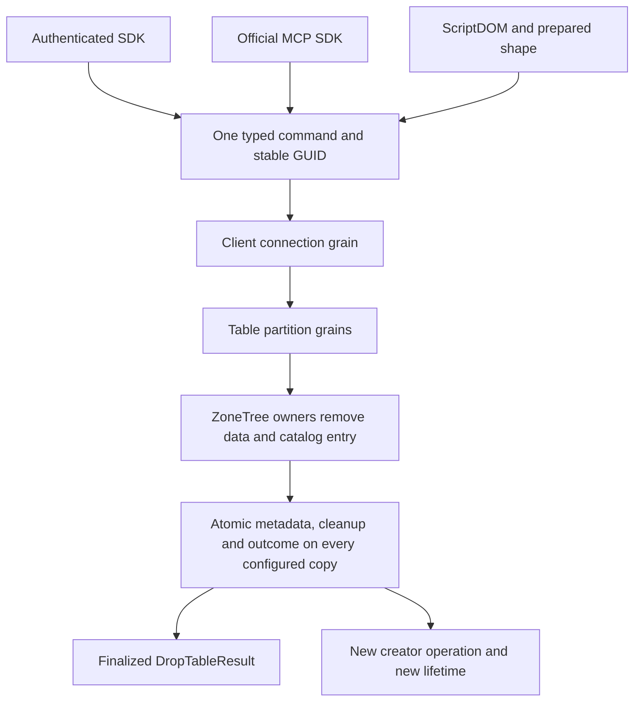

# Canonical DROP TABLE API

This is the source contract for the initial DROP profile. DROP TABLE is an ordinary command: the client's connection grain calls the table's partition grains through Orleans, and the silo-local ZoneTree owners that hold the table's data remove the catalog entry and the table's data. Compilation, genuine public Aspire replicated-cluster tests, recovery and exact-source Linux qualification remain open.

[D1 lifetime identity](../ResourceExecution/ResourceLifetime.md), [ADR-130](../../ADR/ADR-130-microsoft-scriptdom-tsql.md) and [ADR-132](../../ADR/ADR-132-create-table-command-identity.md) retain their own contracts. CREATE's original closed profile is unchanged. This DROP profile does not imply complete SQL DDL, physical erasure, incoming-reference cascade or a SQL Server-compatible protocol.

## Requirements and acceptance

| Requirement | Measurable acceptance |
|---|---|
| REQ-DROPAPI-001: one public typed command | AC-DROPAPI-001: SDK DropTableAsync, official MCP keyload_tables_drop and SQL lowering submit the same DropTableRequest(TenantId, DatabaseId, ResourceName), caller-owned stable command ID and OperationKind.DropTable=53. No client-provided roles, lifetime or replacement command ID. |
| REQ-DROPAPI-002: existing execution | AC-DROPAPI-002: the existing connection grain and command executor reload current persisted authority and run the drop through the normal Orleans calls to the table's partition grains and ZoneTree owners, returning OperationResult only with the finalized DropTableResult. No second dispatcher, task manager, provider or direct catalog-delete shortcut. |
| REQ-DROPAPI-003: complete acknowledgement | AC-DROPAPI-003: no success precedes the required data cleanup and the terminal exact catalog/outcome commit, each acknowledged by all `KeyLoad:ReplicaCount` copies on the ZoneTree owners that hold the table. Work admitted before the drop is settled by its original awaiter; control work cannot bind itself into the retiring old-lifetime work. No network arrival-order or physical-byte-erasure claim. |
| REQ-DROPAPI-004: original outcomes and isolation | AC-DROPAPI-004: same-command replay returns the original finalized result after lost reply/cancellation/restart without deleting a newly created lifetime; unrelated B on the same connection/store continues, and all original and cleanup failures remain observed. |
| REQ-DROPAPI-005: reusable names | AC-DROPAPI-005: recreation is admitted only after the terminal drop commit removes the exact matching catalog/lifetime pair and the required cleanup completes. A new real creator operation produces a different D1 lifetime; old admitted work and bound cursors cannot publish into it. Missing lifetime-bound link targets refuse NotFound; a different current lifetime refuses OwnershipLost, without fallback or backfill. |
| REQ-DROPAPI-006: selected SQL shape | AC-DROPAPI-006: actual pinned ScriptDOM accepts only DROP TABLE with one permanent unqualified name. IF EXISTS, multiple objects, temporary and qualified names refuse before dispatch. Missing/empty stable command ID, extra parameters, cursor and full-scan flags refuse. The same shape is checked before prepared-statement publication. |
| REQ-DROPAPI-007: honest proof | AC-DROPAPI-007: actual SDK, official MCP and prepared SQL complete literal writes, DROP, same-ID replay, recreation and two joined cold cycles on the replicated cluster, preserving full receipts, unrelated data, original errors and all resources. Source/configuration is not execution or acceptance. |

## Public and path

The public request contains only tenant/database/name. Stable command identity is the existing outer HeaderCommand identity. The result is DropTableResult(TenantId, DatabaseId, ResourceName, CommitReceipt Receipt); an internal intermediate state is not a public successful result. MCP hints are mutating, idempotent for a valid identical retry, and destructive.

The SDK reuses its existing authenticated Send transport, cancellation and unknown-write-result classification. The official MCP tool uses the sole existing typed catalog/schema/decoder. SQL compiles the real AST to the same typed payload; the prepared transport keeps original mutation-identity and PossibleWrite behavior. No parser, transport or retry alternative is introduced.

## Test mapping

lifecycle cases and the final public whole-operation declarations are bound to the final coherent source by the integration owner; their source/runtime gates are currently open. No test selector, UID or pass is invented here. Existing mandatory build, TUnit, real-process recovery, Aspire SDK/official-MCP and exact-source Linux gates remain required.
