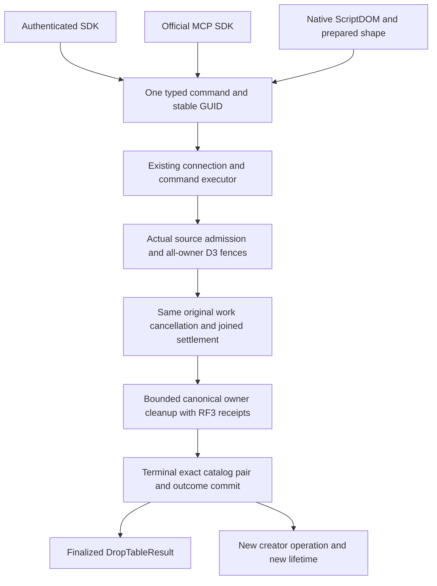

# Canonical DROP TABLE API

This is the source contract for the owner-selected initial DROP profile. It depends on actual D3 retirement, D4 original-work settlement, D5 bounded owner cleanup and D6 terminal catalog/outcome completion. The consumer source alone establishes none of those prerequisite guarantees. Compilation, genuine public Aspire RF3, recovery and exact-source Linux qualification remain open.

[DROP dependencies](DropTableDependencies.md), [D1 lifetime identity](../ResourceExecution/ResourceLifetime.md), [ADR-130](../../ADR/ADR-130-microsoft-scriptdom-tsql.md) and [ADR-132](../../ADR/ADR-132-native-create-table-command-identity.md) retain their own contracts. CREATE's original closed profile is unchanged. This DROP profile does not imply complete SQL DDL, physical erasure, incoming-reference cascade or a SQL Server-compatible native protocol.

## Requirements and acceptance

| Requirement | Measurable acceptance |
|---|---|
| REQ-DROPAPI-001: one public typed command | AC-DROPAPI-001: SDK DropTableAsync, official MCP keyload_tables_drop and SQL lowering submit the same DropTableRequest(TenantId, DatabaseId, ResourceName), caller-owned stable command ID and OperationKind.DropTable=53. No client-provided roles, lifetime or replacement command ID. |
| REQ-DROPAPI-002: existing native execution | AC-DROPAPI-002: the existing connection and command executor reload current persisted authority and invoke the same one-host INativeDropTableExecution. That service admits the actual source D1 and returns OperationResult only with finalized D6 DropTableResult. No second dispatcher, task manager, provider or direct catalog-delete shortcut. |
| REQ-DROPAPI-003: complete acknowledgement | AC-DROPAPI-003: no success precedes every required actual physical-owner D3 fence, D4 original task/reader/producer join, D5 canonical cleanup RF3 acknowledgement and D6 terminal source commit. Control work cannot bind itself into the retiring old-lifetime join. No network arrival-order or physical-byte-erasure claim. |
| REQ-DROPAPI-004: original outcomes and isolation | AC-DROPAPI-004: same-command replay returns the original finalized result after lost reply/cancellation/restart without deleting a newly created lifetime; unrelated B on the same connection/store continues, and all original and cleanup failures remain observed. |
| REQ-DROPAPI-005: reusable names | AC-DROPAPI-005: recreation is admitted only after D6 removes the exact matching catalog/lifetime pair and completes required cleanup. A new real creator operation produces a different D1; old admitted work and bound cursors cannot publish into it. Missing lifetime-bound link targets refuse NotFound; a different current lifetime refuses OwnershipLost under the D6 contract, without fallback or backfill. |
| REQ-DROPAPI-006: selected native SQL shape | AC-DROPAPI-006: actual pinned ScriptDOM accepts only DROP TABLE with one permanent unqualified name. IF EXISTS, multiple objects, temporary and qualified names refuse before dispatch. Missing/empty stable command ID, extra parameters, cursor and full-scan flags refuse. The same shape is checked before native prepared-statement publication. |
| REQ-DROPAPI-007: honest proof | AC-DROPAPI-007: actual SDK, official MCP and prepared SQL complete literal writes, DROP, same-ID replay, recreation and two joined cold cycles on configured RF3 owners, preserving full receipts, unrelated data, original errors and all resources. Source/configuration is not execution or acceptance. |

## Public and native path

The public request contains only tenant/database/name. Stable command identity is the existing outer HeaderCommand identity. The result is DropTableResult(TenantId, DatabaseId, ResourceName, CommitReceipt Receipt); an internal D3 state or local D4 handle is not a public successful result. MCP hints are mutating, idempotent for a valid identical retry, and destructive.

The SDK reuses its existing authenticated Send transport, cancellation and unknown-write-result classification. The official MCP tool uses the sole existing typed catalog/schema/decoder. SQL compiles the real AST to the same typed native payload; the native prepared transport keeps original mutation-identity and PossibleWrite behavior. No parser, transport or retry alternative is introduced.

## Dependency and test mapping

D3/D4/D5/D6 typed implementation, source ownership and native correctness/recovery evidence are required before this consumer can qualify. The D7 source consumes their finalized API and cannot implement them by interpreting BarrierSealed as cleanup. Native C2 lifecycle cases and the final public whole-operation declarations must be bound to the final coherent source by the integration owner; their source/runtime gates are currently open. No test selector, UID or pass is invented here. Existing mandatory build, TUnit, real-process recovery, Aspire SDK/official-MCP RF3 and exact-source Linux gates remain required.

## Native driver and retained source outcomes

The one-host `NativeDropTableExecution` borrows the existing published physical host and native inventory transport. The existing command executor supplies the unchanged signed request expiry explicitly. The driver reads the authenticated subject-scoped durable public parent before resolving the current resource name. Only an absent parent admits the actual source definition/D1 pair under the same authorized read cut; phase27 persists that binding before Preparing. A recreated resource cannot retarget a previously recorded public command.

The original native phase execution remains authoritative. A verified private retirement phase is executed in its existing connection-owned stream through the actual local coordinator, avoiding recursive catalog-command actor entry. No new RPC, scheduler, membership implementation or public inventory method is introduced.

Native reads12/13 return the actual immutable stored phase12/D3 outcomes. The phase12 receipt retains its original native operation and actual issuing policy epoch; the getter verifies its MAC, fingerprint, actor-scoped global outcome, exact stored receipt/state and empty later-stage fields. It never strips a current mutable state to fabricate the old snapshot. Native read14 issues the original source seal on the configured source owner, including when public ingress belongs to another physical group. Frozen lower read fields and aliases are preserved; read14 carries the complete bounded Control/Attempt/Inventory body at request21.

Only after the original D4 work barrier does the driver execute bounded canonical cleanup pages for the final inventory's actual observed holders. Each page has a full-partition/page-ordinal CleanupPage attempt on the existing phase5/6 protocol. Before first effect20 dispatch, phase6 canonically persists the exact native original20 operation, body, read ceilings and fingerprint. The command identity includes that immutable attempt identity. Initial issuance17 shares the original operation budget with the data page, preserving bounded data/metadata headroom without a new allowance or deadline. A known original reserves exactly its stored ceilings if the current budget fits; its settled actual page bytes/records are imported once. Proven native read15 checkpoint/owner-cleanup and read16 owner-release recovery use the actual original actor, epoch, fingerprint and global outcome. Raw checkpoint rows or a newly created empty closure are not acknowledgments. All owner cleanup receipts, catalog finalization, topology releases and phase25 completion precede phase28 and the sole successful public JSON result.

Work-barrier recovered submission failures remain call-local until final DROP completion or are combined with a later terminal failure. Opaque unknown outcomes and cleanup failures remain failures in the current call; a later same-header call may resume only actual durable progress under fresh authority. These local exception references are never serialized. Admission of already captured publications and producer drainage retain the D4 contract; no network arrival-order guarantee is asserted.

Implementation source is prepared and dependency-bound. No build, unit/recovery run, public SDK/MCP/SQL RF3 flow, two-cold qualification, D6 durable handoff qualification, power-loss claim or performance claim follows from this packet. The complete hosted D4 footprint and current source cohort must be composed and qualified before public DROP acceptance.

## Prepared cleanup-page retry contract

REQ-DROPAPI-004 and AC-DROPAPI-004 include failed and unknown page20 recovery. The current CleanupPage attempt is read with authenticated native read4 and an empty attempt ID; this exception applies only to that closed purpose. Native read17 issues original20, and phase6 is the sole canonical publication point. Readonly issuance may repeat while no original has actually been persisted. No effect20 is dispatched without its matching persisted proof. Unknown phase6 must resolve the same original or refuse, never overwrite it.

An unknown or absent original20 outcome retains identical native bytes, including Previous and all read ceilings. Current budget insufficiency refuses before dispatch and cannot rewrite the original. A new attempt requires canonical Close6 and its actual Closed receipt. Persisted originals require an authoritative definite failed outcome; expiry alone cannot close an unknown persisted original. A genuinely never-issued expired attempt may close atomically, fencing late persistence/effects. Server error classification never substitutes for canonical proof. Conditional close retains the original error and every close/release failure; that failed call cannot report success merely because close succeeded.

The prepared-page contracts, Core implementation and Server successor are required together. Structural checkpoint cases bind AttemptId and the five-component identity but do not create authority. The hosted executable-flow specification still requires genuine D3/D4 producers, failed/unknown page20 outcomes, same-header retry, exact original-byte conservation and joined cold roots. This source-only packet claims no execution or qualification result.
