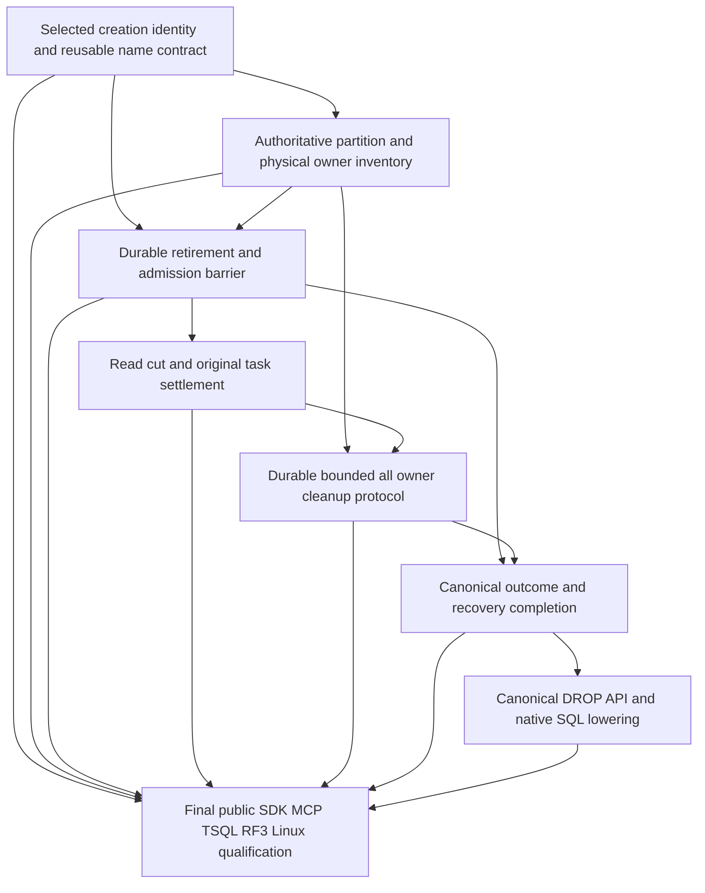

# DROP TABLE foundation dependencies

This is the dependency inventory for REQ-SQLC-006 / AC-SQLC-006, SQLC-DDL. The owner selected reusable resource names with distinct persisted creation incarnations; the [D1 creation contract](../ResourceExecution/ResourceLifetime.md) records that decision and its implemented catalog/lifetime pair. Complete owner inventory, retirement, settlement, cleanup and public removal still require their separate implementation and qualification. `DROP TABLE` remains unsupported by the current canonical SQL compiler. The existing public functional scenario remains unchanged.

The active [SQL conformance inventory](../../implementation/sql-client-conformance.json) describes SQLC-DDL as “database, schema, table, type, index, view and sequence DDL”, owned by the Microsoft ScriptDOM T-SQL AST. Its current execution is “SOURCE CANDIDATE: bounded canonical CREATE TABLE only; full DDL family remains OPEN”. Its acceptance text is:

> Complete independently literal success/refusal→healthy operation, current authority, original receipts, bounds/cancellation, recovery and RF3 evidence required; unsupported AST cannot be ignored.

The [CREATE TABLE contract](CreateTable.md), [ordinary INSERT contract](OrdinarySqlInsert.md), [selected ScriptDOM contract](../QueryExecution/ScriptDom.md), [ADR-130](../../ADR/ADR-130-microsoft-scriptdom-tsql.md) and [ADR-132](../../ADR/ADR-132-native-create-table-command-identity.md) remain authoritative for their existing scope. Their presence does not supply DROP semantics.

## Current source evidence

These are source observations, not runtime or Linux qualification. Line anchors identify the inspected preimages; the guarded SourceN manifest records their hashes.

| Current primitive | Exact source location | Consequence for removal |
|---|---|---|
| Native SQL dispatch supports SELECT, EXEC, INSERT and CREATE TABLE; the default refuses unsupported statements. | `src/KeyLoad.Server/Features/QueryExecution/Queries/SqlOperationCompiler.cs:58–68` | A native `DropTableStatement` being parsable is not executable support. No DROP lowering or command is introduced here. |
| Resource metadata uses tenant/database/name, while data keys include transaction domain and atomic partition key. | `src/KeyLoad.Core/KeySpace.cs:35–48` | Deleting one catalog key cannot discover or remove every table-owned data/index key. |
| ConfigureResource and CreateTable route to CatalogPartition; data commands route by their own partition. | `src/KeyLoad.Clustering/Features/ClusterRouting/Topology/GrainPartitionResolver.cs:42–44` | Catalog RF3 acknowledgement alone is not an all-data-owner retirement or cleanup acknowledgement. |
| CREATE checks catalog absence and writes the definition inside one native transaction. | `src/KeyLoad.Core/Features/RelationalStorage/Commands/DatabaseEngine.TableCreation.cs:10–29` | Catalog absence would permit a later create unless a lifetime fence explicitly forbids or distinguishes reuse. |
| ConfigureResource also writes the catalog and has separate policy/version validation. | `src/KeyLoad.Core/Features/ResourceExecution/Commands/ResourceConfiguration.cs:24–35` | A fence must cover this entry as well as SQL CREATE; fixing only one caller is insufficient. |
| EntityRef contains Partition, Collection and Id; it has no resource incarnation. SchemaVersion initially equals one. | `src/KeyLoad.Abstractions/Features/DocumentStorage/Contracts/DocumentStorageContracts.cs:12,77–79,102–104` | Reusing a name with the same initial schema version can bind an old reference to a different resource. Schema policy version is not a resource incarnation. |
| Resource lookup returns NotFound for missing metadata, then verifies transaction domain and kind. | `src/KeyLoad.Core/DatabaseEngine.cs:165–184` | Catalog deletion makes current lookup fail but supplies neither durable name retirement nor data cleanup. |
| Stored submission resolution reloads the principal and authorizes before selecting an outcome. | `src/KeyLoad.Core/CommandOutcomes.cs:43–67` | Old Batch authorization can return NotFound after resource disappearance before an old receipt is selected. No receipt-read exception may be assumed. |
| Query cursor checks bind schema version, source epoch, policy and native read identity. | `src/KeyLoad.Query/Features/QueryExecution/Execution/QueryCursorExecution.cs:17–45` | Current fences cannot be replaced by a name-only DROP/recreate assumption. Lifetime changes need explicit continuation semantics. |

No complete resource-to-partition/physical-owner inventory, resource retirement barrier or bounded all-owner table-removal operation is established by these primitives. The existing metadata-change check against outstanding partition movement grants is useful admission, but is not that inventory or barrier.

## Required dependency order

D1 supplies the selected creation identity. D2–D6 remain native implementation prerequisites, each with focused native correctness and recovery checks. D7 adds the canonical API and SQL lowering after those prerequisites exist. Q is the separate final public qualification after D7; public DROP tests are not prerequisites for implementing the API they exercise. D1 source or creation evidence does not complete retirement, cleanup or DROP.

| Requirement / acceptance | Foundation to freeze | Required observable completion gate |
|---|---|---|
| REQ-SQLC-006 / AC-SQLC-006, SQLC-DDL | D1 (implementation): resource identity and name reuse | The selected contract identifies server-admitted old-lifetime writes, references and cursors without ambiguity, and states whether reuse is supported or refused. |
| Same original DDL criteria; node-local ownership and RF3 | D2 (implementation): complete owner inventory | Enumerate every table-hosting atomic partition and its current physical owner with bounded original native metadata, including placement changes and unavailable owners. No guessed local scan is accepted as complete. |
| Same criteria; fresh persisted authorization | D3 (implementation): retirement barrier | A durable phase fences effects and background work from the retired lifetime across every affected owner, survives loss/restart and prevents stale admitted work from recreating that lifetime. Every phase retains fresh authenticated authority. |
| Same criteria; original read cuts/cancellation | D4 (implementation): owned settlement | Define which already admitted cuts may finish and how new reads/continuations refuse. Join original writers/readers/producers and preserve all original errors without cancelling unrelated operations or closing shared storage handles. |
| Same criteria; bounded resource removal | D5 (implementation): data/index cleanup | Account for all table-owned canonical rows and indexes and their derived work. Define durable cleanup progress/completion through actual owners and required RF3 barriers, with a precise acknowledgement point; catalog deletion alone proves neither retirement nor cleanup. |
| Same criteria; original receipts/recovery | D6 (implementation): outcome completion | Preserve original success/failure identities, current authority and recoverable phase outcomes. Define acknowledgement, failure, retry and unknown-result behavior against durable retirement and cleanup phase state, without conflating logical acknowledgement with physical erasure. |
| Same criteria; selected T-SQL and real clients | D7 (API implementation): canonical command and lowering | Implement the canonical DROP command and native AST lowering after D1–D6 exist and pass their focused native correctness/recovery checks. Public DROP acceptance is evaluated afterward in Q. |
| Same original criteria; final qualification prerequisites | Q (qualification): complete public operation | After D1–D7, execute the SDK/MCP/T-SQL, genuine RF3, recovery, two-cold and exact-source Linux gates below. Neither the API implementation nor native prerequisite checks alone close Q. |

D2 must cover catalog scope versus data-partition scope explicitly. A table can span different atomic partition keys and physical owners; a command on CatalogPartition does not make those effects one existing atomic transaction. The chosen coordination must retain native Orleans routing, the separate request-grain boundary, node-local ZoneTree ownership and the original RF3 acknowledgement contract.

D3 must define the retirement linearization point and ownership of unfinished work. A catalog tombstone that is invisible to a data owner is insufficient. New admission, already accepted writes, delayed apply, retained retries, background index/projection work, owner movement and node recovery must all obey the same durable lifetime decision. No replacement manager or new execution platform is selected by this proposal.

D4 must distinguish an in-progress native snapshot from a later cursor request. Allowing an already admitted cut to finish is one possible policy; it is not frozen here. Every option must prevent a continuation from silently reading a different incarnation and must retain existing policy/read-generation/source-epoch checks. Cancellation must settle the original work under its existing deadline and ownership rules.

D5 needs a bounded completeness proof. It must enumerate all relevant table-owned key spaces and any disposable derived state, account for work still targeting them, and preserve unrelated models, authorization, replication journals, atomic recovery journals and required outcome history. Removing a catalog row or a locally convenient prefix is insufficient. Native frame/read/write/output limits must bound inventory and every cleanup phase; exceeding a limit must yield the documented refusal or recoverable phase outcome, never a falsely completed result. This document does not assert that a whole database cleanup fits one current frame or prescribe a new limit. The selected contract must distinguish logical retirement, caller-visible DROP acknowledgement and durable cleanup progress/completion. Existing ZoneTree read pins may retain old segments while an admitted cut finishes. No promise to physically erase WAL, backups or every retained byte follows from a logical DROP result, and required journals/history must remain available.

## Resource names and canonical references: open choices

A permanent retired-name tombstone is a possible bounded profile. It would require both CREATE TABLE and ConfigureResource, all relevant writes and recovery paths to recognize the same durable retirement. Name reuse would be refused. Existing canonical references could remain unchanged and become dangling, with an explicitly defined current resolution error; no automatic cascade into documents, graphs, queue payloads or immutable events is implied. This is not an owner-approved choice and cannot be used to advertise general reusable SQL table names.

Reusable names require a different complete contract: a resource incarnation bound at server admission and carried through persisted execution, prepared plans, explicit incarnation-bearing public writes, canonical references and cursors, plus original command/outcome binding. Recreating a name with SchemaVersion one cannot establish that separation. The full old-reference and already admitted old-lifetime write behavior must be defined; adding a generation only to a catalog field or only to one API leaves the other bound paths ambiguous. No migration, fallback or alias to an earlier resource is proposed.

Client construction time is not a server lifetime witness. A raw name-only SQL or PutDocument request first admitted after recreation may legitimately resolve the current resource name; the server cannot infer that its bytes were composed earlier. An unseen request is an old-lifetime write only when it already carries an explicit incarnation binding. Acceptance must fence previously server-admitted/queued work, original replays and bound references/prepared plans/cursors, without inventing a requirement to detect arbitrary unadmitted client bytes.

Incoming references are also a separate constraint decision. A bounded restrictive DROP would need a complete authoritative dependency inventory; checking a few known graphs is insufficient. A dangling-reference policy would need explicit per-model resolution and retained-history behavior. Neither policy is chosen here, and no unbounded scan over arbitrary payloads is authorized.

## Original outcomes and admission

The current command identity and policy rules remain in force. A source-proven malformed or unsupported SQL statement must refuse before canonical dispatch. A genuinely admitted business failure may persist its existing failed-outcome/commit metadata while leaving model effects absent; tests must distinguish those two boundaries.

The future contract must separately define replay of DROP itself, replay of an old CREATE/ConfigureResource, and replay of old successful or failed Batch writes. Stored outcome bytes must not be discarded to make removal easier. Current principal/credential policy must remain authoritative, and replay must never reapply an old effect into a retired or recreated name.

In particular, this proposal does not promise that an old receipt can be read after DROP. Current Batch authorization can fail resource lookup before outcome selection. Any dedicated metadata-only receipt authority would require its own reviewed authentication, privacy and lifetime contract. A preserved internal outcome record is not a new public permission to read it.

## Q: final whole-operation qualification

Q depends on D1–D7. After the canonical API and lowering exist, completion of the DROP slice requires all of the following original evidence. This final public qualification is separate from the focused native checks accompanying D1–D6:

1. Real ZoneTree operations create a typed table, write independent literal rows and indexes across more than one hosting atomic partition, retain canonical cross-model references and a genuine read continuation, and identify actual physical owners. Establish the full preimage, not just the catalog row.
2. Malformed/unsupported syntax, wrong identity, persisted authorization refusal, unavailable or moving owners, active-work/dependency refusal and inventory-budget exhaustion follow their frozen categories. Every refusal is followed by a healthy operation on the original owner. Pre-dispatch refusals preserve the complete original image; admitted failed outcomes preserve their full documented outcome metadata and have no partial model effects.
3. Genuine original-token cancellation and failure during retirement/cleanup join the original tasks and retain all errors. Recovery resumes or refuses the same original command according to the frozen phase contract; no new command ID, enlarged timeout or fabricated completion substitutes for it.
4. Successful DROP acknowledgement proves the frozen catalog/lifetime transition, logical visibility and exact durable cleanup phase state, with unchanged unrelated model data and preserved required journals/outcomes. Completion of all-owner canonical row/index cleanup must be demonstrated separately before claiming cleanup complete; the selected contract may distinguish that point from initial acknowledgement. References, already admitted reads, later reads and old cursors obey the selected contract. No previously admitted old-lifetime writer or background worker resurrects retired data.
5. Real SDK and official MCP callers execute the same canonical operation through the selected T-SQL route and the original authenticated connection execution. Compare independently expected complete results, original receipt/outcome identities, fresh policy denial/repair and exact same-command retries. Native SQL session simple/prepared paths retain their original command identity and failure/settlement rules; no direct-store shortcut stands in for them.
6. Genuine Aspire-owned RF3 repeats the same operation with explicit membership and actual node-local owners, including faulted owner/recovery paths. Two actual joined cold continuations preserve retirement, exact cleanup progress or completion and its recoverable continuation, unrelated data and the frozen replay/name-reuse behavior, followed by a fresh healthy operation.
7. Required build, native TUnit, recovery and exact-source Linux RF3 evidence bind source, DLL/PDB, image, original task/report and cleanup identities. Local development results, syntax acceptance, compilation or this dependency review do not qualify those gates or establish power-loss durability.

Focused native regressions accompany D1–D6; complete public operation cases exercise D7 during Q. The selected D1 creation identity does not yet define implemented retirement, reference, continuation or name-reuse fencing. DROP API/compiler/engine implementation and its public qualification remain open; this dependency inventory promotes no acceptance status.
