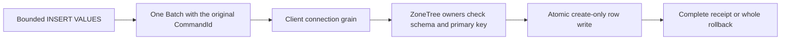

# Ordinary typed SQL INSERT

Source candidate for REQ-SQLC-006 / AC-SQLC-006, REQ-REL-001/003 and AC-TSQL-003/006 under ADR-055, ADR-130 and ADR-132. source admission is distinct from compilation, whole-operation execution, Linux cluster, durability and resource qualification; all those gates remain open before actual joined evidence.

## Accepted bounded operation

TSQL.InsertValues.v1 lowers one unqualified persisted typed table, unique explicit one-part columns and bounded VALUES rows to one existing Batch. Supported scalar inputs are strings, null, finite exact numeric values, parenthesized numeric unary signs and scalar parameters. Public SQL uses named variables; the connection uses only its verified positional slots. Persisted Text primary keys supply canonical entity identifiers. Existing Text, Boolean, WholeNumber, FixedPoint and UtcTimestamp row rules remain authoritative; omitted columns are accepted only when nullable. No schema, primary key or trusted roles come from the caller.

The original nonempty SqlOperationRequest.CommandId and unchanged one-shot session bridge identify the mutation. The existing connection grain and separately signed operation execution are unchanged. No operation tool or dispatcher is added. The generated internal InsertTypedRow mutation has stable Orleans alias keyload.contract.insert-typed-row and Id0 collection/Id1 JSON, and the insertTypedRow JSON discriminator in the existing Batch contract. Existing normalization, canonical fingerprints and transport codecs cover the complete mutation. Its generated payload is not a public serializer fallback.

## Authority and atomicity

Within the original node-local transaction, current persisted DocsWrite, default/current row access, declared field writes and index-field use are checked, then authoritative schema and primary key are resolved. Existing resource policy CAS keeps nonpolicy schema and primary key immutable. Ordinary row insertion requires no cluster-administrator role. Any prior canonical row, including a tombstone or a row staged earlier in this same VALUES operation, refuses with Conflict. An absent row expands to the existing ExpectedRevision0 PutDocument, retaining its complete schema/index/outbox validation. A later duplicate, invalid scalar, missing required column or unique-index conflict rolls back every staged row. The original requested collection advances the existing document epoch; emitted outbox effects are canonical PutDocument.

Fresh typed permissions apply before outcome selection. Successful cached replay additionally checks current row/default access, fields and indexes, without absence/CAS re-execution. The same original request returns the complete saved success or failure; changed content conflicts; revoked permissions and advanced epochs fence old outcomes. A first failed operation may retain its existing failed outcome/clock. Subsequent replay must preserve that complete original outcome, full raw image and cut. No absence pre-read, identity synthesis, overwrite or resurrection is allowed.

## Bounds and unsupported forms

Existing validated source/token/depth/parameter, MaxBatchMutations, document, batch, payload and index bounds apply; no bound is increased. Each serialized row is charged before retention, and the original operation token is checked throughout lowering and execution. There is no retained AST, new session dispatcher or new resource setting. INSERT SELECT, DEFAULT VALUES, OUTPUT, identity/default/computed fields, schema-qualified targets, foreign keys and general DML remain explicit unsupported/open families. Existing graph/queue INSERT composition is preserved.

## Complete operation gates

SqlTypedInsertWholeFlowTests proves independent complete scalar rows and SQL/AST pages, original successful and failed bytes, whole multirow duplicate/unique rollback, exact scalar/missing failures, declared write-grant and principal epoch fences/repair, named/verified-positional parameter parity, bounded rejection and original-token cancellation, then full raw image/cut and independent receipts across two actual ZoneTree cold owners with fresh healthy INSERTs.

SqlTypedInsertClusterWholeFlowTests uses real SDK, official MCP and Npgsql against fixture-owned Aspire cluster. It retains independently literal six-field pages including FixedPoint and UTC values, complete document reads, full receipt scope/vector/durability with authentic positive opaque cluster positions, original success/failure replay, malformed and multirow rollback, fresh resource/principal revoke/repair, genuine admitted AuthorizationReload hold/cancellation/ProducerDisposed settlement and same-GUID healthy retry. Caller scopes settle before both all-three-node cold waves; each cold proves old receipts/pages and a fresh literal INSERT. Public document/outbox conservation does not claim a physical raw-image/global-memory measurement. No local source result closes Linux or full SQL/client compatibility.

Current principal denial precedes cached-result selection: removing DocsWrite returns the complete scope-denied result for both original command IDs. Restoring DocsWrite under a newer principal epoch reaches the distinct complete stored-epoch denial. Both stages preserve original outcome bytes, full no-effects images/cuts and fresh healthy continuation; a shared PermissionDenied code does not make their safe details interchangeable. Original runtime failure is retained; current-source/compiler/runtime/Linux qualification remains open.

