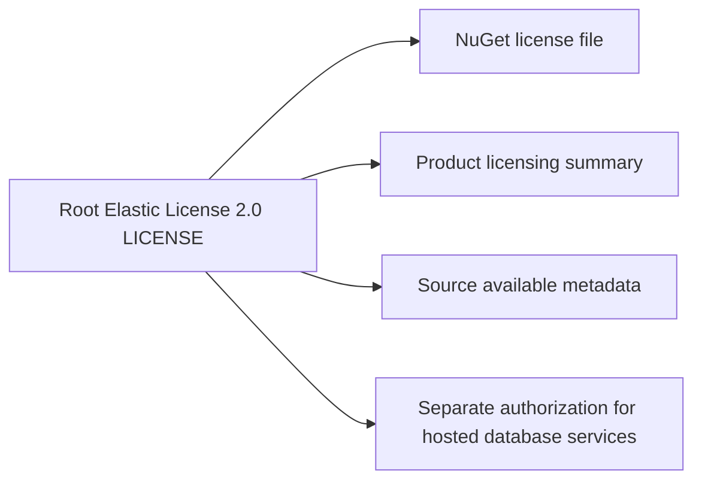

# ReleaseDelivery

## License distribution

KeyLoad is licensed under Elastic License 2.0, which permits application use while
reserving third-party hosted/managed database services for separate authorization
from ManagedCode, without automatic expiry.
[ADR-107](../ADR/ADR-107-elastic-license.md) owns the license and
implementation contract; the complete root [LICENSE](../../LICENSE) is authoritative.

| Requirement | Acceptance and pass/fail evidence |
| --- | --- |
| REQ-LIC-001 standard license | AC-LIC-001: the complete ELv2 body matches the authoritative published source byte-for-byte, with a separate KeyLoad/ManagedCode copyright and licensor header. The hosted/managed-service, license-key and notice-preservation limitations remain unchanged; the published terms are unchanged. Exact standard-text comparison is the manual legal-text exception; absent or altered standard terms fail. |
| REQ-LIC-002 accurate distribution metadata | AC-LIC-002: NuGet packs the actual root LICENSE as a file and dotnet publish copies it into server/CLI distribution roots; README identifies ELv2/source availability and site JSON-LD links to that license. Inspect an actual local package/publish output and the built and source site metadata. A conflicting license declaration or missing license file fails. |
| REQ-LIC-003 preserve independent licenses | AC-LIC-003: third-party license notices and vendored Three.js bytes remain unchanged. Review the scoped diff and original vendor manifest hashes; no dependency relicensing or runtime/storage changes are permitted. |

The license, metadata and site assertions are updated together; exact text, package
output, governance and the final canonical solution build are checked. Runtime
replicated-cluster, coverage and performance gates remain unchanged; license metadata
does not qualify the database.

Delivery uses four independent workflows: Build and Tests, Benchmarks, Website
and Release. Release is manual. It builds downloadable applications, publishes
the server container image to GitHub Container Registry, both through the .NET SDK.

- REQ-REL-001 / AC-REL-001: `dotnet publish --self-contained true` builds the server
  and CLI for `linux-x64`, `linux-arm64`, `win-x64`, `win-arm64`, `osx-x64` and
  `osx-arm64`. Each runtime has one downloadable archive containing both applications,
  their .NET runtime, configuration files and license notices.
- REQ-REL-002 / AC-REL-002: SDK `PublishContainer` publishes the Linux x64 server
  image to `ghcr.io/managedcode/keyload` with the source SHA tag and the moving
  `latest` tag, and retains the centrally configured base image and non-root user.
  The job verifies that both tags resolve to one digest and records
  `ghcr.io/managedcode/keyload:<sha>@sha256:<digest>` in the job summary and the
  `keyload-server-image` artifact. Benchmarks measures the image `latest` resolves to.
- REQ-REL-003 / AC-REL-003: Release uses read-only repository permissions; only the
  server image job receives `packages: write`. Source package and assembly versions
  remain centrally configured. The workflow does not create tags, GitHub Releases or
  NuGet packages.

Canonical implementation: [release.yml](../../.github/workflows/release.yml),
[Directory.Build.props](../../Directory.Build.props) and
[Directory.Build.targets](../../Directory.Build.targets).
[ADR-064](../ADR/ADR-064-workflow-release-delivery.md) records the workflow boundary.
Build and Tests executes the solution build and tests. Benchmarks owns database
measurements; Website builds the static site from one Benchmarks run's result files
and publishes Pages.

A successful publish builds deployment files. Runtime behavior on each target
platform, deployed cluster operation, endurance and power-loss durability require
separate execution evidence. No cross-platform runtime qualification is claimed.
