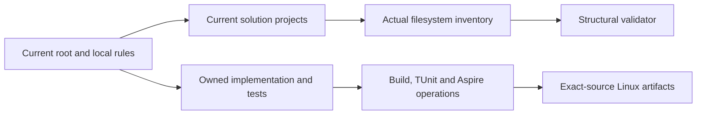

# RepositoryGovernance

Repository rules describe current ownership, execution and qualification. The
[root policy](../../AGENTS.md) controls every project and delivery module.

## Requirements and acceptance

| Requirement | Acceptance | Verification |
|---|---|---|
| REQ-MCAF-001 | AC-MCAF-001: required root policies and real development commands exist. | validator and missing-policy regression. |
| REQ-MCAF-002 | AC-MCAF-002: every declared solution project exists and every discovered project is declared. | Current `KeyLoad.slnx` versus actual filesystem inventory; missing-project regression. |
| REQ-MCAF-003 | AC-MCAF-003: each project and delivery module has local purpose, entry points, ownership, commands, skills and protected risks. | validator reads actual local `AGENTS.md` files. |
| REQ-MCAF-004 | AC-MCAF-004: a single-feature project places populated role folders directly under its root; a project with multiple real features uses `<project>/<SliceName>/<Role>/`. A redundant sole outer feature folder is rejected. | Structural inventory, compiler and source-identity checks. |
| REQ-MCAF-005 | AC-MCAF-005: feature specifications, architecture and decisions describe the current design with valid links. | Current documentation inventory and source review. |
| REQ-MCAF-006 | AC-MCAF-006: required skills follow the owner's explicit scope and are applied where relevant. | Actual installed skill and task review. |
| REQ-MCAF-007 | AC-MCAF-007: status distinguishes local checks from complete exact-source Linux qualification. | Original build, TUnit, Aspire and GitHub artifacts. |
| REQ-MCAF-008 | AC-MCAF-008: transient plan, brainstorm and acceptance working files are absent from the checkout. | Validator and real root/nested negative cases. |
| REQ-MCAF-009 | AC-MCAF-009: scans stay inside the selected repository and do not follow symbolic links. | bounded path and traversal implementation. |

## Ownership and entry points

- Policy: root and local `AGENTS.md` files.
- Tool: `scripts/Features/RepositoryGovernance/verify.mjs`, using Node.js built-ins.
- Decision: [ADR-032](../ADR/ADR-032-mcaf-governance.md).
- Tests: `GovernanceWorkingFileTests`, using the actual validator with a
  test-owned tree assembled from the current solution and policy files.

Run `node scripts/Features/RepositoryGovernance/verify.mjs` from the repository
root. Its success is structural evidence, not database, durability, performance
or production qualification. It must report missing files or malformed policy;
it does not rewrite sources or generate successful runtime results.
