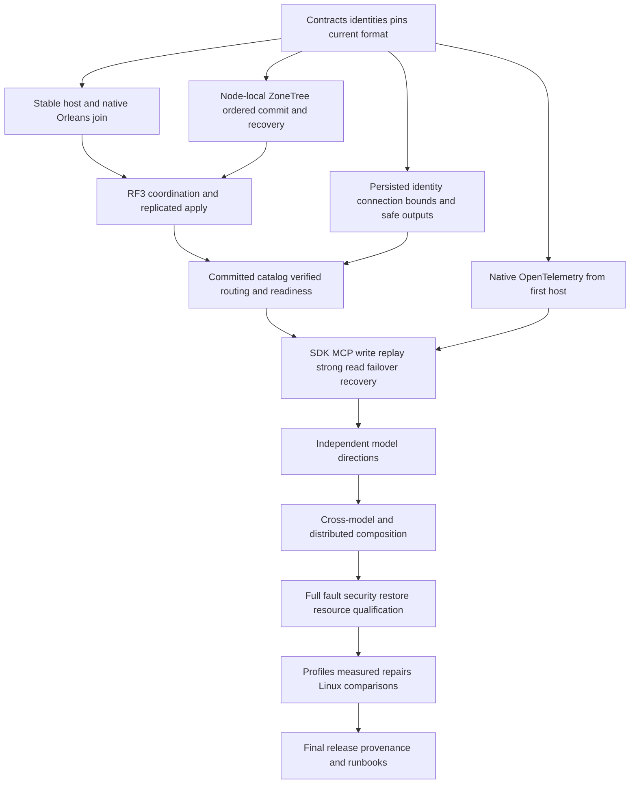

# Foundation-first delivery

Owner decision: 2026-10-15. Canonical slice: RepositoryGovernance. This contract
refines REQ-MCAF-005/007 and ADR-032; it changes execution order, not product scope.
All original KL-001..104 tasks and mandatory KL-105 remain required. The complete
task-definition review and implementation graph are in
[foundation-dependencies.json](../../implementation/foundation-dependencies.json).
[status.json](../../implementation/status.json) alone owns acceptance status.

## Requirements and acceptance

| Requirement | Measurable acceptance |
|---|---|
| REQ-FOUNDATION-001: review every task, not only its title. | AC-FOUNDATION-001: exactly 105 unique IDs retain their original dependency/deliverable/acceptance snapshot, a concrete definition review and implementation prerequisites; no required task disappears. |
| REQ-FOUNDATION-002: distinguish implementation prerequisites from complete qualification. | AC-FOUNDATION-002: all graph references exist and the implementation graph is acyclic; bounded sub-milestones identify their owning existing task. Passing a sub-milestone never marks a whole task done. |
| REQ-FOUNDATION-003: qualify native cluster/storage foundations before broad model expansion. | AC-FOUNDATION-003: the integrated foundation operation below succeeds through actual Aspire-owned Docker RF3, real SDK and official MCP callers, with original receipts and joined cleanup. |
| REQ-FOUNDATION-004: instrument the first working host. | AC-FOUNDATION-004: real native telemetry registration, early listener lifetime, effective container OTLP configuration, actual export and privacy have explicit evidence; dashboard logs or registration alone do not prove all three signals. |
| REQ-FOUNDATION-005: reuse native Orleans ownership correctly. | AC-FOUNDATION-005: actual provider/directory/activation registrations and callers are inspected; no duplicate membership framework is added. Node-local ZoneTree, ordered apply, RF3 authority and physical owner fences remain separate. |
| REQ-FOUNDATION-006: keep public operations safe from their first exposure. | AC-FOUNDATION-006: connection-owned execution, fresh persisted authentication/permissions, output/field/row guards, revocation and admission protect the first command; failures never open readiness. |
| REQ-FOUNDATION-007: run independent ready work concurrently. | AC-FOUNDATION-007: each worker owns a distinct task/path scope, completes a coherent implementation and whole-operation checks, then takes another ready scope. Root owns shared joins, SDK/test execution and delivery. |
| REQ-FOUNDATION-008: finish audits, measurements and release after functional work. | AC-FOUNDATION-008: broad matrices and Linux comparison/profiling receipts precede final release; focused correctness/recovery/security checks stay in every implementation stage. Mandatory normal SIMD and existing licenses/pins apply from the start. |

Verification of AC-001/002/005/007 is an explicit complete-inventory, graph and
source-review exception; getter/setter or source-string unit tests are unsuitable.
AC-003/004/006/008 require the actual runtime and delivery evidence described in
their owning feature contracts. A documentation check cannot satisfy them.

## Foundation order and ownership

1. Freeze stable identities, atomic versus physical partition boundaries, current
   format, native CPU support and approved dependency pins: KL-001/002/069 and
   the current-format part of KL-043. Start KL-015 native OpenTelemetry here.
   The narrow KL-092 native current-time admission must also be real before
   coordinator/silo readiness or public exposure under ADR-133: selected provider,
   ABI, source identity and actual caller checks. A frozen clock contract is not
   that runtime proof; the full scheduler and incomplete provider proposal remain
   separate and unqualified.
2. Complete the node-local ZoneTree owner, file exclusion, read cuts and ordered
   commit/apply/idempotency: KL-003/004/007/008/009/010/011/012/016. Durability
   correctness starts here; the full fault/power-reset campaign is later.
3. Start native host identity and transport (KL-018 host milestone), then native
   Orleans membership (KL-019 native milestone), then database RF3 (KL-017/020).
   Only afterward publish/verify the persisted catalog (KL-018 catalog), expose
   authoritative partition routing (KL-019 authority), and admit public work.
   This staging removes the bootstrap inversion without inventing another provider.
4. Before public admission, complete the bounded connection/auth/output path:
   KL-052/053/061/062 and native subsets of KL-063/064/065/066. Strong/session
   cuts are KL-021; real replica catch-up/recovery is KL-035. KL-005 supplies
   current closed backup; KL-040/076 expand the early resource baseline later.

These are source and runtime milestones inside existing tasks, not additional
product tasks or permission to skip whole-task acceptance. For example, native
document field guards do not wait for every SQL operator, but each SQL operator
must gain its own guard before being exposed. Generic stable-command dedup does
not wait for every index feature; indexed whole-operation qualification still does.

Native Azure Orleans clustering, distributed grain directory, activation
repartitioning and activity propagation are already registered. Verify and qualify
them rather than rebuilding them. Native activation movement does not transfer open
ZoneTree handles or replace physical replica movement in KL-036/070/071/072.

## Integrated foundation gate

Use one actual test-owned Aspire topology: native membership resource plus three
Docker database voters, explicit cohort, discovered endpoints and genuine SDK and
official MCP clients. Authenticate a real connection, commit one bounded write,
retry the same business ID without duplicate effects, read at its receipt/session
cut, revoke and repair current permissions, inject scoped node/minority failure,
recover the original current-format storage, and repeat the exact read/replay.
Retain native identity/receipt/state witnesses and join every owned resource.
Prove effective native telemetry export and privacy; classify each signal and
startup/shutdown interval honestly. No second hand-built cluster or fake provider.

This gate is currently OPEN. R151 on source 924e782f completed ten selected cases:
eight passed and two failed. One original failure is concurrent ordinary-dictionary
mutation in the test controller; the other is physical-catalog cold startup with
original InterruptedWrite/NoLeader outcomes. Their repairs and original complete
operation reruns are required. Neither source preparation nor Docker Running proves
readiness or the unknown original write outcome.

## Complete task inventory and later independent work

The JSON maps every ID exactly once below and retains its detailed review. Bands
are implementation priority, not global whole-task completion barriers. Early
subsets named above protect public work even if a task has later model/audit scope.

| Band | Direction | Tasks |
|---|---|---|
| F0 | Contracts and native observability | 001, 002, 015, 069 |
| F1 | Storage ownership, current format and native cluster startup | 003, 004, 007, 008, 009, 017, 018, 019, 043 |
| F2 | Protected real RF3 operation, session cuts and recovery | 005, 010, 011, 012, 014, 016, 020, 021, 035, 040, 052, 053, 061, 062, 063, 064, 065, 066, 076 |
| F3 | SQL, graph, series, search, events and queues; independent after actual prerequisites | 013, 022, 023, 024, 025, 026, 027, 028, 029, 030, 031, 032, 033, 034, 045, 046, 047, 048, 049, 050, 051, 054, 055, 056, 058, 059, 060, 067, 078, 079, 081, 082, 083, 084, 085, 086, 087, 088, 089, 090, 091, 092, 093, 095, 096, 098 |
| F4 | Physical movement and distributed/cross-model composition | 036, 037, 038, 039, 057, 070, 071, 072, 094, 097, 099, 100 |
| F5 | Complete capability fault/security/restore matrices | 041, 042, 068, 102, 103 |
| F6 | Actual profiles, measured repairs and equivalent Linux comparisons | 006, 073, 074, 075, 077, 101, 105 |
| F7 | Final operational/release manifests and provenance | 044, 080, 104 |

Document/typed-row SQL execution, graphs, series, search and events/queues can
proceed independently after their actual authorized storage/read prerequisites.
SQL is actual Microsoft ScriptDOM T-SQL; executable semantics, native client
protocol and queue-to-entity-to-graph/reverse composition remain distinct mandatory
gates. Events/queues share the canonical transaction domain, not isolated databases.
KL-100 remains required for this all-105 objective; an interim optional-capability
release does not remove it. Use selected native Orleans scheduling primitives by
their real ownership/delivery contract; do not invent another scheduler framework.

## Corrections to stale task definitions

- KL-001: centrally pinned packages, no packages.lock.json; Linux qualification.
  Existing approved pins/original dependency licenses apply immediately; full audit
  is later. No new dependency is implicitly approved.
- KL-006 is not a coding prerequisite for consensus, admission, selected text/ANN
  integration or time-series chunks. Full comparable performance gates remain.
- KL-017/018/019: remove .NEXT/custom membership and metadata-before-native-host
  assumptions. Staged native join and database authority above are different owners.
- KL-014/015: first server is real RF3, with native OTel and authorization from
  inception. A standalone/no-external-services demo is not the product foundation.
- KL-043/072/081: current-format recovery and current ownership/domain outcomes;
  no legacy conversion, old routing fallback or format migration is introduced.
  Immutable historical evidence keeps its actual original identity only.
- KL-046/047: selected T-SQL/ScriptDOM replaces PostgreSQL grammar and handwritten
  parser choices. Native PostgreSQL wire evidence is a separate transport gate.
- KL-053: ADR-125 connection-owned execution supersedes optional SessionGrain or
  separately activated query/request-grain clauses. Operations stay separately
  signed, bounded and freshly authorized.
- KL-069 identity precedes routing; physical movement does not block static-owner
  model kernels. Common generation leases precede provider-specific swap integration.
- KL-075 uses genuine one/three-node Linux comparisons, actual 100k/1m records
  and the unchanged minimum operation/correctness/durability/resource contracts.
- KL-077 normal SIMD/hardware validation is mandatory at the first applicable
  model. Measured optimization follows KL-105 baseline capture; full scalar product
  modes or forced-disable profiles are not reintroduced.
- KL-105 baseline capture uses actual functional source/PID/workload before
  KL-077 repair, then a distinct matched-reprofile milestone, clean comparative
  runs, full KL-105 acceptance and KL-080/104. Baseline/reprofile milestones never
  imply that the final task acceptance already includes those later comparisons.
  Waiting for completed KL-080 before profiling would invert this dependency.
  The 050/057/071/072 capture prerequisites describe the complete final workload
  cohort; bounded diagnosis of a concrete active runtime symptom may use its actual
  process earlier. It neither starts a broad optimization campaign nor closes105.
- KL-092 current-time decisions precede delivery/expiry transitions; its complete
  scheduler follows the queue state machine. KL-090 target-inbox contract precedes
  KL-094 transfer integration; complete remote integration is not an early cycle.

Every original acceptance paragraph is retained as review input. Current owner
decisions and owning feature/ADR requirements supersede its stale clauses; this
document does not waive correctness, fault/power-loss, security, resource, native
client, endurance, coverage, performance, licensing or release requirements.

## Surfaces and verification

RepositoryGovernance owns this execution contract, the JSON graph and architecture
navigation. Product API, frontend, new package, storage schema and wire behavior
are N/A for the planning change; each subsequent implementation owns its separate
feature/ADR contract and actual tests. The three independent reviews cover 001–044,
045–080 and 081–105; Root joins all 105 before integration.

Validate exact ID coverage, unique bands, actual status preservation, graph
references/cycles, current links and the real RepositoryGovernance validator.
Do not add source-string pseudo-tests or change historical done statuses merely
because an earlier prerequisite remains open. Stage85 retains 20 done/85 open;
current changed-source runtime acceptance must be proven independently.
