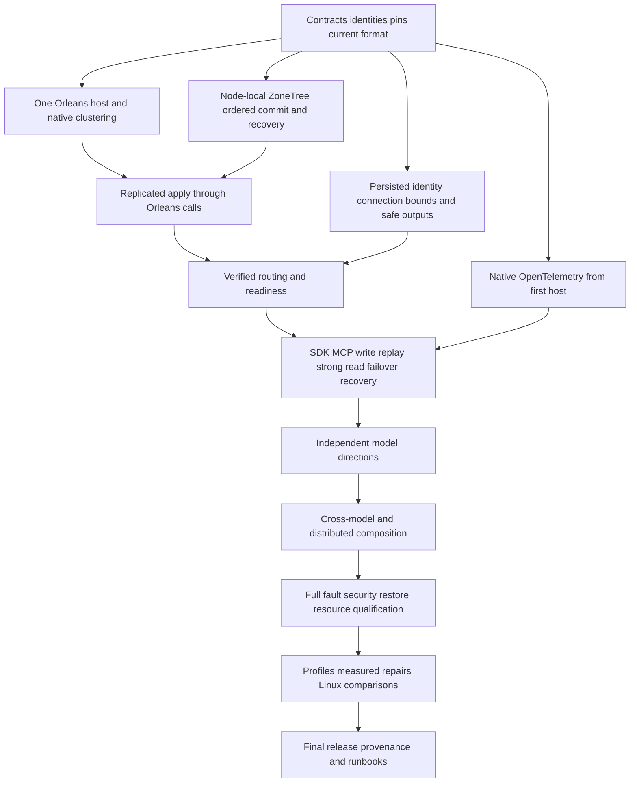

# Foundation-first delivery

Owner decision: 2026-10-15. Canonical slice: RepositoryGovernance. This contract
refines REQ-MCAF-005/007 and ADR-032; it changes execution order, not product scope.
All original KL-001..104 tasks and mandatory KL-105 remain required. The complete
task-definition review and implementation graph are in
[foundation-dependencies.json](../../implementation/foundation-dependencies.json).
[status.json](../../implementation/status.json) alone owns acceptance status.

The native ownership decision is [ADR-136](../../ADR/ADR-136-native-orleans-partition-ownership.md).
The implementation order below incorporates the owner's explicit Grain Service,
partition placement/migration, transactions and Durable Jobs clarifications. It
does not invent another Orleans runtime or postpone the first usable database
behind broad feature, audit or performance campaigns.

## Requirements and acceptance

| Requirement | Measurable acceptance |
|---|---|
| REQ-FOUNDATION-001: review every task, not only its title. | AC-FOUNDATION-001: exactly 105 unique IDs retain their original dependency/deliverable/acceptance snapshot, a concrete definition review and implementation prerequisites; no required task disappears. |
| REQ-FOUNDATION-002: distinguish implementation prerequisites from complete qualification. | AC-FOUNDATION-002: all graph references exist and the implementation graph is acyclic; bounded sub-milestones identify their owning existing task. Passing a sub-milestone never marks a whole task done. |
| REQ-FOUNDATION-003: qualify native cluster/storage foundations before broad model expansion. | AC-FOUNDATION-003: the integrated foundation operation below succeeds through an actual Aspire-owned Docker replicated cluster (`KeyLoad:SiloCount` silos, `KeyLoad:ReplicaCount` copies; three by default), real SDK and official MCP callers, with original receipts and joined cleanup. |
| REQ-FOUNDATION-004: instrument the first working host. | AC-FOUNDATION-004: real native telemetry registration, early listener lifetime, effective container OTLP configuration, actual export and privacy have explicit evidence; dashboard logs or registration alone do not prove all three signals. |
| REQ-FOUNDATION-005: reuse native Orleans clustering correctly. | AC-FOUNDATION-005: actual provider/directory/activation registrations and callers are inspected; Orleans owns membership, discovery, directory, placement, activation migration and internal communication, and KeyLoad adds none of its own. Node-local ZoneTree and ordered apply stay with the silo-local owner; copies are written through ordinary Orleans calls with majority acknowledgement. |
| REQ-FOUNDATION-006: keep public operations safe from their first exposure. | AC-FOUNDATION-006: connection-owned execution, fresh persisted authentication/permissions, output/field/row guards, revocation and admission protect the first command; failures never open readiness. |
| REQ-FOUNDATION-007: run independent ready work concurrently. | AC-FOUNDATION-007: each worker owns a distinct task/path scope, completes a coherent implementation and whole-operation checks, then takes another ready scope. Root owns shared joins, SDK/test execution and delivery. |
| REQ-FOUNDATION-008: finish audits, measurements and release after functional work. | AC-FOUNDATION-008: broad matrices and Linux comparison/profiling receipts precede final release; focused correctness/recovery/security checks stay in every implementation stage. Mandatory normal SIMD and existing licenses/pins apply from the start. |
| REQ-FOUNDATION-009: native silo-local Grain Service owns physical ZoneTree files under one host. | AC-FOUNDATION-009: actual awaited service Init opens/publishes one original owner; eager DI does not borrow unpublished storage; original partial startup, cancel, request/replica drain, late close and same-root cold continuation pass without nested-host or pre-opened-fixture fallback. |
| REQ-FOUNDATION-010: choose native placement, activation migration and transaction boundaries explicitly. | AC-FOUNDATION-010: each grain's placement and migration policy (including the native `[Immovable]` attribute where locality requires it) is reviewed; storage never moves with an activation, and a migrated grain simply calls the ZoneTree owners again through Orleans. Any selected cross-grain ACID path has a real participating ZoneTree provider and commit/abort/conflict/recovery proof. The first same-partition operation does not wait for an unimplemented transaction provider. |

Verification of AC-001/002/005/007 is an explicit complete-inventory, graph and
source-review exception; getter/setter or source-string unit tests are unsuitable.
AC-003/004/006/008 require the actual runtime and delivery evidence described in
their owning feature contracts. AC-009/010 require the real native ownership and
transaction operations in ADR-136; source selection is not runtime qualification.
A documentation check cannot satisfy them.

## Foundation order and ownership

1. Freeze stable identities, atomic partition boundaries versus the silo-local
   ZoneTree owner, current
   format, native CPU support and approved dependency pins: KL-001/002/069 and
   the current-format part of KL-043. Start KL-015 native OpenTelemetry here.
   Orleans is the host: use its native membership, distributed directory,
   lifecycle, placement and activation migration. Standard TimeProvider supplies
   current time and monotonic operation budgets; no separate native clock service
   or replacement scheduler is a foundation prerequisite.
2. Complete the node-local ZoneTree owner, file exclusion, read cuts and ordered
   commit/apply/idempotency: KL-003/004/007/008/009/010/011/012/016. Durability
   correctness starts here; the full fault/power-reset campaign is later. Physical
   files open in the original awaited silo-local storage Grain Service Init, not
   a migrating grain or an independently managed application host.
3. Start the one Orleans host (KL-018 host milestone) with its native clustering
   (KL-019 native milestone), then replicated apply: the partition grain sends each
   write through ordinary Orleans calls to the ZoneTree owners of the
   `KeyLoad:ReplicaCount` silos and acknowledges after a majority confirm durable
   local apply (KL-020). Only afterward admit public work. Orleans placement and
   the logical partition grains provide routing; KeyLoad adds no membership,
   catalog or placement protocol of its own.
4. Before public admission, complete the bounded connection/auth/output path:
   KL-052/053/061/062 and native subsets of KL-063/064/065/066. Strong/session
   cuts are KL-021; a copy that was offline catches up from another copy through
   Orleans calls (KL-035). KL-005 supplies
   current closed backup; KL-040/076 expand the early resource baseline later.
5. Prove `FOUNDATION.usable-core`, then minimum ScriptDOM T-SQL semantics,
   actual parsing/lowering and SDK/MCP/SQL parity. `FOUNDATION.usable-database`
   is the first usable database milestone. Full SQL, native client protocol,
   graph/search/queue composition and every whole-task gate remain required;
   the limited profile is described exactly as implemented.

These are source and runtime milestones inside existing tasks, not additional
product tasks or permission to skip whole-task acceptance. For example, native
document field guards do not wait for every SQL operator, but each SQL operator
must gain its own guard before being exposed. Generic stable-command dedup does
not wait for every index feature; indexed whole-operation qualification still does.

Native Orleans clustering, distributed grain directory, activation
repartitioning and activity propagation are already registered. Verify and qualify
them rather than rebuilding them. Native activation migration does not transfer open
ZoneTree handles; the files stay with the silo-local owner ([ADR-136](../../ADR/ADR-136-native-orleans-partition-ownership.md)).

## Integrated foundation gate

Use one actual test-owned Aspire topology: the native Orleans clustering resource
plus the configured Docker database silos (`KeyLoad:SiloCount`, `KeyLoad:ReplicaCount`;
three by default), discovered endpoints and genuine SDK and official MCP clients. Authenticate a real connection, commit one bounded write,
retry the same business ID without duplicate effects, read at its receipt/session
cut, revoke and repair current permissions, inject scoped node/minority failure,
recover the original current-format storage, and repeat the exact read/replay.
Retain native identity/receipt/state witnesses and join every owned resource.
Prove effective native telemetry export and privacy; classify each signal and
startup/shutdown interval honestly. No second hand-built cluster or fake provider.

Both usable-database and complete foundation gates are OPEN. Existing development
results and original failures remain in the [canonical status](../../implementation/status.json)
and its qualification records. They do not qualify the changed native-host path.
Neither source preparation nor Docker Running proves readiness, original producer
settlement or the outcome of an unknown write.

## Parallel implementation ownership

The current four chats own disjoint coherent batches. Each lead splits its batch
among its own available workers and joins it before Root intake. They do not all
fix the same defect or wait for a shared test run to write independent code.

| Batch / existing tasks | Owned change and join contract |
|---|---|
| One-host composition / KL-014/018/019 | OrleansSiloConfiguration, OrleansNode, ServerConfiguration, ServerApplication and native remote-model construction. One native host, same storage publication, no pre-opened test fallback. |
| Physical storage service / KL-008/018/019 | PartitionHostApplicationOwner, silo-local storage Grain Service, replica service/lifecycle deferred borrowers and genuine partial-start/cold-owner operations. Exact OpenAsync/Borrow/DisposeAsync publication contract, no second store owner. |
| Native journal/jobs / KL-018/092/093 | Existing RuntimeJournal and Durable Jobs registration/provider seams, operation-time borrower resolution and database drain. Remove duplicate runtime reflection/lifecycle only with native equivalent original-task settlement. |
| Main integration / KL-019/021/040/053/064 | Explicit per-grain placement/migration, current original SDK failures, graph/contract review and combined source intake. Root alone mutates shared files, builds, runs selected native TUnit operations and commits/pushes the joined stage. |

These batches contain separate source, lifecycle, native-provider, fixture,
authorization/stream ownership and review work. Each exact file has one writer.
A native API which lacks the required guarantee is recorded precisely rather
than replaced with an invented equivalent. For example, ZoneTree's pinned
maintainer has native cache cleanup but does not expose the original periodic
cleanup Task join: deleting the existing joined worker would lose shutdown
correctness. Keep the necessary ownership until native equivalence is proved.
Confirmed upstream defects are reported under the existing ZoneTree issue rule.

## Complete task inventory and later independent work

The JSON maps every ID exactly once below and retains its detailed review. Bands
are implementation priority, not global whole-task completion barriers. Early
subsets named above protect public work even if a task has later model/audit scope.

| Band | Direction | Tasks |
|---|---|---|
| F0 | Contracts and native observability | 001, 002, 015, 069 |
| F1 | Storage ownership, current format and native cluster startup | 003, 004, 007, 008, 009, 018, 019, 043 |
| F2 | Protected real replicated-cluster operation, session cuts and recovery | 005, 010, 011, 012, 014, 016, 020, 021, 035, 040, 052, 053, 061, 062, 063, 064, 065, 066, 076 |
| F3 | SQL, graph, series, search, events and queues; independent after actual prerequisites | 013, 022, 023, 024, 025, 026, 027, 028, 029, 030, 031, 032, 033, 034, 045, 046, 047, 048, 049, 050, 051, 054, 055, 056, 058, 059, 060, 067, 078, 079, 081, 082, 083, 084, 085, 086, 087, 088, 089, 090, 091, 092, 093, 095, 096, 098 |
| F4 | Distributed and cross-model composition | 037, 038, 039, 057, 094, 097, 100 |
| F5 | Complete capability fault/security/restore matrices | 041, 042, 068, 102, 103 |
| F6 | Actual profiles, measured repairs and equivalent Linux comparisons | 006, 073, 074, 075, 077, 101, 105 |
| F7 | Final operational/release manifests and provenance | 044, 080, 104 |
| — | Superseded by native Orleans clustering ([ADR-136](../../ADR/ADR-136-native-orleans-partition-ownership.md)); the IDs stay accounted for, no KeyLoad-owned implementation remains | 017, 036, 070, 071, 072, 099 |

Document/typed-row SQL execution, graphs, series, search and events/queues can
proceed independently after their actual authorized storage/read prerequisites.
SQL is actual Microsoft ScriptDOM T-SQL; executable semantics, native client
protocol and queue-to-entity-to-graph/reverse composition remain distinct mandatory
gates. Events/queues share the canonical transaction domain, not isolated databases.
KL-100 remains required for this all-105 objective; an interim optional-capability
release does not remove it. Use selected native Orleans scheduling primitives by
their real ownership/delivery contract; do not invent another scheduler framework.

## Corrections to stale task definitions

- KL-001: centrally pinned packages, no packages.lock.json; Linux qualification.
  Existing approved pins/original dependency licenses apply immediately; full audit
  is later. No new dependency is implicitly approved.
- KL-006 is not a coding prerequisite for admission, selected text/ANN
  integration or time-series chunks. Full comparable performance gates remain.
- KL-017/018/019: native Orleans clustering replaces .NEXT and every custom
  membership, consensus or metadata-bootstrap assumption; KL-017 is superseded and
  KeyLoad owns none of these mechanisms.
- KL-014/015: first server is a real replicated cluster, with native OTel and authorization from
  inception. A standalone/no-external-services demo is not the product foundation.
- KL-043/081: current-format recovery and current domain outcomes;
  no legacy conversion, old routing fallback or format migration is introduced.
  Immutable historical evidence keeps its actual original identity only.
- KL-046/047: selected T-SQL/ScriptDOM replaces PostgreSQL grammar and handwritten
  parser choices. Native PostgreSQL wire evidence is a separate transport gate.
- KL-053: ADR-125 connection-owned execution supersedes optional SessionGrain or
  separately activated query/request-grain clauses. Operations stay separately
  signed, bounded and freshly authorized.
- KL-069 identity precedes routing. Common generation leases precede provider-specific
  swap integration.
- KL-075 uses genuine one/three-node Linux comparisons, actual 100k/1m records
  and the unchanged minimum operation/correctness/durability/resource contracts.
- KL-077 normal SIMD/hardware validation is mandatory at the first applicable
  model. Measured optimization follows KL-105 baseline capture; full scalar product
  modes or forced-disable profiles are not reintroduced.
- KL-105 baseline capture uses actual functional source/PID/workload before
  KL-077 repair, then a distinct matched-reprofile milestone, clean comparative
  runs, full KL-105 acceptance and KL-080/104. Baseline/reprofile milestones never
  imply that the final task acceptance already includes those later comparisons.
  Waiting for completed KL-080 before profiling would invert this dependency.
  The 050/057/071/072 capture prerequisites describe the complete final workload
  cohort; bounded diagnosis of a concrete active runtime symptom may use its actual
  process earlier. It neither starts a broad optimization campaign nor closes105.
- KL-092 uses native Orleans scheduling and ordinary TimeProvider; deterministic
  replica application uses committed timestamps. Its complete durable delivery
  behavior follows the queue state machine. KL-090 target-inbox contract precedes
  KL-094 transfer integration; complete remote integration is not an early cycle.

Every original acceptance paragraph is retained as review input. Current owner
decisions and owning feature/ADR requirements supersede its stale clauses; this
document does not waive correctness, fault/power-loss, security, resource, native
client, endurance, coverage, performance, licensing or release requirements.

## All105 tasks, current implementation order and native owner

Each row is reviewed in the canonical JSON, which retains the complete original
definition, corrected scope, next deliverable and separate acceptance gate.
Prerequisites below are implementation milestones, not claims that those tasks
are accepted. F0–F7 are the priority bands above; the named minimum SQL milestones
run in the first usable-database path while full SQL remains F3.

| Task | Band | Implementation prerequisites | Execution owner |
|---|---|---|---|
| KL-001: Версії, ліцензії та platform matrix | F0 | None | RepositoryGovernance / approved manifests |
| KL-002: Формальні API та consistency contracts | F0 | KL-001 | RepositoryGovernance / approved manifests |
| KL-003: ZoneTree durability audit і crash harness | F1 | KL-001, KL-002 | StorageRecovery / silo-local ZoneTree Grain Service |
| KL-004: Transactional read view spike | F1 | KL-001, KL-002 | StorageRecovery / silo-local ZoneTree Grain Service |
| KL-005: Backup/restore spike | F2 | KL-003, KL-004 | StorageRecovery / silo-local ZoneTree Grain Service |
| KL-006: Порівняльні бенчмарки та кластерна методологія | F6 | KL-001 | Performance / original native profiles and Linux comparisons |
| KL-007: KeyCodec і storage envelopes | F1 | KL-002 | StorageRecovery / silo-local ZoneTree Grain Service |
| KL-008: Storage adapter і lifetime | F1 | KL-003, KL-004, KL-007 | StorageRecovery / silo-local ZoneTree Grain Service |
| KL-009: Partition writer і command envelope | F1 | KL-002, KL-008 | DocumentStorage / canonical partition writer |
| KL-010: Document CRUD та CAS | F2 | KL-009 | DocumentStorage / canonical partition writer |
| KL-011: Strict indexes і unique scope | F2 | KL-007, KL-010 | DocumentStorage / canonical partition writer |
| KL-012: Batch і persisted idempotency | F2 | KL-009, KL-010, KL-011 | DocumentStorage / canonical partition writer |
| KL-013: Query AST, planner і cursors | F3 | KL-004, KL-011, FOUNDATION.operation-gate | QueryExecution / native bounded executor |
| KL-014: RF3 server and C# SDK | F2 | KL-010.minimum-command, KL-012.minimum-stable-id, KL-019, KL-053.connection-owner, KL-052, KL-061, KL-064, KL-065.document-acl, KL-066.local-epochs | ClientApi / ASP.NET admission and Orleans connection |
| KL-015: Security і telemetry baseline | F0 | KL-001, KL-002 | Authorization / committed ZoneTree policy |
| KL-016: Committed projection outbox | F2 | KL-012 | DocumentStorage / canonical partition writer |
| KL-017: Consensus provider qualification | F1 | KL-002, KL-003, KL-019.native-membership | ClusterReplication / native Orleans replica services |
| KL-018: Native host and persisted catalog bootstrap | F1 | KL-018.stable-host-identity, KL-020, KL-061.bootstrap-identity, KL-052.core-bounds, KL-043.current-format | ClusterReplication / native Orleans replica services |
| KL-019: Native Orleans membership, placement and ownership | F1 | KL-019.native-membership, KL-018 | ClusterReplication / native Orleans replica services |
| KL-020: Три-вузловий replicated apply | F2 | KL-009, KL-012.minimum-stable-id, KL-017, KL-019.native-membership | ClusterReplication / native Orleans replica services |
| KL-021: Strong read і session tokens | F2 | KL-020, KL-019, KL-053.connection-owner, KL-061 | ClusterReplication / native Orleans replica services |
| KL-022: Graph storage | F3 | KL-011, KL-012, FOUNDATION.operation-gate | GraphTraversal / partition grains and ZoneTree |
| KL-023: Bounded graph traversal | F3 | KL-022, FOUNDATION.operation-gate | GraphTraversal / partition grains and ZoneTree |
| KL-024: Time-series core | F3 | KL-007, KL-012, FOUNDATION.operation-gate | TimeSeries / native series library and ZoneTree |
| KL-025: Time-series range і aggregates | F3 | KL-024, FOUNDATION.operation-gate | TimeSeries / native series library and ZoneTree |
| KL-026: Retention, expiry і rollups | F3 | KL-016, KL-024, KL-025, FOUNDATION.operation-gate | TimeSeries / native series library and ZoneTree |
| KL-027: Canonical vectors і exact search | F3 | KL-010, KL-016, KL-077.normal-simd, FOUNDATION.operation-gate | Search / native FTS and bounded Orleans work |
| KL-028: Text index provider audit | F3 | KL-001, KL-016, FOUNDATION.operation-gate | Search / native FTS and bounded Orleans work |
| KL-029: Text projection і rebuild | F3 | KL-016, KL-028, FOUNDATION.operation-gate | Search / native FTS and bounded Orleans work |
| KL-030: ANN provider qualification | F3 | KL-001, KL-027, FOUNDATION.operation-gate | Search / native FTS and bounded Orleans work |
| KL-031: ANN projection lifecycle | F3 | KL-016, KL-030, FOUNDATION.operation-gate | Search / native FTS and bounded Orleans work |
| KL-032: Filtered vector planner | F3 | KL-013, KL-023, KL-027, KL-031, FOUNDATION.operation-gate | Search / native FTS and bounded Orleans work |
| KL-033: Hybrid rank і Explain | F3 | KL-029, KL-032, FOUNDATION.operation-gate | Search / native FTS and bounded Orleans work |
| KL-034: Search freshness contract | F3 | KL-016, KL-021, KL-029, KL-031, FOUNDATION.operation-gate | Search / native FTS and bounded Orleans work |
| KL-035: Replica snapshot і installation | F2 | KL-005, KL-020 | StorageRecovery / silo-local ZoneTree Grain Service |
| KL-036: Controlled partition movement | F4 | KL-019, KL-035 | ClusterRouting / native placement and physical owners |
| KL-037: Distributed query execution | F4 | KL-013, KL-021, KL-033, KL-036, FOUNDATION.operation-gate | ClusterRouting / native placement and physical owners |
| KL-038: Cross-partition graph edges | F4 | KL-016, KL-022, FOUNDATION.operation-gate | GraphTraversal / partition grains and ZoneTree |
| KL-039: Online index generation swap | F4 | KL-004, KL-016, KL-029, KL-031, KL-036.owner-fence-contract, FOUNDATION.operation-gate | Search / native FTS and bounded Orleans work |
| KL-040: Resource governor | F2 | KL-015, KL-020, KL-052 | ResourceExecution / bounded silo-local admission |
| KL-041: Chaos і corruption suite | F5 | KL-020, KL-035, KL-036, KL-039 | Qualification / actual native functional operations |
| KL-042: Cluster backup і restore drills | F5 | KL-005, KL-035 | BackupRestore / actual native checkpoints |
| KL-043: Current-format recovery, backup and restore | F1 | KL-043.current-format, KL-005, KL-035 | StorageRecovery / silo-local ZoneTree Grain Service |
| KL-044: Release gate і operational handbook | F7 | KL-040, KL-041, KL-042, KL-043 | Delivery / final acceptance and runbooks |
| KL-045: Query capability manifest і AST version | F3 | KL-002, FOUNDATION.operation-gate | QueryExecution / native bounded executor |
| KL-046: T-SQL dialect semantics | F3 | KL-045, FOUNDATION.operation-gate | QueryExecution / native bounded executor |
| KL-047: Microsoft ScriptDOM parser adapter and diagnostics | F3 | KL-001, KL-045, KL-046, FOUNDATION.operation-gate | QueryExecution / native bounded executor |
| KL-048: Binder і field lineage | F3 | KL-047, KL-061, KL-062, FOUNDATION.operation-gate | QueryExecution / native bounded executor |
| KL-049: Rule-based optimizer | F3 | KL-048, KL-013, FOUNDATION.operation-gate | QueryExecution / native bounded executor |
| KL-050: Batch executor і secure operator boundaries | F3 | KL-049, KL-004, FOUNDATION.operation-gate | QueryExecution / native bounded executor |
| KL-051: SQL/JSON/C# equivalence | F3 | KL-050, KL-014, FOUNDATION.operation-gate | QueryExecution / native bounded executor |
| KL-052: Ранній admission control | F2 | KL-052.core-bounds, KL-009 | ClientApi / ASP.NET admission and Orleans connection |
| KL-053: Connection-owned independent operation contexts | F2 | KL-053.connection-owner, KL-014, KL-052 | ClientApi / ASP.NET admission and Orleans connection |
| KL-054: SQL differential і metamorphic suite | F3 | KL-051, FOUNDATION.operation-gate | QueryExecution / native bounded executor |
| KL-055: GraphScope / GraphRetriever / GraphExpansion | F3 | KL-023, KL-045, FOUNDATION.operation-gate | GraphTraversal / partition grains and ZoneTree |
| KL-056: Three-way hybrid retrieval | F3 | KL-033, KL-055, KL-050, FOUNDATION.operation-gate | Search / native FTS and bounded Orleans work |
| KL-057: Global branch ranking | F4 | KL-037, KL-056, FOUNDATION.operation-gate | Search / native FTS and bounded Orleans work |
| KL-058: BM25 corpus і statistics epochs | F3 | KL-029, KL-061, KL-062, FOUNDATION.operation-gate | Search / native FTS and bounded Orleans work |
| KL-059: Managed ANN implementation qualification | F3 | KL-030, KL-027, FOUNDATION.operation-gate | Search / native FTS and bounded Orleans work |
| KL-060: Adaptive filtered retrieval | F3 | KL-032, KL-059, FOUNDATION.operation-gate | Search / native FTS and bounded Orleans work |
| KL-061: Principals, API keys і RBAC | F2 | KL-015 | Authorization / committed ZoneTree policy |
| KL-062: Sensitive field catalog | F2 | KL-061, KL-045.capability-identity | Authorization / committed ZoneTree policy |
| KL-063: Sensitive expression usage enforcement | F2 | KL-063.basic-field-authority, KL-048 | Authorization / committed ZoneTree policy |
| KL-064: Єдиний safe projector | F2 | KL-063.basic-field-authority, KL-050.bounded-output | Authorization / committed ZoneTree policy |
| KL-065: Row ACL planner і graph enforcement | F2 | KL-065.document-acl, KL-023, FOUNDATION.operation-gate | Authorization / committed ZoneTree policy |
| KL-066: Revocation epochs і cursor reauthorization | F2 | KL-066.local-epochs, KL-021 | Authorization / committed ZoneTree policy |
| KL-067: Classification lineage у search projections | F3 | KL-062, KL-029, KL-031, FOUNDATION.operation-gate | Authorization / committed ZoneTree policy |
| KL-068: Security adversarial matrix | F5 | KL-064, KL-065, KL-066, KL-067 | Authorization / committed ZoneTree policy |
| KL-069: Atomic/physical partition contracts | F0 | KL-002 | ClusterRouting / native placement and physical owners |
| KL-070: Placement і tenant packing | F4 | KL-069, KL-036 | ClusterRouting / native placement and physical owners |
| KL-071: Physical shard split/merge | F4 | KL-070, KL-035 | ClusterRouting / native placement and physical owners |
| KL-072: Current ownership tokens and scoped outcomes | F4 | KL-071, KL-021, KL-034 | ClusterRouting / native placement and physical owners |
| KL-073: PostgreSQL baseline kit | F6 | KL-006, KL-001 | Performance / original native profiles and Linux comparisons |
| KL-074: Hybrid quality/performance benchmark | F6 | KL-073, KL-056, KL-060, KL-058, KL-105.matched-reprofile | Performance / original native profiles and Linux comparisons |
| KL-075: Scaling benchmark і fair deployment arms | F6 | KL-073, KL-057, KL-071, KL-072, KL-105.matched-reprofile | Performance / original native profiles and Linux comparisons |
| KL-076: Multi-tenant resource governor | F2 | KL-040, KL-052, KL-070 | ResourceExecution / bounded silo-local admission |
| KL-077: Hot-path allocation і SIMD оптимізація | F6 | KL-006, KL-008, KL-050, KL-105.capture | Performance / original native profiles and Linux comparisons |
| KL-078: Time-series chunk qualification | F3 | KL-026, KL-077.normal-simd | TimeSeries / native series library and ZoneTree |
| KL-079: Resumable change feed і обмежені live queries | F3 | KL-016, KL-066, KL-064, KL-013, FOUNDATION.operation-gate | EventStreams / canonical ZoneTree and native Orleans Streams |
| KL-080: Integrated feature і performance release gate | F7 | KL-044, KL-054, KL-068, KL-074, KL-075, KL-076, KL-077, KL-105, KL-105.final-acceptance | Delivery / final acceptance and runbooks |
| KL-081: Eventing contracts і shared TransactionDomain | F3 | KL-002, KL-045, FOUNDATION.operation-gate | EventStreams / canonical ZoneTree and native Orleans Streams |
| KL-082: Event/queue keyspace і state envelopes | F3 | KL-007, KL-008, KL-081, FOUNDATION.operation-gate | EventStreams / canonical ZoneTree and native Orleans Streams |
| KL-083: AppendEvents, expected revision та dedup | F3 | KL-009, KL-012, KL-082, FOUNDATION.operation-gate | EventStreams / canonical ZoneTree and native Orleans Streams |
| KL-084: ReadStream, feed cursors і catch-up | F3 | KL-004, KL-013, KL-083, FOUNDATION.operation-gate | EventStreams / canonical ZoneTree and native Orleans Streams |
| KL-085: Aggregate snapshots, schemas та replay | F3 | KL-084, KL-064, FOUNDATION.operation-gate | EventStreams / canonical ZoneTree and native Orleans Streams |
| KL-086: Durable enqueue і queue-lane state | F3 | KL-012, KL-082, FOUNDATION.operation-gate | Messaging / partition grains and native Durable Jobs |
| KL-087: Claim, ACK, renew і delivery fencing | F3 | KL-003, KL-086, KL-096, FOUNDATION.operation-gate | Messaging / partition grains and native Durable Jobs |
| KL-088: Retry, DLQ, cancellation та expiry | F3 | KL-087, FOUNDATION.operation-gate | Messaging / partition grains and native Durable Jobs |
| KL-089: Durable groups і contiguous checkpoints | F3 | KL-084, KL-087, FOUNDATION.operation-gate | EventStreams / canonical ZoneTree and native Orleans Streams |
| KL-090: Inbox і CommitProcessing | F3 | KL-012, KL-087, KL-091, KL-090.target-inbox-contract, FOUNDATION.operation-gate | Messaging / partition grains and native Durable Jobs |
| KL-091: Document + event + queue atomic batch | F3 | KL-010, KL-011, KL-083, KL-086, KL-081, FOUNDATION.operation-gate | Messaging / partition grains and native Durable Jobs |
| KL-092: Native Orleans durable scheduling and persisted deadlines | F3 | KL-088, KL-052, FOUNDATION.operation-gate | Messaging / partition grains and native Durable Jobs |
| KL-093: Orleans coordinators і worker SDK | F3 | KL-053, KL-087, KL-089, KL-092, FOUNDATION.operation-gate | Messaging / partition grains and native Durable Jobs |
| KL-094: Cross-partition transfer outbox | F4 | KL-016, KL-020, KL-086, KL-090, KL-090.target-inbox-contract, FOUNDATION.operation-gate | Messaging / partition grains and native Durable Jobs |
| KL-095: Event SQL, queue views та protocol | F3 | KL-051, KL-084, KL-087, KL-064, FOUNDATION.operation-gate | EventStreams / canonical ZoneTree and native Orleans Streams |
| KL-096: Event/message RBAC і sensitive schemas | F3 | KL-061, KL-062, KL-064, KL-081, FOUNDATION.operation-gate | EventStreams / canonical ZoneTree and native Orleans Streams |
| KL-097: Event-driven projections і search lineage | F4 | KL-085, KL-029, KL-031, KL-067, FOUNDATION.operation-gate | EventStreams / canonical ZoneTree and native Orleans Streams |
| KL-098: Eventing retention, purge і backup state | F3 | KL-005, KL-085, KL-088, KL-089, FOUNDATION.operation-gate | EventStreams / canonical ZoneTree and native Orleans Streams |
| KL-099: Eventing replication і migration | F4 | KL-035, KL-036, KL-072, KL-087, KL-089, FOUNDATION.operation-gate | EventStreams / canonical ZoneTree and native Orleans Streams |
| KL-100: Delayed jobs, recurring occurrences і saga state | F4 | KL-090, KL-092, KL-094, FOUNDATION.operation-gate | Messaging / partition grains and native Durable Jobs |
| KL-101: Eventing benchmark kit і .NET baselines | F6 | KL-006, KL-073, KL-081, KL-105.matched-reprofile | Performance / original native profiles and Linux comparisons |
| KL-102: Eventing failure і state-machine suite | F5 | KL-091, KL-090, KL-088, KL-099 | Qualification / actual native functional operations |
| KL-103: Eventing adversarial security suite | F5 | KL-096, KL-095, KL-097 | Qualification / actual native functional operations |
| KL-104: All-in-one release manifest і runbooks | F7 | KL-080, KL-098, KL-099, KL-101, KL-102, KL-103, KL-100 | Delivery / final acceptance and runbooks |
| KL-105: .NET profiling with dotnet-diagnostics-mcp and measured bottleneck repairs | F6 | KL-105.matched-reprofile | Performance / original native profiles and Linux comparisons |

The reviewed graph contains **105 original/required task IDs and133 implementation
nodes with433 prerequisite edges** after the native ownership correction. All
references resolve; no cycles exist; all105 original definitions are preserved.
A named milestone is a bounded portion of its existing task, not a106th task.
Acceptance remains **20 accepted /85 in progress** until the actual whole-task
evidence permits a change.

## Surfaces and verification

RepositoryGovernance owns this execution contract, the JSON graph and architecture
navigation. Product API, frontend, new package, storage schema and wire behavior
are N/A for the planning change; each subsequent implementation owns its separate
feature/ADR contract and actual tests. The three independent reviews cover 001–044,
045–080 and 081–105; Root joins all 105 before integration.

Validate exact ID coverage, unique bands, actual status preservation, graph
references/cycles, current links and the real RepositoryGovernance validator.
Do not add source-string pseudo-tests or change historical done statuses merely
because an earlier prerequisite remains open. Stage85 retains 20 done/85 open;
current changed-source runtime acceptance must be proven independently.
