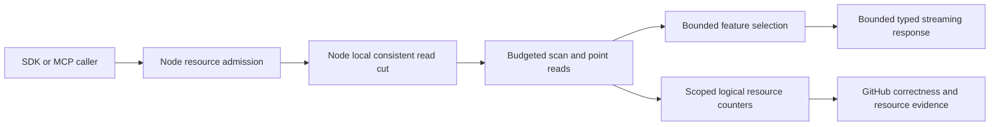
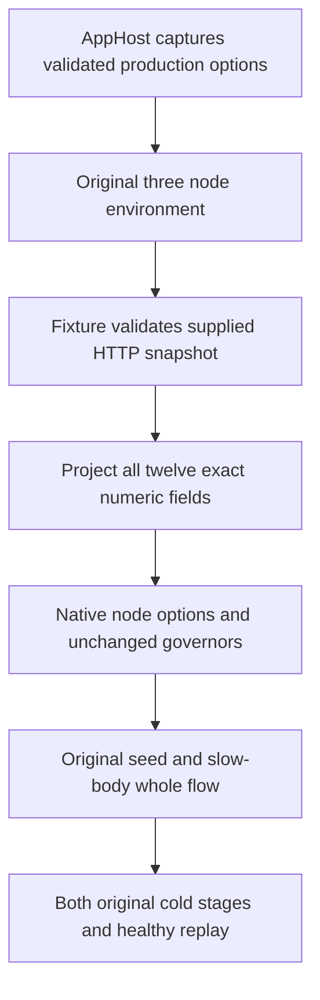

# ResourceExecution

Owner-selected ZoneTree.Analytics adoption is specified in
[OperationalAnalytics](ResourceExecution/OperationalAnalytics.md) and
[ADR-134](../ADR/ADR-134-node-owned-derived-analytics.md). It provides
node-owned disposable operational history alongside OpenTelemetry. The published1.0.0 package uses the existing physical silo owner and administrator Dashboard; new production/public execution remains OPEN. The original whole native component operations
and remaining runtime/resource gates are recorded in the linked feature contract.
Orleans owns the hosting/lifecycle integration.

Actual database phase diagnostics are specified in
[DatabasePhaseProfiling](ResourceExecution/DatabasePhaseProfiling.md) under
[ADR-063](../ADR/ADR-063-bounded-database-phase-profiling.md),
REQ-RESOURCE-003..006 and AC-DBPROF-001..008. The fixed BCL-only Diagnostics
schema is joined first; bank, preserving producer instrumentation, private
node capture and genuine source-bound measurements remain open. This optional
workstream changes no authorized cut, database state, WAL or acknowledgement.

The additive TimeSeries readers under
[ADR-052](../ADR/ADR-052-timeseries-bounded-aggregates.md) map REQ-MP-002/005 and
AC-MP-002/005/011/012 to AC-SERIES-011 and AC-RANGE-REV-003. One original read
gate and one budgeted view charge metadata/data/lookahead exactly once, enforce
deadline/cancellation and exact full JSON results, and preserve healthy
following operations after failure. Root owns BudgetedReadView reverse forwarding;
TimeSeries and StorageRecovery workers own their disjoint operation/provider
acceptance tests. Source and exact-SHA evidence are pending; architecture choices
do not establish maximum throughput, physical I/O, process RSS or numeric coverage.

TASK-RUNTIME-CANCEL-W2 is an accepted AC-MP-009/010/012 fixture refinement under
[ADR035](../ADR/ADR-035-memory-performance.md): arm a dedicated real-file growth
observer before native async report writing; retain the corpus,10second deadline,
quarter-output cutoff, OCE and no-later-file assertions. The same scoped worker
coordinates one bounded second real Kestrel partial-body write after the cancelled
client result while preserving actual RequestAborted, incomplete response,
five-second waits and same-client reuse. Only the four named fixture files and a
necessary same-slice observer helper belong to this worker; product serializers,
client/SDK transports, public contracts and all budgets remain unchanged. Existing
run37015193756/ad594642 is the failing baseline; enabled source quality and the
full new exact-SHA GitHub suite qualify the final result.

Status: Accepted contract; implementation and qualification in progress.
[ADR-035](../ADR/ADR-035-memory-performance.md) owns scoped read/resource/lifetime
decisions. Full requirements and test strategy: [acceptance](../ADR/ADR-035-memory-performance.md).

The staged disposable-cache contract and ordered task graph are accepted in
[ADR-058](../ADR/ADR-058-orleans-coordinated-cache-memory.md). The common pool and
explicit embedded positive-point stage are approved source scopes; authenticated
Orleans control still needs its exact lead-reviewed contract before coding.
Local brainstorm/acceptance/plan scaffolds remain ignored by owner policy; these
durable requirements and the ADR are the reviewable source of truth. No cache or
performance capability is qualified yet. UI/HTTP/SDK/MCP cache administration is
N/A in this stage; existing public database operations remain the visible boundary.

| Cache requirement | Acceptance | Task and automated proof |
|---|---|---|
| REQ-CACHE-001: shared validated retained-byte/entry reservations and lifetime | AC-CACHE-001/002 | TASK-CACHE-MEMORY-R26; real CacheMemoryBudget capacity/overflow/index/concurrent/disposal TUnit |
| REQ-CACHE-002: exact-key coherence and store-generation/recovery fencing | AC-CACHE-003/004 | TASK-CACHE-PROVIDER/PROVIDER-TESTS/INTEGRATION-R28; actual ZoneTree transactions/snapshots/reopen |
| REQ-CACHE-003: owned/scoped buffers and bounded local work | AC-CACHE-005/006 | TASK-CACHE-PROVIDER/PROVIDER-TESTS/INTEGRATION-R28; real pins/callbacks/eviction/logical-charge tests |
| REQ-CACHE-004: bounded node-local cache policy coordination through ordinary Orleans calls | AC-CACHE-007/011 | TASK-CACHE-CONTROL-R26; Orleans grain/service restart and activation-movement tests on a replicated cluster |
| REQ-CACHE-005: current grants, barriers and field/tenant decisions | AC-CACHE-008 | TASK-CACHE-CONTROL-R26; current public SDK/MCP authorization flows |
| REQ-CACHE-006: honest closed resource metrics and comparable benefit | AC-CACHE-009 | TASK-CACHE-NATIVE-R26; repeated GitHub cache-on/off resource JSON |
| REQ-CACHE-007: complete delivered-source/native qualification | AC-CACHE-010 | TASK-CACHE-NATIVE-R26; build/format/analyzers/complexity/governance + unit/scalar/recovery/RF3 and real coverage |

#### Cache acceptance and testing methodology

AC-CACHE-011 adds the exact local provider binding under ADR-058 R69. An actual
opened store creates one configured-cold control with no index charge. Embedded
or existing owners reject another configuration; held/same-thread storage gates
return Busy, and permanent close cannot reopen. Real one-index-budget and
pressure-release cases must progress without lost native data. Withdraw in an actual
native observer must perform one lookup/charge/callback and publish no candidate;
already admitted pinned readers retain charges until completion or exception.
Actual Dispose publishes admission-close before draining its held reader; all
owned charges release after the real drain. R75 rejects Dispose inside the same
thread's actual Read/Commit callback with LockRecursionException before closing
publication. Rejection leaves current eligibility, data and charges intact;
external close and same-directory reopen must then succeed. The exact preserving
repair, ownership and regression sequence are in ADR-058 R75.
Tests use genuine ZoneTree/files and
CacheMemoryBudget in new
`ZoneTreeCoordinatedPointCache*Tests.cs` and real fixture/support files under
UnitTests/ResourceExecution, executed only by GitHub unit normal/scalar.

Coordinated snapshots report effective eligibility and configured-cold state.
Closed means permanent admission closure; retained pinned/index bytes remain
visible until actual release. Current-helper counters reset on cold replacement
and have no-helper gaps; Hits counts successful pins, including rejected pins.
Store diagnostics remain cumulative logical read work across both cache hits and
native reads. Production composition remains cold.

- AC-CACHE-001 passes only when one shared node pool atomically reserves validated
  positive modeled bytes/nonnegative entries before optional owned allocations;
  exact byte/entry caps succeed, one-over and overflow fail without mutation, and
  real concurrent consumers cannot exceed either ceiling. Positive index charges
  may reserve zero entries. Invalid limits/requests must reject explicitly.
- AC-CACHE-002 requires idempotent/concurrent reservation release and coherent
  snapshots after closure. Closing admission or retiring an entry cannot release
  any charge while a reader/candidate still owns its bytes. Real public pool tests
  and genuine pinned-store callbacks prove cleanup on success and exceptions.
- AC-CACHE-003 requires privately owned positive bytes keyed by complete encoded
  content, physical runtime and ReadGeneration. Every Apply invalidates before
  native mutation; unrelated commits retain coherent entries. Real staged
  put/delete/reset/rejection, multi-key commits, tombstones/reinsert and replay
  tests fail if staged or old data appears as a committed hit.
- AC-CACHE-004 requires independent Clear before authority/tree replacement,
  including warm keys absent from a snapshot and interrupted install. Corrupt or
  stale snapshots preserve existing typed failure/authority behavior; known poison
  cannot be bypassed. Same-cut compaction/export may retain entries. Real files,
  recovery observers and cold reopen/disposal prove unchanged durable results.
- AC-CACHE-005 requires caller-owned output copies, the existing scoped readonly
  borrowing boundary and no allocated hit lease. Index/live/retired-pinned/fill
  ownership stays charged; immutable key binding precedes callbacks. Observer and
  consumer execute outside cache/budget locks, with finally release on throw,
  cancellation and eviction. Real synchronized readers prove pin/duplicate-fill
  lifetime rather than inferring it from final occupancy.
- AC-CACHE-006 requires the sole StoreGate -> CacheGate -> budget order and no
  cross-store callbacks/eviction. Admission checks current revision/generation,
  makes at most16 local victim attempts and preserves native results when full,
  oversized, disabled, pin-limited or unavailable. Logical charges/observer order
  and typed errors remain exact; unexpected invalidation failures fail closed.
  Real native diagnostics and shared-store pressure cases prove these conditions.
- AC-CACHE-007 requires cache policy to reach each silo through ordinary Orleans
  calls. Every silo-local cache starts cold, stays bounded and disposable, and
  is never the authority for data, files or access. A silo without the current
  policy stays cold; restart and activation movement start cold and neither move
  data/files nor grant access. Every request still uses the original fresh
  persisted authorization path. Instant atomic cache activation or revocation
  across all silos is not promised. Actual grain/service SDK/MCP tests on a
  replicated cluster are mandatory; embedded opt-in is separate.
- AC-CACHE-008 requires fresh current authentication, credential time/revocation,
  quorum, row/field policy and command replay fingerprint/incarnation checks on
  every public operation. Coherent raw principal/StoredOutcome bytes may be
  retained; grants, final authorized objects and negative lookups may not. Real
  authority changes and cross-tenant/hidden-field/error flows must keep exact results.
- AC-CACHE-009 requires closed data-free counters and repeated matched exact-SHA
  on/off cold/warm/mixed/pressure GitHub profiles with the same topology/ACK/read
  contracts. Retained modeled bytes, allocations/GC, per-node RSS, native lookups,
  latency, throughput, contention and backlog remain distinct. Missing or mixed
  measurements fail any speed/RSS claim; a build is never measurement evidence.
- AC-CACHE-010 requires the delivered-SHA full build/format/governance/analyzer,
  normal/scalar TUnit, real process recovery and Docker/Aspire RF3 SDK/MCP gates,
  plus actual compatible coverage before claiming numeric thresholds. Skipped
  suites, fake providers, local load or unpublished packages cannot count as pass.

Automated sources live in matching ResourceExecution tests; storage/domain tests
retain their original owners. Unit execution is through `ci.yml` normal/scalar;
recovery and RF3 execute their real process/container projects in that workflow.
The accepted R28 task graph supplies exact disjoint files and joins in ADR-058.
Lock order, secret-free metadata and physical ownership have a source-review
exception requiring independent inspection; it does not replace native cases.
Rollback disables ephemeral admission, drains readers and removes optional joins
together. No persisted format, authorization, ACK or production RF3 migration.

| Requirement | Acceptance | Task / test ownership |
|---|---|---|
| REQ-MP-001: all current operation/resource paths reviewed and evidenced defects closed | AC-MP-001 | TASK-MP-001/002/003/004; located inventory and independent final review |
| REQ-MP-002: bounded consistent read/mutation work without redundant materialization | AC-MP-002..006 | TASK-MP-005/006/007; real StoreRecovery, QueryExecution, Search, core feature tests |
| REQ-MP-003: bounded resource lifetime and crash-safe retention | AC-MP-007/008 | TASK-MP-009; real node-local persistence and recovery tests |
| REQ-MP-004: bounded streaming caller/report transport | AC-MP-009/010 | TASK-MP-008; ClientApi and BenchmarkComparisons real contracts |
| REQ-MP-005: honest integrated qualification and resource measurement | AC-MP-011/012 | TASK-MP-010/011; exact-SHA GitHub full suites and resource JSON |
| REQ-MP-006: remove avoidable JSON text byte copies and cached-receive request parses | AC-MP-006/009/011/012 | TASK-MP-007J under ADR-035; public strict text/byte, Unicode/error, owned lifetime, allocation and real-store replay cases |

## Existing ResourceExecution test traceability proposal

These links describe the tested subflow only. They do not close a complete AC or
qualify the current delivered source. Exact parameterized case IDs, source hashes,
line spans, candidate REQ/AC references and per-case limitations are captured in
the private R1 review artifact; the R111 census itself was failed/non-final.

| Existing requirement / AC | Exact source families or method identities | Observed contribution and boundary |
|---|---|---|
| REQ-RESOURCE-001 / AC-RESOURCE-001; REQ-ADM-001 / AC-ADM-001 | `CommandAdmissionGovernorTests.CancellationBeforeAdmissionDoesNotConsumeCapacity`; `HttpAdmissionGovernorTests`; `AdmissionOwnershipTests.HttpAdmissionRejectsInvalidPathFramingAndPrincipalBeforeReservation`; current command-governor cases named in the requirement table above | Real governor reservations check bounded node/data/control lanes, verified scope binding, rejection/cancellation accounting and release. Unit admission is not the planned mixed-load RF3 profile. |
| REQ-ADM-001 / AC-ADM-001 | `AdmissionOwnershipTests.InvalidCommandReservationArgumentsLeaveEveryCounterUnchanged`; `DisposingUnresolvedDispatchedCommandReportsUnknownOutcomeAndReleasesOnce` | Actual invalid reservations leave counters unchanged; unresolved admitted command publishes UnknownWriteOutcome and releases its reservation once. This does not establish current caller integration or AC-ADM-003. |
| REQ-ADM-002 / AC-ADM-002 | `AdmissionOwnershipTests.InboxRejectsConcurrentReaderWithoutConsumingTheQueuedSignal`; `AsyncDisposalStopsAndDrainsRegisteredReaderBeforeRejectingFutureWork`; `PreCancelledReadIsRejectedBeforeReaderOwnershipEvenAfterStop`; `AdmittedCommandInboxTests` | Real inbox single-reader, cancellation, FIFO, control-burst fairness, stop/drain, response cancellation, queue release and bounded reader behavior. `AdmittedCommandReadAllocationTests.WarmedPrefilledInboxReadsWithinSmallAllocationWindow` is an allocation control, not an AC-ADM-002 numeric criterion. |
| REQ-MP-002 / AC-MP-004, AC-MP-005 | `AnalyticalAdmissionTests`; `BudgetedReadViewTests`; `ReadBudgetAllocationTests`; `ReadExecutionBudgetGrant*Tests`; `ReadExecutionTests` | Real engine/store reservation, shared read-byte/record debit, limits before reader/callback/materialization, read cancellation and healthy-follow-up subflows. Allocation assertions are scoped observations, not RSS/physical-I/O or performance qualification. |
| REQ-MP-006 / AC-MP-006; REQ-MP-002 / AC-MP-003 | `CanonicalJsonTests`; `CanonicalJsonAllocationTests`; `JsonPathTests`; `JsonTextProtocolTests`; `JsonTextAllocationTests`; `PreparedScalarTests` | Exact canonical bytes/fingerprints, pointer/scalar behavior, strict text/byte decoding, malformed-input cleanup, persisted retry and bounded allocation cases. These cover named serializer paths, not all public API transports. |
| REQ-MP-006 / AC-MP-006; REQ-MSG-001 / AC-MSG-001; REQ-MSG-003 / AC-MSG-003 | `JsonTextQueueReplayTests` and `JsonTextSubscriptionReplayTests` | Actual receive/replay preserves delivery identity, rejects changed raw request/result data, rechecks current principal or subscription generation, and rejects stale lease/token use. This is a replay/lease subset, not the full messaging API or official-client proof. |
| REQ-ROC-001..004 / AC-ROC-001..004 | `ReadOnlyCollectionContractTests`; `ReadOnlyCollectionValidationTests`; `ReadOnlyCollectionWireTests`; `CanonicalKeyContractTests`; relevant `ReadBudgetAllocationTests` typed owned-read case | Reflection/API shape, exact wire/fingerprint bytes, required collection validation and real independent owned buffers/read results. AC-ROC-005/006 caller-wide build/delivery gates remain separate. |
| REQ-CACHE-001..004 / AC-CACHE-001..008, AC-CACHE-011 (only per-method subset) | `CacheMemoryBudget*Tests`; `CacheReadPermit*Tests`; `ZoneTreeCoordinatedPointCache*Tests`; `ZoneTreePointCache*Tests` | Actual budget, permit, ZoneTree cache, owner-gate, coherence, authorization and pin/retirement subflows as enumerated per case. No unit case here proves cross-node cache enablement on a replicated cluster, AC-CACHE-009 measured benefit or AC-CACHE-010 full qualification. |
| REQ-RESOURCE-003/004 / AC-DBPROF-001..004 | `DatabasePhaseSchemaTests`; `DatabasePhaseBankTests`; `DatabasePhaseBankConcurrencyTests`; `DatabasePhaseArithmeticTests`; `DatabasePhaseAllocationTests` | Fixed bank shape, independent lanes, bounded arithmetic/contention/saturation, detached snapshots and configured primitive allocation. These do not prove all 32 production phase boundaries, private capture or overhead/benefit (AC-DBPROF-005..008). |
| REQ-RESOURCE-003 / REQ-CQ-013; AC-DBPROF-002 / AC-CQ-034/035 | `DatabasePhaseExecutionOptionsTests` | Actual central options binding/validation and bank-construction ordering, including malformed/unknown/scalar settings and allowed bounds. This does not qualify enabled production startup or profiling output. |
| REQ-AISQL-003 / AC-AISQL-007 | `SqlAdmissionTests` | Actual HTTP governor treats SQL as heavy data work, reserves before verified-scope binding, preserves direct-control progress during data saturation and exposes nonrecursive dynamic-effect discovery. Unit evidence does not replace the official .NET/MCP RF3 flow. |
| REQ-DSTORE-001/002/004; REQ-EVENT-004; REQ-MSG-005; REQ-ROUTE-004; REQ-AUTH-004/005 | `TransactionTests.DocumentEventAndQueueCommitTogetherAndCommandRetryDoesNotRepeatEffects`; `UniqueConflictRollsBackDocumentIndexEventAndEnqueue`; `ConcurrentCompareAndSwapHasOneWinner`; `SameLiteralPartitionKeyCannotCrossTransactionDomains`; `TransactionAuthorizationTests` | Preserve the existing many-to-many associations in DocumentStorage, EventStreams, Messaging, ClusterRouting and Authorization. These are actual single-partition DatabaseEngine operations with narrow effects/denial assertions; they do not prove cross-partition atomicity or RF3. `TransactionProtocolTests.MalformedMutationElementsBecomePersistedRejectionsRatherThanApplyExceptions` has per-argument candidate rows for document patch, event revision, topic, and sample negatives in the JSON sidecar; each is a narrow malformed-input persisted-rejection subflow, not its owning feature’s complete AC. The null generic mutation and oversized-frame scenario retain their separate proposals/unmapped reason. |

The following cases remain deliberately unmapped: core null-argument guards without a
current feature AC; the inbox allocation-window control without a declared numeric
AC; `ReadGateLifetimeTests.AcCq016_DisposalObservesRealGateBeforeLaterStoreUse`
(the referenced AC-CQ-016 is not currently defined); and
`ResourceProtocolFailureTests.AcRoc003*` (the body tests persisted invalid-resource
outcome/replay, while AC-ROC-003 governs owned results/dense-vector efficiency).
Do not resolve these by prefix or filename inference. The AC-RESOURCE-002 measured
operation/resource requirement, cache-on benefit, full RF3 admission, DB phase
capture and all full delivered-source qualification remain open even when their
unit subflows pass.

Common storage/resource primitives are shared building blocks. Feature behavior
stays in its canonical slice: StorageRecovery, QueryExecution, Search,
DocumentStorage, EventStreams, TimeSeries, GraphTraversal, Messaging, ChangeFeeds,
ClusterReplication, ClusterRouting, ClientApi and BenchmarkComparisons. New helper
and test files use matching Features paths; flat existing paths remain ADR-032
migration debt and may be repaired without expanding that debt. Shared contracts
and API/composition/CI/docs have exactly one integration owner.

Strict public-collection prerequisites are governed by
[ADR-041](../ADR/ADR-041-read-only-public-collections.md). REQ-ROC-001..006 /
AC-ROC-001..006 map to AC-MP-002/003/004/006/012. The explicit CLR API migration
preserves JSON arrays/base64, exact fingerprints and owned buffers; all consumer
signatures and dense-vector spans must join before build/CI. New tests use this
slice; original business Feature owners retain DTO/operation ownership.
The lead-owned strict converter stage delegates the array protocol to the official
serializer and attaches only its fresh private arrays without another full copy.
Required null/default values reject explicitly; nullable arrays and byte tombstones
keep their meaning. See ADR-041 for exact ownership and tests-first join conditions.

Admission/inbox ownership and the related CLR type migration are governed by
[ADR-042](../ADR/ADR-042-admission-resource-ownership.md): REQ-ADM-001..003 and
AC-ADM-001..003 extend REQ-RESOURCE-001 / AC-RESOURCE-001 and AC-MP-006/012.
TASK-MP-010J owns disjoint admission source/tests; the lead joins actual callers
and exact GitHub evidence. Semaphore disposal must follow registered-reader drain.

No cache may outlive its authority/read cut without explicit invalidation. Mutable
storage arrays cannot escape through a borrowing optimization. Cancellation and
budgets must stop work before a complete excess page is allocated. Logical work,
managed allocation and process working set are different measurements; physical
I/O needs real provider/OS evidence. UI/persisted domain-data changes are N/A for
the common resource contract; any required retention/transport mutation receives
an explicit ADR implementation stage before coding.

## Accepted TASK-MP-007E canonical-JSON work

REQ-MP-002 maps AC-MP-006/012 to exact canonical validation and fingerprints used
by mutations, signed cursors and replay. Validation retains ordinal property order,
duplicate-name rejection, decimal `G29` normalization, escaping, object/depth/input
byte rules and the existing owned UTF-8-decoded string. Fingerprinting retains raw
number spelling and exact lowercase SHA-256 under the same JsonDefaults options.
Null fingerprints remain valid; invalid arguments fail before work.

Serialize fingerprints directly to a JsonDocument sharing its pooled serializer
buffer, then stream canonical bytes to IncrementalHash. Flush Utf8JsonWriter after
each complete value when pending bytes reach a named 64 KiB threshold; a single
large token and object-sort metadata remain separately allocated. Validation
decodes the used MemoryStream buffer without ToArray. No hard RSS limit, input
limit change, storage migration, signature or public API change is implied.

Lead owns JsonData.cs and shared docs; worker owns only new Core/UnitTests
Features/ResourceExecution canonical writer/hash adapter and tests. Tests precede
code: handcrafted canonical/hash fixtures cover property order, nested arrays,
Unicode, null, duplicate names and numeric spelling; real database retries preserve
outcomes; warmed allocation growth over many modest tokens detects full-output
buffer duplication. Execution is GitHub-only; runtime/resource evidence is pending.
Lead moves the existing JSON-pointer parse/escape algorithm into a matching shared
helper solely to keep JsonData within the mandatory type limit while repairing
its documentation, braces and null guards. Public wrappers, 1,024-character bound,
RFC 6901 decoding, missing/scalar distinction and field-patch behavior stay exact;
direct pointer/patch acceptance cases join existing real-document regressions.

## Historical progressive report output repair

TASK-MP-008C under ADR-035/044 described streaming output for the former
ComparisonReport schema. [ADR-142](../ADR/ADR-142-shared-live-benchmark-sessions.md)
retires that standalone report, its write-only projections and exclusive schema
fixtures. Historical original measurements keep their exact source identities.

Current shared sessions retain original per-case reports and samples through
native asynchronous file serialization. They must preserve bounded output,
cancellation, exact source/image/runtime provenance and meaningful native
correctness assertions. Successful compilation and current Linux output/resource
qualification remain separate gates; the old report tests do not qualify the
replacement pipeline.

## Accepted exact-CI fixture corrections

TASK-RUNTIME-ADMISSION-W preserves REQ-MP-002/005 and AC-MP-004/011/012 under
ADR-035. Run37005805424 proves that a held shared read callback does not block
another reader. Only the two analytical-admission cases use a new real exclusive
ZoneTree Commit callback holder with no staged changes; existing read-lifetime
tests retain their original helper. Keep all saturation, independent-engine,
in-flight cancellation, cleanup, ten-second bounds and healthy-followup assertions.
The worker owns those two test references and the new helper; the lead reviews
complete task/holder release before store disposal and qualifies on GitHub.

TASK-RUNTIME-JSON-ORACLES-W keeps REQ-MP-006 / AC-MP-006/012 and ADR-035/041
serializer contracts. Existing direct System.Text.Json byte/text/OperationResult
lone-escaped-surrogate cases expect the actual JsonException on all three paths;
raw UTF-8 replacement and all strict collection/base64 cases remain unchanged.
The embedded benchmark keeps unsorted producer input and expects ordinal canonical
stored JSON under ADR-047 / AC-EM-002. Topic quota comparisons use the correct
Int64 operands without changing exact-byte, one-byte-short or rollback checks.
These are test-oracle repairs, with no new product or persistence decision.

## Admission, operations та observability

### Accepted TASK-MP-006C analytical-read admission

REQ-MP-002/005 and AC-MP-003/004/011/012 require one fail-fast analytical-read
allowance per DatabaseEngine for SQL, AST, both live-query calls and text/vector/
hybrid search. The configured MaxConcurrentQueries must be positive. A new shared
Core/Features/ResourceExecution gate uses one bounded atomic count, no wait queue
or per-caller dictionary. DatabaseEngine exposes an owned IDisposable reservation
and an observational current reservation count through a new partial source file;
existing DatabaseEngine.cs remains with its concurrent integration owner.

Acquire checks cancellation before reserving, rejects saturation with the existing
ResourceExhausted query-concurrency detail, and compensates if cancellation or
allocation fails immediately after the atomic reservation. Dispose releases exactly
once. Each operation keeps the reservation across adaptation, authorization, store
gate wait, scanning/ranking and final result validation. Existing public result,
fingerprint, storage and cancellation contracts stay unchanged; no host clock change.

TASK-MP-006C owns QueryEngine.cs, LiveQueries.cs and SearchEngine.cs admission joins,
new Core/Features/ResourceExecution gate/partial files and new UnitTests
Features/ResourceExecution admission cases. Lead owns shared docs and final review.
Tests first use real ZoneTree read-gate coordination to hold an actual admitted
search while SQL/AST/live/search requests and a second engine instance are rejected
before storage work. Independent databases remain independent. Direct reservation
disposal, invalid limits, pre-/in-flight cancellation, validation/budget errors and
a successful following call prove release. Coordination timeouts detect hangs and
are not throughput measurements. Tests run in GitHub only; source rollback changes
no persisted format or wire and removes the new method/joins together.

### Accepted TASK-MP-011A provider diagnostics

TASK-MP-007H additionally owns an internal BudgetedReadView in this slice. It
wraps an existing IKeyValueView only inside a committed read action, forwards
borrowed callbacks with one cumulative ReadExecutionBudget charge before copy/
decode, and implements the same owned Get/Scan contracts through borrowed work.
VisitRange composes a caller observer without double charging and honors both the
operation and any method-specific cancellation token. Existing provider budgets,
ordering, lookahead, stop flags and callback non-mutation remain unchanged. This
adapter reuses persisted authorization helpers; it does not reimplement principal
or policy decisions. The shared budget's CreateView(IKeyValueView) exposes that
read-only capability under an explicit same-store-action lifetime contract; the
concrete adapter remains internal. Direct real-store adapter cases cover every method, observer
order/failure, cancellation and healthy follow-up in addition to source-read flows.

REQ-MP-005 / AC-MP-011/012 adds an immutable per-ZoneTreeStore read snapshot with
a fresh nonpersisted session ID and cumulative Int64 owned/borrowed point counts,
point examined bytes, range attempts, baseline/staged/tombstone entries, logical
limit lookaheads and range examined bytes. Counters use constant memory and atomic,
saturating increments; a saturated field stops growing and cannot prove later
deltas. Snapshots are observational and non-atomic across fields under concurrency;
only quiescent isolated real-store test windows provide exact operation deltas.

Point hits count key plus logical value bytes, misses/tombstones key bytes, before
copy/observer/decode. A transaction fallback is counted once by the owner; a staged
hit is counted once by the transaction. Scan delegates the one range attempt.
Range attempts include invalid/pre-cancel calls with zero examined work. Each
matching fetched baseline or selected staged entry is counted before cancellation,
provider cap or observer rejection, including prefetch, overwrite, tombstone and
true live result-limit lookahead. Never-fetched staged peeks and iterator keys
outside the range are not examined payloads. Existing StorageScanResult.ReadBytes
remains accepted budget work and is distinct from these total attempted counters.

This observes logical provider operations only; native iterator/cache/seek and OS
physical I/O remain unmeasured. No keys, paths, identities, payloads or credentials
are recorded. Reopen starts a new session; diagnostics do not alter durable data,
authorization, gates or wire. Public node/report telemetry is a later lead-owned
contract, with canonical and replica store scopes separate.

Lead owns existing provider instrumentation joins and public composition; worker
owns new StorageRecovery counter/snapshot helpers and matching real-store tests.
Tests precede integration: found/missing/staged/tombstone/failing-observer points,
range overwrite/tombstone/prefetch/lookahead/bounds, pre- and mid-cancellation,
provider budget failure and healthy subsequent reads. GitHub executes them; no
measurement claim follows from authored counters or local static validation.

Актори: data caller, trusted control caller, operator та CI observer. Actual entry points: [CommandAdmissionGovernor](../../src/KeyLoad.Core/CommandAdmissionGovernor.cs), [HTTP admission](../../src/KeyLoad.Server/ApiEndpoints.cs), [ServiceDefaults telemetry](../../src/KeyLoad.ServiceDefaults/Extensions.cs), Aspire composition; shared resource contracts у [Admission](../../src/KeyLoad.Abstractions/ResourceExecution/Contracts/Admission.cs) і [HttpAdmission](../../src/KeyLoad.Abstractions/ResourceExecution/Contracts/HttpAdmission.cs). Public UI N/A; benchmark views належать BenchmarkComparisons.

| Вимога | Acceptance / flows | Test mapping |
|---|---|---|
| REQ-RESOURCE-001: node/tenant/principal admission має bounded data lanes та незалежний control reserve | AC-RESOURCE-001: concurrent admissions не перевищують ceilings; quota/cancel/auth rejection звільняє reservation exactly once; кілька API keys не обходять principal cap; full data traffic не вичерпує bounded control capacity | Existing `BytesAndScopesAreReservedAtomicallyAndReleasedExactlyOnce`, `TenantAndPrincipalCapsCannotBeEvadedWithMoreApiKeys`, `FullDataAdmissionPreservesBoundedControlCapacity`, `ConcurrentLoadCannotExceedTheNodeCeilingAndReleasedScopesDoNotAccumulate` у [CommandAdmissionTests](../../tests/KeyLoad.UnitTests/CommandAdmissionTests.cs); [HttpAdmissionTests](../../tests/KeyLoad.UnitTests/HttpAdmissionTests.cs); real RF3 mixed-load expansion PLANNED |
| REQ-RESOURCE-002: operations/telemetry показують фактичні guarantees і bounded work без secrets | AC-RESOURCE-002: кожна advertised operation family має exact workload, topology, read/acknowledgement semantics, explicit numeric resource/latency/throughput budget і measured result; bounded low-cardinality counters/timings покривають admission, Orleans hops, quorum/apply wait та logical reads/bytes/scans where applicable; PII/keys/tokens/request IDs відсутні; logical bytes, managed allocations/GC, client working set і per-node CPU/RAM мають окремі names/provenance; unknown measurements are reported unavailable, not zero | Source counters alone do not pass. TUnit proves metric names/labels/privacy and configured thresholds; real Docker/Aspire RF3 profiles exercise successful, saturated, rejected, cancelled and slow-consumer/backpressure cases through the .NET SDK and official MCP client. Repeated exact-SHA baseline/candidate JSON must use identical workload, topology and acknowledgement/read guarantees; thresholds are derived from that evidence under AC-MP-011. |

Рішення: [ADR-010](../ADR/ADR-010-query-budgets-security.md), [ADR-028 scheduling time](../ADR/ADR-028-persisted-scheduling-time.md), [ADR-031 modular resource isolation](../ADR/ADR-031-modular-all-in-one-resource-isolation.md), ADR-035. TimeProvider.System залишається host/Orleans clock; operation clock не заморожує cluster runtime. Mixed query/search/graph/event/queue workloads потребують real correctness+liveness tests, а не окремих synthetic doubles.

Shared primitive/config/telemetry composition мають одного integration owner; бізнес-work і matching tests залишаються в owning `Features/<SliceName>/`. Configuration validation, invalid bounds, zero/empty work, overflow, cancellation/deadline і healthy follow-up входять до AC. Freeze shared limits → real regression source → feature fixes → integrated GitHub gates → actual measurements. Local doc review не доводить numeric coverage, memory ceilings чи performance gain; metrics публікуються тільки з successful GitHub JSON.

## Independent query output ceiling, TASK-QUERY-RESULT-CAP-001

REQ-QUERY-007 / AC-QUERY-007-JOIN-001 and AC-REL-004-JOIN-004/006 require the literal4096 complete joined-result rejection without disabling native RF3 startup. Authentic run37612238705 attempt1 SHA24c0ac47 job112762012221 retains node1/node2/node3 native startup failures: RuntimeJournalClient.ValidateOptions rejects default MaximumJournalBytes2097152 against MaxBatchBytes4096 minus required EnvelopeMetadataBytes65536. Even a minimum journal cannot fit a negative capacity. These are actual original log diagnostics; no bind or image mismatch is established. Raising4096 or reducing invalid journal quotas is inadmissible.

Freeze before implementation: add nullable positive QueryExecutionOptions.MaximumResultBytes; null applies the existing MaxBatchBytes ceiling, explicit values add a ceiling min(configured, native MaxBatchBytes), never expand it. This is server-owned typed query/read output configuration, not a caller request field, native command budget or persisted format. Existing Core ReadExecutionBudget adds a monotonic result-byte constraint over its original captured limits, cancellation and deadline. It changes only bounded exact UTF8 output counting; it does not restart a clock, native read/work grant, admission lease, authorization or read cut. Default null preserves original calls and clock checks. Callback/page state and complete response accounting remain shared across SQL/AST/SDK/official MCP execution.

Map every existing output owner before implementation: QueryEngine scalar/Q2/model/explain and GraphPath SQL, live-query snapshot/delta, partition query plan/leaf retained grants/merge/public mapping, SearchEngine text/vector/hybrid/graph results and SQL graph search consume the same bound. Existing cumulative selected-result/retained byte checks use the constrained budget; native store scanned-byte/record limits remain unchanged. Exact final serializer accounting includes response metadata and must throw existing BudgetExceeded without a successful partial result. No serialization alias/field IDs, policy/authority, cursors, native journal limits, HTTP input admission or database MaxBatchBytes changes. Existing server native QueryExecutionOptions binding/Validate remains configuration authority.

Ownership: Core ReadExecutionBudget owns monotonic counter constraint; Query QueryExecution/Validation/QuerySemantics/QueryResultBudgetPolicy.cs resolves/composes the typed ceiling; existing feature execution owners consume it. Integration ClusterFixture gets an explicitly validated query-options overload and feature-local ClusterReplication helper applies only the explicit MaximumResultBytes environment setting to every owned Aspire node before Build. Existing twenty DatabaseLimits properties are unchanged. Result-budget RF3 case keeps4096 and all original source/payload/no-effect/error/healthy SDK/official MCP assertions, configuring only the independent query cap with default valid native batch/journal limits. Existing work/read-byte cases remain unchanged.

Native QueryExecution QueryResultByteLimitTests must execute real scalar and Q2 SQL/AST large-page rejection at4096, default successful baseline, complete persisted-source equivalence and a complete healthy smaller projection with unchanged position; null/default and explicit larger cap cannot expand native MaxBatchBytes. Shared constraint uses original token/deadline and no reset. Root owns guarded join/fresh strict build/native normal/scalar/current RF3 and original Linux gates; this private source stage is unexecuted. Original151/165 report and all node diagnostics remain immutable. No performance/SIMD/durability/readiness claim. Rollback removes this query configuration and its consumer composition, never changes stored bytes, native admission or old outcomes.

TASK-QUERY-RESULT-CAP-002 composition amendment (source-stage; unqualified): REQ-QUERY-007 and AC-QUERY-007-GRAPH-002 require SQL graph parsing, graph owner admission, native graph reachability, selected document/context projection and final protocol serialization to share the original ReadExecutionBudget. QueryEngine may receive a SearchEngine with different frozen options: effective output/retained cap is the monotonic minimum of the original native ceiling, SQL owner configured cap and SearchEngine configured cap. No new clock/start, token, examined-record/read-byte grants or task boundary may replace that parser budget. The public SearchEngine GraphSearchAsync entry still creates its original budget, then delegates to one feature-local internal owned-budget overload; that overload constrains its own frozen output policy, admits with the original initiating token, awaits the original worker, and disposes its actual admission. SQL delegates to that same overload and retains existing final checks. No duplicated dispatcher or worker exists.

AC-QUERY-007-GRAPH-002 maps to SqlGraphSearchResultCompositionTests: actual persisted ZoneTree documents and graph, mismatched caps in both directions, exact projected-search cumulative BudgetExceeded diagnostic before final graph serialization, no returned partial result, complete ordered raw native record bytes and commit position unchanged, then literal healthy graph hit/entity/revision/JSON/rank/empty-expansion oracle under the same owners. This specifically distinguishes early retained projection enforcement from post-allocation wrapper rejection. Root must run native full normal/scalar, focused graph cases and RF3 gates; this amendment does not claim runtime qualification. Rollback removes the shared-budget composition and regression coherently with its accepted query-cap contract; native journal/auth/storage/SQL dialect contracts remain unchanged.

## Live delta retained output composition, TASK-QUERY-RESULT-CAP-LIVE-002

REQ-QUERY-001/003, AC-MP-003/012 and REQ/AC-FEED-002/003 under ADR-004/010/013/022/118 require the existing constrained result budget to admit each retained selected live delta before retention. Core keeps its existing public ReadChangeFeedView signature and adds an internal synchronous before-retain overload, invoked only after original request.MaxBytes admits the change and before changes.Add/checkpoint advancement. LiveQueryResultByteAdmission uses exact original budget.MeasureResult and cumulative MaximumResultBytes; overflow is existing QueryEngine.ResultLimitExceeded BudgetExceeded, not partial success. Full wrapper serializer check remains. No operation clock/token/read grants/admission/read cut reset or new request/serialization/persistence field. Install this additional callback only for an explicit configured result cap; null/default preserves old feed behavior.

LiveQueryResultCompositionTests use actual ZoneTree Start->multirow mutation->Read, individually fitting changes whose combined output exceeds4096, exact terminal error/noPartial/fullnative store bytes and position invariance, healthy smaller literal projection and complete checkpoint/cut/receipt/row metadata. A separate original request.MaxBytes page/resume flow proves candidates excluded by original pagination are not charged against retained query cap. Root owns discovery/native normal/scalar/full RF3 proof; source-only packet is unexecuted. Rollback removes internal callback, live admission helper and matching cases together; R2 default cap/native journal/auth contracts remain unchanged.

### TASK-DBPROF-INVALID-RESERVATION-ORACLE-001

REQ-RESOURCE-003/004 and AC-DBPROF-002 map `DatabasePhaseExecutionOptionsTests.StandaloneBclBoundaryRejectsBeforeEnabledOrDisabledCounterReservation` to actual BCL invalid stripe/CAS rejection with exact ArgumentOutOfRangeException.ParamName in BOTH enabled and disabled modes. Each measured rejected construction independently remains below the unchanged MinimumStripeCounterBytes counter-array lower bound. Runtime exception allocation need not be identical between modes; authentic eb0 normal4,-1 observed1088 versus1336 bytes, which does not establish counter reservation or a product defect. Preserve that failed original and every existing invalid-input case. No threshold growth, added prewarming, retry, skip or product/configuration change is permitted.

After both real rejected constructions, centrally bound valid disabled/enabled banks execute native Begin/End and RecordBusy and capture concrete counters: disabled remains empty/unavailable; enabled records exactly one completed scope and one admission rejection in the actual phase, with unchanged quality and detached cumulative capture. This is the invalid-to-healthy bank subflow only, not production startup, RF3, measured overhead or full AC qualification. ADR-063/113 retain the original ownership and fixed bounds. Root owns guarded join and fresh native normal/scalar/full required gates; this source-only oracle correction is unexecuted.

## TASK-KL076-TENANT-TURNS-001

REQ-RESOURCE-TENANT-001 / AC-RESOURCE-TENANT-001 supersedes only global FIFO between tenants: the existing two-lane inbox preserves FIFO within each authenticated tenant and dispatches one command per tenant turn in each lane. The original configured control burst, reservation ceilings, fresh persisted principal, single consumer/commit gate, original cancellation and consumer-owned completion/release remain unchanged. Tenant comes from the immutable actual admitted lease, never caller roles or payload claims. Empty tenant queues are removed, and queue owners are bounded by outstanding admitted commands. No public/persisted contract, default, provider or dispatcher changes. Modeled bytes are not process RSS.

The finite native operation flow queues busy A and B, proves B's independent literal fair turn and A's per-tenant order, cap-refusal complete no-effects, accepted-response cancellation retaining ownership, joined real producer release, healthy subsequent work, exact original receipt replay and same-root cold records. Existing control-burst/single-tenant FIFO/shutdown/cancellation operation tests remain mandatory. Core ResourceExecution owns CommandInboxLanes, AdmittedCommand and feature-local CommandTenantLane; Unit ResourceExecution owns TenantAdmissionWholeFlowTests and its genuine fixture/assertions. Root integrates guarded docs before code and executes final whole-source/Linux gates. No numeric UID or runtime PASS is assigned from source. SDK/official MCP sustained overload, physical CPU/RSS/disk liveness, compaction/reindex/transitive budgets and full KL-076 acceptance remain OPEN.

TASK-KL076-WAIT-CANCELLATION-002 retains the first actual tenant operation failure and corrects only its authored CLR wait oracle: pre-cancelled original Task.WaitAsync must throw exact TaskCanceledException with the same original caller token, while synchronous admission cancellation remains exact OperationCanceledException. The admitted completion stays pending and the complete reservation/raw state/journal image remains unchanged until the original native producer settles. No product cancellation, deadline, lease, result or cold contract changes. The original full flow/UID and all independent literal receipts/records remain mandatory.

TASK-KL076-SEMANTIC-RECEIPT-003 retains the corrected runtime original failure: MutationReceipt native record equality also compares its private ImmutableArray backing state, so default-versus-empty representation can reject an otherwise equal complete logical receipt. The whole tenant operation independently checks every native field: mutation Kind/Resource/Id/Revision plus complete CompositionReferences; DocumentResult Reference/Revision/Json/Redacted/RedactedFields; canonical DocumentRecord Reference/Revision/Json/Access OwnerId/ProjectId/TeamId/UpdatedAt/Deleted. Literal records, original signed timestamps, complete original commit token/durability, exact native original outcome replay, raw no-effect image/journal cut and cold healthy assertions remain unchanged. No observed value becomes an expected value, no field is omitted, and no production serialization/layout/equality contract changes. Initial compiler/wait/mutation failures remain immutable; fresh whole-operation runtime qualification is required.

TASK-KL076-ORIGINAL-FAILURE-004: the whole operation decodes its original native result before the full replay oracle, preserving the actual returned ErrorCode/SafeDetail exception on rejection rather than replacing it with a missing-value assertion. Every existing full result/model/raw-cut assertion remains. Original R3 failure is retained; no cause is assigned until original result evidence.

REQ-RESOURCE-TENANT-SHUTDOWN-001 / AC-RESOURCE-TENANT-SHUTDOWN-001 / TASK-KL076-TENANT-SHUTDOWN-001: the existing complete tenant operation now additionally owns an independent native fixture proving Stop releases queued A/B leases with exact UnknownWriteOutcome/503/original detail and no storage/journal effects while retaining the selected original reservation. The selected genuine native producer ACKs; a fresh inbox re-admits the unchanged never-applied IDs, proves full literal receipts/models/replay, joins both inboxes and reopens the same native root for complete cold replay and healthy continuation. No new declaration/UID/product policy/clock/budget/timeout is introduced.

## Queue-owned command reservation transfer

TASK-KL076-QUEUED-LEASE-001 refines REQ-RESOURCE-001 / AC-RESOURCE-001, REQ-ADM-001/002 / AC-ADM-001/002 and REQ-RESOURCE-TENANT-001 / AC-RESOURCE-TENANT-001. The current inbox returns its command before actual dequeue; premature public finalization currently returns governor capacity while the original command/TCS/tenant turn and signal remain queued. This source-proven bounded-retention counterexample has no assigned historical runtime failure or measured memory/latency magnitude.

The existing actual CommandTenantLane.Dequeue marks transfer only after removing that command. Before transfer, Complete/Fail reject InvalidOperationException without result/finalization/lease mutation. Dispose from an awaiting submitting scope leaves queue-owned work and reservation intact, just as response cancellation cannot release accepted ownership; the consumer or Stop still owns settlement. After actual transfer, the original Complete/Fail/Dispose once-only result/error/release stays unchanged. Stop already removes each queued entry before failing it; no new queue, lock, provider, dispatcher, quota, numeric default, caller role or wire/persistence contract exists. Native mark-transfer is internal to the existing queue, not authority supplied by a caller. A disposal racing dequeue may finalize only after removal, when queue retention no longer requires that lease.

Extend the EXISTING TenantAdmissionWholeFlowTests operation through TenantAdmissionRefusals: queued Dispose twice, premature Complete and Fail must preserve pending completion, the FULL governor snapshot and genuine raw storage/journal cuts. The original capacity refusal, principal mismatch and original response cancellation remain; actual subsequent dequeue must return the same original IDs in the existing tenant order. Genuine ordered native submit retains every literal receipt/model/outcome, known same-ID replay, healthy following command, joined inbox shutdown and same-root cold receipt/model assertions. No new test declaration/UID, fake completion, arbitrary root, forced scalar, deadline or healthy clock change. Existing inbox FIFO/control-burst, dispatched disposal, tenant shutdown and reader-drain cases remain mandatory.

Owned source: Core ResourceExecution AdmittedCommand and CommandTenantLane; existing Unit ResourceExecution TenantAdmissionRefusals. Core public valid consumer calls and actual ClusterCoordinator.AdmitAsync/ExecuteAsync remain unchanged: authenticated pending response cancellation does not dispose a queued command; actual consumer completes only a removed command. Existing using scopes in whole tests can dispose still-queued work on assertion failure, so queued Dispose is deferred, not a cleanup-throw workaround. Current source review is not runtime/compiler/PASS; Root owns native build/analysis/format/native50 and exact-source Linux/RF3 qualification. Full KL076 admission/resource/performance gates remain open.

## Native failed-reader grant settlement

REQ-MP-002/005, AC-MP-004/005/012; TASK-KL076-READ-GRANT-SETTLEMENT-001.
The original scoped native grant retains its unused bytes/records while the real borrowed callback and scope own the read. CompleteSettledReadGrant rejects an active scope without mutation. A consumer IOException retains its original identity; native accepted bytes/record stay charged. After the original scope has exited, original caller cancellation rejects ordinary completion; cancellation-independent settled completion returns only the actual unused reservation, once. A fresh independent operation reads both original literal records under its unchanged aggregate ceiling. Full raw image and committed position remain unchanged throughout refusal/cleanup/healthy reads and same-root cold reopen.

This is one complete Unit ZoneTree read/lifetime acceptance flow, not a new governor policy or proven production defect. No cancellation reset, deadline renewal, quota change, storage mutation, wire/schema/alias/API change, public transport, RF3 or physical-memory claim. Cross-owner ordinary CompleteReadGrant active-scope semantics remain untouched. No new native UID is assigned before authentic discovery. Current source-only; compiler/runtime/Linux gates remain open.

Owned paths: existing ResourceExecution settled-grant case; new feature-local failure settlement helper; ResourceExecution feature and ADR035 append-only contract. Original existing methods/assertions remain unchanged. Root alone integrates/builds/tests. Normal SIMD/default native50 entry applies when executed.

Exact authored native declaration: `ReadExecutionBudgetSettledGrantTests.AcMp004005012FailedBorrowedReaderSettlesOnlyAfterScopeExitThenCancelledCleanupAndColdHealthyRead`; existing original three settled-grant cases and all cancellation/scoped-grant cases remain mandatory. No syntax-derived native UID or execution result is assigned.

## Original analytical byte-budget continuation

REQ-MP-002 / AC-MP-004/012: the original AcMp012_ReadBudgetFailureReleasesAllowanceForFollowingSearch cannot expect nontrivial text metadata reads to fit one byte. Configure its fixture-only allowance from independent original Resource key/native payload plus absent BM25-head key bytes. Keep the populated original search BudgetExceeded, identical original safe detail, same-owner allowance release and same-term empty-collection healthy continuation, original cancellation identity, complete raw rows/position and same-root cold repetition. Production byte limits, charging, APIs and original UID are unchanged. Native preview/compiler/runtime/Linux gates remain OPEN.

## Original analytical admission healthy T-SQL continuation

REQ-MP-002/005 and AC-MP-004/011/012, with REQ/AC-TSQL-001/002/006, require the existing AcMp004_RealStoreWaitSharesOneAdmissionAcrossAllAnalyticalEntries healthy SQL continuation to use selected native T-SQL: SELECT TOP (1) * FROM orders. The original malformed SQL used during saturation remains unchanged, so admission still refuses before parsing/storage while the actual held search owns the reservation. All six saturated entries, complete read diagnostics, independent database, original gate release and worker joins, zero final reservations, empty healthy result and ten-second coordination limit remain unchanged. Original319c run38578269537 failed at the final healthy query because LIMIT is retired syntax; this is a fixture language repair, not an admission or parser workaround. Original test declaration and arguments remain. Compiler, whole-operation runtime and exact-source Linux qualification remain OPEN.

## TASK-HTTP-FIXTURE-PROJECTION-001 — complete typed native HTTP admission projection

REQ-HTTP-FIXTURE-PROJECTION-001: when ClusterFixture receives an HttpAdmissionLimits snapshot, validate it with the existing HttpAdmissionLimits.Validate contract and project all twelve numeric properties to each of the same three actual Aspire ContainerResources. Keep the existing late WithEnvironment seam: AppHost construction has already captured its own options and emitted its initial node environment. Do not replace the supplied snapshot with production defaults, mutate the cached AppHost options, use reflection, add another options provider or change native governor policy.

AC-HTTP-FIXTURE-PROJECTION-001 maps to the existing `SlowBodyAdmissionReturnTests.CanceledAndDisconnectedSlowBodiesReturnCapacityThenBothCallersAndTwoCold`. The complete genuine RF3 operation must reach its first resource configuration and seed, both caller-cancellation and actual physical-disconnect slow-body modes, exact complete admission counters, fresh persisted authorization, original outcomes/replay, healthy SDK/official MCP continuation and both original cold stages, with every original producer/caller/socket/fixture cleanup retained. Preserve its supplied MaxReservedBytes=130000, OtherReservedBytes=0, ReservedControlBytes=20000 and all other supplied values. No limit, timeout, policy, case or oracle is relaxed.

The original R196 failure was a ResourceExhausted SDK result at the first ConfigureResource call, before seed, slow-body attempts or cold continuation. The fixture emitted only four properties; its omitted OtherReservedBytes and ReservedControlBytes remained those of the earlier AppHost snapshot. Under the source-derived default OtherReservedBytes=8388608, even a zero-body ordinary request needs at least 8392704 reserved bytes including the native envelope, exceeding the supplied 130000 ceiling. Original runtime options were not read back, so these exact effective values are a source projection witness rather than an observed runtime snapshot. Preserve the original failure evidence and require new real execution after integration.

The adjacent existing `AdmissionClusterTests.OversizedDeclaredAndChunkedBodiesAreRejectedBeforeCommandsClaimTheirIds` remains mandatory regression coverage for declared/chunked rejection, unchanged command identity and healthy control admission. Production HttpAdmissionLimits defaults, HttpAdmissionGovernor, CommandAdmissionGovernor, AppHost global projection, public/serializer contracts, persisted authority and RF3 ownership remain unchanged. Source/native numeric checks do not qualify compiler/analyzers, actual effective node options, native producer/socket joins, real client/RF3 execution or exact-source Linux delivery.
