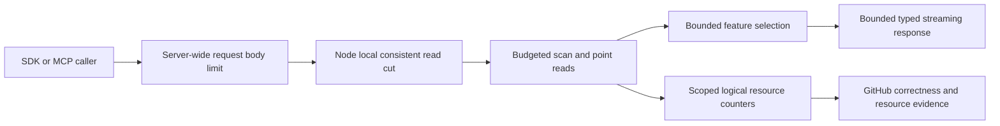
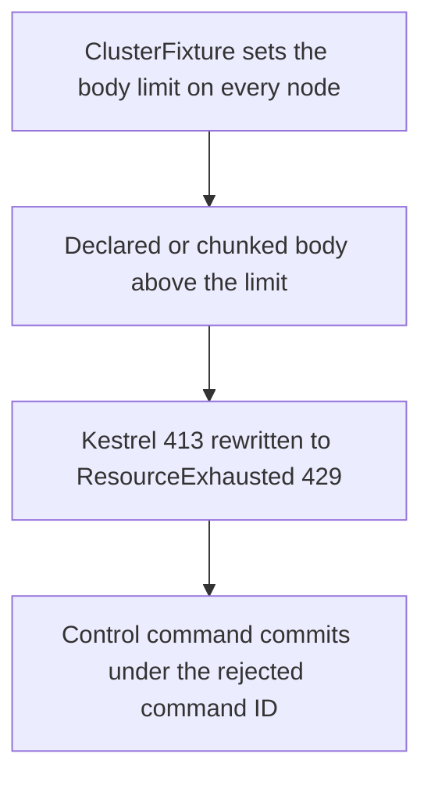

# ResourceExecution

ResourceExecution owns the per-operation execution context (cancellation,
explicit expiry), canonical resource lifetimes, the shared deduplicated
resource-lifetime ledger and joined ownership. Orleans owns cluster and activation
lifecycle; the silo-local ZoneTree owner retains files and engine handles.
[AnalyticsStore](AnalyticsStore.md) owns user analytics requirements and its
bounded derived generations. OpenTelemetry owns instrumentation.

Actual database phase diagnostics are specified in
[DatabasePhaseProfiling](ResourceExecution/DatabasePhaseProfiling.md) under
[ADR-063](../ADR/ADR-063-bounded-database-phase-profiling.md),
REQ-RESOURCE-003..006 and AC-DBPROF-001..008. The fixed BCL-only Diagnostics
schema is joined first; bank, preserving producer instrumentation, private
node capture and genuine source-bound measurements remain open. This optional
workstream changes no authorized cut, database state, WAL or acknowledgement.

The additive TimeSeries readers under
[ADR-052](../ADR/ADR-052-timeseries-bounded-aggregates.md) map REQ-MP-002/005 and
AC-MP-002/005/011/012 to AC-SERIES-011 and AC-RANGE-REV-003. One original native read
snapshot and one view read metadata/data/lookahead exactly once, enforce
deadline/cancellation and exact full JSON results, and preserve healthy
following operations after failure. Architecture choices do not establish
maximum throughput, physical I/O, process RSS or numeric coverage.

AC-MP-009/010/012 fixture flow under [ADR-035](../ADR/ADR-035-memory-performance.md):
a dedicated real-file growth observer is armed before async report writing,
retaining the corpus, 10-second deadline, quarter-output cutoff, OCE and
no-later-file assertions. One bounded second real Kestrel partial-body write
follows the cancelled client result while preserving actual RequestAborted,
incomplete response, five-second waits and same-client reuse. Product serializers,
client/SDK transports, public contracts and all budgets remain unchanged.

Status: Accepted contract; implementation and qualification in progress.
[ADR-035](../ADR/ADR-035-memory-performance.md) owns scoped read/resource/lifetime
decisions. Full requirements and test strategy: [acceptance](../ADR/ADR-035-memory-performance.md).

## Native storage ownership

ZoneTree owns its mutable segments, disk caches, version retention and cache
maintenance through `CreateMaintainer()`. KeyLoad keeps no separate point-value
cache, cache read permit or periodic engine-cache sweep. Independent transactional
operations use native MVCC snapshots and conflict detection without an application
reader/writer gate or writer semaphore. Plain tables use the native non-transactional
tree described in [NonTransactionalTables](RelationalStorage/NonTransactionalTables.md).

Fresh persisted authorization remains mandatory on every operation. Native caches
contain physical records, never a reusable authorization decision. The complete
classification, revocation, redaction, cancellation and two-reopen operation is
specified in [NativePolicyEpochQualification](ResourceExecution/NativePolicyEpochQualification.md).

REQ-CACHE-001 / AC-CACHE-001 and AC-CACHE-002 retain exact byte/entry
reservation accounting for actual derived-memory consumers, including invalid
requests, overflow, concurrent reservations and idempotent release. REQ-CACHE-002
keeps ownership charged until retained readers release their bytes. The
`CacheMemoryBudget*Tests` exercise that common budget; these requirements do not
add a cache or admission limit to native database operations.

The generic retained-memory budget remains available to derived index owners.
It does not sit between database callers and ZoneTree. Physical file ownership,
joining active borrowers before closing native handles, and joining visitors before
disposing their iterator are lifecycle obligations. They do not serialize independent
database operations. See [NativeMvcc](StorageRecovery/NativeMvcc.md).

## Memory and performance requirements

| Requirement | Acceptance | Test ownership |
|---|---|---|
| REQ-MP-001: all current operation/resource paths reviewed and evidenced defects closed | AC-MP-001 | located inventory and independent final review |
| REQ-MP-002: bounded consistent read/mutation work without redundant materialization | AC-MP-002..006 | real StoreRecovery, QueryExecution, Search, core feature tests |
| REQ-MP-003: bounded resource lifetime and crash-safe retention | AC-MP-007/008 | real node-local persistence and recovery tests |
| REQ-MP-004: bounded streaming caller/report transport | AC-MP-009/010 | ClientApi and BenchmarkComparisons real contracts |
| REQ-MP-005: honest integrated qualification and resource measurement | AC-MP-011/012 | exact-SHA GitHub full suites and resource JSON |
| REQ-MP-006: remove avoidable JSON text byte copies and cached-receive request parses | AC-MP-006/009/011/012 | public strict text/byte, Unicode/error, owned lifetime, allocation and real-store replay cases |

## ResourceExecution test traceability

These links describe the tested subflow only. They do not close a complete AC or
qualify the current delivered source.

| Existing requirement / AC | Exact source families or method identities | Observed contribution and boundary |
|---|---|---|
| REQ-MP-002 / AC-MP-004, AC-MP-005 | `AnalyticalAdmissionTests`; `BudgetedReadViewTests`; `ReadBudgetAllocationTests`; `ReadExecutionTests` | Real engine/store reservation, one operation's cancellation and expiry before reader/callback/materialization, read cancellation and healthy-follow-up subflows. Allocation assertions are scoped observations, not RSS/physical-I/O or performance qualification. |
| REQ-MP-006 / AC-MP-006; REQ-MP-002 / AC-MP-003 | `CanonicalJsonTests`; `CanonicalJsonAllocationTests`; `JsonPathTests`; `JsonTextProtocolTests`; `JsonTextAllocationTests`; `PreparedScalarTests` | Exact canonical bytes/fingerprints, pointer/scalar behavior, strict text/byte decoding, malformed-input cleanup, persisted retry and bounded allocation cases. These cover named serializer paths, not all public API transports. |
| REQ-MP-006 / AC-MP-006; REQ-MSG-001 / AC-MSG-001; REQ-MSG-003 / AC-MSG-003 | `JsonTextQueueReplayTests` and `JsonTextSubscriptionReplayTests` | Actual receive/replay preserves delivery identity, rejects changed raw request/result data, rechecks current principal or subscription generation, and rejects stale lease/token use. This is a replay/lease subset, not the full messaging API or official-client proof. |
| REQ-ROC-001..004 / AC-ROC-001..004 | `ReadOnlyCollectionContractTests`; `ReadOnlyCollectionValidationTests`; `ReadOnlyCollectionWireTests`; `CanonicalKeyContractTests`; relevant `ReadBudgetAllocationTests` typed owned-read case | Reflection/API shape, exact wire/fingerprint bytes, required collection validation and real independent owned buffers/read results. AC-ROC-005/006 caller-wide build/delivery gates remain separate. |
| REQ-RESOURCE-003/004 / AC-DBPROF-001..004 | `DatabasePhaseSchemaTests`; `DatabasePhaseBankTests`; `DatabasePhaseBankConcurrencyTests`; `DatabasePhaseArithmeticTests`; `DatabasePhaseAllocationTests` | Fixed bank shape, independent lanes, bounded arithmetic/contention/saturation, detached snapshots and configured primitive allocation. These do not prove all production phase boundaries, private capture or overhead/benefit (AC-DBPROF-005..008). |
| REQ-RESOURCE-003 / REQ-CQ-013; AC-DBPROF-002 / AC-CQ-034/035 | `DatabasePhaseExecutionOptionsTests` | Actual central options binding/validation and bank-construction ordering, including malformed/unknown/scalar settings and allowed bounds. This does not qualify enabled production startup or profiling output. |
| REQ-AISQL-003 / AC-AISQL-007 | `SqlToolDiscoveryTests.AcAiSql007SqlDiscoveryReportsDynamicEffectsAndCannotBeCalledRecursively` | The generic SQL tool is a catalog adapter with no fixed read or command kind, reports non-read-only, non-idempotent and destructive hints, and cannot be resolved as a canonical operation that SQL could call recursively. Unit evidence does not replace the official .NET/MCP cluster flow. |
| REQ-DSTORE-001/002/004; REQ-EVENT-004; REQ-MSG-005; REQ-ROUTE-004; REQ-AUTH-004/005 | `TransactionTests.DocumentEventAndQueueCommitTogetherAndCommandRetryDoesNotRepeatEffects`; `UniqueConflictRollsBackDocumentIndexEventAndEnqueue`; `ConcurrentCompareAndSwapHasOneWinner`; `SameLiteralPartitionKeyCannotCrossTransactionDomains`; `TransactionAuthorizationTests` | Preserve the existing many-to-many associations in DocumentStorage, EventStreams, Messaging, OrleansExecution and Authorization. These are actual single-partition DatabaseEngine operations with narrow effects/denial assertions; they do not prove cross-partition atomicity or cluster. `TransactionProtocolTests.MalformedMutationElementsBecomePersistedRejectionsRatherThanApplyExceptions` has per-argument candidate rows for document patch, event revision, topic, and sample negatives in the JSON sidecar; each is a narrow malformed-input persisted-rejection subflow, not its owning feature’s complete AC. The null generic mutation and oversized-frame scenario retain their separate proposals/unmapped reason. |

The following cases remain deliberately unmapped: core null-argument guards without a
current feature AC; the inbox allocation-window control without a declared numeric
AC; `ReadGateLifetimeTests.AcCq016_DisposalObservesRealGateBeforeLaterStoreUse`
(the referenced AC-CQ-016 is not currently defined); and
`ResourceProtocolFailureTests.AcRoc003*` (the body tests persisted invalid-resource
outcome/replay, while AC-ROC-003 governs owned results/dense-vector efficiency).
Do not resolve these by prefix or filename inference. The AC-RESOURCE-002 measured
operation/resource requirement, DB phase
capture and all full delivered-source qualification remain open even when their
unit subflows pass.

Common storage/resource primitives are shared building blocks. Feature behavior
stays in its canonical slice: StorageRecovery, QueryExecution, Search,
DocumentStorage, EventStreams, TimeSeries, GraphTraversal, Messaging, ChangeFeeds,
StorageReplication, OrleansExecution, ClientApi and BenchmarkComparisons. New helper
and test files use matching Features paths; flat existing paths remain ADR-032
migration debt and may be repaired without expanding that debt.

Strict public-collection prerequisites are governed by
[ADR-041](../ADR/ADR-041-read-only-public-collections.md). REQ-ROC-001..006 /
AC-ROC-001..006 map to AC-MP-002/003/004/006/012. The explicit CLR API migration
preserves JSON arrays/base64, exact fingerprints and owned buffers; all consumer
signatures and dense-vector spans must join before build/CI. New tests use this
slice; original business Feature owners retain DTO/operation ownership.
The strict converter delegates the array protocol to the official
serializer and attaches only its fresh private arrays without another full copy.
Required null/default values reject explicitly; nullable arrays and byte tombstones
keep their meaning. See ADR-041 for exact ownership and join conditions.

[ADR-145](../ADR/ADR-145-no-request-throttling.md) removes request throttling: no
node, tenant, principal or connection pool counts requests, commands or reserved
bytes. The server-wide request body limit and the per-operation data bounds this
slice owns are the only request limits; otherwise overload appears as latency.

No cache may outlive its authority/read cut without explicit invalidation. Mutable
storage arrays cannot escape through a borrowing optimization. Cancellation and
budgets must stop work before a complete excess page is allocated. Logical work,
managed allocation and process working set are different measurements; physical
I/O needs real provider/OS evidence. UI/persisted domain-data changes are N/A for
the common resource contract; any required retention/transport mutation receives
an explicit ADR implementation stage before coding.

## Canonical JSON validation and fingerprints

REQ-MP-002 maps AC-MP-006/012 to exact canonical validation and fingerprints used
by mutations, signed cursors and replay. Validation retains ordinal property order,
duplicate-name rejection, decimal `G29` normalization, escaping, object/depth/input
byte rules and the existing owned UTF-8-decoded string. Fingerprinting retains raw
number spelling and exact lowercase SHA-256 under the same JsonDefaults options.
Null fingerprints remain valid; invalid arguments fail before work.

Serialize fingerprints directly to a JsonDocument sharing its pooled serializer
buffer, then stream canonical bytes to IncrementalHash. Flush Utf8JsonWriter after
each complete value when pending bytes reach a named 64 KiB threshold; a single
large token and object-sort metadata remain separately allocated. Validation
decodes the used MemoryStream buffer without ToArray. No hard RSS limit, input
limit change, storage migration, signature or public API change is implied.

Handcrafted canonical/hash fixtures cover property order, nested arrays,
Unicode, null, duplicate names and numeric spelling; real database retries preserve
outcomes; warmed allocation growth over many modest tokens detects full-output
buffer duplication. Execution is GitHub-only; runtime/resource evidence is pending.
The JSON-pointer parse/escape algorithm lives in a matching shared helper so
JsonData stays within the type limit. Public wrappers, 1,024-character bound,
RFC 6901 decoding, missing/scalar distinction and field-patch behavior stay exact;
direct pointer/patch acceptance cases join existing real-document regressions.

## Analytical admission and JSON oracle flows

REQ-MP-002/005 and AC-MP-004/011/012 under ADR-035: a held shared read callback
does not block another reader, so only the two analytical-admission cases use a
real exclusive ZoneTree Commit callback holder with no staged changes; existing
read-lifetime tests keep their original helper. All saturation, independent-engine,
in-flight cancellation, cleanup, ten-second bounds and healthy-followup assertions
remain, and the holder is released before store disposal.

REQ-MP-006 / AC-MP-006/012 and ADR-035/041: direct System.Text.Json
byte/text/OperationResult lone-escaped-surrogate cases expect the actual
JsonException on all three paths; raw UTF-8 replacement and all strict
collection/base64 cases remain unchanged. The embedded benchmark keeps unsorted
producer input and expects ordinal canonical stored JSON under ADR-047 / AC-EM-002.
Topic quota comparisons use Int64 operands without changing exact-byte,
one-byte-short or rollback checks.

## Operations and observability

### Analytical-read accounting

REQ-MP-002/005 and AC-MP-003/004/011/012 require SQL, AST, both live-query calls
and text/vector/hybrid search to hold one counted reservation on their
DatabaseEngine for the whole read. The count never refuses or queues a read; it
lets owners and tests prove that every completed, failed or cancelled read released
its reservation. DatabaseEngine exposes an owned IDisposable reservation and an
observational current reservation count.

Acquire checks cancellation before and after counting and compensates if the second
check fails. Dispose releases exactly once. Each operation keeps the reservation
across adaptation, authorization, store gate wait, scanning/ranking and final result
validation. Existing public result, fingerprint, storage and cancellation contracts
stay unchanged.

Tests take hundreds of concurrent reservations and still run a query and a search,
hold an actual search at the real ZoneTree read gate while it is cancelled, and
prove pre-/in-flight cancellation, validation/budget errors and repeated disposal
release the count before a successful following call. Coordination timeouts detect
hangs and are not throughput measurements.

### Provider diagnostics

An internal BudgetedReadView in this slice
wraps an existing IKeyValueView only inside a committed read action, forwards
borrowed callbacks after the ReadExecutionBudget cancellation and expiry check,
binds the resource lifetimes it observes, and implements the same owned Get/Scan
contracts through borrowed work. VisitRange composes a caller observer and honors
both the operation and any method-specific cancellation token. Existing provider budgets,
ordering, lookahead, stop flags and callback non-mutation remain unchanged. This
adapter reuses persisted authorization helpers; it does not reimplement principal
or policy decisions. The shared budget's CreateView(IKeyValueView) exposes that
read-only capability under an explicit same-store-action lifetime contract; the
concrete adapter remains internal. Direct real-store adapter cases cover every method, observer
order/failure, cancellation and healthy follow-up in addition to source-read flows.

REQ-MP-005 / AC-MP-011/012 adds an immutable per-ZoneTreeStore read snapshot with
a fresh nonpersisted session ID and cumulative Int64 owned/borrowed point counts,
point examined bytes, range attempts, baseline/staged/tombstone entries, logical
limit lookaheads and range examined bytes. Counters use constant memory and atomic,
saturating increments; a saturated field stops growing and cannot prove later
deltas. Snapshots are observational and non-atomic across fields under concurrency;
only quiescent isolated real-store test windows provide exact operation deltas.

Point hits count key plus logical value bytes, misses/tombstones key bytes, before
copy/observer/decode. A transaction fallback is counted once by the owner; a staged
hit is counted once by the transaction. Scan delegates the one range attempt.
Range attempts include invalid/pre-cancel calls with zero examined work. Each
matching fetched baseline or selected staged entry is counted before cancellation,
provider cap or observer rejection, including prefetch, overwrite, tombstone and
true live result-limit lookahead. Never-fetched staged peeks and iterator keys
outside the range are not examined payloads. Existing StorageScanResult.ReadBytes
reports the bytes one storage range delivered and is distinct from these total attempted counters.

This observes logical provider operations only; iterator/cache/seek and OS
physical I/O remain unmeasured. No keys, paths, identities, payloads or credentials
are recorded. Reopen starts a new session; diagnostics do not alter durable data,
authorization, gates or wire. Public node/report telemetry is a separate contract, with canonical and replica store scopes separate.

Tests cover found/missing/staged/tombstone/failing-observer points,
range overwrite/tombstone/prefetch/lookahead/bounds, pre- and mid-cancellation,
provider budget failure and healthy subsequent reads. GitHub executes them; no
measurement claim follows from authored counters or local static validation.

Actors: the caller, the operator and the CI observer. Actual entry points: the request body limit in [ServerExecutionOptions](../../src/KeyLoad/ClientApi/Configuration/ServerExecutionOptions.cs), request lifetimes and the connection idle timeout in [GrainRoutingOptions](../../src/KeyLoad.Clustering/RequestExecution/Configuration/GrainRoutingOptions.cs), [ReadExecutionBudget](../../src/KeyLoad.Core/ResourceExecution/Execution/ReadExecution/ReadExecutionBudget.cs), [AnalyticalReadGate](../../src/KeyLoad.Core/ResourceExecution/Queries/AnalyticalReadGate.cs), [ServiceDefaults telemetry](../../src/KeyLoad.ServiceDefaults), Aspire composition; the optional queue transfer attempt policies are [DatabaseLimits](../../src/KeyLoad.Abstractions/ResourceExecution/Contracts/DatabaseLimits.cs). Public UI is N/A; benchmark views belong to BenchmarkComparisons.

| Requirement | Acceptance / flows | Test mapping |
|---|---|---|
| REQ-RESOURCE-001: requests are limited only by the server-wide request body limit, caller-supplied operation bounds, explicit expiries and the physical storage ceilings; no node, tenant, principal or connection pool throttles callers and no configured operation limit refuses work ([ADR-145](../ADR/ADR-145-no-request-throttling.md), [ADR-149](../ADR/ADR-149-no-operation-limits.md)) | AC-RESOURCE-001: a declared or chunked body above `KeyLoad:ServerExecution:MaximumBodyBytes` returns `ResourceExhausted` (HTTP 429) before the command claims its ID, and a control command then commits under that same ID; a second command on one connection succeeds while the first is held; caller-supplied operation bounds reject excess work with their typed errors and a following operation succeeds | [RequestBodyLimitClusterTests](../../tests/KeyLoad.ClusterTests/ResourceExecution/Cases/RequestBodyLimitClusterTests.cs) `OversizedDeclaredAndChunkedBodiesAreRejectedBeforeCommandsClaimTheirIds`; `ConnectionFailureTests.AcCrs053ConnectionRunsAnotherOperationWhileTheFirstIsHeld`; the per-operation bound cases in the traceability table above; real cluster mixed-load expansion PLANNED |
| REQ-RESOURCE-002: operations/telemetry show the actual guarantees and bounded work without secrets | AC-RESOURCE-002: every advertised operation family has an exact workload, topology, read/acknowledgement semantics, an explicit numeric resource/latency/throughput budget and a measured result; bounded low-cardinality counters/timings cover Orleans hops, configured-copy apply wait and logical reads/bytes/scans where applicable; no PII, keys, tokens or request IDs appear; logical bytes, managed allocations/GC, client working set and per-node CPU/RAM have separate names and provenance; unknown measurements are reported unavailable, not zero | Source counters alone do not pass. TUnit proves metric names/labels/privacy and configured thresholds; real Docker/Aspire cluster profiles exercise successful, overloaded, bound-rejected, cancelled and slow-consumer/backpressure cases through the .NET SDK and official MCP client. Repeated exact-SHA baseline/candidate JSON must use identical workload, topology and acknowledgement/read guarantees; thresholds are derived from that evidence under AC-MP-011. |

Decisions: [ADR-010](../ADR/ADR-010-query-budgets-security.md), [ADR-028 scheduling time](../ADR/ADR-028-persisted-scheduling-time.md), [ADR-031 modular deployment](../ADR/ADR-031-modular-all-in-one-resource-isolation.md), ADR-035, [ADR-145 no request throttling](../ADR/ADR-145-no-request-throttling.md), [ADR-149 no operation limits](../ADR/ADR-149-no-operation-limits.md). TimeProvider.System remains the host/Orleans clock; an operation clock does not freeze the cluster runtime. Mixed query/search/graph/event/queue workloads need real correctness and liveness tests, not separate synthetic doubles.

Business work and the matching tests stay in the owning `<SliceName>/` slice. Configuration validation, invalid bounds, zero/empty work, overflow, cancellation/deadline and a healthy follow-up are part of the AC. A local document review proves no numeric coverage, memory ceiling or performance gain; metrics are published only from successful GitHub JSON.

## Query output and live query pages

There is no query, search or read result-byte ceiling and no query execution option that configures one ([ADR-149](../ADR/ADR-149-no-operation-limits.md)). `ReadExecutionBudget` carries only cancellation, the explicit expiry and resource-lifetime bindings; scalar, InnerJoin, model and explain SQL, live-query snapshots and deltas, partition query leaves and merge, and text, vector, hybrid and graph search results are bounded by their own `Limit` and the data they read. SQL graph search shares one operation with the graph search it calls; its composition is in [QueryExecution](QueryExecution.md).

A live-query page is bounded by its `Limit` only. `LiveQueryResultCompositionTests.HiddenOutboxPagesResumeFromTheOriginalCursorWithLiteralPages` reads through outbox entries of a hidden collection one page at a time: each page advances the cursor without returning hidden rows, the visible change arrives exactly once and replays from its cursor, and the raw store image, position and identity stay unchanged.

### Database phase bank invalid-construction flow

REQ-RESOURCE-003/004 and AC-DBPROF-002 map `DatabasePhaseExecutionOptionsTests.StandaloneBclBoundaryRejectsBeforeEnabledOrDisabledCounterReservation` to actual BCL invalid stripe/CAS rejection with exact ArgumentOutOfRangeException.ParamName in BOTH enabled and disabled modes. Each measured rejected construction independently remains below the unchanged MinimumStripeCounterBytes counter-array lower bound. Runtime exception allocation need not be identical between modes. Preserve every existing invalid-input case. No threshold growth, added prewarming, retry, skip or product/configuration change is permitted.

After both real rejected constructions, centrally bound valid disabled/enabled banks execute Begin/End and RecordBusy and capture concrete counters: disabled remains empty/unavailable; enabled records exactly one completed scope and one admission rejection in the actual phase, with unchanged quality and detached cumulative capture. This is the invalid-to-healthy bank subflow only, not production startup, cluster, measured overhead or full AC qualification. ADR-063/113 retain the original ownership and fixed bounds.

## Owner shutdown and command outcome

REQ-RESOURCE-TENANT-SHUTDOWN-001 / AC-RESOURCE-TENANT-SHUTDOWN-001 requires the
silo-local request-work owner to cancel selected work on shutdown, refuse new
work, and join every acquired lease before the same storage root is reopened. A
command refused during shutdown leaves no effect; the same command can then
commit and replay with an unchanged outcome. Orleans owns activation scheduling
and request execution.

`TenantShutdownWholeFlowTests.OwnerShutdownCancelsSelectedWorkThenOriginalCommandReplayAndSameRootColdPreserveOutcome`
uses a real persisted principal and an actual tenant partition. It holds one
command lease in a `RequestWorkOwner` and starts the owner drain. Shutdown
cancels the selected work: submitting the original command under that cancelled
token throws the original `OperationCanceledException`, and a new acquisition
fails with `OwnershipLost`. Both failures preserve the raw canonical image and
the applied/store positions and leave the document absent. The drain completes
only after the held lease is disposed, and the owner then reports joined.

The original command then commits under a fresh token. The receipt oracle
independently checks every mutation field: Kind/Resource/Id/Revision and complete
CompositionReferences. Document results and canonical records retain their
complete Reference/Revision/Json, redaction and access fields, command timestamp
and deletion state. The exact commit token, durability and persisted copy count
are checked against the owning execution store. The stored prepared command
retains its stable ID, subject, input bytes and fingerprint. Same-ID replay
preserves the original full receipt and canonical image without advancing the
physical position. Failures retain their original problem before any
result-value assertion.

The same case then calls `TestDatabase.JoinOwnedResources` and opens a new store
at the original path. The complete original receipt, the literal document and
immutable replay survive that close/reopen, and a fresh command commits a healthy
literal document. No public contract, deadline or persisted format is changed by
this ownership contract.

The source maps these oracles to `TenantShutdownWholeFlow`,
`TenantAdmissionOperations`, `TenantAdmissionAssertions` and
`TenantAdmissionCold`. An actual run is required to qualify them. Sustained
SDK/MCP overload, Orleans request shutdown under in-flight distributed work,
physical CPU/RSS/disk liveness and delivered-source qualification remain open;
this focused local operation alone establishes none of those gates.

## Original analytical admission healthy T-SQL continuation

REQ-MP-002/005 and AC-MP-004/011/012, with REQ/AC-TSQL-001/002/006, require the existing AcMp004_RealStoreWaitSharesOneAdmissionAcrossAllAnalyticalEntries healthy SQL continuation to use selected T-SQL: SELECT TOP (1) * FROM orders. The original malformed SQL used during saturation remains unchanged, so admission still refuses before parsing/storage while the actual held search owns the reservation. All six saturated entries, complete read diagnostics, independent database, original gate release and worker joins, zero final reservations, empty healthy result and ten-second coordination limit remain unchanged. LIMIT is retired syntax, so the healthy query uses T-SQL TOP; this is a fixture language choice, not an admission or parser workaround. Original test declaration and arguments remain.

## Server request body limit

AC-RESOURCE-001 covers the one server-wide request body limit. Kestrel applies
`KeyLoad:ServerExecution:MaximumBodyBytes` (default and maximum 33,554,432 bytes)
to every public route, including MCP; no route has a separate body cap. A
declared `Content-Length` above the limit and a chunked body that grows past it
are rejected while the body is read, and the identity middleware rewrites the
Kestrel 413 into a `ResourceExhausted` problem (HTTP 429). An MCP POST whose
declared length exceeds the limit is rejected before the body is read.

`RequestBodyLimitClusterTests.OversizedDeclaredAndChunkedBodiesAreRejectedBeforeCommandsClaimTheirIds`
starts a real Aspire cluster through `ClusterFixture(maximumBodyBytes: 1024)`,
which sets `KeyLoad__ServerExecution__MaximumBodyBytes` on every node. For a
declared and then a chunked delivery body above that limit, the node returns HTTP
429 with `ResourceExhausted`, and a body-free `/admin/dispatch` control command
then commits under the rejected command ID, so the rejected request claimed no
command identity.

