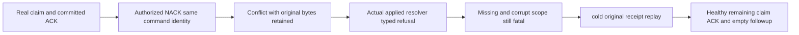

# Applied outcome definitive refusals

REQ-MSG-001 / AC-MSG-001 and REQ-MSG-007 / AC-MSG-007 under ADR-002/003/026 preserve canonical committed outcome identity and truthful public ACK replay. ResourceExecution owns the same applied-outcome resolver consumed by the actual write-apply path. No public/persisted format, alias, scope, storage, cluster acknowledgement, provider, dependency or budget changes are introduced.

The current resolver checked stored command identity outside its narrow definitive-refusal catch. A changed authorized ACK-to-NACK payload under the original ID therefore threw Conflict after real append/apply; the write path's begun-write boundary converted that exception to UnknownWriteOutcome. Move only ValidateStoredSubmissionIdentity into the existing closed nonfatal refusal catch so definitive Conflict and TokenInvalidated return their actual typed refusal. Outcome selection and missing-outcome RecoveryRequired stay outside. Fatal Corruption and unsupported/recovery failures remain fail-closed. PersistCommandOutcome already refuses overwriting existing bytes; this repair does not claim or fix an outcome overwrite.

The existing cluster response-loss case changes its altered action from Renew to Nack: its persisted subject has QueueConsume/QueueAck, while Renew requires QueueRenew. Both actual SDK/MCP changed-content Conflict calls keep their independent complete queue images, original receipt replay, cancellation settlement, fresh persisted revocation/restoration and healthy continuation. This fixture correction is coupled with the owning source repair, never presented as the product fix.

AppliedOutcomeDefinitiveRefusalTests uses a genuine ZoneTree store and generated operations with a persisted non-admin QueueConsume/QueueAck principal. It seeds two messages, claims and commits original ACK, applies authorized changed NACK under the same ID, then requires local apply and the actual write-path resolver to return closed Conflict while complete queue/outcome/store bytes and original receipt remain unchanged. Actual scoped stored-incarnation corruption returns TokenInvalidated; foreign partition scope remains fatal Corruption; an actually never-submitted operation remains fatal RecoveryRequired. Exact original row repair, cold reopen, original result and full state replay, real healthy remaining-message claim/ACK and empty continuation complete the flow. Original and healthy ACK receipts are independently literal including CommandId, actual preapply partition/incarnation and checked next store position, mutation and ProcessDurable. Complete literal two-message metadata/body, counters and ready/lease/scheduled references are checked before and after both cold opens; cancellation is checked at owned stage boundaries. Existing blob resolver cases retain their complete operations and are updated only for the now definitive typed identity refusals; their missing/scope-corruption guards still throw.

compilation, focused Unit cases, actual SDK/MCP replicated-cluster transport evidence and full Linux qualification remain required. The local internal seam is the actual owning method, without reflection, synthetic exception translation, fake transport or a new dispatcher.

