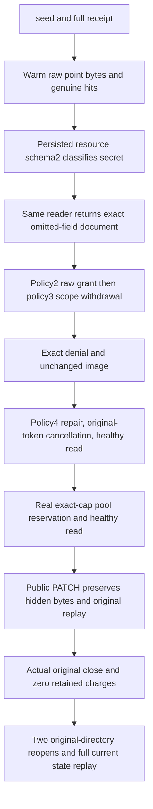

# Warm cache bytes and current policy epochs

This operation maps [ResourceExecution](../ResourceExecution.md) REQ-CACHE-001/002/005 and AC-CACHE-001/002/003/005/008 to one actual embedded ZoneTree/DatabaseEngine operation. Applicable decisions are [ADR-058](../../ADR/ADR-058-orleans-coordinated-cache-memory.md), [ADR-022](../../ADR/ADR-022-policy-epoch-revocation.md) and [ADR-117](../../ADR/ADR-117-tunit-ci-entry.md). No production defect is selected; this fills the gap between existing raw-key cache coherence cases, credential-expiry/revocation cases, and authorization cases whose store has no embedded cache.

REQ/AC-CACHE-POLICY-001: seed an actual collection, persisted scoped reader and literal full document through ApplyEmbedded. Validate the complete independent process-durable receipt, retain the untouched stored outcome, and execute repeated real GetDocument calls with genuine positive cache hit deltas. The initial unclassified resource returns the literal full document. A real policy-only resource CAS from schema1 to2 classifies /secret; the SAME reader must then receive the exact omitted-field document, Redacted=true and the exact path. Raw positive cached document bytes are not a cached authorized object.

REQ/AC-CACHE-POLICY-002: persisted reader policyepoch2 gains the raw-read field grant and returns the full original document. Epoch3 removes scope grants and must return the exact current PermissionDenied without altering any records or position. Epoch4 restores the original scope plus existing field grant; original-token pre-cancellation must retain OperationCanceledException token identity without effects, and a subsequent genuine read succeeds. A root public-field PATCH then returns a complete independent revision2 receipt and preserves the hidden canary byte-for-byte in the literal canonical document. Original seed and PATCH command IDs replay their original complete receipts without changing original outcome bytes, records or position.

REQ/AC-CACHE-POLICY-003: the actual embedded helper uses one validated modeled pool. A genuine additional zero-entry reservation occupies the exact remaining byte capacity; one extra byte refuses without snapshot mutation while the original charge stays owned during successful authorized reads. The original reservation is disposed once with body and disposal failures separately retained. cache pins/fills are settled after each operation, configured byte/entry ceilings remain bounded, and each original store close returns ALL pool charges before a new original-directory open. This observes modeled retained bytes, not allocation, RSS, physical I/O or throughput. It does not duplicate callback-held pin lifetime or read-cut budget cases.

REQ/AC-CACHE-POLICY-004: perform TWO genuine close/reopen transitions on the original directory only after the original owner actually releases. Preserve all nine StoreIdentity fields (allow only the documented nondecreasing read generation), copied original signing bytes, complete record inventory and position. Capture the fresh cache diagnostic immediately after open, before engine catalog reads, to prove zero initial hits. Fresh engines read the persisted physical owner, current schema2/policy4, literal revision2 document and original receipts/outcomes; pre-cancellation then healthy continuation and replay remain exact. No live file reads, reserialized golden or provider substitution is used.

Actual method: `CachePolicyEpochTests.WarmBytesRespectResourceClassificationAndCurrentPolicyRepairUnderBoundedAdmissionThenTwoReopens`. `CachePolicyEpochProvision` owns literal seed and healthy mutation, `CachePolicyEpochWarm` owns persisted resource/principal phases and real pool pressure, assertions own complete current/refusal/replay oracles, and `CachePolicyEpochCold` owns original-directory transitions. New feature-local fixture ownership registers each real StorageOwnerSettlement before OpenOwned. Unknown acquisition or original close blocks later open/delete; every actual store Dispose is attempted at most once. The outer lexical owner collects original body plus independent cleanup errors and retains failed evidence. The shared pool closes independently; no shared fixture is modified or borrowed owner disposed.

Compiler/analyzers/style, declaration/profile admission, original actual execution and exact-source Linux remain OPEN. Embedded opt-in does not enable caches on a replicated cluster or prove result-cache admission. SDK/official MCP, replicated-cluster current authorization, cross-node cache enablement and restart/activation movement, measured benefit, endurance/power-loss and complete cache acceptance remain separate required gates. No HTTP/API/provider/format/configuration toggle, operational deadline, governor or performance claim is introduced; UI and deployment are N/A.
