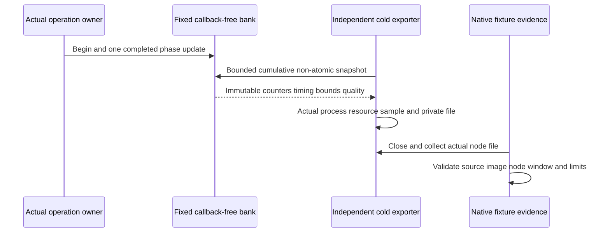

# DatabasePhaseProfiling within ResourceExecution

Status: Accepted contract; implementation and native measurements pending.
Decision [ADR-063](../../ADR/ADR-063-bounded-database-phase-profiling.md).
Requirements and acceptance: this Feature and the ADR-063 implementation contract.
REQ-RESOURCE-003 actual preserved phase ownership → AC-DBPROF-001/003.
REQ-RESOURCE-004 bounded callback-free bank → AC-DBPROF-002/004.
REQ-RESOURCE-005 private honest node capture → AC-DBPROF-005/007.
REQ-RESOURCE-006 correctness/measured overhead → AC-DBPROF-006/008.
Existing REQ-RESOURCE-002 and REQ-MP-005 require actual native evidence.

REQ-CQ-013 / AC-CQ-034/035/038 map to this
primitive's operational reservation and retry policy. ADR-113 freezes native
DatabasePhaseExecutionOptions registration, pre-ownership validation and explicit
BCL scalar projection: disabled mode by default, stripes1/2/4 (default4), attempts
1..4 (default4), no primitive fallback. DatabasePhase* TUnit cases cover nondefault
native binding, invalid admission, actual bounded allocation, concurrency and
unchanged snapshots. Fixed bank dimensions, metadata and128KiB remain upper guarantees;
enabled-startup/overhead/export/cluster qualification remains separately pending.

## Canonical slice map and actors

Diagnostics owns BCL bank/schema/arithmetic at `Features/ResourceExecution/`;
Server owns private exporter/startup composition in the same slice. Existing
feature owners retain their actual source boundaries; no business behavior moves
into Diagnostics. Unit/Integration tests use ResourceExecution; frontend N/A
because this stage has no public UI or endpoint. SDK/MCP contracts are unchanged,
tested through the actual replicated cluster.

## Closed phase inventory

A replicated write is ordinary Orleans calls to the ZoneTree owners on ReplicaCount silos with acknowledgement from every configured copy after durable local apply; its profiling boundaries are not part of this inventory yet.

|ID/name|Actual timing boundary; preservation|
|---|---|
|00 PublicAuthenticationDispatch|CredentialResolver actual node ExecuteRead await; exclude next middleware.|
|01 PublicOperationDispatch|CanonicalOperationGateway actual node Execute await.|
|04 AuthorizedReadCapability|Verified grain capability call/result; excludes encoding.|
|23 CanonicalApplyWait|Original materializer watermark wait; not CPU or gate wait.|
|24 CanonicalApplyGateWait|Existing actual worker/checkpoint/snapshot/install gate wait.|
|25 CanonicalApplyGateHold|Successful corresponding acquire through actual release; maintenance included.|
|26 CanonicalApplyBatch|Actual scheduling batch, including per-entry commits; not group commit.|
|27 ProviderReadGateWait|Actual Store.Read EnterReadLock to acquire/failure.|
|28 ProviderWriteGateWait|Actual Store.Commit EnterWriteLock to acquire/failure.|
|29 ProviderWriteGateHold|Commit acquire through original ExitWriteLock; no-change calls included.|
|30 AtomicJournalWriteFlush|Existing header/payload writes through Flush(true), inside original poison try.|
|31 NativeTreeMutation|Actual Runtime.Apply cache/value/native Sync-WAL/tree work; not isolated native fsync.|

## Acceptance, methodology and evidence

Branch-local outcome precedence is frozen in ADR-063. CallerCancelled records
an observed OCE with the actual phase-local input token cancelled; that token
may already be linked and does not prove an external SDK cancellation. No error
code, timing guess or transported origin substitutes for observed provenance.

All pass/fail conditions and criterion-to-test matrix are frozen in working
acceptance; ordered roles/paths/stages are in ADR-063. Literal primitive tests
cover fixed dimensions/boundaries, invalid/overflow inputs, successful/disabled
records, real concurrency/monotonicity, sticky quality and actual allocations.
The production-owned pure AddSaturating helper covers exact/overflow snapshot
math; source review verifies every real Capture merge applies its overflow
marker as sticky quality. Tests do not mutate live counters to force overflow.
Production joins receive independent exact-source review plus genuine SDK/MCP
replicated-cluster authorization/minority/cancellation, original-task and process-recovery gates.
Private capture tests reject missing/partial/wrong-node/source/image/window,
oversize/default schema and degraded profiles instead of fabricating numbers.

The primitive bank, arithmetic and immutable process-mode facade are
implemented in source with acceptance-derived TUnit cases. Default mode remains
off. Direct enabled counter, private capture, trusted process-mode startup and
actual replicated-cluster profile qualification remain open; source and build
checks establish no actual phase counts, allocations or performance.

Runtime/allocations/performance qualification is GitHub TUnit/MTP only. Full
build/formatter/analyzers/governance, normal/scalar/recovery/cluster must pass
without skips. Development checks, authored fixtures and fixed budgets are
source evidence only. Numeric coverage collection remains unconfigured.
Periodic node snapshots and resources bracket client windows; phases overlap
and can end after the initiating quorum. No summing/subtracting phases into
exclusive request latency or attributing whole-process CPU to one operation.
Repeated exact-source disabled/enabled workloads measure overhead; their numeric
budget requires actual baseline. Complete cohort/site, multi-host scale, fault/
endurance and power-loss remain independent open requirements.
