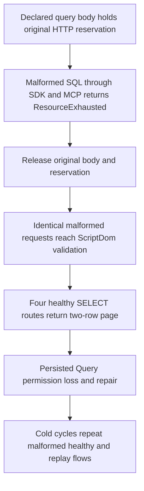

# Early SQL admission through real cluster callers

ResourceExecution. REQ/AC-ADM-001, REQ-MP-002/AC-MP-004/005 and REQ-AISQL-003/AC-AISQL-007.

A real declared query body writes its first byte and holds the original HTTP reservation. Exact server node and verified-scope counts plus declared-body/working reservation witness the hold. Malformed native T-SQL through SDK Query, SDK unified SQL and both official MCP operations must return ResourceExhausted; official operation dispatch has not occurred. Lightweight known-document/outbox reads and a native control command remain available. Join the original body, native result and reservation release before cleanup.

After release the identical malformed requests reach the native ScriptDom Validation. The ordinary query is dispatched before parsing; unified SQL is compiled before operation dispatch. This distinction is asserted rather than flattened. Four healthy SELECT routes return the complete independent two-row page. The same live persisted identity loses Query, fails every valid route and repairs. Original complete receipt replays are independently bracketed by full model/outbox conservation. Two actual Aspire cluster cold cycles repeat malformed/healthy/replay flows.

Held-phase checks inspect both public document wrappers and original outbox via both callers; exhaustive query inventory is checked after release because the data query lane is deliberately saturated. No physical canonical-byte or blanket activation-absence claim follows. Authentication itself can route through its existing server-owned connection. The public dispatch witness concerns the selected database operation.

Frontend N/A: qualification-only stage. Product/API/persistence changes N/A. Runtime/default two-minute phase fit, compiler/style, Linux qualification, cancellation stopping native work, RSS/fairness/deadline remain OPEN. No new profile, network code, library, fake provider or performance claim.

