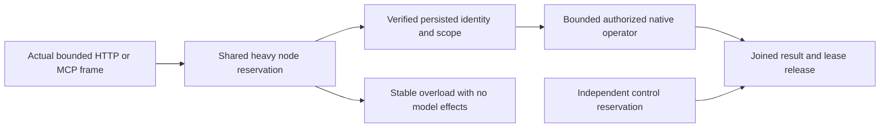

# Canonical heavy-read route admission

REQ/AC-RES early-admission criteria require shared node/tenant/principal capacity before typed request decoding and database work, bounded retained reservations, stable overload refusal and an independent control lane. The existing governor and its chunk/rollup rules remain unchanged.

SearchApi graph-scoped search and native ANN plus GraphApi shortest-path/incoming reads used the smaller Other reservation because HttpAdmissionGovernor matched only the original exact search and traverse paths. This allowed equivalent typed SDK and official MCP operations to bypass the shared heavy-read reservation used by their query counterparts. The fix adds exactly four canonical routes. The public AnnSearchProtocol.Route is reused without a Server dependency. Other three server-local route constants are kept domain-named in Core; no broad prefix, new limit, default, pool, provider, output permission or storage format is introduced.

The reservation is conservative model accounting, not an observed allocation, RSS bound or performance measurement. Existing command/read budgets still constrain actual work. Whole early-admission qualification also retains body/depth, cancellation, fairness, deadline and Linux resource/endurance gates.

Four native operation arguments preserve the original complete admission class and add exact route refusal under a held query lease, unchanged reservation snapshots, independent control capacity, release, server credential verification/current persisted principal binding, protected native shortest-path refusal and persisted use-grant repair/withdrawal/repair, full literal healthy path, original full native receipt/outcome replay and two same-owner cold opens. This native operation checks each reservation category around one independently authored path operator; public tests separately bind each route to its actual operator. Native seed/replayed mutation CompositionReferences are independently empty. Native full store image/cut/identity conservation runs after primary assertion failure too.

The new real Aspire cluster case composes existing validated HTTP limits with enabled existing ANN capability. It provisions actual native ANN over three canonical vectors/documents plus a two-edge graph, authentic persisted reader credentials, and an original independently authored full public mutation receipt bound to the real partition and positive acknowledged position. A real HTTP content producer writes one byte of a valid declared request body, then waits; the test waits for actual server node and verified-scope admission counts plus the exact owned declaration/working reservation delta against a settled native baseline, not a client-side counter or elapsed sleep. While that request owns heavy capacity, all four actual SDK operations and official MCP tools must refuse ResourceExhausted before data-operation dispatch. A real independent control command succeeds. The producer always releases and the actual response task joins before caller disposal, then full independently authored path/incoming/search/ANN results succeed. Warm persisted capability withdrawal and repair use the same real authenticated sessions. Original receipt replay and full canonical document/outbox checks remain around calls. Two existing Aspire-owned cluster cold cycles reconnect clients; both attempts are retained before aggregate failure. Public cuts are authentic opaque witnesses with acknowledged lower bounds, never predicted physical positions. Public JSON has four mutation fields; the hidden native fifth field is proven only in native Unit/store flow.

No compiler, runtime, Linux qualification, native-wire compatibility or speed claim follows from this contract. All original suites and fault/resource gates remain required.

