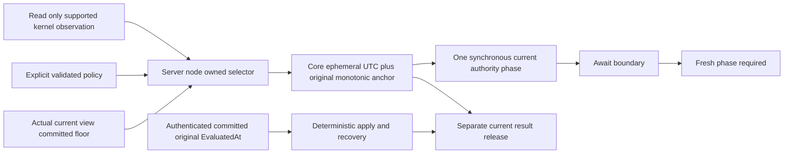

# Kernel clock phase admission — KL092 contract stage

Status: implementation contract accepted in [ADR-133](../../ADR/ADR-133-node-owned-kernel-clock-phase.md); owning IO policy joined. Native interop and runtime binding are not implemented by this documentation stage. Complete provider/binding/current caller integration and actual Linux ABI/physical/scheduler/RF3 qualification remain OPEN. The independent EventVector logged/current stage is not a kernel provider or Ready proof.

## Decision and existing architecture mapping

This contract implements architecture-v0.3 logged deterministic time, current persisted authorization and node-local ownership. It maps [TimeProvider REQ-TIME-001/002/003 and AC-TIME-001/002/003](TimeProvider.md), [ClusterReplication REQ-REP-001 / AC-REP-001](../ClusterReplication.md), [Messaging REQ-MSG-004 / AC-MSG-004 / AC-MSG-092-DEADLINE](../Messaging.md), ADR-028/ADR-110 scheduling, ADR-115 TimeProvider and current ADR-125 connection ownership. ADR-133 freezes the additional read-only kernel observation and phase contract.

Choose a narrowly read-only supported Linux kernel observation as CONDITIONAL host clock-health evidence. No chrony42 candidate code, package/tool install, external process/daemon, NTP modification, new unsafe project or automatic Ready is admitted. A configured NTP service is not synchronization proof; kernel self-report is not an independent physical accuracy guarantee.

## Requirements

- REQ-KERNEL-PHASE-001: IO ResourceExecution/Interop owns only typed bounded native observation. Require verified little-endian LP64 Linux x64/arm64 GNU libc; missing/musl/unverified ABI refuses. Actual runtime ABI probing is mandatory. Source-derived size/offsets do not replace a matching executed Linux probe.
- REQ-KERNEL-PHASE-002: native input modes is private zero and cannot be caller-supplied. Only documented libc observation executes. Require conservative acceptable state/status, nonnegative configured maximum/estimated errors, bounded actual monotonic acquisition age and checked units/conversions. The actual System clock must match the phase owner. Compare the single original System UTC sample against observed kernel timeval within checked measured acquisition age plus reported error and declared subsecond quantum; a detected clock step refuses. This remains conditional self-reported health, not independent physical accuracy.
- REQ-KERNEL-PHASE-003: Core owns an internal nonserialized invocation phase containing accepted UTC, same original TimeProvider and conservative monotonic anchor. No request JSON, trusted roles, RequestContext/AsyncLocal, wire/serializer changes or public arbitrary-time overload. Missing binding/invalid health refuses fresh current admission.
- REQ-KERNEL-PHASE-004: Server binds the real selector once in PartitionDatabaseComposition.Open before exposure/coordinator/silo readiness. Server already references IO and has friend access; no Core/Clustering dependency cycle or143-constructor rewrite. Explicit validated server policy has no implicit healthy defaults. Missing policy/binding is unavailable.
- REQ-KERNEL-PHASE-005: derive the committed clock floor from the current actual owning store view. Never recursively open another Store.Read during commit or substitute a caller/cached floor. Enqueue, final term-locked append, post-await result release and later reads are distinct phases. Trusted original committed Apply/recovery uses original logged EvaluatedAt without physical selection.
- REQ-KERNEL-PHASE-006: ReadExecutionLifetime retains the original provider/start/bound. Phase constrain checks cancellation/stage/deadline first, same clock by ReferenceEquals, then ages the original anchor. ONE measured timestamp supplies BOTH phase age and elapsed since original read start, preventing a tiny second-sample extension. Intersect the original bound; never renew/reset/change limits. A new invocation is a separate budget.

## Native contract evidence and units

Primary pinned sources: [Linux6.12 timex UAPI](https://raw.githubusercontent.com/torvalds/linux/v6.12/include/uapi/linux/timex.h), [glibc2.40 timex](https://raw.githubusercontent.com/bminor/glibc/glibc-2.40/sysdeps/unix/sysv/linux/bits/timex.h), [glibc adjtimex declaration](https://raw.githubusercontent.com/bminor/glibc/glibc-2.40/sysdeps/unix/sysv/linux/sys/timex.h) and [Linux ntp state implementation](https://raw.githubusercontent.com/torvalds/linux/v6.12/kernel/time/ntp.c).

LP64 derived layout is208 bytes, with maxerror24/esterror32/status40/timeval72+80/tai160. The GNU public signature takes an in/out timex pointer. Reject nonzero return state, unsynchronized/hardware-error or pending-leap status conservatively; reject out-of-bound/negative errors and excessive observation age. Maxerror/esterror remain microseconds. Timeval subsecond interpretation follows STA_NANO; validate its range before checked conversion. Unavailable symbol/native errno/unsupported architecture is a typed unavailable observation, never a success. No native invocation or actual layout probe is claimed here.

Declared libc support must be proven against the actual loaded runtime, not guessed from a Linux name or a source header. The exact Root-reviewed GNU verification seam uses private `gnu_get_libc_version` and a named maximum32-byte NUL-bounded read of its static return bytes, with null/missing symbol/missing terminator/unsupported version shape unavailable. This identifies the actual reported runtime version; it does not replace a matching executed Linux ABI probe or silently admit musl/compatibility stubs. Primary declaration and implementation: [GNU libc version API](https://raw.githubusercontent.com/bminor/glibc/glibc-2.40/include/gnu/libc-version.h), [GNU libc static version return](https://raw.githubusercontent.com/bminor/glibc/glibc-2.40/csu/version.c). The pure health classifier's synthetic inputs are arithmetic tests, not physical evidence.

## Acceptance and evidence boundaries

| Acceptance | Required complete operation |
|---|---|
| AC-KERNEL-PHASE-001 | Real Linux observation+ABI/source/image/policy identity; real health/refusal/recovery where available; bounded independently labelled pure status/unit/overflow controls |
| AC-KERNEL-PHASE-002 | Before-append health refusal preserves exact journal/ClockBytes/outcome/locator/full model image; same GUID executes after legitimate current recovery; no persisted fake failure |
| AC-KERNEL-PHASE-003 | Actual committed original entry applies/replays under present unavailable health; later current caller release separately refuses, preserving original receipt and unknown-write boundary |
| AC-KERNEL-PHASE-004 | Expired/revoked current credentials, capabilities, creator and leases remain denied after health recovery; repair uses real persisted grants; current results never borrow original log time |
| AC-KERNEL-PHASE-005 | Actual read/model operations prove real elapsed expiry, no deadline renewal, exact cancellation token, whole image/identity/receipt conservation, legitimate fresh read/replay and both same-root cold opens |
| AC-KERNEL-PHASE-006 | Actual elected scheduler and signed SDK/official MCP operations, leadership/restart/lease races, all after-await fresh phases, two owned cold cycles and original Linux RF3/lateness/resource gates |

No documentation/source preview/compiler/local result establishes physical accuracy, power-loss safety, benchmark speed or production readiness. All missing native observations, counts/UIDs, ABI executions and Linux/RF3 runs stay explicit UNKNOWN/OPEN. Root owns combined099/100 integration, source adoption, SDK checks, status and Git.
