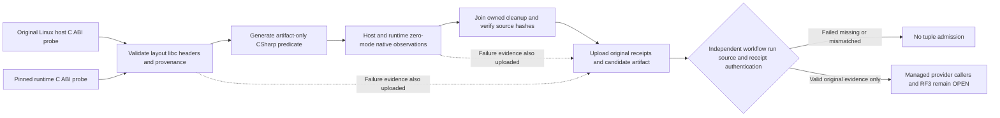

# Native clock prerequisite producer

This isolated manual-input Linux job in Build and Tests is the first bounded intake for KL092. It joins four exact scripts from selected127, a native C verification entry, bounded original-evidence driver and document, plus one guarded input/job delta in the existing workflow. It does not adopt the runtime observer/provider, C# contracts, callers, configuration or node binding. The new boolean workflow_dispatch input `native_clock_prerequisites` defaults to false. Its job runs only for an explicit own-main manual dispatch with the input enabled. Every pre-existing job, condition and needs edge stays byte-exact; dispatch with the existing `task=all` to retain the full original mandatory cohort. Benchmarks, Website and Release are untouched, and the repository retains its four workflows.

The original host and pinned runtime C probe must execute successfully before generation. The generator validates exact layout, loaded GNU libc file identity, unchanged library bytes/version, matching dev-header package, source/binary/compiler/image and original run identities. It writes the current predicate only in that job's source directory and uploads it as an artifact. No C# file from that artifact is committed or compiled during this prerequisite job.

After genuine ABI validation, a separate fixed C program performs one `adjtimex` observation with all-zero input/modes. It checks its actual layout before calling, emits bounded original native fields, and never exposes a setting mode or caller-provided library path. The host runs under the original runner identity. The pinned runtime image runs as its actual APP_UID with all capabilities dropped, read-only root, no network and no privilege escalation. A bounded executable tmpfs holds only the compiled verifier. No added clock capability, seccomp relaxation, retry or healthy fallback is allowed. If default container restrictions refuse the read, that is a real failing compatibility gate.

The C observation checks TIME_OK, UNSYNC/leap/hardware status, 100 ms maximum/estimated error and 25 ms acquisition tolerances. These are engineering refusal bounds, not measured accuracy. Acquisition timing in the C program does not prove the managed observer's later observation-age check. The host and container share the runner kernel; these are two executed ABI environments, not independent physical clocks or RF3 evidence.

Every command, native output, source/binary identity and owned cleanup failure is retained. The native prerequisite job succeeds only after original probes, generation, both native observations and owned cleanup succeed. Upload runs after failure as well and never turns a failed command into success. Root authenticates the actual Build and Tests workflow/native job/run/attempt/SHA/artifact before accepting any tuple.

| Requirement | Actual completion gate |
|---|---|
| REQ-CLOCK-PRODUCER-001 | Both independently executed C layout probes and their exact library/header/source/binary/compiler/image receipts validate before generation. |
| REQ-CLOCK-PRODUCER-002 | One original C read-only observation per host/runtime environment meets the explicit tolerances, without added privilege or fallback. |
| REQ-CLOCK-PRODUCER-003 | Source hashes remain unchanged, every owned resource joins, and actual job/run/attempt/SHA/artifact identities are independently inspected. |

A successful prerequisite proves only the executed native ABI and C compatibility observations. Managed provider execution, current-budget/expiry integration, actual native operation fixtures, recovery and SDK/official MCP RF3 remain OPEN. Root must independently review the receipts, preserve the two exact admitted tuples and compose the selected127 runtime intake before closing foundation admission. Broader KL092 and all prior task failures/acceptance remain retained.

