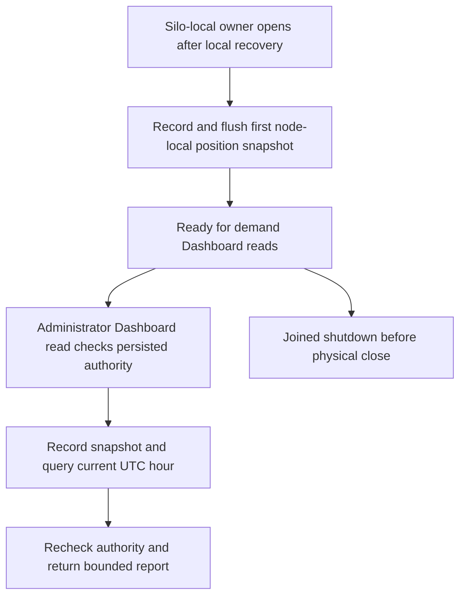

# ResourceExecution: Derived operational analytics

Status: selected ZoneTree.Analytics1.0.0 native component now has a physical-owner production path and an additive existing administrator Dashboard report. Actual public SDK/MCP and single-silo/replicated-cluster execution remain OPEN until their original results pass. Decision: [ADR-134](../../ADR/ADR-134-node-owned-derived-analytics.md).

## Actual path and requirements

- REQ-ANALYTICS-001: Preserve the actual published1.0.0 package, original MIT asset, central pin and native ZoneTree2.0.1 dependency. No local package, engine replacement or source copy.
- REQ-ANALYTICS-002: One OperationalAnalyticsRuntime witness belongs to the existing physical silo/PartitionHostApplicationOwner. It exists before native allocation and blocks physical root release after unknown construction or unjoined cleanup. Derived history is disposable and never canonical authorization, model state or cluster authority.
- REQ-ANALYTICS-003: After physical recovery, record and flush one actual locked node-local committed/applied position snapshot before physical readiness. Each admitted existing administrator Dashboard read records another actual snapshot and queries the current UTC hour. The unused former SampleInterval setting is removed and strict configuration binding rejects it. Sampling is demand-driven; no periodic sampler, separate scheduler/host, command callback, synthetic cut or invented clock provider.
- REQ-ANALYTICS-004: Keep only fixed event/site and committed/applied/backlog numeric values. Disable raw/session/visitor/geography/UA/version/query-string/custom dimension/web processing. Validate exact nonnegative integer range and checked backlog. Never export caller data, credentials, node private paths or native logger text.
- REQ-ANALYTICS-005: Capture and validate options before physical/native allocation. Existing native bounds, one worker and one pending query/flush stay fixed; existing Database.AdmitQuery covers the original native query task through settlement. Native backend scheduling remains its actual implementation. Engineering item limits do not prove hard RSS/disk quotas or measured performance.
- REQ-ANALYTICS-006: Keep actual native FlushAsync(None), QueryAsync timeout and original task identity. Caller cancellation ends only its wait; the retained original still owns the analytical-read lease. Saturation returns ResourceExhausted. No replacement worker, unbounded wait queue, fabricated zero or healthy fallback.
- REQ-ANALYTICS-007: Existing joined physical shutdown settles connections/request producers/transport, then native analytics originals/engine, then PartitionHost. Unknown closure retains the root. Native remaining-resource cleanup retry preserves its original failure; actual HasJoinedEngine controls release.
- REQ-ANALYTICS-008: Existing administrator SDK DashboardAsync and official MCP admin.dashboard expose additive AdminNodeSnapshot field7 with fixed generated report contracts. Check current persisted administrator authority before execution and reload it again after the awaited report. Native planning coverage/loss counters are not sampled-history completeness, a database read cut or a cluster receipt.

## Public report

OperationalAnalyticsReport carries UTC hour bounds, native planning coverage, immutable hourly rows and process-local accepted/processed/dropped/rejected/error/queue counters. Each row contains only hour, sample count and committed/applied/backlog sums. Position sums are observations; they are not transaction counts. Native counters reset after process reopen while persisted rows may remain. Current-hour query shape is fixed and bounded; raw fallback and caller query expressions are absent. Serialized report bytes are checked against the validated65536-byte ceiling. Existing Dashboard node identity identifies the actual executing silo, never a cluster-wide rollup.

## Completion gates

| Gate | Concrete required operation | State |
|---|---|---|
| Published native dependency | Exact archive/source/license and current compiler | Pending |
| Production lifetime | Actual silo-native physical open, first node-local position sample/flush, demand Dashboard sampling, joined shutdown before physical close | Runtime execution OPEN |
| Public semantics | Real SDK and official MCP Dashboard reports after real writes; current-hour/native rows, loss counters, bounded numeric conservation and canonical receipt/document conservation | OPEN |
| Current authorization | Real persisted nonadministrator denial and administrator revocation/expiry reject later Dashboard operations; canceled/stale request returns no report | OPEN |
| Ownership/recovery | Existing second-owner/cancel/two-cold component flows plus selected production physical close/root evidence | Production replicated-cluster execution OPEN |
| Resource/fault/privacy | Native queue/query/flush/cleanup behavior, actual resource usage, retention/hour boundaries, native faults and no private payload leakage | OPEN |
| Linux/cluster/performance | Original mandatory Linux suites and actual native replicated-cluster clients; matched measurements only for speed claims | OPEN |

The three existing private real-engine flows remain original development evidence. They do not satisfy the new production/public gates. TimeSeries append/read/aggregate/expire correctness is separate from native OperationalAnalytics execution. An installed package, module wrapper count, green compiler or TimeSeries sum does not close this feature. Remaining correctness, recovery, resource, fault/endurance, licensing and release gates remain independent.

