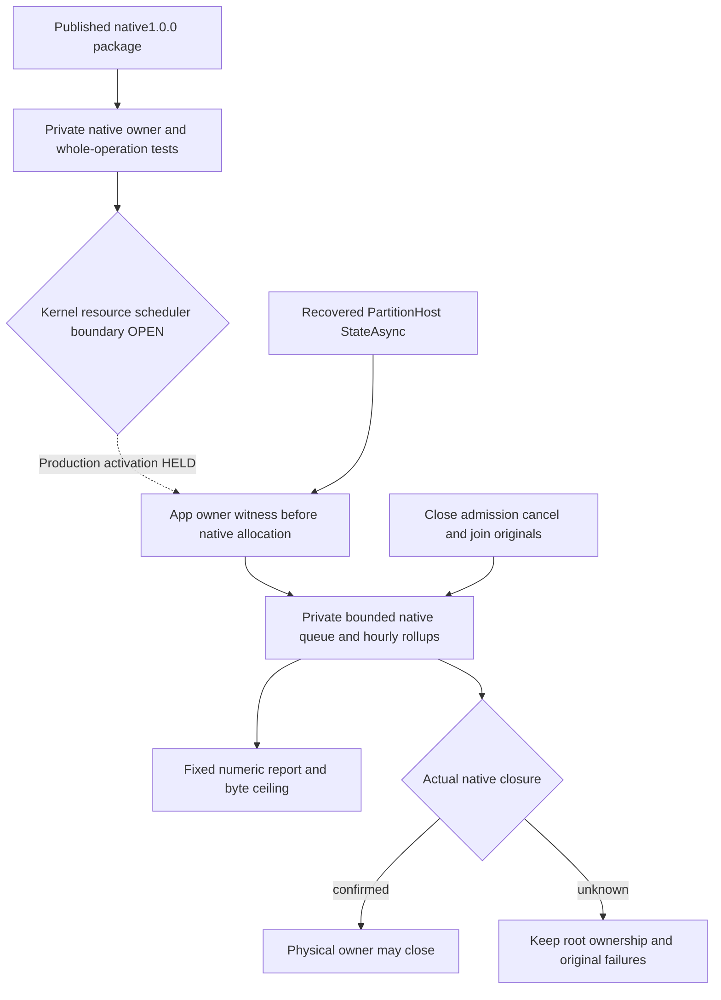

# ResourceExecution: Derived operational analytics

Status: actual ZoneTree.Analytics1.0.0 publication/metadata verified; private native owner and three complete real-engine operations pass the current local full compiler/formatter and selected functional tests in [Stage89](../../implementation/qualification-stage89-foundation.md). ServerApplication activation/registration are HELD pending the mandatory kernel/resource/scheduler boundary. Complete coverage, resource and Linux/RF3 acceptance remain OPEN. Decision: [ADR-134](../../ADR/ADR-134-node-owned-derived-analytics.md).

## Requirements and selected native path

- REQ-ANALYTICS-001: Use the genuine published core package1.0.0, original MIT license/copyright and native ZoneTree2.0.1 dependency. Root owns central pin, Server reference/license asset, restore and actual builds. The official archive/source identities are frozen in ADR134. Earlier404 receipts are historical; no unpublished fallback or publication defect claim remains.
- REQ-ANALYTICS-002: The separately HELD application-owned OperationalAnalyticsRuntime overlay would own one exclusive native engine under the physical node's fixed private derived child. Its witness exists before native acquisition; unknown construction/closure cannot authorize physical root release. History remains disposable and distinct from canonical models, credentials, journals and RF3 receipts.
- REQ-ANALYTICS-003: The separately HELD production overlay uses native locked PartitionHost.Consensus.StateAsync to supply actual committed/applied state, first after physical recovery and then sequentially every10 seconds. Only fixed numeric values/timestamp enter Track. Validate ordering/exact double range and checked backlog subtraction. Missing, full, rejected or failed samples remain explicit native counters/unavailability, not manufactured zeros, command counts or cluster totals. No command/ACK/apply hook changes canonical outcomes.
- REQ-ANALYTICS-004: Disable raw events, sessions, visitor/geography/UA/web collection, bot detectors, filters/enrichers and default rollups/indexes. Use empty AllowedDimensions plus zero custom dimensions before Track. Only fixed event/site and three numeric names exist. Native filter exceptions fail open and cannot enforce privacy/auth. No native public HTTP collection/report API is installed. The private logger retains first exception plus native numeric counters without exporting private text; all direct operation/cleanup originals remain in the server ledger.
- REQ-ANALYTICS-005: Capture validated init-only options: queue64, buffer128, groups192, buckets168, rows192, report65536 bytes, mutable4096 and disk/partition16384 items, native flush/query2 seconds, hourly retention7 days, check60 minutes. One worker and one query-or-flush admission are fixed. No automatic expansion or performance claim. Actual native Task.Run/Timer, UTC retention, kernel/scheduler ownership, memory/physical quota and delayed merge/cleanup qualification stay OPEN; native settings do not constitute a hard RSS/disk-byte bound.
- REQ-ANALYTICS-006: Queue acceptance is not flush/durability/DB ACK. Caller cancellation may end a wait but cannot discard the original accepted flush/query identity. Preserve the original native FlushAsync(None) task, QueryAsync actual timeout/token, native result limits and one pending operation. Expected original caller OCE remains observed explicitly and does not fail a normally joined owner close; native/unrequested fault keeps its original identity and refuses new admission.
- REQ-ANALYTICS-007: Close sample/query admission, request and join original cancellation/sampler/work, then directly await native DisposeAsync before physical close. Preserve all direct primary/cleanup failures. The library's native remaining-resource retry is attempted once after failed closure, preserving the original failure; only actual successful native closure sets HasJoinedEngine. App-owned shutdown cannot abandon work or turn a wait timeout into release.
- REQ-ANALYTICS-008: Real same-directory second owner must be refused. Joined close permits two true same-root cold reopens and exact canonical receipt/state conservation. Deleted/missing derived history is unavailable history; fresh sampling may resume without replaying database effects. NativePlanComplete is planning coverage, never complete sampling history or zero loss.

## Fixed report contract

ReadAsync accepts UTC hour-aligned from/to only, positive span within retention, from >= current UTC minus retention and to <= next UTC hour. Including the current whole bucket does not backdate the actual samples. One native QuerySource.Rollups/FillMode.None request selects Events and committed/applied/backlog sums, no user-shaped expressions. Projection rejects native raw/index fallback, unexpected shape/count/nonfinite/nonintegral/out-of-exact-range values and serialized reports above the configured byte budget. Only immutable numeric row/counter fields and UTC bounds are returned; native plans/warnings/private paths do not escape. The2-second native query timeout does not promise a2-second accepted flush or shutdown join.

## Acceptance and evidence map

The selected component has no ServerApplication activation, options registration, sampler task or new feature-off toggle. Those exact four source postimages remain a conditional overlay. Existing command/read/cache/request owners do not expose a native Analytics worker scheduler/clock admission contract; caller-shaped command/principal fabrication and a parallel governor are prohibited. A real modeled reservation must be retained through native settlement, but it alone is not scheduler/kernel coverage. This is the next concrete integration boundary, not permission to waive REQ-ANALYTICS-005.

The complete native operation case is `OperationalAnalyticsNativeTests.ActualNativePositionsAndFixedBacklogRefuseSecondOwnerThenTwoJoinedColdReopensConserveReportsAndCanonicalReceipts`. Its real TestDatabase native journal/apply cuts and one explicitly labeled fixed17/12 arithmetic input exercise ingestion into the actual engine; independent totals are3 samples, committed20, applied15, backlog5. This does not substitute for the actual StateAsync sampler or RF3 ACK flow. The combined source is adopted and all three actual Analytics operation cases pass in R288. The original native cancellation marker was observed. Their local scope and remaining gates are recorded in Stage89; the production sampler is not activated.

| Acceptance | Required complete operation and original evidence | Current gate |
|---|---|---|
| AC-ANALYTICS-001 | Genuine1.0.0 archive/nuspec/original MIT/native dependency plus current full restore/compiler | Published metadata and current full Release PASS; Linux gate OPEN |
| AC-ANALYTICS-002 | Same real native engine: actual journal-derived samples plus independent numeric control, explicit flush, exact hourly totals/coverage and disabled raw/session state | Actual native whole case PASS R288; production sampler OPEN |
| AC-ANALYTICS-003 | Actual node SDK/official MCP writes advance real native StateAsync sampling; original receipts/canonical authority unchanged on success/refusal/cancellation | Full RF3 operation OPEN |
| AC-ANALYTICS-004 | Genuine queue-full acceptance/drop, one-query admission, native timeout/cancel, original work settlement and healthy continuation after refusal | Native preadmission/refusal and observed original caller cancellation PASS R288; deterministic queue-full/contention/timeout OPEN |
| AC-ANALYTICS-005 | Actual second-directory-owner refusal, joined close and two same-profile same-root cold reopens; independent full canonical image/receipt conservation | Actual native second-owner/two-cold whole case PASS R288; RF3 OPEN |
| AC-ANALYTICS-006 | Live Read then actual cancellation race and close without replacing pending work with healthy read; original terminal report or OCE retained, engine joined; native failure/unknown preserves root | Actual original caller cancellation and joined close PASS R288; primitive native fault/partial-acquisition proof OPEN |
| AC-ANALYTICS-007 | Only allowlisted native report/storage names/fields; private identity/query/document/credential sentinels absent, empty dimensions enforced; no routes/filter bypass; actual freshly authorized RF3 callers | Private report/canonical conservation controls PASS R288; production activation/full RF3 privacy OPEN |
| AC-ANALYTICS-008 | Finite query span/native limits/report bytes; actual native scheduler/kernel/UTC retention/hour changes, merge cleanup and memory/physical ownership contract | Production activation HELD; actual native-worker admission/kernel/scheduler/resource/physical quota qualification OPEN |

The cancellation race must preserve its actual outcome. A native operation may finish before cancellation; that is not evidence that an accepted operation was canceled. Do not insert a fake worker/filter/clock/transport gate or claim the cancellation gate closed when no genuine cancellation was observed. R288 records the actual original caller-cancellation witness for these bodies. It does not establish native queue saturation, a query timeout, shutdown fault injection or production sampler qualification.

## Applicable surfaces and retained gates

Backend: Server ResourceExecution/Analytics owns this integration. Public contracts, SDK/MCP catalogs, SQL/wire formats and frontend/site: N/A for this private history stage. Existing public database clients supply the required later RF3 workload; no dashboard or public report promise is added. Infrastructure: original test-owned Aspire RF3 and canonical Linux workflow; no new topology/workflow. OpenTelemetry, ManagedCode.TimeSeries and native canonical ZoneTree remain unchanged. Benchmarks are N/A to correctness delivery; KL105 matched diagnostics precedes any optimization/performance claim.

All105 task states remain unchanged. Genuine current Linux ABI/provider/caller admission, full mandatory Unit/recovery/RF3, resource/fault/endurance, physical durability, complete acceptance and performance qualification remain open independently of this locally verified private component.

