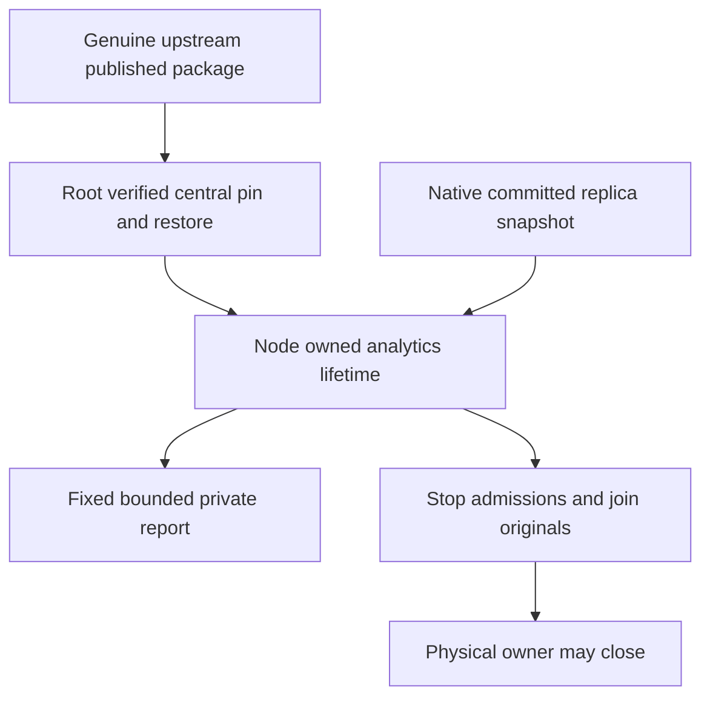

# ResourceExecution: Derived operational analytics

Status: dependency selected, implementation contract PROPOSED. Package publication and every source/runtime gate remain OPEN. ADR: [ADR-134](../../ADR/ADR-134-node-owned-derived-analytics.md).

## Requirements

- REQ-ANALYTICS-001: Adopt the actual published ZoneTree.Analytics core package only after exact version, original MIT license and transitive native ZoneTree compatibility verification. Observed source directly pins ZoneTree 2.0.1; this is source alignment, not binary proof. Root owns central pin/reference/restore/build. No unpublished fallback.
- REQ-ANALYTICS-002: One application-owned native engine exclusively owns one private node-derived directory. Storage remains disposable operational history, never command/model/authorization/receipt authority. No additional host, replica topology, distributed analytics singleton, database dispatcher or storage migration.
- REQ-ANALYTICS-003: Use actual native StateAsync committed/materialized snapshot outside command/ACK/apply execution. Emit only fixed event/value names and checked finite numeric backlog/progress observations. Missing/full/failed samples remain explicit unavailable/drop evidence. Physical-node samples do not define exact command counts or cluster totals. Preserve signed SDK/MCP operation execution unchanged.
- REQ-ANALYTICS-004: Disable raw event storage, sessions, visitor identification, geography/UA/web collection, custom filters/enrichers and default web rollups/indexes. No private identifiers, input payloads, query text, paths, URLs, credentials or exception detail. Construct fixed allowlisted event/value names and permitted fields before Track; use an explicit allowed-dimension set, empty when none are permitted. Native AllowedDimensions=null keeps all; EventFilter exceptions fail open and cannot enforce privacy or authorization. Native storage access remains private; no native public HTTP collection/report API.
- REQ-ANALYTICS-005: Captured validated options bound queue/workers/flush/buffer/retention/report span/buckets/groups/filled rows and query concurrency. Proposed numeric profile is frozen in ADR-134 for review. No performance claim, automatic bound expansion or hidden raw-event fallback. Freeze a finite application-owned report field/byte budget before integration; native row/group limits do not bound result bytes. Establish actual memory/disk ownership separately; retention cleanup is delayed by merges. Existing ResourceExecution/kernel admission and scheduler ownership must cover the actual sampler/query/native worker lifecycle before integration. Native Task.Run/Timer work and UTC/Stopwatch retention are not automatically redirected by KeyLoad TimeProvider registration; system-clock/time-zone/hour-boundary behavior remains OPEN.
- REQ-ANALYTICS-006: Track/TrackAsync acceptance is not flush/durability/DB ACK. Native FlushAsync barriers and QueryAsync native timeout/cancellation keep original work identity. An expired or canceled caller does not reset deadlines or dispose still-owned resources. Native query work must settle before engine disposal.
- REQ-ANALYTICS-007: Start after recovered physical state; close sample/query admission and join original sampler/query/flush/disposal before physical store closes. Preserve primary plus cleanup errors using existing server failure observer. No background task abandonment, swallowed storage faults, caller-wait timeout treated as completed shutdown or disposal-based ACK reversal.
- REQ-ANALYTICS-008: Reopen the same derived directory twice under the real owner; canonical authority/receipts remain unchanged. A second live owner is refused by the library's native directory lock. Missing/deleted derived history is unavailable history and can resume from fresh samples without replaying database effects. No synthetic historical completeness claim.

## Acceptance and evidence map

All cases below are required proposed whole-operation regressions, not existing tests or executed results. Source-only ADR/requirements stage explicitly has no executable test mapping yet. Implementation must bind each row to actual named tests and immutable original Linux artifacts before closing it.

| Acceptance | Required real operation and observable oracle | Gate |
|---|---|---|
| AC-ANALYTICS-001 | Original NuGet package/version/license/dependency metadata; actual pinned restore/build, no source substitution | OPEN external publication |
| AC-ANALYTICS-002 | Real native engine tracks fixed values, explicit flush, exact independent native hourly result/coverage; raw/session/identity disabled; query cannot raw-fallback | OPEN implementation/runtime |
| AC-ANALYTICS-003 | Actual node SDK and official MCP writes advance committed/applied native state; bounded sampler reports genuine corresponding state without changing original receipts; failed/canceled operation retains canonical result | OPEN RF3 |
| AC-ANALYTICS-004 | Full native queue acceptance/drop/cancellation, bounded query admission/native timeout and original query join; healthy fresh operation follows refusal | OPEN implementation/runtime |
| AC-ANALYTICS-005 | Actual second engine cannot open same directory; joined close permits reopen; two true cold same-root cycles preserve canonical state and truthfully partial derived history | OPEN native/recovery |
| AC-ANALYTICS-006 | Shutdown while native ingestion/query is active closes admission, retains original tasks and all primary/cleanup failures, releases only after settlement; fresh new owner succeeds | OPEN lifecycle |
| AC-ANALYTICS-007 | Read native results/storage through bounded test-owned APIs; sentinel credentials/private document/query strings absent, only explicit allowlisted names/fields present, empty dimension allowlist enforced when required; no filter-as-privacy or auto collector/routes; RF3 clients still freshly authorized | OPEN privacy/RF3 |
| AC-ANALYTICS-008 | Finite retention/report span/buckets/groups/concurrency and report field/byte budget enforced; real native kernel/scheduler ownership, system-clock retention/hour boundaries, merges/cleanup and owner reservations satisfy selected resource contract; no RSS/disk promise from config alone | OPEN resource qualification |

## Applicable surfaces

Backend: Server ResourceExecution owns node-local analytics integration. Shared public contracts, SDK/MCP command catalogs and wire formats: N/A for this first private operational history stage; their current database operations supply the required whole RF3 test workload. Frontend/site: N/A; no dashboard promise. Infrastructure: existing test-owned Aspire RF3 and canonical Linux workflow, no new topology or workflow. Benchmarks: N/A to this foundation correctness delivery; KL105 matched diagnostics remains a separate prerequisite for any optimization or performance claim.

