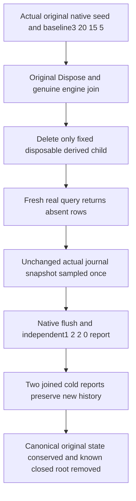

# Missing derived analytics history and actual fresh sampling

Parent: [OperationalAnalytics](OperationalAnalytics.md), [ADR-134](../../ADR/ADR-134-node-owned-derived-analytics.md), [native operation qualification](OperationalAnalyticsNativeQualification.md). REQ-ANALYTICS-008 / AC-ANALYTICS-002,005,006,007 maps to `OperationalAnalyticsHistoryTests.ActualJoinedDerivedHistoryDeletionLeavesAbsentSamplesThenFreshNativeCutAndTwoColdConserveOriginalCanonicalState`.

The real native engine first ingests the existing actual journal positions plus explicitly labeled arithmetic control and returns the independent3/20/15/5 baseline. Only after its original successful Dispose and HasJoinedEngine witness does the test delete the fixed private derived-operational-analytics child. The actual canonical native owner, journals and root stay live. This deletes disposable history; it is not a crash, physical fault injection or canonical restore/migration.

A real new native owner creates fresh derived storage. Its actual query returns empty rows and zero newly accepted/processed counters. These rows mean absent sample history. No zero row is manufactured. NativePlanComplete describes query planning and is deliberately not asserted as completeness of the missing sampling history. Complete immutable report bounds/privacy and canonical conservation still apply.

The same original journal observation, captured after actual document commit2, is passed unchanged to fresh TryRecord. No configure/write/command is reissued to regenerate history, no timestamp is backdated, and the System clock remains native. An actual flush/query must return exactly one aligned in-range row with independent literal1sample/2committed/2applied/0backlog. A fresh owner and two further genuinely joined cold owner cycles conserve only this new history, never the deleted three samples. Cold counters correctly describe the new process lifetime, separately from persisted row totals.

Every phase conserves the original complete stored row/outcome bytes, native journal cut, store position, full typed identity/signing bytes, public receipt contract/private-empty references, literal document and same-ID no-effect replay using the existing admitted controls. Their replay checks conserve the original outcome and do not repopulate derived history. Raw event/session stores stay absent and private voter/leader/document sentinels remain absent from the bounded full report. The borrowed known-close lifetime reuses original close latches, independent cleanup ledgers and the current memoized canonical fixture join. Unknown ownership or any body failure retains the root. Final successful closure removes the originally owned root, verified through actual filesystem state.

This adopted operation uses the integrated private component, native seed/assertions, report-budget lifetime and memoized TestDatabase lifecycle. Existing admitted bodies, clocks, r209 original50 selection and production composition remain unchanged. Current full compiler/analyzers/formatter and the actual complete R288 missing-history operation PASS. [Stage89](../../implementation/qualification-stage89-foundation.md) records the original result and selected coverage. Linux execution, uncovered error branches and primitive close-failure proof remain OPEN. Normal server activation, NativeResourceKernel/scheduler/admission, genuine queue-full/drop/timeout/retention, full StateAsync RF3/SDK/official MCP/OTel and resource/performance qualification remain separate OPEN gates. No empty-history provenance API, complete sampling coverage, power-loss or production-readiness claim is added.
