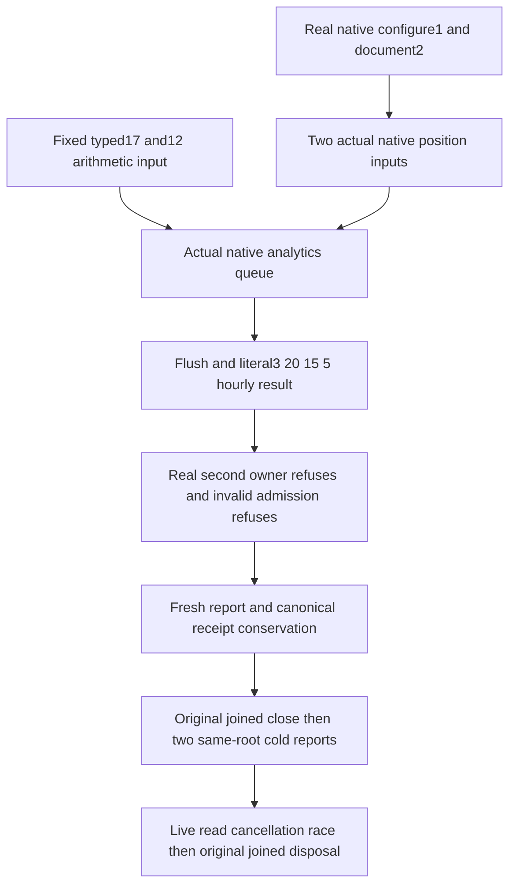

# Native operational analytics operation qualification

Parent: [OperationalAnalytics](OperationalAnalytics.md), [ADR-134](../../ADR/ADR-134-node-owned-derived-analytics.md). The adopted native test component consumes the separately authored KeyLoad.Server native analytics owner and the genuine published ZoneTree.Analytics1.0.0 package. Root owns dependency admission, implementation composition, discovery and the canonical test entry. No existing r209 selection, production body, package pin or shared test options are changed.

REQ-ANALYTICS-NATIVE-TEST-001 / AC-ANALYTICS-002,005,007 maps to `OperationalAnalyticsNativeTests.ActualNativePositionsAndFixedBacklogRefuseSecondOwnerThenTwoJoinedColdReopensConserveReportsAndCanonicalReceipts`. The original TestDatabase nativeReplicaAdmission=true owns real canonical/replica stores and the configured three-voter journal/materializer. Actual ConfigureResource1 and PutDocument2 operations settle before their journal cut/LastApplied values are projected into typed ReplicaNodeState ingestion inputs. These are genuine native numeric positions, not a fake StateAsync producer. A third explicitly fixed typed arithmetic input17committed/12applied verifies nonzero backlog5 in the same actual engine. Independent literal totals are3samples,20committed,15applied,5backlog. This control is not an RF3 quorum or production sampler proof; the production sampler must separately use actual PartitionHost.Consensus.StateAsync through the native server lifecycle.

Explicit original Flush and native rollup-only hourly queries check exact UTC From/To, unique aligned in-range nonempty buckets, independent totals, processed/accepted counters on the original owner, no dropped/errors/pending queue, and the finite64KiB report envelope. The real current System clock defines the initial UTC hour and the next UTC hour after samples, so crossing an hour remains valid without backdating input or waiting for a clock boundary. Actual raw-event and session directories remain absent after ingestion and each cold query. Fixed private voter/leader/document canaries remain absent from the complete bounded returned report. Canonical complete bounded row bytes, store position/identity, native journal cut, independent complete original public receipt plus private composition-emptiness control, full document and same-ID no-effect replay remain unchanged.

NativePlanComplete means native query coverage only. It does not mean complete sampling history, ACK counts, zero-drop operation counts or cluster totals. The published source [RollupActivations29–61](https://github.com/ZoneTree/ZoneTree.Analytics/blob/f7511306bbf0c375a918fc8a93845b1f596777b7/src/ZoneTree.Analytics/Storage/RollupActivations.cs) gives new-directory definitions/tier activation0 and conserves unchanged activation on reopen. The selected UTC-aligned recent range is within native retention and uses that unchanged profile; the expected native plan is complete. No raw fallback can substitute for the fixed report.

REQ-ANALYTICS-NATIVE-TEST-002 / AC-ANALYTICS-004,006 uses actual second native owner refusal before a duplicate object is acquired; lexical async ownership settles an unexpectedly opened object and the independent opened flag prevents a later IOException from masquerading as constructor refusal. Original owner remains usable. Misaligned and longer-than-admitted ranges, a pre-canceled actual caller, negative/inconsistent and inexact-double-range typed numeric inputs all refuse with exact exception category/parameter or selected token. A fresh native report afterward must retain the same independent totals. Original successful Dispose and HasJoinedEngine permit each of two real same-root cold opens, conserving derived history without replaying canonical effects.

The second cold ends with a live Read followed by selected cancellation and joined original owner disposal, with NO healthy operation replacing that retained tail. If the report already won, validate its full original report. If caller cancellation wins, retain its exact token. Only actual ObservedCallerCancellation after joined shutdown emits `analytics-original-caller-cancel-observed`; otherwise the fixed marker records that the original native query completed. Caller-wait cancellation has its separate fixed marker. Native work may legitimately finish first; no fake scheduler/clock/worker/filter gate forces the race. Actual accepted-operation cancellation execution remains OPEN in any run lacking its original witness. Normal joined disposal must not turn expected caller cancellation into an unrelated shutdown failure, and native/unrequested failures remain failures.

The test lifetime retains actual owner references and marks close attempted before the original Dispose. Only a returned close clears the reference and permits reopen. An uncertain acquisition/close or earlier body failure retains the complete root; independent canonical resources still join without deleting that root. Cleanup is memoized; no fake no-op close, retry-as-proof or root deletion after unknown ownership.

The current complete solution compiler/analyzers and canonical formatter pass, and R288 executes this actual whole-operation declaration successfully with the original caller-cancellation marker observed. See [Stage89](../../implementation/qualification-stage89-foundation.md) for original report and coverage identities. Existing R209 remains an independent historical selection. Complete Linux qualification and the explicit uncovered branches remain OPEN. Actual native queue-full/drop saturation, deterministic one-query contention/native timeout, storage fault/retry, physical quotas/retention merges/system-clock change, server sampler startup and full RF3 SDK/official MCP/OTel correctness remain separate OPEN gates. No primitive Dispose fault, power loss, performance, benchmark, production readiness or complete Analytics acceptance is claimed. Frontend/new API/new topology: N/A.
