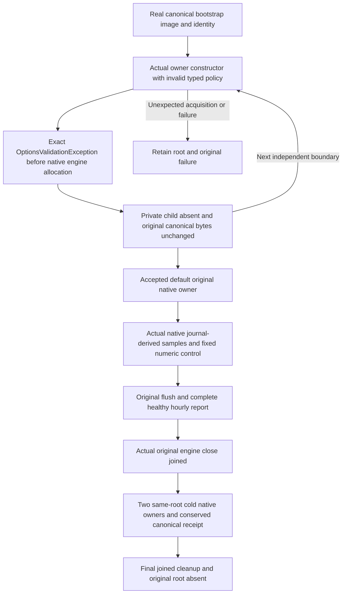

# Native analytics policy refusal and healthy same-root continuation

This SourceN operation targets REQ-ANALYTICS-005/008 and
AC-ANALYTICS-004/005/008 in [OperationalAnalytics](OperationalAnalytics.md), under
[ADR-134](../../ADR/ADR-134-node-owned-derived-analytics.md). It does not activate
production analytics or qualify native queue saturation, a timeout, scheduler/kernel
admission, a primitive close fault, physical quota, RF3 or performance.

## Exact operation contract

**Test:** `OperationalAnalyticsPolicyTests.InvalidTypedPolicyAcquisitionPreservesCanonicalThenHealthySamplingSurvivesTwoJoinedColdReopens`.
One complete operation batches the following 42 independent invalid policies before
opening the accepted native owner. Inputs and expected ceilings are independently
frozen from ADR-134, not read from production constants or computed from its validator.

| Policy | Actual rejected constructor inputs |
| --- | --- |
| Mutable items | -1, 0, 4097 (ceiling4096) |
| Disk items | -1, 0, 16385 (ceiling16384) |
| Queue capacity | -1, 0, 65 (ceiling64) |
| Buffered rows | -1, 0, 129 (ceiling128) |
| Groups | -1, 0, 193 (ceiling192) |
| Buckets | -1, 0, 169 (ceiling168) |
| Rows | -1, 0, 193 (ceiling192) |
| Report bytes | -1, 0, 65537 (ceiling65536) |
| Disk versus mutable | disk4095 with mutable4096 |
| Flush interval | -1tick, zero, 2seconds+1tick |
| Query timeout | -1tick, zero, 2seconds+1tick |
| Retention | -1tick, zero, 7days+1tick |
| Fixed sample interval | -1tick, zero, 9seconds, 11seconds (required10) |
| Fixed retention check | -1tick, zero, 59minutes, 61minutes (required60) |

- **AC-ANALYTICS-POLICY-001:** Every input invokes the actual
  `OperationalAnalyticsOwner` constructor with `Options.Create(policy)` and the
  original `TimeProvider.System`. Require exact `OptionsValidationException`,
  options type `OperationalAnalyticsOptions`, empty options name, and the complete
  independent failure sequence containing only
  `The private operational analytics policy is invalid.`. No getter-only assertion,
  policy mock, fake clock or direct call to `IsValid` substitutes for acquisition.
- **AC-ANALYTICS-POLICY-002:** After every refusal the fixed private derived child
  remains absent. The complete captured canonical key/value byte rows (including
  every persisted outcome record), position, real replica journal cut and all nine
  StoreIdentity fields remain unchanged. This initial cut is genuine bootstrap
  state; it is not represented as an already issued document receipt.
- **AC-ANALYTICS-POLICY-003:** After the full refusal batch, use the existing
  `OperationalAnalyticsNativeOwner.Open`, `OperationalAnalyticsNativeSeed.RecordAsync`
  and full report/canonical assertions. The genuine native configure/document cuts
  remain1/2, with the existing clearly labelled fixed typed arithmetic control;
  independent sample totals remain3/20/15/5. Explicitly flush, verify the full healthy
  bounded report/privacy state and conserve the original full issued receipt,
  document, raw canonical rows, identity and journal cut.
- **AC-ANALYTICS-POLICY-004:** Close the original engine successfully, reopen twice
  on the same actual root/profile and verify the same frozen report range and full
  original canonical receipt/state each time. Every original close must report
  `HasJoinedEngine`; closed owners refuse new sampling. Final actual owner disposal
  must remove the original root. The original token governs all operations, with no
  deadline reset or raised native bounds.

All body/assertion and independent cleanup failures remain in the existing native
failure ledger. Unexpected successful acquisition is explicitly disposed through its
original owner and still fails the oracle. Unexpected constructor/native ownership
retains the root; it does not become known release merely because no owner returned.

## Qualification boundary

Existing three analytics cases and product/options/registration/helper sources are
unchanged. This packet adds one coherent operation and test-local inputs/snapshots
only. Native compilation/analyzers/formatting and actual original operation execution
remain OPEN until Root runs them. Earlier R288 coverage and successes do not transfer
to these new bodies. Linux/RF3, deterministic native queue-full/timeout, production
activation and all resource/scheduler/kernel gates remain separately OPEN.
