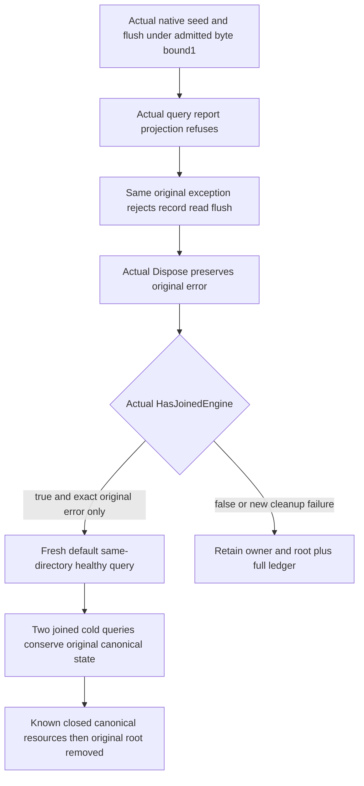

# Native analytics report-byte refusal and joined recovery

Parent: [OperationalAnalytics](OperationalAnalytics.md), [native operation qualification](OperationalAnalyticsNativeQualification.md), [ADR-134](../../ADR/ADR-134-node-owned-derived-analytics.md). This is a private native component regression for resource policy. It does not activate the normal server sampler.

REQ-ANALYTICS-BYTE-TEST-001 / AC-ANALYTICS-002,004,006,007 maps to `OperationalAnalyticsBudgetTests.ActualNativeReportByteRefusalLatchesOriginalFailureThenJoinedEngineReopensHealthyAndTwoColdConserveCanonicalState`. The actual validated options admit MaximumReportBytes=1. The actual engine ingests the existing original ConfigureResource1/PutDocument2 positions and explicit17/12 arithmetic control, flushes, and executes its native rollup query. The resulting report cannot fit one byte; the genuine projection throws the independent expected InvalidOperationException message. No injected error, fake provider, clock, native hold, production activation or second governor creates this refusal.

The complete original exception object must be the same object returned by fresh TryRecord, Read and Flush admission refusals. The test invokes the actual original Dispose once, requires that same original exception object and HasJoinedEngine=true, and only then releases its owner reference. Any additional native cleanup failure, different exception, missing actual join witness or incomplete close retains the real reference/root and preserves the independent failure ledger. An expected operation failure with proven native closure is not itself uncertain ownership.

A fresh default owner opens the same directory and executes the full independent3sample/20committed/15applied/5backlog report checks. Two further actual joined cold owner cycles repeat those checks without new samples. All rounds conserve the complete original stored row/outcome bytes, full typed StoreIdentity including owned signing bytes, original native journal cut and store position, complete public receipt JSON contract/private-empty reference contract, document result and same-ID replay. Raw-event/session storage stays absent. The constrained and every later owner refuse new TryRecord after their actual joined close.

The final successful test lifetime joins all actual owners and canonical native resources, then requires the originally owned root directory to be absent. Earlier body failure or uncertain close retains it. Canonical disposal uses the separately guarded original-join memoization fix; a second no-op close is never proof. All actual body/cleanup errors are retained independently; cleanup is memoized.

Complete Linux qualification and uncovered native cleanup/error branches remain OPEN. An actual primitive close-failure path is not fabricated or claimed. Queue-full/drop, contended query admission, native timeout, retention/storage failure, replicated-cluster sampler/current SDK/official MCP/OTel and production worker activation remain separate OPEN gates. All admitted source bodies remain unchanged. No performance or production-readiness claim follows.
