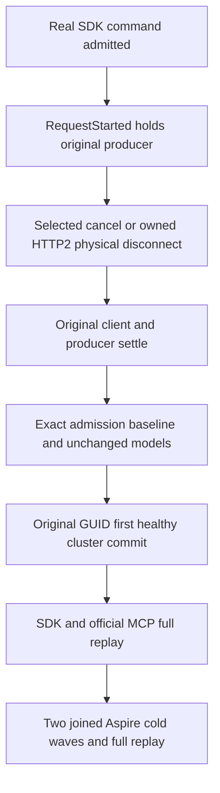

# Post-dispatch admission return

[ClientApi AC-CLIENT-CONNECTION-002](../ClientApi.md) requires actual canceled work
to release its original bounded owners. [ADR-125](../../ADR/ADR-125-connection-owned-execution.md)
and [ADR-117](../../ADR/ADR-117-tunit-ci-entry.md) retain connection
execution and Aspire-owned qualification.

REQ-ADMISSION-POSTDISPATCH-001 / AC-ADMISSION-POSTDISPATCH-001:
`PostDispatchAdmissionReturnTests` has independent selected-cancellation and
physical-disconnect cases. A real SDK command on the discovered direct HTTP/2
endpoint reaches the existing authenticated RequestStarted probe. That execution
boundary precedes command partition resolution and canonical effects. The actual
original SDK task remains pending, node command admission increases by one and
retained bytes match the SDK unknown-length body reservation exactly.
The node pool shares its one ingress scope; the global verified pool adds one
unique persisted principal/tenant, one command and the fixed envelope reservation.
Both control lanes remain unchanged. No new provider, clock, quota or production
seam is used.

REQ-ADMISSION-POSTDISPATCH-002 / AC-ADMISSION-POSTDISPATCH-002:
cancel the original caller token, or dispose the same SocketsHttpHandler owning
that physical connection. Do not release the held producer to manufacture an
outcome. Require the original SDK UnknownWriteOutcome, original execution
ProducerDisposed and settlement, exact complete HTTP admission baseline return,
and full original document/outbox conservation. UnknownWriteOutcome is no ACK;
the separate original-state oracle establishes no effect for this pre-dispatch
boundary. Disconnect also requires the original activation absent;
selected cancellation must keep the same actual connection activation reusable.
This differs from incomplete slow-body admission, idle disconnect and ordinary
selected-cancellation tests without complete admission conservation.

REQ-ADMISSION-POSTDISPATCH-003 / AC-ADMISSION-POSTDISPATCH-003:
use the interrupted command's original GUID for the first healthy commit. Require
its literal full mutation receipt, ProcessDurable, actual signed incarnation,
partition and positive opaque commit cut. Full document reads
use that actual minimum token. SDK and official MCP replay must retain the full
public receipt, complete document and exact outbox. A single original document
change increments outbox tail/count once; retained bytes are observed rather than
predicted from serialization. Join original transports/producers and perform two
existing Aspire-owned same-volume cold waves, repeating every complete replay
and model oracle and retaining original cold receipts.

The existing ConnectionClusterScenario owns Aspire resources, readiness, real clients,
original operation tasks, producer settlement, private controls and evidence/root
retention. Its actual shutdown must finish before resource deletion. This source
adds no manual app or Docker deployment. Build/analyzers, discovery, actual
execution and exact-source Linux cluster qualification remain OPEN. No benchmark,
power-loss, endurance or production-ready claim follows.
