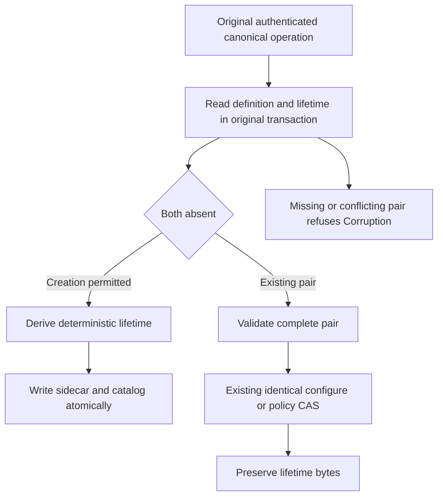
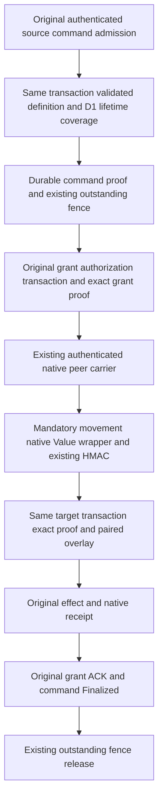
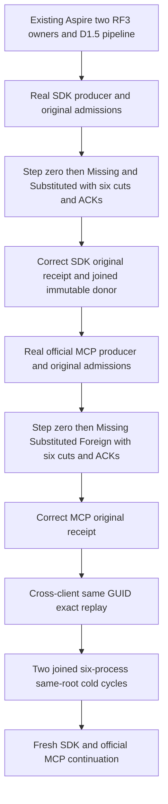

# Resource lifetime creation identity — D1

The owner selected reusable resource names with distinct persisted resource incarnations for the future DROP/resource-lifetime design. A permanent reserved-name profile is not the target. D1 implements only active creation identity and preservation through existing metadata updates. It supplies no retirement barrier, name reuse, DROP TABLE or completed resource-removal behavior. The earlier [DROP dependency proposal](../RelationalStorage/DropTableDependencies.md) remains the dependency inventory; its open identity alternatives are resolved by this owner selection, while its missing admission/inventory/cleanup foundations remain open.

This foundation supports REQ-SQLC-006 / AC-SQLC-006, SQLC-DDL, without closing them. [CREATE TABLE](../RelationalStorage/CreateTable.md), existing ConfigureResource/policy CAS and [native serialization](../InternalSerialization.md) keep their current authorization, transaction, RF3 and format contracts. Build, native TUnit, recovery and exact-source Linux RF3 qualification are separate gates.

## Frozen D1 contracts

Both new records are internal, generated Orleans contracts in namespace `KeyLoad`. No field is added to ResourceDefinition, EntityRef, ReplicatedOperation, public requests or default public JSON. Existing request fingerprints and native raw-byte conventions remain unchanged.

| Record | Stable alias | Fields |
|---|---|---|
| ResourceIncarnationV1 | `keyload.resource-incarnation.v1` | 0: Value, a full lowercase 64-character SHA256 hexadecimal identity. |
| ResourceLifetimeV1 | `keyload.resource-lifetime.v1` | 0: TenantId; 1: DatabaseId; 2: ResourceName; 3: TransactionDomainId; 4: Kind; 5: typed Incarnation; 6: CreationFingerprint. |

The adjacent native sidecar key is the existing KeyCodec version-one encoding of `("resource-lifetime-v1", tenantId, databaseId, resourceName)`. The canonical catalog definition remains at its existing key. The producer owns atomic creation and validation of that pair in the original transaction; the pure identity helper owns neither storage nor routing.

CreationFingerprint is exactly the existing `NativeOperationFingerprint.Compute(original)` of the original canonical committed creator operation. That frozen fingerprint already binds operation kind, principal ID, original command GUID and exact normalized PayloadJson. It excludes evaluation time. The helper does not change that digest or reserialize the request to introduce another input identity.

The incarnation is exactly:

```text
lowerhex(SHA256(KeyCodec.Encode(
  "keyload:resource-incarnation:v1",
  tenantId, databaseId, definition.Name, CreationFingerprint)))
```

KeyCodec supplies its existing version byte, typed UTF-8 components and zero escaping. This frames each component unambiguously and introduces no new encoder or library. Replicas applying the same original committed input derive the same identity; evaluation time, clock, store-local identity, randomness and process hash codes are not inputs. Equal GUIDs used by different principals have different creation fingerprints and thus different incarnations. Scope and changed canonical input also remain bound.

`ResourceLifetimeIdentity.Create(original, tenantId, databaseId, definition)` returns a complete ResourceLifetimeV1 for ConfigureResource or CreateTable creation. Producers invoke it only after their existing canonical payload and authority admission. `Validate(lifetime, tenantId, databaseId, definition)` requires matching tenant/database/name/domain/kind, strict lowercase 64-hex creation fingerprint and incarnation, and exact recomputation from the stored fingerprint and current scope. Malformed or mismatched identity fails the fixed Corruption diagnostic. Native serialization with an unsupported version retains its existing FormatUnsupported contract; this helper does not catch or reinterpret native deserialization. These hashes identify trusted persisted creation; they do not authorize client-supplied lifetime fields or replace native operation authentication.

## Producer transitions



For a genuine first ConfigureResource or CREATE TABLE, both catalog definition and lifetime must be absent. The engine producer checks actual storage and writes the sidecar with the catalog in the same native transaction. Failure rolls back that transaction through its existing owner. CREATE remains create-only; a different command cannot replace an existing resource.

For existing identical ConfigureResource, policy-only CAS and queue dispatch metadata updates, the complete pair must already be present and valid before effects. Preserve the original incarnation and creation fingerprint byte-for-byte. A new policy-update command is not a new creation. Existing schema-version, policy, authorization, queue/blob accounting and failed-outcome rules remain authoritative.

If exactly one half is missing, or the pair's scope/identity conflicts, fail Corruption. Never manufacture a lifetime for an existing definition, silently backfill a missing sidecar or treat a sidecar without metadata as a new creation. No migration or legacy fallback is provided.

## Whole-operation evidence and remaining dependencies

D1 regressions must exercise actual ConfigureResource and compiled native CREATE through the canonical command path and real ZoneTree. Verify independently expected creation identity and complete metadata, identical/configured policy transitions with unchanged sidecar bytes, original success/failure replay and policy fencing, cross-principal same-GUID separation, deterministic replica application, malformed/missing-pair refusal with no partial model effects, and actual joined cold continuation. Generated native round trips preserve both records; public request JSON and existing frozen digest controls remain unchanged. Helper-only assertions do not replace these producer operation flows.

## D1 acceptance mapping and stage gate

The following source cases map only the D1 implementation slice of REQ-SQLC-006 / AC-SQLC-006 (SQLC-DDL). They do not close the full criterion. Source declarations are distinct from executed evidence:

- **Creation flow:** [ResourceIncarnationWholeFlowTests](../../../tests/KeyLoad.UnitTests/ResourceExecution/Cases/Resource/ResourceIncarnationWholeFlowTests.cs), `OriginalCreationIdentitySurvivesWritesPolicyRepairReplayIndependentStoreAndTwoColdOwners(bool sql)`. Its two actual TUnit arguments select ConfigureResource (`false`) and compiled native CREATE TABLE (`true`).
- **Queue flow:** [ResourceIncarnationQueueWholeFlowTests](../../../tests/KeyLoad.UnitTests/ResourceExecution/Cases/Resource/ResourceIncarnationQueueWholeFlowTests.cs), `QueuePauseResumePreservesLifetimeAndQueuedWorkAcrossCorruptionRepairAndTwoColdOwners()`.

| Existing requirement / acceptance slice | Actual owning source case | Whole-operation oracle |
|---|---|---|
| REQ-SQLC-006 / AC-SQLC-006: D1 creation identity | Creation flow, both arguments | Real canonical creation and rows; the ConfigureResource argument checks an independent literal creation fingerprint/incarnation; both arguments check agreement with a separate actual store and a distinct identity for another persisted principal using the same GUID. |
| Same criteria: metadata update preservation | Creation flow, both arguments; Queue flow | Real policy CAS and queue pause/resume preserve the original sidecar bytes while complete metadata and row/queue work remain correct. |
| Same criteria: original outcomes and policy versions | Creation flow, both arguments; Queue flow | Original success/failure replay, changed-content conflict, stale policy CAS refusal and persisted-pair repair retain the documented outcome/model boundaries and do not mint a new lifetime. |
| Same criteria: malformed/missing pair refusal | Creation flow, both arguments; Queue flow | Genuine stored-pair corruption refuses, complete unchanged model effects are checked, and exact repair is followed by healthy original-owner operations. |
| Same criteria: native recovery continuation | Creation flow, both arguments; Queue flow | Two actual joined cold owners preserve the full pair and model/outcome state, then continue genuine writes or enqueue/claim/ack work. |

A D1 implementation checkpoint requires the combined strict full-solution build with no warnings/errors and all three declared focused native TUnit cases actually executed and passed, with zero skips and original source/compiled/TRX/cleanup evidence. This document and the SourceN packets do not assert those results. Existing required recovery, real Aspire RF3 and exact-source Linux qualification remain separate mandatory gates; a focused D1 checkpoint does not replace them or establish delivered qualification.

## Remaining dependencies

The later owner inventory can consume the typed lifetime produced here. D1 does not yet bind EntityRef, public by-name writes, prepared plans or signed cursors to resource incarnations, does not fence an admitted old-lifetime write, and does not implement retirement or cleanup. Those dependencies still precede reusable-name execution and DROP public qualification. An unadmitted name-only request carries no client-construction-time witness; a future contract must distinguish fresh name resolution from explicitly or previously server-bound lifetime work.

No source packet, compilation or local operation run establishes full SQL, production readiness, power-loss durability or delivered Linux qualification. The existing functional gate remains unchanged by D1.

## D1.5 authenticated command and grant lifetime coverage

REQ-RLGRANT-001 / AC-RLGRANT-001 extends D1 only at the existing controlled-command and movement-grant authority boundary under [ADR-106](../../ADR/ADR-106-partition-owner-movement.md). The original control admission transaction captures a complete validated lifetime for every admitted ResourceDefinition through ResourceLifetimeCatalog.Read. Default, duplicate, missing, extra, cross-tenant/database/domain or invalid lifetime coverage refuses before effects. The explicit array may be empty only when the original admitted resource set is empty. Check the complete coverage bijection against both original delegation resources and grant resources, with exact admitted definitions; do not infer missing lifetimes from the destination catalog. Existing byte, mutation and scan bounds remain authoritative.

The new internal generated records live in Core ClusterRouting.Contracts. Each alias is a separate version-one native contract; named field constants own the listed IDs.

| Record / alias | Stable fields |
|---|---|
| ResourceLifetimeCoverageV1 / `keyload.resource-lifetime-coverage.v1` | 0 Partition: complete PartitionRef; 1 Lifetimes: ImmutableArray of full ResourceLifetimeV1. |
| PartitionControlLifetimeProofV1 / `keyload.partition-control-lifetime-proof.v1` | 0 OriginalDelegation: complete PartitionControlDelegation; 1 Coverage: ResourceLifetimeCoverageV1. |
| PartitionMoveLifetimeProofV1 / `keyload.partition-move-lifetime-proof.v1` | 0 OriginalGrant: complete PartitionMovePhaseGrant; 1 AuthorizationFingerprint: the unchanged NativeOperationFingerprint of the actual original authorizing operation; 2 ControlProof: PartitionControlLifetimeProofV1. |
| PartitionMovementAuthenticatedCommandV1 / `keyload.partition-movement-authenticated-command.v1` | 0 Original: unchanged PartitionMovePhaseCommand; 1 LifetimeProofs: ImmutableArray of PartitionMoveLifetimeProofV1. |

REQ-RLGRANT-002 / AC-RLGRANT-002 binds the exact original authenticated operation, command identity, principal, effect, move, complete partition, target placement, physical control/receiver owners, both native source admission cuts, policy epochs and expiries. Keep the full original delegation and grant rather than reconstructing identity from a resource name or command GUID. Normalize only the grant's Settlement and AbortDisposition to null for its originally issued immutable identity. Every other original field remains exact. Validate that proof against the actual transported grant and the delegation in the original apply body; match the actual authorizing operation fingerprint. No proof object, digest or structurally valid record supplies authority on its own.

REQ-RLGRANT-003 / AC-RLGRANT-003 makes PartitionMovementAuthenticatedCommandV1 the mandatory native Value root of every newly issued movement operation, including specialized receiver-issue and expired-retire-cancellation writers. Exactly one lifetime proof is required for ControlApplyCommand; all other stages carry an explicit empty array. Null/default roots, default arrays, wrong cardinality and the old bare phase root refuse; there is no old-root fallback, migration or dual-format reader. This is a forward-only native Value format change. The nested original phase, old logical request JSON, MovementPhaseIdentityJson, original request fingerprints and existing BodyDigest recipes remain unchanged. NativeOperationAuthority authenticates the complete new Value through its existing ValueHash and HMAC. Existing owner, principal, expiry, membership, replay and original operation authority checks remain mandatory.

The dedicated server-owned PartitionControlLifetimeTransportV2 carries the full typed original PartitionMovementTransportRequest and complete PartitionMoveLifetimeProofV1 together in one generated Orleans graph, only for ControlApplyCommand. Fields 0 (OriginalRequest) and 1 (Proof) use the fresh alias `keyload.partition-control-lifetime-transport.v2` and MAC purpose `keyload-partition-control-resource-lifetime-request-v2`, retaining the existing MAC primitive and full outer native-request signature. The factory shares the original grant only after exact standalone native-byte equality of both the complete grant and complete proof. Whole-operation assertions require exact standalone native-byte equality of the full decoded request and proof. The request, envelope and phase body retain all original fields and bytes; no digest replaces a proof field. Other stages retain their original transport. No V1 carrier decoder or MAC-purpose fallback is admitted. Core contracts do not mint peer authority or repurpose the distinct NativeCommandPayload.TransferProof field.

REQ-RLGRANT-004 / AC-RLGRANT-004 stores command and grant proofs in the same original source transactions as their corresponding admissions. Existing distinct outstanding-command/grant accounting and metadata-change admission remain the lifetime fence: command settlement is Finalized and grant settlement follows its existing acknowledged/abort/retire-cancellation terminal rules. Expiry alone never releases that fence. Target apply validates the authenticated complete pair overlay and applies effects in the same original native transaction; it neither guesses local catalog state nor starts a second authorization dispatcher, scheduler or counter. Source malformed persisted pairs retain Corruption, native unsupported formats retain FormatUnsupported, invalid peer authentication retains its native refusal, and existing grant owner/expiry/binding refusals remain OwnershipLost. Preserve original errors and complete task/cleanup ledgers.



The declared native whole-operation owner is [ResourceLifetimeGrantWholeFlowTests](../../../tests/KeyLoad.UnitTests/ClusterRouting/Cases/Resource/ResourceLifetimeGrantWholeFlowTests.cs), `AuthenticStoredLifetimeGrantRefusesSubstitutionThenCompletesAndReplaysAcrossTwoColdOwners()`. It creates the genuine retired-source command admission, source grant and authenticated target effect, then acknowledges the original grant and command and finalizes the original outcome. Its source declarations are not execution evidence.

| Requirement / acceptance | Actual owning source coverage |
|---|---|
| RLGRANT-001 coverage | The case's Capture/Refusals helpers compare complete source D1 pairs, require absent target-local catalog, and refuse missing, duplicate, extra, wrong-partition and substituted-incarnation coverage without changing either real owner image/cut. Default coverage arrays are rejected by existing native encoder validation before transport; this is a separate boundary from owner-valid malformed native roots below. |
| RLGRANT-002 original authority | Refusals checks altered signed carrier, old proofless transport, substituted delegation cut/policy, stored authorization fingerprint and missing source pair. StoredAuthority changes the actual persisted command admission cut/owner and original authorization outcome MoveId/journal owner/digest; each refuses Corruption before exact-byte repair and healthy original proof capture. |
| RLGRANT-003 native format | The same case invokes [ResourceLifetimeGrantNativeFormat.ExecuteAsync](../../../tests/KeyLoad.UnitTests/ClusterRouting/Contracts/ResourceLifetimeGrantNativeFormat.cs) before effects. A real Core-issued ControlApply operation preserves exact original phase JSON. Bare old phase, empty-proof and duplicate-proof Values have correct actual target-owner ValueHash/HMAC and pass VerifyOperationAuthority, then public ResolveOutcome returns Corruption with no JSON/native value. Both original owner images/journal/apply cuts remain unchanged, followed by the valid operation's exact missing-outcome RecoveryRequired control. No owner-signed default-root variant is claimed. |
| RLGRANT-004 settlement and recovery | Actual metadata Conflict and exact original outcome accounting are checked with both command+grant pins, then again with command-only pins after grant ACK. Command ACK/Finalize releases the remaining pins; fresh legitimate metadata operation and old failed-ID replay preserve the lifetime. Two actual joined cold owners retain exact proof, original native effect entry/receipt, original finalized outcome, models and healthy continuation. |

Caller cancellation in this case is pre-cancelled at the genuine submit boundary and conserves the already retained source admission; it does not prove cancellation of an executing admitted command. The expiry negative submits an already-expired input envelope; it does not prove naturally elapsed admitted-grant expiry or release. The contract still forbids expiry-only accounting release. The case uses genuine configured native owners/MAC and journals; it does not itself qualify Docker/Aspire RF3 or public SDK/MCP transport.

The original three native movement writers remain separate source responsibilities: [ordinary movement authority](../../../src/KeyLoad.Core/ClusterRouting/Identity/PartitionMovement/PartitionMoveNativeAuthority.cs), [receiver issuance](../../../src/KeyLoad.Core/ClusterRouting/Identity/PartitionMovement/PartitionMoveReceiverIssueAuthority.cs) and [expired-retire cancellation](../../../src/KeyLoad.Core/ClusterRouting/Commands/PartitionMovement/Cancellation/PartitionMoveExpiredRetireCancellation.cs) all emit the mandatory wrapper while retaining their original logical phase identity. Existing current-format consumers migrate through PartitionMovementNativePayload, including controlled phase/process submission, retained-entry and retire/install observations, and portable BM25 movement helpers. The existing process continuation keeps its current-owner MAC/Core proof admission before its unchanged joined handoff. These are source adaptations, not new declarations or a claim that all three writer lifecycles executed in this case; their original owning recovery cases remain mandatory.

Implementation prerequisites are the frozen contracts and D1 producer pairs, followed by Core capture/validation/overlay plus server/cluster carrier integration and focused native correctness/recovery checks. A D1.5 checkpoint requires a strict full-solution build and actual passing native TUnit owning declarations with original source/compiled/report/cleanup identities; none is asserted here. Final qualification separately retains existing process-recovery gates, real Aspire-owned SDK/official-MCP RF3 and exact-source Linux evidence. READ/C4 and D2 are separate work: no read-fence, lifetime movement namespace, resource retirement, reusable-name execution, DROP, global lifetime protection or completed SQLC-006 claim follows from D1.5.

## COMMAND RF3 lifetime-carrier negative and healthy operation

This successor freezes the COMMAND RF3 operation under ADR-106. The preceding D1.5 contracts/native cases remain source work until their required exact-source execution gates pass. Main's separately reported D1 build/native evidence does not qualify this COMMAND increment or its prior source packet.

REQ-RLCMD-RF3-001 / AC-RLCMD-RF3-001: run the genuine six-container Aspire topology with two registered RF3 owners through the existing protected-document wave. Use persisted credentials and the real KeyLoad .NET SDK and official MCP C# SDK. Public commands use the existing controlled source admission, RF3 read barrier, original grant and proof capture, native target authority, original acknowledgements and finalization. Select a new narrow diagnostic-only lifetime-carrier observer after the original source RF3 barrier/proof capture and before target dispatch. It is enabled only within the existing bounded private request-probe composition. Bind the actual session, immutable arm, principal, canonical command, complete partition and actual server-owned ingress connection/request identity. It introduces no public proof parameter, alternate authorization dispatcher, network/provider or storage authority.

REQ-RLCMD-RF3-002 / AC-RLCMD-RF3-002: hold step zero after genuine source command/grant admissions and before diagnostic sends. Retain the exact original correct carrier privately. Under the same original operation token/deadline, execute the fixed actual native sequence with bounded step witnesses and per-step acknowledgements: the first SDK producer sends Missing then Substituted (two negatives); the second official MCP producer sends Missing, Substituted then Foreign (three negatives). CaptureOriginal is the step-zero witness, not a zero-fault donor plan. Missing sends the exact old proofless Phase form. Substitution changes typed coverage while preserving the selected original operation. Foreign uses the immutable captured proof of a prior genuine SDK producer, selected through its existing immutable donor SourceArmId; never manufacture another authority, fetch an arbitrary path or mutate the donor record. Existing configured HMAC, full native outer signature, phase/body identity, expiry, clock, fresh authorization, owner checks and budgets remain unchanged. The diagnostic witnesses record actual native refusals. Public SDK/MCP calls resume with the original correct carrier and succeed after probing; these are not invented public error responses.

REQ-RLCMD-RF3-003 / AC-RLCMD-RF3-003: at step zero and after each actual native refusal, read an exact six-owner live cut with the new private typed NativeCommandLifetimeCut request. Reuse the existing enabled canonical-diagnostic HTTP listener, persisted administrator authentication, current owner checks, signed response and joined diagnostic lease; do not overload queue/transfer fields in NativeCanonicalModelCutRequest. Bound the new request record by 8192 bytes and all work/results by the existing native read budgets. Digest the complete actual rows selected by PartitionRecordFamilies for the complete partition and bind the exact logical command outcome and technical phase outcome. This proves conservation of that explicit partition-family/outcome scope only. It is not a full-store, catalog, resource-lifetime sidecar or outstanding-pin inventory proof.

The baseline is after legitimate source admissions, which necessarily create records and accounting. Every negative step must preserve the same selected partition-family rows and exact selected logical/technical outcomes relative to that baseline, with no target effect or fabricated acknowledgement. The test binds each step witness to the original arm/session/request/command/connection/partition and verifies both actual native request and reply with the control-group MAC. Each diagnostic cut independently binds a fresh nonce, arm/session/public command/principal/complete partition/effect command/technical principal and signed current physical owner. The cut endpoint does not independently latch step or connection: the test establishes that chronology by reading all six cuts while the actual matching step remains held, then writing only its matching acknowledgement. StorePosition is context, not a cross-owner equality oracle. A live producer cannot advance to the next step or its correct original send until the owning test acknowledges the matching completed observation. Bounded existing owner files and the original lifecycle own those step records; no new network endpoint for proof invocation, uncontrolled file path, detached worker or parallel provider is added. The new typed cut route belongs to the already enabled authenticated diagnostic listener, not the public database API.

REQ-RLCMD-RF3-004 / AC-RLCMD-RF3-004: release only the owned final step, allowing the unchanged original correct carrier to complete its genuine target effect, grant/command acknowledgements and original finalized outcome. Require the independently expected complete durable receipt, canonical command, mutation values, complete partition, actual owner/incarnation/epoch and current acknowledgement profile. Replay the same canonical GUID through both real clients and require the exact original receipt without another effect. Join the original public/native producers and six owned processes/AppHost resources, reopen the same roots/configuration and persisted credentials, replay original outcomes and models, then execute fresh SDK and official MCP healthy continuation. Retain original failures and cleanup ledgers and keep donor ownership settled/joined. No expiry extension, clock replacement, retry-ID substitution, manufactured receipt or unjoined root deletion is allowed.



| Requirement / acceptance | Actual source declaration and oracle |
|---|---|
| RLCMD-RF3-001 | [PartitionMovementLifetimeProofRf3Tests](../../../tests/KeyLoad.IntegrationTests/ClusterRouting/Cases/Partition/PartitionMovementLifetimeProofRf3Tests.cs), `PublicSdkAndOfficialMcpRefuseInvalidLifetimeCarriersThenReplayExactEffectsAcrossSameRootColdContinuation()`, delegates to Trial. NativeCanonicalModelCutWaveStartup starts the genuine protected six-resource Aspire application; the existing seed persists authentication and supplies real SDK and official MCP clients. PartitionMovementEffectTransport selects the existing observer after actual barrier/proof capture; RequestCqrsControlledLifetimeObservation retains the original callback, connection/request claim, gate and bounded cancellation. |
| RLCMD-RF3-002 | NativeCommandLifetimeProofRf3Fixture and NativeCommandLifetimeCarrierAssertions verify SDK Missing/Substituted (two), then official MCP Missing/Substituted/Foreign (three). Missing uses old Phase and returns native Unauthenticated; typed incarnation substitution returns Corruption; the actual prior successful SDK proof selected by immutable SourceArmId returns OwnershipLost for the MCP operation. Exact native request/reply frames and control-group outer/inner MACs are verified. Every negative has a fresh unique nonce, with all other original request bytes exact. The foreign proof equals the retained SDK carrier proof; its real producer and ProducerDisposed marker are joined before reuse. These private errors are not public call results. |
| RLCMD-RF3-003 | NativeCommandLifetimeCutClient verifies fresh nonce-bound diagnostic responses from all six current signed owners. Root's NativeCommandLifetimeCutCapture/Reader visit complete PartitionRecordFamilies under the native Store.Read gate and original budgets, with exact selected logical and technical outcome bytes. Fixture holds step zero and each negative until LiveAsync compares exact per-owner model count/read bytes/digest and absent selected outcomes, then writes the matching step ACK. Observer publishes Released only after the final ACK; no ordinary release file is manufactured. |
| RLCMD-RF3-004 | Calls and Assertions verify literal document content/revision/mutation, full partition/owner/epoch/durability and exact same-GUID SDK/MCP replay. DurableAsync reconstructs the expected complete receipt from actual target phase journal fields and independent literal mutation values and checks every receiver/control stored outcome. Cold performs two true joined AppHost shutdown/reopen cycles on the same roots, reconnects the official MCP session after each, conserves stopped images and receipts, then performs fresh SDK and MCP work. Settled original arm files remain until the final joined stop so cold native inventory reconstruction retains their ownership. Trial independently joins every original producer task/full fault vector and retains roots on failed or uncertain cleanup. |

The concrete private server protocol is RequestCqrsControlledLifetimePlan, RequestCqrsControlledLifetimeStepWitness and RequestCqrsControlledLifetimeStepAck. Plan.Variation Substituted with null SourceArmId selects two negatives; Foreign with the genuine donor SourceArmId selects three. RequestCqrsControlledLifetimeFiles/Inventory own immutable bounded parts under the existing owner/session directory and original aggregate/file limits. ControlledLifetimeReplayExchange sends the actual native packets and preserves the verified native error replies; it supplies no successful public receipt. NativeCommandLifetimeCutRequest and NativeCommandLifetimeCutWitness use the existing enabled listener with a distinct native frame/signature domain and bounded 8192-byte request/response, not a new public proof API. ResourceLifetimeGrant native source coverage and its prior requirements remain unchanged.

These declarations and source reviews are not compilation, discovery or execution evidence. Implementation prerequisites are the frozen semantic contract, typed D1.5 carrier/fences and existing probe ownership, followed by the concrete observer/cut/whole-operation source and focused review. Final qualification separately requires the combined strict build, actual declared native RF3 operation within existing record/read/hold/deadline limits, original reports/source/compiled/image identities, joined cleanup, process recovery and exact-source Linux gates. Runtime, RF3 startup, operation/deadline/record fit, the actual three receiver refusal codes and same-root continuation are OPEN. No naturally elapsed admitted-grant expiry release, executing-admitted-command cancellation, READ/C4/D2 fence, retirement, reusable-name execution, DROP or global lifetime authority is claimed.


## Local current resource definition-pair integrity

This stage extends D1 producer integrity into ordinary authoritative local resource resolution. The previous D1 contract creates and preserves the adjacent pair but does not itself make every reader validate it. This extension validates the current server-resolved pair; it does not add a client-supplied incarnation, identify when a name-only request was constructed, bind a public EntityRef/cursor to a generation, or implement resource retirement/name reuse. Existing public request JSON, operation fingerprints, signed bytes, native formats and canonical stored outcomes remain unchanged.

| Requirement | Measurable acceptance |
|---|---|
| REQ-RLLOCAL-001: every ordinary authoritative local ResourceDefinition binding validates its current adjacent D1 lifetime in the same already-owned native view. | AC-RLLOCAL-001: genuine canonical native model commands and read/query projections refuse a missing lifetime, orphan lifetime, malformed native record or scope/name/domain/kind/incarnation mismatch before model effects/projection. Complete absence retains existing NotFound; malformed/mismatched pairs retain Corruption and unsupported native formats retain FormatUnsupported. Exact repair permits the same owner to continue without backfill or inferred lifetime. |
| REQ-RLLOCAL-002: preserve fresh persisted authorization and existing canonical outcome semantics. | AC-RLLOCAL-002: existing coarse capability checks occur before private catalog/pair diagnostics, including unauthorized corrupt-resource input. Original failed command outcome and same-ID replay/conflict semantics survive repair and cold reopen without new IDs, outcome replacement or lookup moved ahead of required authorization/current metadata admission. A current invalid pair is not a promise of unconditional old-receipt access. |
| REQ-RLLOCAL-003: controlled views resolve only authenticated source definitions and complete source lifetime coverage. | AC-RLLOCAL-003: COMMAND and selected READ views consume their existing verified Definition+coverage constructors, validate the same pair through that scoped view and refuse missing coverage without target-sidecar fallback. An unrelated target-local sidecar cannot repair or replace missing authenticated source authority. Existing source/target read and effect transactions, source cuts, owner/policy checks and native budgets remain intact. |
| REQ-RLLOCAL-004: preserve original native ownership, work charging and bounded complete-operation recovery. | AC-RLLOCAL-004: reads use the caller's same gated/budgeted view and native work observers; commands use their original transaction and rollback/outcome path. Whole-operation tests check independent complete model/cut/receipt images, refused mixed effects, exact repair, healthy continuation and two actual joined same-root cold owners. No new cache, registry, provider, migration or implicit sidecar creation is introduced. |

The first common consumers are DatabaseEngine.Resource, including its existing current physical-owner gates and domain/kind validation, and the retired-outcome metadata branch of BatchResource. The latter retains its distinct owner admission semantics. Other direct authoritative catalog readers and authenticated overlay constructors must be mapped against their current callers and authorization order before the integrated source is frozen; a common helper alone does not qualify complete coverage. Existing producer ConfigureResource, compiled CREATE TABLE and queue metadata transitions retain their same-transaction D1 producer checks.

Both definition and lifetime are read through the same existing IKeyValueView: read the nullable canonical definition, validate the pair with ResourceLifetimeCatalog.Read, then apply the existing absence/domain/kind result. If both records are absent, the original absent-resource result remains. If exactly one exists, the pair is inconsistent. No swallowed native error, unbudgeted store access, definition-only bypass or old-format fallback is permitted. The integrity helper grants no authorization and does not open a new store/read cut.

Implementation prerequisites are this local-integrity requirement extension, the original D1 producer pair, the accepted COMMAND authenticated coverage view and selected READ successor APIs, followed by a complete current authoritative reader/caller inventory and coordinated source/test integration. The selected final ANN source companion supplies its authenticated definition/coverage lineage and consumes the same native query-admission seam; its separate source seal is not execution evidence. Final active/obsolete caller closure, including retired Core V1 routes, remains a mandatory integration prerequisite. The concrete native declarations and coverage are mapped below; their source existence is not a passing result.

Final qualification is separate from those implementation prerequisites: strict combined solution build, actual focused native TUnit whole operations, existing process recovery and real Aspire-owned SDK/official-MCP RF3 and exact-source Linux gates retain their original obligations. This draft provides no compilation, executed tests, RF3, deadline/work-budget fit or recovery proof. D2, read-forward protocol expansion, reusable-name fencing, DROP and global lifetime safety remain separate dependencies.

The common implementation seam is internal DatabaseEngine.BindResourceDefinition(IKeyValueView, PartitionRef, string, ResourceKind?). It reuses the original absence/domain/kind diagnostics. DatabaseEngine.Resource retains both original owner gates before calling it, and the retired BatchResource branch calls it without inventing a current-owner gate. Existing capability checks remain at their actual callers. Grant-scoped readers must supply a view created by their original ReadExecutionBudgetReadGrant, preserving native read charging and cancellation; this binding helper does not unwrap, reserve or charge a second view.

Pair Corruption/FormatUnsupported does not become a fabricated durable failed outcome. Existing AtomicCommandCommit excludes those errors from ordinary failed-outcome recording. Under real native replica admission, preserve and join the original committed-but-unapplied entry/materializer failure, perform exact-byte repair only after that join, and recover the same retained original entry through the native materializer. Only its genuine resulting receipt and existing same-GUID success/failure/conflict behavior are accepted. No fresh-GUID retry hides a faulted original entry.

The existing public four-argument WithQueryView API remains unchanged and delegates Capability.None to a narrow internal additional-capability overload. That overload uses the same original Store.Read and requires the existing Query | DocumentsRead mask, then separately requires the additional native capability before any Resource/pair diagnostic. Separate grant entries remain valid; the additional capability is not merged into a stricter single-grant mask. The selected ANN caller supplies its actual additional capability through that seam; this is not a new authorization dispatcher or a source/target lifetime equality rule. A genuine denied-extra-capability operation over damaged metadata must preserve permission refusal and all model state, followed by authorized repaired healthy continuation.

Transfer admission preserves its distinct cluster-administrator prerequisite and the existing stripped data principal. Before the general batch resource binding and retired metadata preflight, RequireQueueTransferCapabilities checks the original applicable lane permissions without reading metadata. Each capability remains its original sequential check, so separate persisted grants remain valid. The selected source/destination dispatch, receipt, inspection, peer, attempt, repair and apply/reauthorization callers repeat their existing coarse permissions before either resource binding, retaining original field/header checks afterward. No new transfer capability, policy provider or outcome dispatcher is introduced.

### Local integrity implementation and owning declarations

The internal query seam additionally accepts the caller's existing optional ReadExecutionBudget and an optional synchronous beforeResourceAdmission action. The same original Store.Read charges principal/owner/definition/lifetime metadata through the supplied budget. After the subject's original Query | DocumentsRead check and separate additional capability check, the action receives that already-budgeted metadata view before Resource binding. The result callback retains the original raw view for its existing explicitly budgeted work. The public four-argument API is unchanged. Bm25CorpusCapture uses the action to reload the distinct persisted publisher and require its actual administrator authority before pair diagnostics; subject identity, statistics capture and the original terminal CreateVerifiedBm25CorpusPublication revalidation remain separate and unchanged.

The early storage-free RequireRecurringSagaCapabilities gate checks the original scheduler/data lane for ConfigureRecurringSchedule, EmitRecurringOccurrences, CancelRecurringSchedule, CompareExchangeSaga and ExpireSaga before primary batch binding and retired metadata preflight. It delegates to the existing stripped-data-principal RequireScheduleCapability with its original SchedulerManage | QueuePublish mask, and retains deeper original timeout/creator checks. Transfer Publish and Inspect checks remain separate calls so principals with separate matching persisted grant entries retain their original semantics.

Selected controlled views supply their authenticated source definition and complete source coverage. No missing lifetime read may fall through to the target's local sidecar. The two selected ordinary-owned/document-query READ paths remove redundant extra definition checks because their common Resource or ReadPartitionQueryFenceView binding now validates the current local pair in the same original charged view. They retain fresh source/target authority, read cuts, field/row intersection and existing native errors. This avoids a second D1 lookup without admitting a definition-only authority.

| Requirement / acceptance | Actual source declaration and bounded oracle |
|---|---|
| RLLOCAL-001 local current pair | `ResourcePairBindingWholeFlowTests.NativeMixedModelsBlobAndSqlRefuseDamagedResourcePairsThenRecoverSameEntriesAcrossTwoColdOwners(ResourcePairBindingFault)` has four arguments: MissingLifetime, MalformedLifetime, ConflictingLifetime and MissingDefinition. It uses genuine canonical/native-journal mixed document/event/queue commands, blob work and compiled SQL INSERT plans, checks complete independent model/cut/receipt images, exact repair and healthy continuation. Both-absent preserves native NotFound. This is current local pair integrity, not a name-reuse witness. |
| RLLOCAL-002 original authority/outcomes | The same case checks coarse extra VectorSearch denial over damaged metadata, separate-grant authorized continuation and unchanged four-argument query admission. It checks a scheduler administrator without its required stripped data grant before pair diagnostics. Genuine BM25 capture uses distinct persisted subject and publisher identities: publisher denial wins over damaged metadata, exact repair permits actual publication with independent literal statistics/receipt/replay. Pair Corruption retains the committed-but-unapplied original entry/materializer failure; exact repair and recovery resume that same entry, while existing ordinary failed-outcome and same-GUID semantics remain intact. |
| RLLOCAL-003 source coverage and target-local substitution | `NativeControlledLifetimeCarrierBudgetTests.EightKiBIssuerAndFullCarrierRetainNativeCompletionReplayAndTwoColdCuts()` captures actual source authority, copies the genuine source lifetime row into the real target store while the target definition remains absent, then selected V2 read with missing Coverage refuses Corruption. The exact unchanged original V2 frame succeeds. Complete source/target image/journal conservation and exact successful fixture undo precede the original authenticated command effect and cold flow. This negative reaches Coverage.Require before overlay construction; it is not a direct old-constructor-prefix, native wire/signature or legacy compatibility test. Active unit consumers use the selected source V2 capture/target V2 read/source V2 revalidation. |
| RLLOCAL-004 budgets, native completion and recovery | The pair case exercises the original-budget metadata/lifetime boundary with refusal and authorized healthy control, same-original-entry recovery and two genuine joined cold reopen cycles of the same canonical/native-journal roots followed by fresh work. The carrier case checks a borrowed native issuer configured with MaxBatchBytes = 8192 and separately asserts the complete signed-request/proof carrier is at most 8192 bytes. The bounded actual native issuer search checks largest-representable-at-or-below and one-character-larger refusal without effects. Both supporting native movement owners instead use the unchanged default MaxBatchBytes = 8,388,608; their peer admissions use those same limits, and both cold reopen cycles retain them. Original command receipt/replay, complete images and two cold continuations remain mandatory. The witness records both supporting owner and peer limits explicitly. The separate `ActualEightKiBNativeOwnersRefuseOversizeBeforeEffectsThenCompleteReplayAndTwoColdCuts()` case passes MaxBatchBytes = 8192 through the existing shared owner-construction seam and executes the same complete original terminal movement, full family corpus, issuer/carrier checks, proofs, no-effect negatives, receipt/replay, complete images and cold flow. Both peer admissions derive their limits from those owners and every reopen retains the same original options. This true 8KiB-owner case is an independent mandatory gate. Its executed qualification is OPEN; the larger-owner issuer/carrier case does not satisfy it. A budget failure in the true-owner case remains a real failure and cannot justify a cap increase or a reduced corpus. No exact 8192-byte full-carrier representability is asserted. |

These are native test declarations under their existing TUnit/Aspire-owned entry, not direct test launches or real public SDK/MCP RF3 evidence. The current source composition must include all normal binding/auth callers, original grant-budget adapter, the same-cut BM25 publisher action, selected READ coverage/no-fallback integration, final ANN lineage companion and confirmed obsolete/active route closure as one coherent increment. No source packet is advertised ready for adoption before that closure. Strict combined build, actual owning declarations with no missing/skipped cases, original failure/report/source/image identities, runtime work/deadline/carrier fit, recovery, public Aspire RF3 and exact-source Linux qualification remain OPEN until their original evidence exists.


### Selected Blob outcome integration and open qualification

The selected coherent full366, DocV1 closure12 and Outcome72 source composition includes the active Blob outcome repair together with local definition/lifetime binding and coordinated route closure. This closes the previous source-integration blocker; it does not assert canonical adoption, compilation or executed qualification. The actual OutcomeV2 admission captures the authenticated source definition and complete mandatory D1 lifetime coverage in the same original charged source cut. The target receiver uses that exact paired coverage for its original authorization/outcome flow, with fresh persisted technical authority, existing owner/policy/publication checks and native budgets. Missing coverage cannot fall through to a target-local lifetime sidecar or a definition-only authority.

The selected ResourceLifetimeBlobOutcome native channel5 and private ControlledBlobOutcomeV2 kind91 are effect-sensitive: MayHaveEffects remains true, the original effect boundary and known terminal-failure behavior are preserved, and UnknownWriteOutcome remains an uncertain write outcome. Channel3 remains read-only DATA, channel4 carries native ANN and channel0 admits queue-transfer commands only. Frozen original nested V1 frame, call and result bytes, aliases, field IDs and original receipt identities remain unchanged; they do not provide V1 serving, an old receiver pipeline or a compatibility fallback. The selected V2 route carries the complete source pair through actual receiver authorization and final source validation; it does not rebind an original outcome to a new lifetime or source policy epoch.

Genuine native whole-operation coverage must still prove malformed/missing/other-resource coverage refusal, healthy original receipt and replay, policy repair without reviving old command identities, original cancellation and bounded work, and actual joined cold recovery. Source declarations and source review supply no passing runtime result. Strict combined build and generated serializers, actual declared cases and UID/selector admission, complete wrapper/native outer-frame and file admission within existing budgets/deadlines, real SDK/official MCP Aspire RF3, cold recovery and exact-source Linux qualification remain OPEN until their original evidence exists. The optimistic read/outcome fence does not exclude already admitted old-lifetime effects or implement retirement, bounded cleanup, name reuse or DROP; those remain separate mandatory dependencies.
