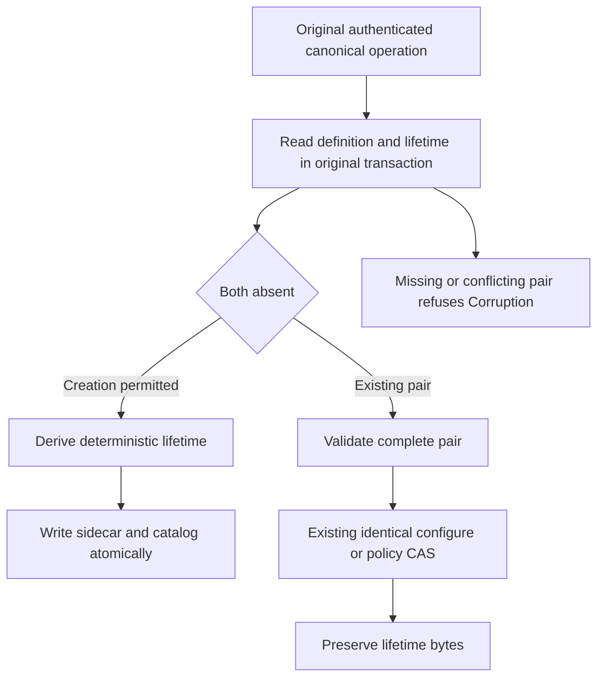

# Resource lifetime creation identity — D1

Resource names are reusable and carry distinct persisted resource incarnations; a permanent reserved-name profile is not used. This contract implements only active creation identity and preservation through existing metadata updates. It supplies no retirement barrier, name reuse, DROP TABLE or completed resource-removal behavior.

This foundation supports REQ-SQLC-006 / AC-SQLC-006, SQLC-DDL, without closing them. [CREATE TABLE](../RelationalStorage/CreateTable.md), existing ConfigureResource/policy CAS and [serialization](../InternalSerialization.md) keep their current authorization, transaction, cluster and format contracts. Build, TUnit, recovery and exact-source Linux cluster qualification are separate gates.

## Frozen D1 contracts

Both new records are internal, generated Orleans contracts in namespace `KeyLoad`. No field is added to ResourceDefinition, EntityRef, Command<DatabaseCommand>, public requests or default public JSON. Existing request fingerprints and raw-byte conventions remain unchanged.

| Record | Stable alias | Fields |
|---|---|---|
| ResourceIncarnation | `keyload.resource-incarnation` | 0: Value, a full lowercase 64-character SHA256 hexadecimal identity. |
| ResourceLifetime | `keyload.resource-lifetime` | 0: TenantId; 1: DatabaseId; 2: ResourceName; 3: TransactionDomainId; 4: Kind; 5: typed Incarnation; 6: CreationFingerprint. |

The adjacent sidecar key is the existing KeyCodec version-one encoding of `("resource-lifetime", tenantId, databaseId, resourceName)`. The canonical catalog definition remains at its existing key. The producer owns atomic creation and validation of that pair in the original transaction; the pure identity helper owns neither storage nor routing.

CreationFingerprint is exactly the existing `RuntimeOperationFingerprint.Compute(original)` of the original canonical committed creator operation. That frozen fingerprint already binds operation kind, principal ID, original command GUID and exact normalized PayloadJson. It excludes evaluation time. The helper does not change that digest or reserialize the request to introduce another input identity.

The incarnation is exactly:

```text
lowerhex(SHA256(KeyCodec.Encode(
  "keyload:resource-incarnation:v1",
  tenantId, databaseId, definition.Name, CreationFingerprint)))
```

KeyCodec supplies its existing version byte, typed UTF-8 components and zero escaping. This frames each component unambiguously and introduces no new encoder or library. Replicas applying the same original committed input derive the same identity; evaluation time, clock, store-local identity, randomness and process hash codes are not inputs. Equal GUIDs used by different principals have different creation fingerprints and thus different incarnations. Scope and changed canonical input also remain bound.

`ResourceLifetimeIdentity.Create(original, tenantId, databaseId, definition)` returns a complete ResourceLifetime for ConfigureResource or CreateTable creation. Producers invoke it only after their existing canonical payload and authority admission. `Validate(lifetime, tenantId, databaseId, definition)` requires matching tenant/database/name/domain/kind, strict lowercase 64-hex creation fingerprint and incarnation, and exact recomputation from the stored fingerprint and current scope. Malformed or mismatched identity fails the fixed Corruption diagnostic. serialization with an unsupported version retains its existing FormatUnsupported contract; this helper does not catch or reinterpret deserialization. These hashes identify trusted persisted creation; they do not authorize client-supplied lifetime fields or replace operation authentication.

## Producer transitions



For a genuine first ConfigureResource or CREATE TABLE, both catalog definition and lifetime must be absent. The engine producer checks actual storage and writes the sidecar with the catalog in the same transaction. Failure rolls back that transaction through its existing owner. CREATE remains create-only; a different command cannot replace an existing resource.

For existing identical ConfigureResource, policy-only CAS and queue dispatch metadata updates, the complete pair must already be present and valid before effects. Preserve the original incarnation and creation fingerprint byte-for-byte. A new policy-update command is not a new creation. Existing schema-version, policy, authorization, queue/blob accounting and failed-outcome rules remain authoritative.

If exactly one half is missing, or the pair's scope/identity conflicts, fail Corruption. Never manufacture a lifetime for an existing definition, silently backfill a missing sidecar or treat a sidecar without metadata as a new creation. No migration or legacy fallback is provided.

## Whole-operation evidence and remaining dependencies

D1 regressions must exercise actual ConfigureResource and compiled CREATE through the canonical command path and real ZoneTree. Verify independently expected creation identity and complete metadata, identical/configured policy transitions with unchanged sidecar bytes, original success/failure replay and policy fencing, cross-principal same-GUID separation, deterministic replica application, malformed/missing-pair refusal with no partial model effects, and actual joined cold continuation. Generated round trips preserve both records; public request JSON and existing frozen digest controls remain unchanged. Helper-only assertions do not replace these producer operation flows.

## D1 acceptance mapping and stage gate

The following source cases map only the D1 implementation slice of REQ-SQLC-006 / AC-SQLC-006 (SQLC-DDL). They do not close the full criterion. Source declarations are distinct from executed evidence:

- **Creation flow:** [ResourceIncarnationWholeFlowTests](../../../tests/KeyLoad.UnitTests/ResourceExecution/Cases/Resource/ResourceIncarnationWholeFlowTests.cs), `OriginalCreationIdentitySurvivesWritesPolicyRepairReplayIndependentStoreAndTwoColdOwners(bool sql)`. Its two actual TUnit arguments select ConfigureResource (`false`) and compiled CREATE TABLE (`true`).
- **Queue flow:** [ResourceIncarnationQueueWholeFlowTests](../../../tests/KeyLoad.UnitTests/ResourceExecution/Cases/Resource/ResourceIncarnationQueueWholeFlowTests.cs), `QueuePauseResumePreservesLifetimeAndQueuedWorkAcrossCorruptionRepairAndTwoColdOwners()`.

| Existing requirement / acceptance slice | Actual owning source case | Whole-operation oracle |
|---|---|---|
| REQ-SQLC-006 / AC-SQLC-006: D1 creation identity | Creation flow, both arguments | Real canonical creation and rows; the ConfigureResource argument checks an independent literal creation fingerprint/incarnation; both arguments check agreement with a separate actual store and a distinct identity for another persisted principal using the same GUID. |
| Same criteria: metadata update preservation | Creation flow, both arguments; Queue flow | Real policy CAS and queue pause/resume preserve the original sidecar bytes while complete metadata and row/queue work remain correct. |
| Same criteria: original outcomes and policy versions | Creation flow, both arguments; Queue flow | Original success/failure replay, changed-content conflict, stale policy CAS refusal and persisted-pair repair retain the documented outcome/model boundaries and do not mint a new lifetime. |
| Same criteria: malformed/missing pair refusal | Creation flow, both arguments; Queue flow | Genuine stored-pair corruption refuses, complete unchanged model effects are checked, and exact repair is followed by healthy original-owner operations. |
| Same criteria: recovery continuation | Creation flow, both arguments; Queue flow | Two actual joined cold owners preserve the full pair and model/outcome state, then continue genuine writes or enqueue/claim/ack work. |

Qualification of this contract requires a strict full-solution build with no warnings or errors and the declared focused TUnit cases actually executed with zero skips; the required recovery, real Aspire replicated-cluster and exact-source Linux gates remain separate.

No source change, compilation or local operation run establishes full SQL, production readiness, power-loss durability or delivered Linux qualification.

## Local current resource definition-pair integrity

This stage extends D1 producer integrity into ordinary authoritative local resource resolution. The previous D1 contract creates and preserves the adjacent pair but does not itself make every reader validate it. This extension validates the current server-resolved pair; it does not add a client-supplied incarnation, identify when a name-only request was constructed, bind a public EntityRef/cursor to a generation, or implement resource retirement/name reuse. Existing public request JSON, operation fingerprints, signed bytes, formats and canonical stored outcomes remain unchanged.

| Requirement | Measurable acceptance |
|---|---|
| REQ-RLLOCAL-001: every ordinary authoritative local ResourceDefinition binding validates its current adjacent D1 lifetime in the same already-owned view. | AC-RLLOCAL-001: genuine canonical model commands and read/query projections refuse a missing lifetime, orphan lifetime, malformed record or scope/name/domain/kind/incarnation mismatch before model effects/projection. Complete absence retains existing NotFound; malformed/mismatched pairs retain Corruption and unsupported formats retain FormatUnsupported. Exact repair permits the same owner to continue without backfill or inferred lifetime. |
| REQ-RLLOCAL-002: preserve fresh persisted authorization and existing canonical outcome semantics. | AC-RLLOCAL-002: existing coarse capability checks occur before private catalog/pair diagnostics, including unauthorized corrupt-resource input. Original failed command outcome and same-ID replay/conflict semantics survive repair and cold reopen without new IDs, outcome replacement or lookup moved ahead of required authorization/current metadata admission. A current invalid pair is not a promise of unconditional old-receipt access. |
| REQ-RLLOCAL-004: preserve original ownership, work charging and bounded complete-operation recovery. | AC-RLLOCAL-004: reads use the caller's same gated/budgeted view and work observers; commands use their original transaction and rollback/outcome path. Whole-operation tests check independent complete model/cut/receipt images, refused mixed effects, exact repair, healthy continuation and two actual joined same-root cold owners. No new cache, registry, provider, migration or implicit sidecar creation is introduced. |

The first common consumers are DatabaseEngine.Resource, including its existing current physical-owner gates and domain/kind validation, and the retired-outcome metadata branch of BatchResource. The latter retains its distinct owner admission semantics. Other direct authoritative catalog readers and authenticated overlay constructors must be mapped against their current callers and authorization order before the integrated source is frozen; a common helper alone does not qualify complete coverage. Existing producer ConfigureResource, compiled CREATE TABLE and queue metadata transitions retain their same-transaction D1 producer checks.

Both definition and lifetime are read through the same existing IKeyValueView: read the nullable canonical definition, validate the pair with ResourceLifetimeCatalog.Read, then apply the existing absence/domain/kind result. If both records are absent, the original absent-resource result remains. If exactly one exists, the pair is inconsistent. No swallowed error, unbudgeted store access, definition-only bypass or old-format fallback is permitted. The integrity helper grants no authorization and does not open a new store/read cut.

Implementation prerequisites are this local-integrity requirement extension and the original D1 producer pair, followed by a complete current authoritative reader/caller inventory and coordinated source/test integration. The concrete declarations and coverage are mapped below; their source existence is not a passing result.

Final qualification is separate from those implementation prerequisites: strict combined solution build, actual focused TUnit whole operations, existing process recovery and real Aspire-owned SDK/official-MCP cluster and exact-source Linux gates retain their original obligations. This draft provides no compilation, executed tests, cluster, deadline/work-budget fit or recovery proof. Reusable-name execution, DROP and global lifetime safety remain separate dependencies.

The common implementation seam is internal DatabaseEngine.BindResourceDefinition(IKeyValueView, PartitionRef, string, ResourceKind?). It reuses the original absence/domain/kind diagnostics. DatabaseEngine.Resource retains both original owner gates before calling it, and the retired BatchResource branch calls it without inventing a current-owner gate. Existing capability checks remain at their actual callers. Grant-scoped readers must supply a view created by their original ReadExecutionBudgetReadGrant, preserving read charging and cancellation; this binding helper does not unwrap, reserve or charge a second view.

Pair Corruption/FormatUnsupported does not become a fabricated durable failed outcome. Existing AtomicCommandCommit excludes those errors from ordinary failed-outcome recording. Under real replica admission, preserve and join the original committed-but-unapplied entry/materializer failure, perform exact-byte repair only after that join, and recover the same retained original entry through the materializer. Only its genuine resulting receipt and existing same-GUID success/failure/conflict behavior are accepted. No fresh-GUID retry hides a faulted original entry.

The existing public four-argument WithQueryView API remains unchanged and delegates Capability.None to a narrow internal additional-capability overload. That overload uses the same original Store.Read and requires the existing Query | DocumentsRead mask, then separately requires the additional capability before any Resource/pair diagnostic. Separate grant entries remain valid; the additional capability is not merged into a stricter single-grant mask. The selected ANN caller supplies its actual additional capability through that seam; this is not a new authorization dispatcher or a source/target lifetime equality rule. A genuine denied-extra-capability operation over damaged metadata must preserve permission refusal and all model state, followed by authorized repaired healthy continuation.

### Local integrity implementation and owning declarations

The internal query seam additionally accepts the caller's existing optional ReadExecutionBudget and an optional synchronous beforeResourceAdmission action. The same original Store.Read charges principal/owner/definition/lifetime metadata through the supplied budget. After the subject's original Query | DocumentsRead check and separate additional capability check, the action receives that already-budgeted metadata view before Resource binding. The result callback retains the original raw view for its existing explicitly budgeted work. The public four-argument API is unchanged. Bm25CorpusCapture uses the action to reload the distinct persisted publisher and require its actual administrator authority before pair diagnostics; subject identity, statistics capture and the original terminal CreateVerifiedBm25CorpusPublication revalidation remain separate and unchanged.

The early storage-free RequireRecurringSagaCapabilities gate checks the original scheduler/data lane for ConfigureRecurringSchedule, EmitRecurringOccurrences, CancelRecurringSchedule, CompareExchangeSaga and ExpireSaga before primary batch binding and retired metadata preflight. It delegates to the existing stripped-data-principal RequireScheduleCapability with its original SchedulerManage | QueuePublish mask, and retains deeper original timeout/creator checks.

The ordinary-owned/document-query READ paths remove redundant extra definition checks because their common Resource or ReadPartitionQueryFenceView binding now validates the current local pair in the same original charged view. They retain fresh authorization, read cuts, field/row intersection and existing errors. This avoids a second D1 lookup without admitting a definition-only authority.

| Requirement / acceptance | Actual source declaration and bounded oracle |
|---|---|
| RLLOCAL-001 local current pair | `ResourcePairBindingWholeFlowTests.MixedModelsAndSqlRefuseDamagedResourcePairsThenRecoverSameEntriesAcrossTwoColdOwners(ResourcePairBindingFault)` has four arguments: MissingLifetime, MalformedLifetime, ConflictingLifetime and MissingDefinition. It uses genuine canonical/journal mixed document/event/queue commands and compiled SQL INSERT plans, checks complete independent model/cut/receipt images, exact repair and healthy continuation. Both-absent preserves NotFound. This is current local pair integrity, not a name-reuse witness. |
| RLLOCAL-002 original authority/outcomes | The same case checks coarse extra VectorSearch denial over damaged metadata, separate-grant authorized continuation and unchanged four-argument query admission. It checks a scheduler administrator without its required stripped data grant before pair diagnostics. Genuine BM25 capture uses distinct persisted subject and publisher identities: publisher denial wins over damaged metadata, exact repair permits actual publication with independent literal statistics/receipt/replay. Pair Corruption retains the committed-but-unapplied original entry/materializer failure; exact repair and recovery resume that same entry, while existing ordinary failed-outcome and same-GUID semantics remain intact. |
| RLLOCAL-004 budgets, completion and recovery | The pair case exercises the original-budget metadata/lifetime boundary with refusal and authorized healthy control, same-original-entry recovery and two genuine joined cold reopen cycles of the same canonical/journal roots followed by fresh work. Original command receipt/replay, complete images and two cold continuations remain mandatory. |

These are test declarations under their existing TUnit entry, not direct test launches or real public SDK/MCP cluster evidence. The current source composition must include all normal binding/auth callers, the original grant-budget adapter and the same-cut BM25 publisher action as one coherent increment. Strict combined build, actual owning declarations with no missing/skipped cases, original failure/report/source/image identities, runtime work/deadline fit, recovery, public Aspire cluster and exact-source Linux qualification remain OPEN until their original evidence exists.
