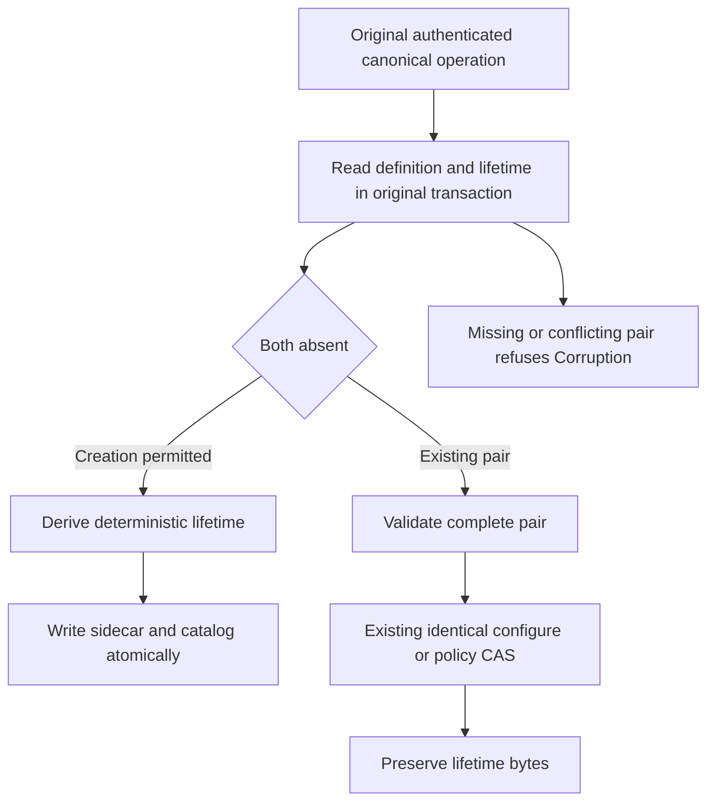

# Resource lifetime creation identity — D1

The owner selected reusable resource names with distinct persisted resource incarnations for the future DROP/resource-lifetime design. A permanent reserved-name profile is not the target. D1 implements only active creation identity and preservation through existing metadata updates. It supplies no retirement barrier, name reuse, DROP TABLE or completed resource-removal behavior. The earlier [DROP dependency proposal](../RelationalStorage/DropTableDependencies.md) remains the dependency inventory; its open identity alternatives are resolved by this owner selection, while its missing admission/inventory/cleanup foundations remain open.

This foundation supports REQ-SQLC-006 / AC-SQLC-006, SQLC-DDL, without closing them. [CREATE TABLE](../RelationalStorage/CreateTable.md), existing ConfigureResource/policy CAS and [native serialization](../InternalSerialization.md) keep their current authorization, transaction, RF3 and format contracts. Build, native TUnit, recovery and exact-source Linux RF3 qualification are separate gates.

## Frozen D1 contracts

Both new records are internal, generated Orleans contracts in namespace `KeyLoad`. No field is added to ResourceDefinition, EntityRef, ReplicatedOperation, public requests or default public JSON. Existing request fingerprints and native raw-byte conventions remain unchanged.

| Record | Stable alias | Fields |
|---|---|---|
| ResourceIncarnationV1 | `keyload.resource-incarnation.v1` | 0: Value, a full lowercase 64-character SHA256 hexadecimal identity. |
| ResourceLifetimeV1 | `keyload.resource-lifetime.v1` | 0: TenantId; 1: DatabaseId; 2: ResourceName; 3: TransactionDomainId; 4: Kind; 5: typed Incarnation; 6: CreationFingerprint. |

The adjacent native sidecar key is the existing KeyCodec version-one encoding of `("resource-lifetime-v1", tenantId, databaseId, resourceName)`. The canonical catalog definition remains at its existing key. The producer owns atomic creation and validation of that pair in the original transaction; the pure identity helper owns neither storage nor routing.

CreationFingerprint is exactly the existing `NativeOperationFingerprint.Compute(original)` of the original canonical committed creator operation. That frozen fingerprint already binds operation kind, principal ID, original command GUID and exact normalized PayloadJson. It excludes evaluation time. The helper does not change that digest or reserialize the request to introduce another input identity.

The incarnation is exactly:

```text
lowerhex(SHA256(KeyCodec.Encode(
  "keyload:resource-incarnation:v1",
  tenantId, databaseId, definition.Name, CreationFingerprint)))
```

KeyCodec supplies its existing version byte, typed UTF-8 components and zero escaping. This frames each component unambiguously and introduces no new encoder or library. Replicas applying the same original committed input derive the same identity; evaluation time, clock, store-local identity, randomness and process hash codes are not inputs. Equal GUIDs used by different principals have different creation fingerprints and thus different incarnations. Scope and changed canonical input also remain bound.

`ResourceLifetimeIdentity.Create(original, tenantId, databaseId, definition)` returns a complete ResourceLifetimeV1 for ConfigureResource or CreateTable creation. Producers invoke it only after their existing canonical payload and authority admission. `Validate(lifetime, tenantId, databaseId, definition)` requires matching tenant/database/name/domain/kind, strict lowercase 64-hex creation fingerprint and incarnation, and exact recomputation from the stored fingerprint and current scope. Malformed or mismatched identity fails the fixed Corruption diagnostic. Native serialization with an unsupported version retains its existing FormatUnsupported contract; this helper does not catch or reinterpret native deserialization. These hashes identify trusted persisted creation; they do not authorize client-supplied lifetime fields or replace native operation authentication.

## Producer transitions



For a genuine first ConfigureResource or CREATE TABLE, both catalog definition and lifetime must be absent. The engine producer checks actual storage and writes the sidecar with the catalog in the same native transaction. Failure rolls back that transaction through its existing owner. CREATE remains create-only; a different command cannot replace an existing resource.

For existing identical ConfigureResource, policy-only CAS and queue dispatch metadata updates, the complete pair must already be present and valid before effects. Preserve the original incarnation and creation fingerprint byte-for-byte. A new policy-update command is not a new creation. Existing schema-version, policy, authorization, queue/blob accounting and failed-outcome rules remain authoritative.

If exactly one half is missing, or the pair's scope/identity conflicts, fail Corruption. Never manufacture a lifetime for an existing definition, silently backfill a missing sidecar or treat a sidecar without metadata as a new creation. No migration or legacy fallback is provided.

## Whole-operation evidence and remaining dependencies

D1 regressions must exercise actual ConfigureResource and compiled native CREATE through the canonical command path and real ZoneTree. Verify independently expected creation identity and complete metadata, identical/configured policy transitions with unchanged sidecar bytes, original success/failure replay and policy fencing, cross-principal same-GUID separation, deterministic replica application, malformed/missing-pair refusal with no partial model effects, and actual joined cold continuation. Generated native round trips preserve both records; public request JSON and existing frozen digest controls remain unchanged. Helper-only assertions do not replace these producer operation flows.

## D1 acceptance mapping and stage gate

The following source cases map only the D1 implementation slice of REQ-SQLC-006 / AC-SQLC-006 (SQLC-DDL). They do not close the full criterion. Source declarations are distinct from executed evidence:

- **Creation flow:** [ResourceIncarnationWholeFlowTests](../../../tests/KeyLoad.UnitTests/Features/ResourceExecution/Cases/ResourceIncarnationWholeFlowTests.cs), `OriginalCreationIdentitySurvivesWritesPolicyRepairReplayIndependentStoreAndTwoColdOwners(bool sql)`. Its two actual TUnit arguments select ConfigureResource (`false`) and compiled native CREATE TABLE (`true`).
- **Queue flow:** [ResourceIncarnationQueueWholeFlowTests](../../../tests/KeyLoad.UnitTests/Features/ResourceExecution/Cases/ResourceIncarnationQueueWholeFlowTests.cs), `QueuePauseResumePreservesLifetimeAndQueuedWorkAcrossCorruptionRepairAndTwoColdOwners()`.

| Existing requirement / acceptance slice | Actual owning source case | Whole-operation oracle |
|---|---|---|
| REQ-SQLC-006 / AC-SQLC-006: D1 creation identity | Creation flow, both arguments | Real canonical creation and rows; the ConfigureResource argument checks an independent literal creation fingerprint/incarnation; both arguments check agreement with a separate actual store and a distinct identity for another persisted principal using the same GUID. |
| Same criteria: metadata update preservation | Creation flow, both arguments; Queue flow | Real policy CAS and queue pause/resume preserve the original sidecar bytes while complete metadata and row/queue work remain correct. |
| Same criteria: original outcomes and policy versions | Creation flow, both arguments; Queue flow | Original success/failure replay, changed-content conflict, stale policy CAS refusal and persisted-pair repair retain the documented outcome/model boundaries and do not mint a new lifetime. |
| Same criteria: malformed/missing pair refusal | Creation flow, both arguments; Queue flow | Genuine stored-pair corruption refuses, complete unchanged model effects are checked, and exact repair is followed by healthy original-owner operations. |
| Same criteria: native recovery continuation | Creation flow, both arguments; Queue flow | Two actual joined cold owners preserve the full pair and model/outcome state, then continue genuine writes or enqueue/claim/ack work. |

A D1 implementation checkpoint requires the combined strict full-solution build with no warnings/errors and all three declared focused native TUnit cases actually executed and passed, with zero skips and original source/compiled/TRX/cleanup evidence. This document and the SourceN packets do not assert those results. Existing required recovery, real Aspire RF3 and exact-source Linux qualification remain separate mandatory gates; a focused D1 checkpoint does not replace them or establish delivered qualification.

## Remaining dependencies

The later owner inventory can consume the typed lifetime produced here. D1 does not yet bind EntityRef, public by-name writes, prepared plans or signed cursors to resource incarnations, does not fence an admitted old-lifetime write, and does not implement retirement or cleanup. Those dependencies still precede reusable-name execution and DROP public qualification. An unadmitted name-only request carries no client-construction-time witness; a future contract must distinguish fresh name resolution from explicitly or previously server-bound lifetime work.

No source packet, compilation or local operation run establishes full SQL, production readiness, power-loss durability or delivered Linux qualification. The existing functional gate remains unchanged by D1.
