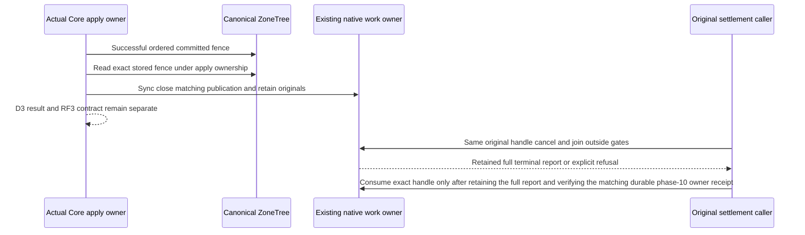

# Resource lifetime work settlement (D4)

Status: selected contract; implementation and native qualification OPEN. This is the D4 prerequisite of [DROP TABLE](../RelationalStorage/DropTableDependencies.md), under [ADR-125](../../ADR/ADR-125-connection-owned-execution.md) and [ADR-139](../../ADR/ADR-139-resource-lifetime-read-fence.md). D3 durable retirement, D4 work settlement, D5 cleanup, D6 durable outcome completion and public DROP acceptance are distinct gates.

## Purpose and boundaries

Retiring a resource stops new work for its exact persisted D1 creation lifetime and settles already admitted matching readers, writers and producers. Unrelated work on the SAME actual connection and physical store must remain usable. Existing native Orleans connection/capability owners, their original enumerators, deadlines, work admission and physical ZoneTree owners retain ownership. No replacement manager, scheduler, provider, public RPC or whole-connection cancellation is selected.

Every hosted server and receiver path supplies an explicit native operation binding through its actual caller, capability and original budget. Lower direct Core/Query/storage APIs and their tests remain a lower proof boundary; their existence does not prove hosted D4 settlement. Hosted Bound entrypoints reject a missing native owner before business execution; no default manager or null/no-op fallback is allowed. Trusted native retirement/inventory controls are selected by verified internal execution branches and must not self-cancel; callers cannot request an exemption.

## Requirements and completion criteria

| Requirement / criterion | Pass condition | Failure condition |
|---|---|---|
| REQ-D4SET-001 / AC-D4SET-001: exact admission | After fresh coarse authorization, capture the actual definition and validated D1 once in the SAME charged native cut, check D3 RequireOpen, then bind that exact dependency to the original work lease. Bind both join sides and actual ModelSource dependencies before use. | Name-only, domain-wide conservative membership, preauthorization binding, source/target substitution, or a hosted unbound path. |
| REQ-D4SET-002 / AC-D4SET-002: publication | Per-item publication ADMISSION serializes under the existing owner gate with matching publication closure. An item admitted before closure may finish while its original producer drains. | A token check alone, a check-to-yield race presented as exclusion, or a thread lock held across yield/await. |
| REQ-D4SET-003 / AC-D4SET-003: exact joined work | Cancel and join the exact original matching tasks, readers, enumerators and owned publication producers outside every storage/commit/materializer/replica gate. D4 ACK follows that join and no later owned publication follows ACK. | Cancellation requested without join, replacement tasks/tokens/deadlines, inferred network arrival order, or unrelated connection/store shutdown. |
| REQ-D4SET-004 / AC-D4SET-004: original failures | Retain original outcomes/failures separately from cleanup/join failures, including exact failure vectors. A cleanly joined original selected cancellation or business failure does not block settlement ACK; cleanup/join failure does. Fatal precedence remains. | Lost primary/cleanup errors, rewriting the original caller result, an ACK after failed cleanup, or exceptions on the wire. |
| REQ-D4SET-005 / AC-D4SET-005: bounded original retention | Close matching publication even when retained-handle capacity is unavailable. Preserve exact closed original leases and terminal errors in the existing bounded owner. Return explicit capacity-refused settlement, no D4 ACK; healthy retry captures those originals. Successful capture returns the SAME handle until explicit consumption. | Throwing handle capacity through already committed Core apply, discarding/resnapshotting old work, unbounded history, or an empty-binding ACK used as D4 proof. |
| REQ-D4SET-006 / AC-D4SET-006: cursors | Current scalar/live issuance and validation bind the original D1 and current format, retaining policy/schema/source/read-generation/native identity/hash/expiry checks. Reject missing/old format and stale D1 before business reads; then demonstrate healthy continuation. | A legacy reader, fallback/re-sign/migration, or rebinding an old cursor to a new creation. |
| REQ-D4SET-007 / AC-D4SET-007: recovery | Use actual physical owner identity, exact committed D3 control/fence receipt and the persisted pre-fence owner/voter runtime cohort. A cold process cannot replace lost original work with a new empty closure; verify real cold owners and fresh healthy work. | Treating a remote fence as a fabricated local owner, claiming old tasks were joined across process death, or power-loss claims from process recovery. |
| REQ-D4SET-008 / AC-D4SET-008: complete hosted coverage | All actual server/receiver, command, query, search, model, blob and long-producer paths use the explicit binding and original settlement path. Verify SAME physical connection with actual native witness IDs. | Only a generic query observer, a subset relabelled complete, or HttpClient reuse alone offered as same-connection proof. |
| REQ-D4SET-009 / AC-D4SET-009: verified local child retention | Reserve a server-created signed child in the SAME bounded original native owner frame table. After actual signed-request and connection verification, atomically claim its exact original producer and SAME ledger on the expected physical owner, voter and full runtime generation. Join dispatch, writer and cleanup before releasing the parent hold. | A fresh child allowance, missing/mismatched reservation accepted as a new root, duplicate producer acquisition, context used as authority, premature undispatched completion racing a live consume, or parent cleanup before child dispatch cleanup. |

## Committed fence and publication linearization

The existing atomic store's transaction callback runs BEFORE journal publication. It must not announce a staged fence as committed. After successful committed Apply, and while the original materializer/apply ownership remains held, Core immediately reads and validates the exact stored owner fence and synchronously closes matching publication under that read gate, before Apply returns. A fresh authorized recovery ReadOwnerFence repeats the trusted closure in its actual read gate. New bindings check the durable fence in the same local authorized cut, preventing admission through the intervening interval.

The actual postcommit Close is the D4 publication-admission linearization point. D3 durable fence/RF3 ACK remains distinct; D3 execution may finish before D4 settlement. Cancellation and joining never run under CoreStoreCommit, materializer applyGate or ReplicaAppend locks. The actual all-hosted NativeRequestWorkOwner is attached once before inventory/native admission readiness; a movement-only work owner is not a substitute.

## Binding, budgets and native boundaries

The internal contracts live in Core.Features.ResourceExecution: IResourceLifetimeWorkBinding, IResourceLifetimeReadBindingView, IResourceLifetimeWorkFence and IResourceLifetimeWorkSettlement. A resource coverage contains its real full partition; a command metadata/EventControl effect set may be legitimately flat. Its Bind(ImmutableArray<ResourceLifetimeV1>) never invents a partition. Existing authenticated resource coverage validates its real partition and forwards the exact lifetimes.

BindAuthorizedReadResource is invoked only after the caller's fresh coarse permission check. It resolves the actual pair once, checks native owner/publication and D3 admission, and then calls the explicit budgeted-view binding. Generic preauthorization resource resolution has no D4 callback. BindAuthenticatedReadResourceLifetime handles an already verified source definition/lifetime and local D3 fence without substituting a local sidecar. A target's own D1 may legitimately differ from its authenticated source D1: bind both genuine logical dependencies to the target's own original local work lease. Source connection ownership never proves remote physical execution settlement.

Retained encoded D1 bytes consume the SAME ORIGINAL operation-owned result-retention ledger; available MaximumResultBytes decreases accordingly. Retained entries use the existing MaxScanRecords bound. Parent and children share that ledger, with no reset or duplicate allowance. A fully reserved native read grant supplies no extra free bytes. Preserve actual raw read/ACK counters, current limits, cancellation and the original request deadline. Fixed long-operation plans bind their actual complete dependency closure; successive child budgets cannot create an unbounded parent union.

## Verified local child admission and joined dispatch

A local helper can cross an Orleans RPC even inside one process. Adding a CLR binding argument to that helper does not transfer its ledger to the child activation. The selected mechanism extends the SAME NativeRequestWorkOwner admission frame table; it does not add a registry, manager, wire budget protocol, hard placement rule or CLR reference in a request/context.

Before the existing native dispatch, the original producer reserves the server-created signed child RequestId, exact verified purpose/body/subject fingerprint and expected actual physical owner, voter, incarnation and full silo runtime address. The reservation consumes existing producer/frame capacity, retains the original parent token and ledger, and inherits already validated parent dependencies under the same owner gate. Further actual child dependencies extend that same bounded parent union after authorization. Child budgets may tighten the original ceiling but cannot reset or enlarge it.

The child verifies the actual signed request and connection identity before selecting its producer. Selected private query/search child purposes atomically consume the exact preallocated producer on the SAME attached owner and borrow the SAME ResultRetention reference. Missing, changed, duplicate, closed or wrong-runtime claims fail closed with OwnershipLost; they never acquire a new root allowance. PreferLocal placement alone is insufficient. Existing native routing is retained, and actual healthy placement remains an RF3 qualification gate.

Dispatch closure and verified consumption serialize under the existing owner gate. An undispatched reservation becomes closed before its original child is completed, so late consumption cannot start work whose producer was already released. A consumed dispatch waits for that same original child producer and writer to settle. Identity restoration, linked cancellation disposal and input cleanup finish and retain every cleanup failure before the parent completion hold is released. Original business failure and cleanup/join failure remain separate; all child/dispatch cleanup failures are propagated to the parent settlement, with fatal precedence retained.

Follower document reads also use one original budget/binding across capture, the existing native follower read barrier and completion. Their transient in-process snapshot retains the original same-cut D1 without changing the frozen V1 wire serializer. Completion revalidates current permissions and that exact D1 before row visibility/projection, preserving native term, placement, read-generation, minimum-token and lag checks.

## Retention, consumption and remaining liveness

Qualified handles and retained original frames share the existing MaximumTotalFrames capacity. Close always marks matching original publication closed and tags those originals before reporting capacity refusal. A refused settlement produces BudgetExceeded and no D4 ACK. Completing unrelated work can permit a later qualified capture of the SAME tagged originals; a fresh snapshot of newer work is insufficient.

A successful handle memoizes its original cancellation/join task and full terminal report even when cleanup fails. Exact-fence replay returns that handle until ConsumeSettlement(fence, originalHandle). Consumption requires the actual owning D4 caller has retained all typed receipt and error information and verified the exact durable phase-10 owner acknowledgement. A lost reply must retry the same retained handle or the actual stored owner receipt, preserving its original snapshot and evidence; it must not capture a newer empty set. Consumption does not rewrite the original caller's outcome. Existing global shutdown starts and joins the same retained handles outside locks so pending cancellation observers cannot deadlock original completion.

All slots occupied by matching retained originals may conservatively remain refused. Broader D6 durable receipt ownership, replay, consumption after restart and final DROP liveness remain OPEN. This is not permission for permanent unbounded history, false success or dropping errors. No process-generation reset proves pre-crash tasks joined.

## Durable work acknowledgement and recovery

Native work read 10 joins the same retained local closure outside storage/apply/append ownership and publishes a bounded witness only after its complete clean terminal report. The witness names the full exact stored fence, actual physical owner, voter, full runtime address, store identity, read generation, matched snapshot count, maximum publication generation and snapshot digest. Raw exceptions, user payloads and identity claims stay local. Both original signed native request and signed reply are verified before a fresh phase-10 canonical owner submission.

Phase 10 commits each owner acknowledgement through that actual owner RF3 group; phase 11 records its genuine receipt in source RF3; phase 12 seals the complete configured owner set in source RF3. D3 BarrierSealed does not substitute for this work barrier or permit D5 cleanup. Capture every configured voter before validating the complete cohort. Any capacity refusal, cleanup or join failure produces no work acknowledgement.

An actual durable owner receipt can survive the original reply or phase-11 delivery being lost. A fresh authenticated work read may return that stored receipt, so retry reuses the original phase-10 body and command identity. Historical proof verification preserves its exact envelope bytes and MACs without renewing its deadline; current admission still requires fresh persisted authorization and a fresh authenticated observation of the durable owner receipt.

Attaching the physical work owner records the maximum of actual database LastApplied and the original durable replication log LastIndex before readiness. A newly qualified closure requires the fence receipt AppliedPosition to be later than that baseline. Store.Position is a different storage counter and must not be compared with this replication index. This baseline alone is insufficient when a cold lagging voter receives an already committed fence later. The actual pre-fence OwnerStatus replies therefore capture every configured owner/voter full native SiloAddress generation, store node/incarnation and read generation; Begin persists that exact bounded cohort in its control. Before creating a new work witness, the receiver must match its actual current identity to that original cohort. A directory or store identity alone does not prove the same process survived. Lower D3 fixtures without runtime origins cannot provide D4 proof.

Replaying a pre-attach fence still closes matching publication but cannot fabricate a successful empty closure. Before a durable owner acknowledgement, lost original runtime/closure evidence refuses settlement. After acknowledgement, a fresh authorized native observation may replay the exact stored typed receipt and original cohort witness across restart; it does not resnapshot current work. Process termination does not prove a clean pre-crash join or power-loss durability.

Conflict reconciliation reads the actual immutable owner or source outcome, including its original command, control, body and witness cohort. The existing leader read cut must materialize every locally accepted durable log entry before another submit. An opaque UnknownWriteOutcome can include cleanup failure and therefore cannot become a successful acknowledgement in that same call. A later same-identity request may read a genuine durable outcome. Original submission failures remain local and retained through terminal cleanup.

The phase-12 work barrier retains the actual signed original operation and original principal policy epoch. D5 uses its immutable first stored state, with no later cleanup/release fields, rather than rebuilding a phase-12 snapshot from current state. Final source reads validate actual phase-22 and phase-25 operations/outcomes. Public DROP resolves its durable parent mapping before consulting a current resource name, so retrying an original header command after recreation returns the original result without targeting the new creation.

## Verification and execution contract

A owns native owner/lease publication closure, bounded original handle retention, asynchronous cleanup and actual server/receiver plumbing. B owns original budgets, Query/Search/ANN binders and current scalar/live cursor format. C owns disjoint Core model readers and their explicit Bound entrypoints. C2 owns Core retirement, the authorized pair resolver, actual postcommit hook and leader effect-set binding. Main assigned C4 the cohesive D4 native authenticated orchestration and transport successors over the selected C1 D3 source; C2 owns the shared work ABI, state validators and D5/D6. Existing C1 D3 authentication and RF3 contracts remain prerequisites. Root joins the complete source and preserves original evidence; only Main writes canonical source and runs semantic tools, formatter, build, native tests and Git in the current shared cohort.

| Criterion | Owning whole-operation evidence | Current status |
|---|---|---|
| AC-D4SET-001/006 | ResourceLifetimeCursorNativeTests.GenuineScalarAndLiveCursorsBindCreationRejectOldFormatAndAnotherActualCreationThenHealthyAndTwoCold: native scalar/live issuance, unsupported typed old format, another genuine creation, negative pair drift and exact restoration, literal healthy continuation, original receipt replay and two cold owners. | Source prepared. Lower direct cursor proof only; not hosted D4 ACK. Truly missing current-field decoder proof remains OPEN because the strict native signer refuses it before reader execution. |
| AC-D4SET-002/003/004/005 | Actual native owner capacity refusal, matching original publication closure, unrelated healthy work, retry retaining original failures, same-handle replay and explicit consumption. Use a genuine committed fence from the actual owner; no fake fixture or manual positive fence. | Implementation/test composition OPEN. The obsolete two-owner D3 fixture cannot manufacture required RF3 Preparing authority. |
| AC-D4SET-001/002/003/007/008 | Existing real two-group RF3 topology, actual source/target directory and authenticated D3 driver; held native table read and MaintainOnlineTextIndex at OnlineTextCaptured, same HTTP/2 connection with native probe IDs, unrelated literal operations/replay and two cold waves. | OPEN; native retained-handle observation and complete hosted closure still required. |
| AC-D4SET-009 | Genuine native V2 signed child, same producer/ledger reference, failed missing/body/subject/runtime/late claims, healthy new-child retry, inherited D1 conservation and joined parent release using actual native discovery identities. | Source implementation and test preparation in progress. A lower owner contract test does not prove hosted routing, Docker/Aspire RF3 or a D4 ACK. |
| All | Combined strict solution build, native diagnostics/analyzers, canonical format and actual selected TUnit cases, required process recovery and genuine Aspire RF3 SDK/official MCP runs, original source/DLL/PDB/image/TRX/cleanup identities and exact-source Linux qualification. | OPEN. No checks executed by this prepared-source leaf; coverage/CRAP unmeasured. |

Do not add packages, suppress diagnostics or relax limits. Review the existing SDK/owned analyzer findings and the 64 method/200 aggregate type/400 file/nesting3 rules against the final combined source. dotnet format remains canonical; CSharpier and adding overlapping analyzer packages are not applicable. Existing native TUnit fixtures own Aspire resources and joined shutdown; Main runs their selected current repository entry. A prepared packet, static review or compilation is not a passing runtime, recovery, RF3, power-loss, performance or production-readiness gate.
