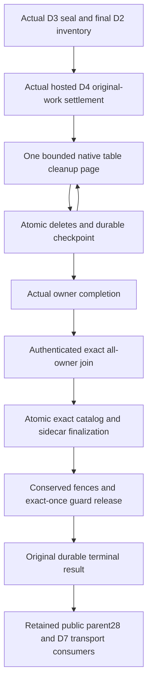

# Bounded table retirement completion

This is D5/D6 source design and implementation work under the [DROP dependency inventory](../RelationalStorage/DropTableDependencies.md). The selected D3 source and actual hosted D4 settlement are prerequisites. The prepared leaf implementations are not yet a connected, compiled or RF3-qualified DROP operation. Public D7 API/lowering is a separate consumer; parsing DROP syntax or deleting metadata is insufficient. The completion ADR remains a draft until Main reserves its number; no unreserved ADR is part of this source packet.

## Scope and completion contract

One exact ResourceLifetimeV1 remains retired while every captured physical RF3 owner cleans its table-owned rows in bounded native transactions. Orleans routes separately authorized request work; the node-local owner retains ZoneTree handles, journals and ordered apply. Native generated contracts bind the actual original command, retirement, lifetime, physical owner/incarnation, logical partition and preceding durable cursor. Each page commits deletes and its next checkpoint together. An unknown original native result remains unknown until the same stored original is recovered; rebuilding an original with a new timestamp is not recovery.

The family visitor deletes only document, index, unique, document-epoch, visibility-epoch, vector, vector-projection-lineage, current BM25 and current online-text rows for the exact table/partition. Mixed source-target vector-projection-effect rows remain fenced idempotency provenance. It preserves unrelated models, shared outbox/consumer progress, authentication, original command outcomes and atomic/replication journals. No external graph, queue, event or arbitrary JSON payload is cascade-deleted. D4 owns joined disposal of RAM/index snapshots and original work; deleting logical records is not physical erasure of WAL, pins, backups or device blocks.

The source finalization requires exact all-owner completion joined to the sealed final D2 inventory. Every registered owner participates, including owners with no matching partitions. It atomically removes BOTH the exact old catalog definition and lifetime sidecar, writes immutable old-incarnation history and a name succession pointer, and retains its original final result. A mismatch cannot remove a successor incarnation. Proposed CREATE identity is checked directly against all retired incarnations by its exact history key; replaying an old fingerprint cannot resurrect old D1 even when an old result is unavailable.

Catalog-finalized and terminal-released are separate states. Phase23 stages the immutable owner release, exact native authority summary, conservation step/floor/marker and both owner replacement/fence decrements in one transaction. A source owner contributes its retained finalization history in addition to the fence, cleanup and owner release rows; other owners contribute their three exact rows. The retained per-lifetime prepared count remains immutable. Native image replacement and genuinely fresh restore must preserve the same conserved authority through C1's selected image/lineage implementation before this release is admitted as a qualified gate. Phase25 removes only the source Begin blocker after every exact owner release is recorded. Neither a counter decrement nor catalog deletion establishes public success or durability qualification.

The finalization stores the actual phase22 operation, its commit-time policy epoch and canonical receipt. The canonical token uses the native operation apply position, matching the existing replicated command token law; the physical Store.Position counter remains separate. Completed state similarly stores the actual phase25 operation and policy epoch. Retained completion reads verify their original Core signatures, fingerprints, exact global outcomes and closed result arms. Missing outcomes remain RecoveryRequired; metadata alone cannot recreate an acknowledgement. A currently authorized recovery administrator may differ from the original Begin actor.

The public53 parent is keyed by the authenticated subject, public header GUID and requested scope. Its lookup precedes fresh name admission. Native27/28 use a dedicated versioned identity derived from the public lookup and phase, while retaining and checking the exact original operations/outcomes. Completion28 requires the actual completed old-lifetime state and phase22 receipt; it stores the public result JSON once. A reused table name never redirects an old header GUID to the successor. The phase22 receipt keeps its actual native command ID instead of taking the public parent ID.

## Canonical entity references

Fresh external EntityRef submissions may omit their witness and resolve once at actual authenticated admission. NEW persisted/returned canonical references contain EntityRefLifetimeV1 with the actual server-bound D1 incarnation. EntityRef retains field IDs0–2; optional field3 is the typed witness, omitted from JSON when null so original name-only command bytes remain unchanged. Original signed/native commands, digests and outcome bytes are not rewritten to install a witness.

Stored canonical typed links require the witness. Null/malformed stored bindings are unsupported current format and return FormatUnsupported, without backfill or a works-until-reuse branch. Missing target resource returns NotFound; an existing different lifetime returns OwnershipLost. Existing SQL join behavior for an absent row remains unchanged. A current fresh name-only lookup is distinct from resolving a stored link. Generic queue/event user JSON is not implicitly scanned at insertion; converting a selected payload to a typed reference requires strict binding.

Controlled reads/writes validate canonical references against authenticated SOURCE coverage where the existing native protocol gives that coverage authority. Independent target-local metadata still owns its own admission and cannot substitute a different lifetime for a controlled source reference. Remote graph preparation needs an authenticated bound-destination companion; original request/digest remains immutable. New original canonical intent images contain the bound references before their own digest is frozen.

Dynamic QueueToGraph whose endpoints are learned from queued payloads exposes a separate signed-scope planning dependency: its native admission cannot omit actual endpoint lifetimes, speculate effects, union every database resource or infer future in-batch selection from an earlier store read. This dependency remains explicit until its selected bounded planning contract is implemented. Strict source coverage and reference checks remain enforced.

## Prepared cleanup-page retry contract

CleanupPage is the third closed purpose of the existing native phase5/6 prepared-attempt protocol. Its context binds the exact retirement control, registered receiver and full logical PartitionRef plus logical page ordinal. Older SealBarrier and OwnerReservation identities, key bytes and expiry rules remain unchanged. A page coordinate has one direct current-attempt pointer in the existing attempt storage; it does not append page attempts to the retirement state or preparation owner arrays. Retry-attempt ordinal and logical page ordinal are separate quantities.

Phase5 records the actual source-owned attempt and its original outcome. The existing attempt read accepts an empty attempt ID only for this CleanupPage purpose to discover the validated current pointer; an absent pointer returns NotFound. The phase5 result uses the dedicated CleanupAttempt arm. A currently authorized target administrator may differ from the source phase5 actor.

The target's readonly native issuer may construct phase20 only for the exact context and attempt. Canonical phase6 Persist is the sole publication of its complete original native operation: actor, evaluation time, signed body, previous flat checkpoint, byte/record grants and fingerprint become immutable together. Phase20 requires that exact persisted original from an open attempt before cleanup effects. Its command ID includes the attempt identity; the durable checkpoint carries that attempt ID before candidate encoding and sizing. The stored original is separate from the flat checkpoint, avoiding recursive previous-original chains.

The actual driver reserves one finite data grant before issuing the original, leaves bounded metadata headroom and retains that same grant through issue, Persist6, page20 and actual import/join. A recovered original retains its exact grants. If the current authorized budget cannot cover them, retry refuses rather than rebuilding the body under the same GUID. Losing the Persist6 or successful page reply requires reading the actual persisted original and original outcome; absence of a reply is not proof of failure.

A persisted Original20 whose outcome is missing or UNKNOWN remains RecoveryRequired even after its expiry. Neither expiry nor a transport error permits closing it, changing its grants or starting a new attempt. Conditional phase6 Close advances only after the actual owner proves the exact canonical failed outcome; the original error code alone is not such proof. A genuine successful outcome cannot be classified as failed. Only the actual durable Closed receipt permits a later phase5 attempt for the same page coordinate.

A never-issued attempt is a distinct case: an atomic authoritative phase6 Closed record with Original=null may fence it after the existing deadline. That durable terminal state must permanently reject both a delayed PersistOriginal20 and a delayed phase20 effect. Mere absence, a read or expiry without that committed non-execution fence cannot license a new attempt.

Qualification requires a genuine D3 all-voter seal and D4 joined-work producer followed by failed20/Close6/healthy retry, persisted-UNKNOWN no-advance, delayed-persist/effect refusal after a never-issued close, exact lost-success replay, coordinate substitution refusal and two joined cold reopens. Low-level family-visitor tests and incomplete two-owner quiescence fixtures do not establish this gate. These native and RF3 gates remain OPEN until the selected implementation and real clients pass them.

## Requirements and gates

| Requirement | Contract | Acceptance and evidence |
|---|---|---|
| REQ-D56-001 | Exact table-family ownership and a candidate sized against the actual native outcome, clock/applied metadata and WAL codec before effects. | AC-D56-001: real multi-partition page receipts, charged scan/lookahead bytes, bounded retained keys/mutations, failure-before-progress for an oversized required record, and unchanged unrelated models/history. Native TUnit companion OPEN. |
| REQ-D56-002 | Actual original D4 settlement precedes every cleanup effect. Await/join occurs outside append, Store and apply gates. | AC-D56-002: genuine all-voter original closures, cancellation/release/join failures and capacity refusal produce NOACK and no cleanup. Actual hosted bridge OPEN. |
| REQ-D56-003 | Atomic durable continuation and original outcome recovery. | AC-D56-003: stale/mixed/skipped cursors refuse, original page replay does not append/redelete, actual process cut after a real page receipt resumes through owner restart and two joined same-path cold reopens. Native fixture OPEN. |
| REQ-D56-004 | Exact catalog/lifetime finalization and preserved old identity history. | AC-D56-004: missing half/mixed owner/different incarnation refuses atomically; recreated successor survives old finalization replay; retired CREATE fingerprint cannot resurrect; current authorization controls original result access. Connected source protocol and native evidence OPEN. |
| REQ-D56-005 | All canonical typed links bind actual lifetime and cannot retarget a recreated name. | AC-D56-005: document/graph/vector/composition/queue/event typed-resolution paths and real SDK/MCP roundtrips validate the selected witness, with explicit controlled source lineage and no legacy migration. Source closure in progress; qualification OPEN. |
| REQ-D56-006 | Exact-once topology guard release preserves old fences/history and concurrent retirements. | AC-D56-006: genuine late frames, native image replacement, current owner restart and two-cold recovery preserve old-life exclusion; no counter underflow/release of another retirement. Core release and C1 image source are prepared; their cohesive adoption and native/RF3 evidence remain OPEN. |

The D4 immutable phase12 snapshot must come from the original authenticated stored outcome. Cleanup pages and owner completion reject mutable D5 progress as a replacement snapshot before journal admission. The actual D4 producer/getter, pre-fence runtime cohort, native read successors, public driver and C4 public17 consumers are separate required source dependencies. The selected Core source component is conditional until these exact successors are joined; the incomplete all-operation composition planner is excluded.

Prepared phase6 Close eligibility is checked through one shared read-only validator at both the existing leader preappend boundary and atomic apply. A persisted CleanupPage Original20 without an actual canonical outcome remains RecoveryRequired even after expiry; a never-issued attempt may close only at or after its actual expiry. Ineligible requests must leave the replica last/commit/apply indices and outcomes unchanged. The existing leader round, applied-tail cut, state lock and unchanged phase6 evaluation order the eligibility read with append. Original captured admission errors keep their prior failure boundary, and hard recovery errors do not become fabricated canonical outcomes. Genuine native refusal, healthy follow-up and two-cold regressions remain required and unexecuted in this source component.

## Evidence boundary

Prepared source is reviewable work, not a passing build, TUnit result, process recovery, RF3 SDK/MCP run or Linux qualification. No public DROP completion, power-loss durability, physical erasure, benchmark improvement or production-readiness claim follows from these leaves. Main integration owns exact virtual successor composition, canonical adoption, required checks and delivery checkpoints.
