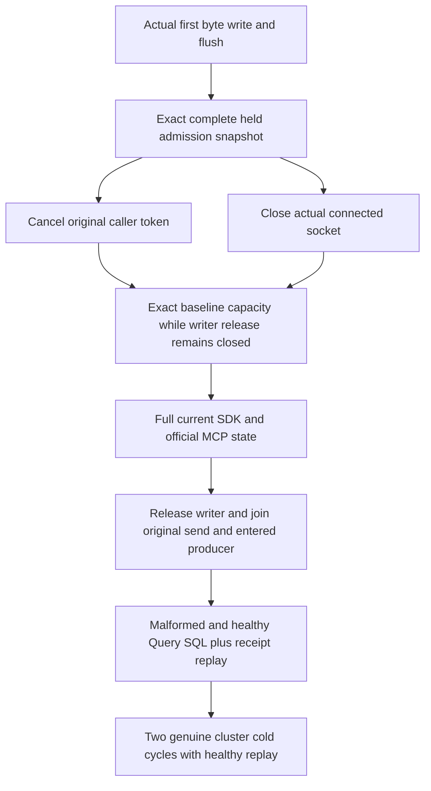

# Slow-body cancellation and physical disconnect return admission

ResourceExecution; extends [EarlyAdmissionQualification](EarlyAdmissionQualification.md) without repeating its saturation/normal-body-completion case. REQ/AC-ADM-001, REQ-MP-002/AC-MP-004/005, REQ-AISQL-003/AC-AISQL-007.

The genuine Aspire cluster fixture seeds the same independent two-document canonical image, full original commit receipt and complete outbox. Two separate actual HTTP/1 request owners declare a real QueryRequest length, flush one byte and withhold the remainder. A complete HTTP admission snapshot must match the independently derived hold: original baseline plus one node/scope request and exact heavy-read/envelope/body charge, with all other fields conserved. Client body entry alone does not establish server admission.

One attempt cancels its original caller token. The other disposes the actual connected Socket retained by SocketsHttpHandler.ConnectCallback, using the discovered Aspire endpoint and a real NetworkStream. No substitute server/provider or server test seam participates. Each must return the complete admission snapshot to its original baseline while the body release gate is still closed; healthy full SDK/official MCP document/query/outbox reads then run. The original send and producer are joined, and independent cleanup observes socket/client/handler disposal plus counter return without discarding the primary failure. Disconnect is a transport-socket claim, not an inferred grain-deactivation or storage-handle claim.

Both public clients then repeat malformed SQL validation and complete healthy SELECT through Query and unified SQL, preserving exact document wrappers, complete two-row pages, null cursor and literal bounded-full-scan access path, full outbox, and the independently constructed original commit receipt on real replay. Two actual Aspire cluster cold cycles repeat the healthy/validation/replay flow against the same canonical partition and persisted identity. This qualifies public logical model/outcome conservation; it does not assert physical raw-file-byte conservation or absence of every internal dispatch.

Frontend N/A: qualification-only flow. Product, contracts, authentication, server probes and shared source N/A: unchanged. Default50/coverage inventory, discovery UID, compiler/analyzers/format, actual original termination behavior and deadline fit, Linux cluster SDK/official MCP execution, all recovery/endurance gates remain OPEN until original execution evidence exists. No local execution, benchmark, performance, power-loss or production-readiness claim.

The original body serializer records actual entry before its first write. This entry witness is separate from Started, which still requires the first byte write and flush and cannot stand in for server admission. Cleanup joins the entered serializer through its original Finished task even if the first write/flush failed or was canceled before Started. Existing original send termination, socket closure, writer release, independent cancellation and bounded cleanup failures remain conserved; no pre-first-write fault is claimed as executed.

## Criterion verification mapping

| Requirement | Acceptance and original automated case |
|---|---|
| REQ-SLOW-RETURN-001 | AC-SLOW-RETURN-001: `SlowBodyAdmissionReturnTests.CanceledAndDisconnectedSlowBodiesReturnCapacityThenBothCallersAndTwoCold` requires actual first byte write/flush plus exact complete held snapshot. Node adds one request, heavy-read/body reservation and envelope; verified scopes add one request and the independent literal4096-byte envelope. All other limits, counts, active scope inventory and control fields match baseline. |
| REQ-SLOW-RETURN-002 | AC-SLOW-RETURN-002: the same case independently cancels the original caller and closes the actual owned connected socket. Complete capacity returns to baseline before releasing the body producer; no cancellation is substituted for physical disconnect. |
| REQ-SLOW-RETURN-003 | AC-SLOW-RETURN-003: the same original flow joins original send and entered body, preserves primary plus cleanup failures, then checks full SDK/official MCP current documents/outbox, malformed and healthy Query/SQL pages and original receipt replay. Two genuine same-root cluster cold cycles repeat healthy/replay checks. UID and execution remain OPEN. |

This finite oracle correction follows the actual `HttpAdmissionLease.Bind` → `scopes.Reserve(kind, principal, 0, 0)` → `CommandAdmissionGovernor.CalculateRetainedBytes` path. Zero payload reserves the existing4096-byte envelope in verified scopes; it does not reserve a second body or heavy-read charge there. No product limit or reservation algorithm changes. The Allman/named-text corrections and feature-local settlement extraction preserve original operation and cleanup ordering. It does not close timing/termination fit, Linux cluster or qualification gates.
