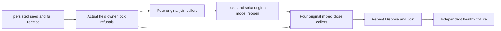

# fixture successful concurrent close

REQ-FIXTURE-CLOSE-001 requires the current shared `TestDatabase.JoinOwnedResources` / `Dispose` entry points and their `TestDatabaseCloseState` gate to close one real fixture safely for concurrent and repeated successful calls. AC-FIXTURE-CLOSE-001 maps to `TestDatabaseConcurrentCloseTests`: a genuine persisted root/configured collection, fixed original command and exact full receipt/document/record/complete collection page precede all closes. The expected token uses the independently known next committed index, never local ZoneTree Position. Exact original command replay conserves full canonical rows, identity and local position.

REQ-FIXTURE-CLOSE-002 / AC-FIXTURE-CLOSE-002 uses four dedicated actual callers released only after all are ready. Join-only closes the same original owners while retaining the root. Both actual canonical and replica owner locks are refused while active and reacquired after original callers finish. Strict existing canonical reopen verifies the full original identity, current model, canonical image and complete receipt replay. A separate argument starts mixed Join/Dispose directly from a fresh live fixture. All original worker tasks are joined, including partial scheduling/cancellation failures; no fake close delegate, task failure, provider or injected error is used.

REQ-FIXTURE-CLOSE-003 / AC-FIXTURE-CLOSE-003 requires successful mixed Dispose, repeated Dispose and Join to return and leave the original root absent. An independent healthy fixture repeats the complete acknowledged operation, join/reopen and successful disposal. Unexpected body/cleanup failures remain in original-first observer ledgers; uncertain reopened ownership prevents later directory deletion. No new timeout, retry policy, production option, library or existing source seam is changed. The current owner holds `closeState.Gate` through `TryBeginJoin`, the original execution `JoinCore` and `CompleteJoin`; `Delete` independently requires that same completed successful close. Bootstrap and configuration use the current extracted factory roles. No old private close-helper API is restored. Every reopened lock acquisition is gated by the preceding owner’s proven `CanAdvance` close result.

The private materializer shutdown task is not exposed by this new-only test: original caller task completion, ownership locks and actual source linkage supply the bounded observation, not an invented task counter. Failed-close EDI identity, actual concurrent-close scheduling overlap inside the serialized critical section, OS faults, compiler, repeated full runtime, Recovery/cluster/Linux and full qualification remain OPEN. Source code and deterministic concurrency setup are not runtime evidence. This is not an old-code-failing failure discriminator or a power-loss claim.

The [ResourceExecution](../ResourceExecution.md) feature and [ADR-117](../../ADR/ADR-117-tunit-ci-entry.md) retain TUnit execution and original resource ownership. Existing simple one-close fixture cases and pointcache/stream-owner races are not duplicates of this actual shared fixture operation.

