# fixture constructor rollback continuation

REQ-FIXTURE-ROLLBACK-001 / AC-FIXTURE-ROLLBACK-001 strengthens the existing `AcTest006_FailedFixtureSetupReleasesStoreAndOwnedDirectory` with its unchanged zero and negative concurrency arguments. The actual central DatabaseLimits validation occurs after Store acquisition, before engine bootstrap or replica acquisition. Exact original InvalidOperationException type and canonical message, root absence and genuine same-path reopen at Position0 remain required. This is initial fixture setup rollback, not replacement or migration of acknowledged data.

REQ-FIXTURE-ROLLBACK-002 / AC-FIXTURE-ROLLBACK-002 requires complete zero canonical records, unchanged full identity across the read, nonempty node/incarnation and ProcessDurable before that reopened owner is closed. Its original body and close failures are retained independently and original-first. Only successful close plus all successful empty-state assertions admits deletion of that owned metadata/tree directory. Uncertain acquisition/close or unexpected records retain the path and prevent the healthy continuation. No acknowledged record is discarded.

REQ-FIXTURE-ROLLBACK-003 / AC-FIXTURE-ROLLBACK-003 starts an actual replica TestDatabase on that same now-absent path. It reuses the exact reviewed concurrent-close seed/receipt/model/replay/lock/reopen roles: configure a real collection, commit a fixed original command, independently require the complete expected receipt and full literal model/record/page, replay the actual original retained entry and conserve complete canonical state. Actual join callers, strict same-store reopen and mixed/repeated successful Dispose complete before asserting root removal.

The [concurrent-close contract](TestDatabaseConcurrentSuccessfulClose.md) is an explicit required source dependency, not a new copy of its oracles. The [ResourceExecution](../ResourceExecution.md) feature, [ADR-011](../../ADR/ADR-011-current-format.md) and [ADR-117](../../ADR/ADR-117-tunit-ci-entry.md) preserve ownership and TUnit execution. Source code does not qualify execution. Original exception reference identity is not independently observed at the constructor boundary; actual disposal failure and uncertain nested replica constructor cleanup are not fabricated or claimed. Compiler, runtime, Recovery/cluster/Linux and actual fault qualification remain OPEN.

```mermaid
flowchart LR
  Invalid[Original invalid central option] --> Rollback[Actual acquired Store close and root removal]
  Rollback --> Empty[Same-path reopen Position0 and full empty cut]
  Empty --> Close[Original owner closed successfully]
  Close --> Fresh[Same-path fresh replica fixture]
  Fresh --> Ack[Full independent receipt and model replay]
  Ack --> Joined[Actual join and strict reopen]
  Joined --> Dispose[Successful repeated Dispose and absent root]
```

