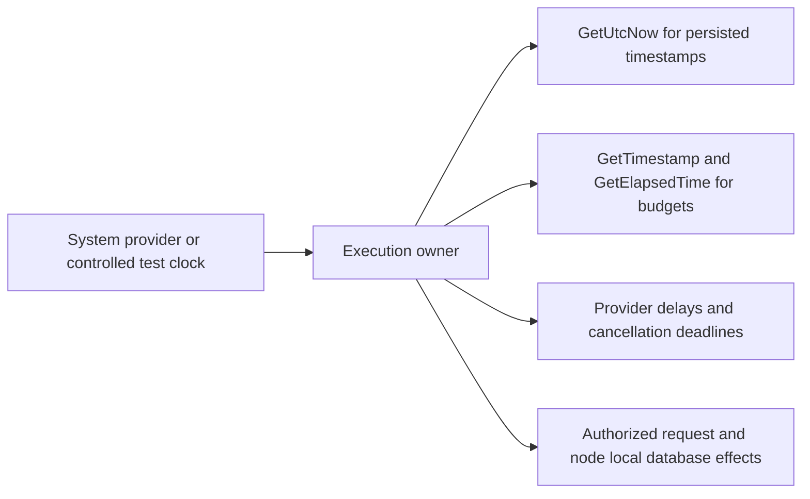

# ResourceExecution: controlled time

Status: Accepted contract. Full runtime qualification remains incomplete; local development verification is distinct from Linux qualification.
Decision: [ADR-115](../../ADR/ADR-115-time-provider.md).

## Goal and scope

All KeyLoad-owned C# current-time reads and elapsed/deadline/timer work use native .NET `TimeProvider`. KLD0022 rejects DateTime/DateTimeOffset static clocks, native Stopwatch properties, fields, calls and creation, and Environment tick access. Use injected clocks in execution owners and select System only in constructor defaults or composition roots. Preserve UTC persisted timestamps, signed-request validity, cluster ordering, native Orleans scheduling, monotonic budgets and actual benchmark provenance. No new packages or replacement database/transport dependencies. Provider control is explicitly authorized for tests. Runtime-host and business clocks may remain separately composed where their ownership differs.

## Requirements and acceptance

| Requirement | Acceptance | Evidence |
|---|---|---|
| REQ-TIME-001: current UTC is supplied by the execution owner's provider | AC-TIME-001: embedded JSON/native commands and due discovery observe an injected clock, including expiry/error and preserved state | real engine TUnit workflows; source inventory |
| REQ-TIME-002: elapsed work uses GetTimestamp/GetElapsedTime/TimestampFrequency | AC-TIME-002: budget expiry is deterministic and UTC changes do not replace monotonic elapsed authority | controlled-provider engine/read-cut workflows; timing source inventory |
| REQ-TIME-003: delays, deadline sources and managed timers use the owning provider | AC-TIME-003: cancellation, linked tokens, disposal and cleanup survive migration; native Orleans-owned timers retain native scheduling | source/call-site audit; Aspire unit/recovery/cluster suites |
| REQ-TIME-004: direct clocks cannot re-enter runtime code | AC-TIME-004: KLD0022 rejects DateTime clocks, Environment ticks and Stopwatch timing while allowing native providers and unrelated symbols | real Roslyn analyzer workflows and exact spans |
| REQ-TIME-005: timing remains measurable and composition is explicit | AC-TIME-005: benchmark clocks preserve monotonic units and original measurements; diagnostics use matching provider frequency; defaults remain System | consumer build, source audit, existing benchmark protocol tests; performance claims require separate GitHub evidence |

## Mapped real-operation workflows

`TimeProviderOperationTests` (JSON/native command timestamp and retry, query/due-work expiry, UTC versus monotonic budget), `NativeReadCutClockTests` (real snapshot expiry, released slot and preserved bytes), `DueWaitControlledClockTests` (real apply waiter fallback/cancellation and joined timers), `ReadExecutionTests` and `ZoneTreeStorageExecutionOptionsTests` (including deterministic record-budget assertions under an unchanged one-second elapsed policy) execute the requirements above. Full unit/scalar and recovery/cluster gates remain required. The controlled timer supports single-threaded one-shot workflows; it is not a general concurrent or periodic timer implementation. Framework-native synchronous process/thread waits without a provider overload remain bounded OS observations; managed delays and timed task waits use provider overloads.

## Exact current wall-clock projection

REQ/AC-TIME-KIND-001 preserves UTC/local DateTimeKind: borrowed GetUtcNow().UtcDateTime, GetLocalNow().LocalDateTime and local Date. DateTimeOffset uses native GetUtcNow/GetLocalNow. System selection stays in composition; provider timezone review is separate from machine-local DateTime conversion. Native monotonic budgets/timers, original evaluated timestamps, explicit dates and parsing remain unchanged. Existing TimeProviderOperationTests and genuine Roslyn SystemClockSemanticTests own complete current command/replay/read-budget and compiler controls; no new scalar profile or claimed runtime gate. KeyLoad KLD0022 owns this rule independently of Prostir.
